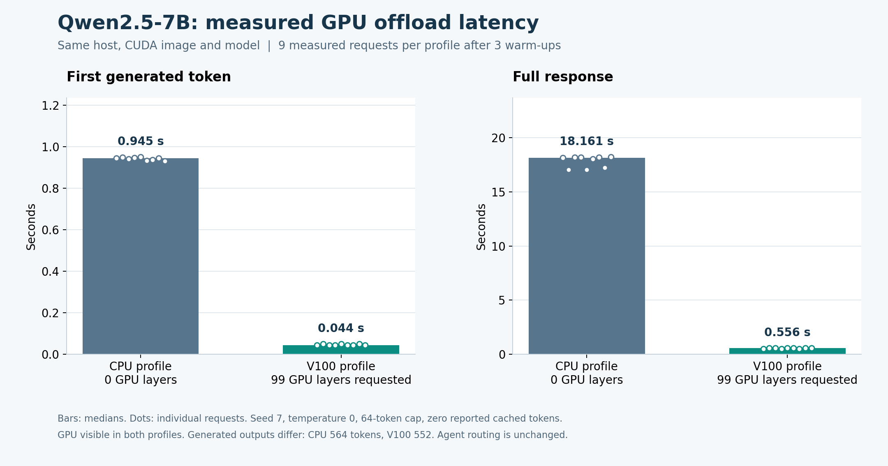

# Private LLM inference: setup, model call and benchmarks

The selected agents use Qwen2.5 7B on a private V100 worker. A separate, earlier CPU prototype served Qwen2.5 1.5B. This page follows the deployed route, shows a retained model response and keeps both measured experiments in their original scopes. The [CPU recovery procedure](agent_restart_recovery.md) is for the standby prototype.

The later [V100 experiment](gpu_inference.md) compares zero versus GPU offload for the 7B model on a separate worker. Its source, image, hardware and measurements are recorded separately from the prototype below.

## What each part does

The **model file** contains learned weights. The **model server** loads those weights and generates tokens. The **router** accepts an OpenAI-compatible request and selects a model-server endpoint. A **tool call** is a structured request from the model to application code; generating that request does not execute the tool.

The selected path is `client → llm-d/Envoy → observer and turn adapter → model-control → llama.cpp on V100`. The observer and model-control share a CPU Deployment. The model backend runs on a different node. The private ClusterIP services remain in `iot-llm`; the gateway UI does not expose this backend to the Internet. The observer records model activity, model-control bounds generation turns, and the specialist's MCP server executes the actual tool.

## Set up or resume the selected 7B route

1. **Check the retained cluster.** Run the following on the existing CPU node. Keep its approved session and the GPU worker's session in view. A clone contains the source and evidence; weights, runtime images, credentials and source packets are retained on the lab machines.

   ```bash
   sudo k3s kubectl get nodes -o wide
   sudo k3s kubectl get deployment,pod,service,inferencepool -n iot-llm
   sudo k3s kubectl get node iot-cw-gpu -o jsonpath='{.status.allocatable.nvidia\.com/gpu}'
   ```

   Expect one allocatable GPU on `iot-cw-gpu`, Ready private workloads, and the retained `iot-router-epp` Service on port 8081. The [node role](../../infra/ansible/roles/gpu_node/tasks/main.yml) installs K3s `v1.35.9+k3s1`, enables the pinned NVIDIA runtime and reserves that worker for inference. On a configured worker, inspect `nvidia-smi`; do not reapply Terraform or reinstall the driver to reopen a retained demo.

2. **Prepare and verify the weights on the GPU worker if they are absent.** The [7B lock](../../infra/llm/assistant.lock.json) specifies the Hugging Face revision and the sizes and SHA-256 of both Q4_K_M shards. The [runtime lock](../../infra/llm/gpu-runtime.lock.json) pins the CUDA 12.8.1 image and compatible driver branch. Use the retained, sealed benchmark source under `/srv/iot-inference/source/`; pass the **actual** session deadline and project. This step verifies downloads before promotion into the model directory.

   ```bash
   cd "$SEALED_GPU_SOURCE"
   sudo /usr/bin/python3 -B -m llm.gpu_benchmark \
     --runtime-root /srv/iot-inference --source-root "$SEALED_GPU_SOURCE" \
     --phase prepare --run gpu-prepare-review \
     --deadline "$ACTUAL_GPU_AUTO_STOP_UTC" --project "$LAB_PROJECT"
   ```

   The [GPU Deployment](../../infra/charts/iot-gpu-model/templates/model.yaml) reads `/srv/iot-inference/models/iot-qwen2.5-7b` at `/models`, requests one GPU, uses an 8,192-token context and one generation slot, and waits for `/health`. The update strategy is `Recreate`: there is only one physical GPU.

3. **For the first GPU promotion from the retained CPU route, validate the candidate before switching.** On the CPU node, use [the guarded deployer](../../scripts/deploy-gpu-backend.py) with a sealed source packet under the existing `data/llm-source/` directory. It checks actual node/GPU readiness and both mounted hashes, runs direct generation, verifies a deliberately failed Helm upgrade restores the previous working image, then changes the known CPU selector and tests the private routed response. It requires at least 75 minutes in the approved control-node session. It deliberately refuses an already-changed selector; skip this command if the current GPU/observer route is already deployed.

   ```bash
   sudo /usr/bin/python3 -B "$SEALED_CPU_SOURCE/scripts/deploy-gpu-backend.py" \
     --runtime-root "$LAB_ROOT" --source-root "$SEALED_CPU_SOURCE" --run gpu-backend-review
   ```

4. **Validate and promote the observer separately when installing it.** [The observer deployer](../../scripts/deploy-llm-observer.py) takes the retained build quality receipt, scoped Vault AppRole file and CA. Its canary leaves the current route unchanged. The [canary probe](../../scripts/probe-llm-observer.py) exercises actual model generation and reconciles its receipts; [promotion](../../scripts/promote-llm-observer.py) requires both receipts before changing the router. The [observer manifest](../../infra/charts/iot-llm-observer/templates/workload.yaml) pins the model-control sidecar. Do not regenerate credentials or promote an unverified image. The original [GPU integration](../evidence/gpu-agents/manifest.json) and [observer promotion](../evidence/llm-observer/manifest.json) capsules keep the two phases separate.

5. **Call the private route.** Use the loopback port-forward and request in [Run and inspect](#run-and-inspect). Check the returned model alias, generated text and `usage`. A Ready Pod or an HTTP response from `/health` alone cannot prove generation.

## Actual model call

The recorded `model-control-29e` test submitted [`routed-0-request.json`](../evidence/gpu-agents/cpu/native/model-control-29e/routed-0-request.json) to the llm-d route. It asked the retrieval model to choose an available tool for P-001. These fields are selected from the [original routed response](../evidence/gpu-agents/cpu/native/model-control-29e/routed-0-response.json):

```json
{
  "model": "iot-qwen2.5-7b",
  "system_fingerprint": "b11977-7ac5727d6",
  "finish_reason": "tool_calls",
  "function": {
    "name": "get_machine_features",
    "arguments": "{\"request\": {\"machine_id\": \"P-001\"}}"
  },
  "usage": {"prompt_tokens": 686, "completion_tokens": 29, "total_tokens": 715}
}
```

This proves the model generated a structured tool request. The tool result is a separate event: the [accepted retrieval request and response](../evidence/gpu-agents/cpu/native/agent-chat-29m/retrieval-response.json) were checked against actual MCP history. The retained [original CPU tool response](../evidence/llm-inference/native/llm-foundation-29b/tool-response.json) belongs to the earlier 1.5B deployment.

## 7B GPU offload benchmark

[The benchmark](../../llm/gpu_benchmark.py) compared zero GPU layers with an offload upper bound of 99 on the **same V100 worker and CUDA image**. It retained the same weights, three CPU threads, 8,192-token context, one generation slot and three-CPU/10-GiB container limits. Each profile had three warm-up requests and nine measured requests: three prompts repeated three times, temperature zero, seed seven, 64-token cap, no prompt-cache hits. Original SSE events, usage and elapsed times are in the [native benchmark capsule](../evidence/gpu-inference/manifest.json).

| Metric | 0 GPU layers | GPU offload |
|---|---:|---:|
| Median time to first token | 0.9446 s | 0.0438 s |
| Median complete response | 18.1607 s | 0.5558 s |



The measured full-response ratio was **32.68×**. Outputs need not be byte-identical, and some reached the token cap. This is a small sequential backend comparison, with the loopback client on the GPU worker; it is separate from routed request latency, answer quality or throughput at multiple users. For an authorized repeat use the command in step 2 with `--phase benchmark` and a fresh run name. The script retains original output, failed attempts and container inspection, and only stops its own containers.

## Upstream llm-d-benchmark run

Two native trials ran GuideLLM 0.5.3 through the official `llm-d-benchmark` v0.5.2 image. Both used the same Qwen2.5 7B model, V100 Pod, image and inference pool. An authenticated relay on the CPU VM streamed each response from the existing llm-d route and held the observer key in memory. An actual 7B completion checked the route before each trial. The measured latencies include the relay and the existing inference path. [Pinned upstream release](https://github.com/llm-d/llm-d-benchmark/tree/3045e869269ec7e6d562129ae06a20b5ea86840e) · [Runner](../../scripts/run-llm-d-benchmark.py) · [Model response](../evidence/llm-d-benchmark/serial/model-smoke-response.json)

| Native measurement | Sequential | Two in flight |
|---|---:|---:|
| Measurement window | 30 s | 30 s |
| Successful requests | 6 | 11 |
| Incomplete requests | 2 | 5 |
| Errored requests | 0 | 0 |
| Mean successful request rate reported by GuideLLM | 0.167 req/s | 0.333 req/s |
| TTFT p50 / p95 | 3.831 / 6.200 s | 3.984 / 5.755 s |
| Full response p50 / p95 | 4.779 / 7.173 s | 4.912 / 6.730 s |
| Mean output token throughput reported by GuideLLM | 7.95 tokens/s | 13.51 tokens/s |

The concurrent trial completed more requests within the same time budget and left more requests incomplete at the cutoff. These are single trials for a small synthetic workload. The latencies describe successful requests, and the native scheduler totals include requests that crossed the time limit. The earlier offload comparison used a separate benchmark client and experimental design. [Metric index and native identities](../evidence/llm-d-benchmark/summary.json) · [Sequential raw result](../evidence/llm-d-benchmark/serial/results.json) · [Concurrent raw result](../evidence/llm-d-benchmark/concurrent/results.json)

The initial attempt stopped before measurement when Torch tried to resolve the non-root UID for its default cache. The corrected run used a writable cache while retaining that UID. Both measured trials produced original GuideLLM JSON and a standard v0.1 report. The v0.2 converter expected Kubernetes harness metadata and exited with an error in the run-only environment. The recorded upstream exit is 1 in both trials. The runner now checks native workload success and reports the converter outcome separately. [Startup failure](../evidence/llm-d-benchmark/startup-failure/harness.stderr.txt) · [Sequential v0.1 report](../evidence/llm-d-benchmark/serial/benchmark-report-v01.yaml) · [Concurrent v0.1 report](../evidence/llm-d-benchmark/concurrent/benchmark-report-v01.yaml) · [Converter failure](../evidence/llm-d-benchmark/concurrent/harness.stderr.txt) · [Native file manifest](../evidence/llm-d-benchmark/manifest.json)

Render the bounded profile locally first:

```powershell
python -B -S scripts/run-llm-d-benchmark.py --run llmdb-review-plan
```

For an authorized run, check available space on the filesystem reported by `sudo docker info --format '{{.DockerRootDir}}'` before pulling the exact image digest. Docker reported a 7.30 GB image after extraction in the recorded run. The runner requires 8 GiB available RAM, 35 GiB free scratch and 30 minutes remaining on each approved VM session. Place `tokenizer.json` and `tokenizer_config.json` in a new directory under `/srv/iot-fast/models`. The runner checks their pinned hashes and generates synthetic prompts using those files. Confirm the 7B GPU model is ready before starting. [Image readback](../evidence/llm-d-benchmark/image-prepare.json) · [Pinned tokenizer revision](https://huggingface.co/Qwen/Qwen2.5-7B-Instruct/tree/a09a35458c702b33eeacc393d103063234e8bc28)

```bash
sudo /usr/bin/python3 -B scripts/run-llm-d-benchmark.py \
  --runtime-root "$LAB_ROOT" --tokenizer "$LOCAL_7B_TOKENIZER" \
  --run llmdb-review-serial --concurrency 1 --execute
```

The measured workload stops at 30 seconds or 24 requests, with 128-input-token and 32-output-token targets. The client has two CPU cores and 3 GiB of RAM. Use a fresh run name with `--concurrency 2` for the second profile. The output directory retains the original profile, image digest, report, console, request counts and converter status.

## Historical 1.5B CPU prototype

## Pinned configuration

| Item | Recorded configuration |
|---|---|
| Hardware | Existing single VM: 8 vCPU, 64 GiB RAM; AMD EPYC 7B12 with AVX2 |
| Model | Qwen/Qwen2.5-1.5B-Instruct-GGUF, revision `91cad51170dc346986eccefdc2dd33a9da36ead9` |
| Quantization | Q4_K_M; 1,117,320,736 actual bytes; Apache-2.0 model |
| Model server | llama.cpp image pinned by amd64 digest; native response fingerprint `b11960-8642541b2` |
| Router | llm-d standalone chart and endpoint picker v1.0.0; Envoy v1.33.2 |
| Inference CRD | Gateway API Inference Extension v1.6.2 |
| Context / slots | 4,096 context tokens; one generation slot |
| Backend limits | 4 CPU, 6 GiB RAM; two router containers have separate small limits |
| Scheduling | Router-observed in-flight token load; no claim of vLLM cache metrics or multi-backend scaling |

The default upstream CPU example requests much larger resources and a gated model. This lab keeps the required llm-d routing layer and supplies its own smaller OpenAI-compatible CPU backend. Weights stay on the existing SSD outside Git. The [model lock](../../infra/llm/model.lock.json), [backend chart](../../infra/charts/iot-llm/values.yaml) and [router values](../../infra/llm/router-values.yaml) identify the actual configuration.

## Measured change

Only CPU generation/batch threads change from one to four. Each profile uses the same model digest, context, CPU limit, three fixed prompts, temperature zero, seed seven and 64-token cap. There are three warm-up requests followed by three repetitions of all three prompts. Actual responses report zero cached prompt tokens; generated texts are identical across both profiles.

| Measurement | 1 thread | 4 threads |
|---|---:|---:|
| Measured requests | 9 | 9 |
| Generated tokens across measured requests | 357 | 357 |
| Median first-token time | 1.745 s | 0.520 s |
| Median full-response time | 5.047 s | 1.682 s |
| Median completion tokens / full-response second | 7.727 | 23.185 |

The observed response-time ratio is 3.001 on this small workload. The client runs on the VM and calls the private Service. This is a sequential-client comparison, not a concurrency SLA, GPU comparison or model-quality evaluation. A separate three-request routed smoke test has a 1.760 s median response time; it is not a second nine-request optimization benchmark.

## Native failure and recovery

The initial run completed the baseline, upgraded the backend, then encountered `No route to host` when the Service data path had not settled. A later actual health call succeeded. Recovery retains the completed baseline, checks the same machine/model/configuration and waits for the Service health endpoint before measuring. It uses new source/output directories and preserves the failed initial report. Neither old measurements nor their timestamps were rewritten.

The resulting model response contains `tool_calls` for `get_machine_features` with `machine_id=P-001`. This verifies tool selection only. No MCP server was executed by that probe.

## Run and inspect

The [deployment CLI](../../scripts/deploy-llm-inference.py) expects the retained VM, an approved unexpired session and a sealed source packet. It requires at least 12 GiB available RAM, 30 GiB free SSD and one hour remaining. It installs only into a fresh `iot-llm` namespace; an explicit recovery option preserves a completed baseline from a failed initial run. It does not provision a VM or extend its session.

To inspect the existing deployment on the VM:

```bash
sudo k3s kubectl get deployment,pod,service,inferencepool -n iot-llm
sudo k3s kubectl logs deployment/iot-model -n iot-llm --tail=30
sudo k3s kubectl logs deployment/iot-router-epp -n iot-llm --all-containers --tail=30
```

To expose the router only on the VM's loopback interface, keep this command open there:

```bash
sudo k3s kubectl port-forward -n iot-llm --address=127.0.0.1 service/iot-router-epp 18083:8081
```

From a separate PowerShell terminal on your PC/laptop, open IAP access:

```powershell
gcloud compute ssh iot-cw-vm --project YOUR_PROJECT_ID --zone us-central1-a --tunnel-through-iap --command="sleep 3600" -- -L 127.0.0.1:18083:127.0.0.1:18083
```

Then, in another PowerShell terminal:

```powershell
$body = @{
  model = 'iot-qwen2.5-7b'
  messages = @(@{role = 'user'; content = 'Explain why a high vibration reading alone does not prove a pump failure.'})
  max_tokens = 100
  temperature = 0
} | ConvertTo-Json -Depth 6
$reply = Invoke-RestMethod -Method Post -Uri http://127.0.0.1:18083/v1/chat/completions -ContentType 'application/json' -Body $body
$reply.choices[0].message.content
$reply.usage
```

This command targets the current 7B backend and tests generation without retrieval. Use the [grounded probe](llm_grounding.md#repeat-the-live-probe-on-the-retained-vm) to retrieve and verify references. Neither command inspects a real machine.

Offline verification requires no running VM:

```powershell
python -S scripts/verify-llm-inference.py
python -S scripts/verify-gpu-inference.py
python -S scripts/verify-gpu-agents.py
```

The checker pins the [94-payload capsule](../evidence/llm-inference/manifest.json), verifies uploaded source bytes, replays measurement arithmetic, checks actual readiness/image IDs and inspects the original structured tool response. It does not rerun inference or establish current endpoint readiness.

## Next dependency

The [LLM learning guide](../README.md) follows the full request. [RAG orchestration](rag_orchestration.md) and [grounded responses](llm_grounding.md) now have separate native proof. The [workstream](llm_platform.md) tracks remaining global model configuration, MCP, specialist/coordinator agents, registry, sandbox, warm-up, CI, telemetry and A/B requirements.

Official references: [llm-d quickstart](https://llm-d.ai/docs/getting-started/quickstart), [llama.cpp server](https://github.com/ggml-org/llama.cpp/blob/master/tools/server/README.md), [Qwen model](https://huggingface.co/Qwen/Qwen2.5-1.5B-Instruct-GGUF).
