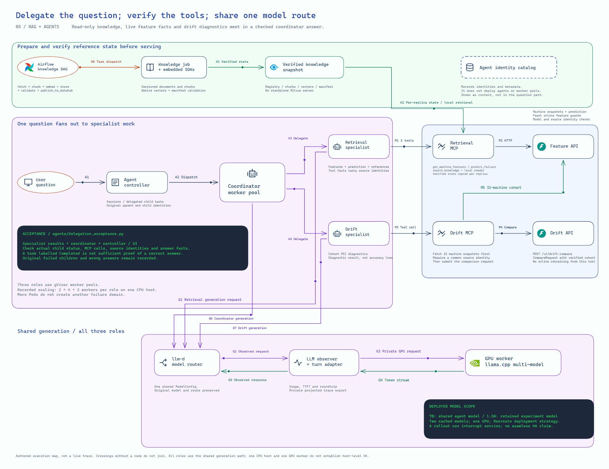

# LLM and agent platform

The assistant helps a technician investigate pump readings, failure risk and relevant maintenance passages. The coordinator delegates work to specialist agents and returns an answer that can be checked against their actual tool results.

Open the current diagram and select **Agent calls** to see who calls each service. Select **Shared LLM** to follow requests to the private GPU or **RAG** to follow document lookup. [Current architecture and viewer](../architecture/ml-llm-platform-v19-notes.md)

The earlier routing diagram below is part of the recorded GPU and agent checkpoint.

<picture>
  <source media="(prefers-reduced-motion: reduce)" srcset="../images/platform-llm-plan.png">
  
</picture>

[Earlier Excalidraw](../diagrams/platform-llm-plan.excalidraw) · [Earlier SVG](../images/platform-llm-plan.svg) · [Earlier viewer](../diagrams/architecture.html) · [Diagram index](../diagrams/README.md)

## IoT interaction

For a question such as “What is the failure risk for P-001, and what does the vibration guide say?”, follow the request from the private UI or authenticated A2A client to the coordinator. Agentgateway routes the coordinator's child requests to kagent, which manages each specialist session. [Gateway and controller routes](global_model_config.md)

1. The retrieval specialist calls Retrieval MCP. The Feature API supplies the pump's sensor summary, and the KServe predictor supplies the checked failure-risk score through that API.
2. Retrieval MCP forwards the document question to RAG Search API. Each Search Pod verifies and copies the sealed Feast/Milvus Lite index and returns ranked passages with their document IDs and revisions.
3. If the investigation asks about changes across several pumps, Drift MCP gets a consistent cohort from the Feature API and asks Drift API for a Population Stability Index (PSI) comparison. In serving-model mode, it requires at least 32 operating machines and the training reference that matches the served model.
4. The agents use the shared llm-d route to generate text on the private GPU. The specialists return their findings to the coordinator. The recorded acceptance check compares the resulting answer with both child tasks and the source records.

[Tool contracts and backends](mcp_tools.md) · [Current Search and drift design](../architecture/ml-llm-platform-v19-notes.md) · [Recorded acceptance check](agent_runtime_validation.md)

The [MMD sensor study](../edai-1/joint_cohort.md) evaluates a separate offline diagnostic.

## Components

| Area | What to inspect | Recorded evidence |
|---|---|---|
| Inference | llm-d platform, custom server, global model configuration, measured optimization | Router/custom backend and CPU-thread comparison verified; shared agent model config applied |
| Knowledge | Authored corpus, Airflow text/chunk/embedding pipeline, Feast storage, validation and DataHub lineage | [Six-task Airflow/GMS run, ten checks and invalid-input rejection](rag_orchestration.md); [source-cited generation](llm_grounding.md) verified on three questions |
| Tools | Private calls for sensor summaries, predictions, document search and drift | [Original MCP releases and rollback](mcp_tools.md#native-deployment-and-failure-checks) · [Later Search scaling and serving-model drift](../architecture/ml-llm-platform-v18-notes.md#cpu-lab-verification-on-november-24-2026) |
| Agents | Retrieval and drift specialists, coordinator, registry publication, multi-replica autoscaling and sandbox | [Complete native conversations](gpu_agent_routing.md), [direct MCP isolation](agent_network_isolation.md), [automatic 2 → 4 → 2 scaling and original UI](agent_scaling.md) |
| Startup | Agent Substrate warm-up, worker-pool HA explanation and startup benchmark | [24 fresh actors, matched cold/golden startup, mixed timings and single-host HA explanation](agent_warmup.md) |
| Delivery | RAG and agent/MCP test-build-auto-deploy pipelines, gateway/UI access and secrets | [RAG Jenkins release, six native Airflow tasks and DataHub readback](ci_rag.md) verified; [three accepted MCP/agent pipelines](ci_agents.md) add service/agent delivery; [private gateway/Vault consumers and a complete routed conversation](agent_gateway.md) add native security/interface proof |
| Evaluation | Notebooks, coverage >90%, mutation >80%, boundary/property tests and native load HTML | [79 native MCP tests and load reports](mcp_tools.md); [132 current tests and local mutation gate](mcp_quality.md); [executed agent notebook](agent_notebook.md) verified; fresh 132-case API gates and unchanged-source mutation reuse run in [native CI](ci_agents.md); [original coverage, fixture, boundary, mutation and replay captures](mcp_quality_evidence.md) are recorded; the latest [rehearsal](agent_runtime_validation.md) independently rechecks the complete tool-grounded answer |
| Operations | Token counts, round-trip time, TTFT, safety/PII hits, agent/tool calls/failures and A/B | [Native monitoring/load](llm_monitoring_demo.md), [policy-frequency window](llm_policy_window.md), [model-artifact results](llm_model_ab.md) and [agent configuration comparison](agent_configuration_ab.md) |
| Extensions | Two documented LLM-track ideas with working proof | [OPA capability/budget admission](agent_admission_policy.md) and [document-weighted corpus MMD review](rag_corpus_drift.md), with original accepted/rejected native runs and explicit limits |

## Acceptance evidence

Each requirement is linked to its own implementation and recorded evidence in the final tracker. The records preserve source/model/config identities; actual process/Pod readiness; native inference/tool/chat responses; RAG chunk/embedding/Feast readbacks and DataHub lineage; registry/sandbox/replica/warm-up observations; CI stage results; test/coverage/mutation/load reports; telemetry comparisons; and actual A/B behavior.

An architecture drawing, generated YAML, a mocked test or an unrelated ML dashboard is not native LLM proof. A proposed model is not described as deployed, and new cloud resources are not assumed authorized by this plan.

The [compact response contract](agent_response_contract.md) retains the failed predecessor. The recorded policy 0.2.2 release has [verified GPU conversations and actual child delegation](gpu_agent_routing.md). The later scaling run checks each final parent against both child histories, while retaining the explicit capacity rejections and bounded admission retries.

For additional evidence, follow the [generator and stream data exercise](assistant_data_validation.md), [private retrieval HTTPS](mcp_gateway.md), [infrastructure captures](llm_infrastructure_evidence.md) and [Vault metadata UI](vault_agent_ui.md). The [requirement map](../edai-1/implementation_map.md) and [LLM tracker](rubric_tracker.md) map these results to the original criteria. [Live lab prerequisites](../edai-1/operations.md)

## Workbook references

The source links point to [llm-d](https://llm-d.ai/docs/getting-started/quickstart), [kagent custom providers](https://kagent.dev/docs/kagent/supported-providers/byo-openai), [agent registry](https://aregistry.ai/), [sandbox agents](https://kagent.dev/docs/kagent/examples/agent-sandbox), [Agent Substrate](https://kagent.dev/docs/kagent/concepts/agent-substrate), [KEDA](https://keda.sh/) and [Feast RAG](https://docs.feast.dev/tutorials/rag-with-docling). These are requirement references retained from the supplied workbook; no installation or compatibility is claimed from merely listing them.
