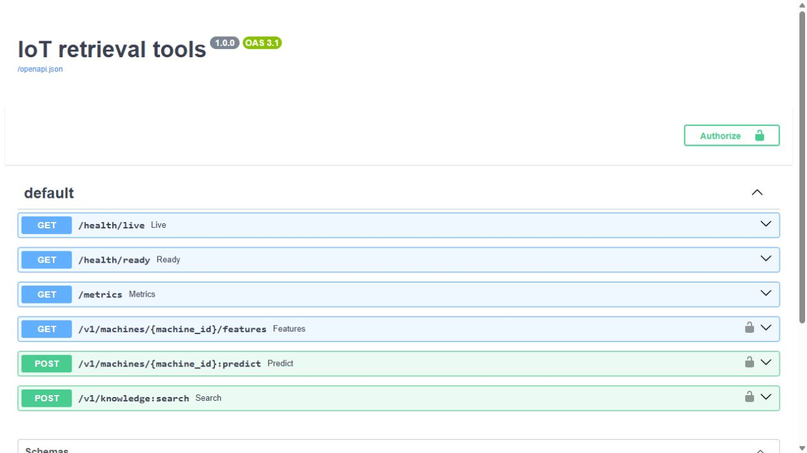
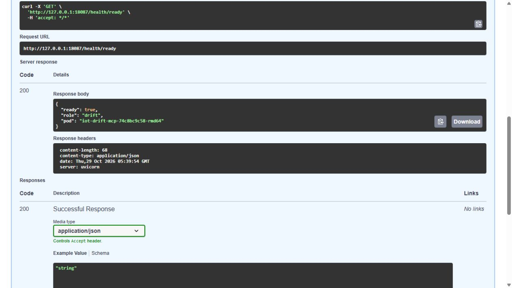
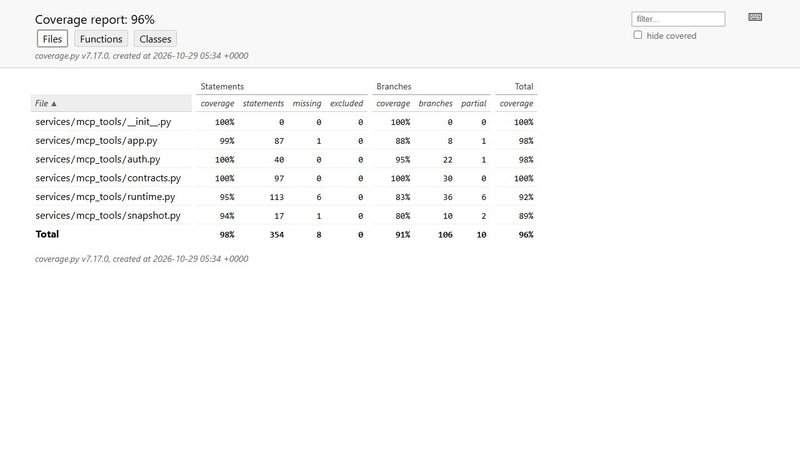
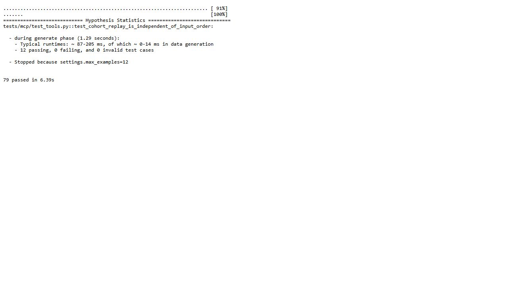
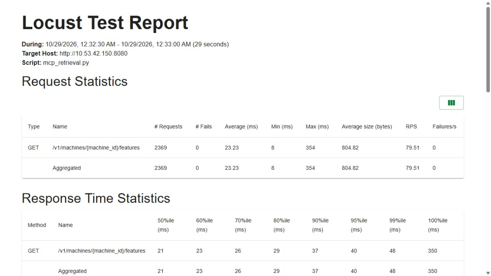
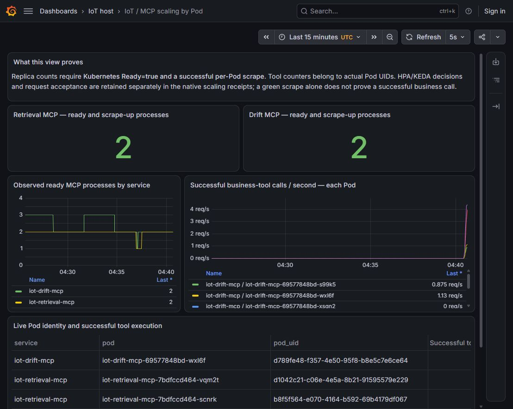
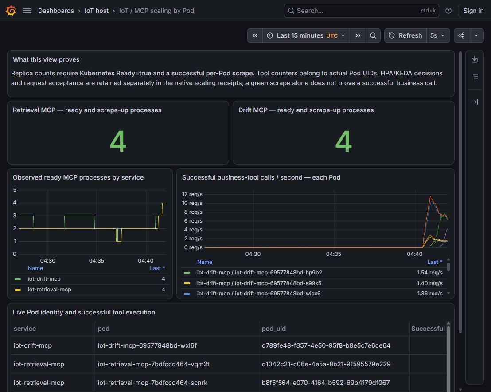
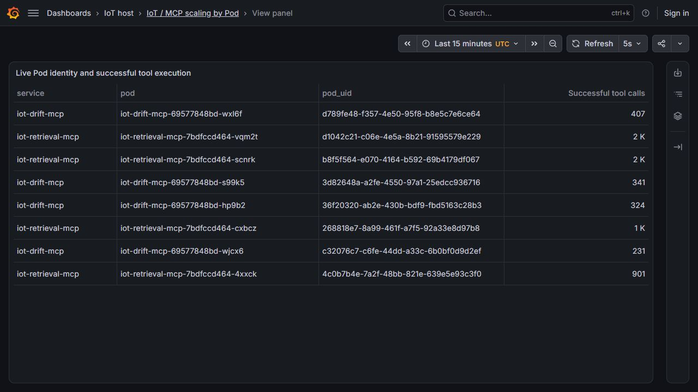
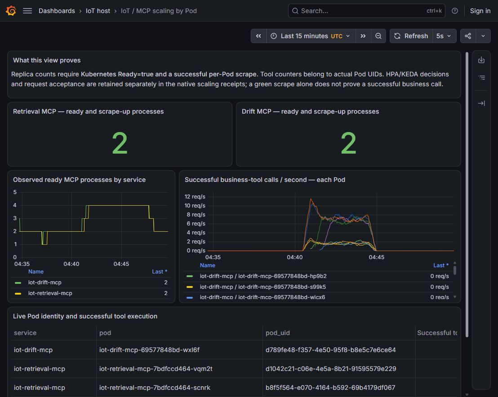

# Machine and knowledge tools over MCP

| Boundary | Implementation / execution |
|---|---|
| Code | [Application factory](../../services/mcp_tools/app.py), [typed contracts](../../services/mcp_tools/contracts.py), [runtime](../../services/mcp_tools/runtime.py) |
| Runs on | Two retrieval and two drift MCP replicas in K3s `iot-agents` |
| Input → output | Authenticated role-specific tool call → validated native feature/model/reference/drift facts |
| Validation | Original SDK/rollout cases below; [current API quality](mcp_quality_evidence.md) and [agent delegation](agent_runtime_validation.md) are separately scoped |

Two private MCP services now expose the existing IoT APIs and knowledge snapshot. Native SDK clients discovered and executed the tools on Kubernetes, including rejected requests and replay after an automatic Helm rollback. This milestone establishes tool execution. [Specialist answers and coordinator delegation](gpu_agent_routing.md) have separate native validation. This page retains the original MCP-service workload and version scope.

## Follow one request

For `get_machine_features(P-001)`, the MCP server validates the machine ID, reads the native Feature API asynchronously and validates the returned identity, features and timestamps. `predict_failure` uses the same API's pinned model path. The caller cannot supply its own feature values, a model override or an arbitrary URL.

For a reference question, `search_knowledge` queries a per-replica copy of the 18-chunk Feast/Milvus snapshot. Each ranked chunk ID is resolved through a singleton Feast read, preserving the [ordering correction](llm_grounding.md#why-the-retrieval-adapter-exists). Every returned passage is checked against its source record. These are authored simulator references, not a manufacturer's maintenance manual.

The drift service fetches a bounded cohort through the Feature API and requires a common simulated clock, preparation time, protocol and source version. It then calls the existing PSI comparison API with a pinned training reference. Sorting machine IDs and deriving window times from the snapshot makes reordered replay return the same persisted assessment.

| Service | MCP tool | Input | Actual backend |
|---|---|---|---|
| Retrieval | `get_machine_features` | `machine_id` | Feature API and native online store |
| Retrieval | `predict_failure` | `machine_id` | Feature API and served model version 6 |
| Retrieval | `search_knowledge` | `question`, `top_k` | Pinned MiniLM encoder and per-Pod Feast/Milvus snapshot |
| Drift | `assess_feature_drift` | `window_id`, 32–200 distinct `machine_ids` | Feature API and fixed-reference drift API |

## Asynchronous request handling

The MCP registration and the REST adapter share one dispatcher. The [actual retrieval handler](../../services/mcp_tools/app.py#L105) awaits the dispatcher; it does not call a synchronous HTTP client from the event loop:

```python
async def get_machine_features(request:MachineRequest)->dict:
    """Read a simulated pump's current feature snapshot with event time, preparation time and source provenance."""
    return await mcp_call('get_machine_features',request)
```

`mcp_call` awaits `invoke`, which awaits the corresponding `ToolRuntime` method. In [the runtime](../../services/mcp_tools/runtime.py#L69), each process shares an `httpx2.AsyncClient` with an eight-second timeout and a semaphore of eight. The request method enters the semaphore before awaiting the network:

```python
async with self.slots:
    response = await self.client.request('POST' if body is not None else 'GET', base+path, json=body)
```

[Knowledge search](../../services/mcp_tools/runtime.py#L114) uses `await asyncio.to_thread(self.knowledge.search, request)` inside the same bound. The encoder and native Feast/Milvus operation are synchronous; putting them in a worker thread keeps the event loop responsive. `KnowledgeReader` also locks its native reader within each replica. This design does not promise eight simultaneous encoder calls per replica.

[Drift comparison](../../services/mcp_tools/runtime.py#L122) schedules bounded, asynchronous feature reads before sending one comparison request. It checks that all returned rows belong to the same snapshot before sending any cohort:

```python
records = await asyncio.gather(*(self.features(MachineRequest(machine_id=identifier)) for identifier in sorted(request.machine_ids)))
```

The [concurrency boundary test](../../tests/mcp/test_contract_edges.py#L124) holds the upstream fixture open, starts nine actual asynchronous calls, verifies only eight enter, releases the fixture and requires all nine results. It also preserves `POST` for an empty dictionary and `GET` for no body. The separate native Locust workload below exercised the deployed REST adapter; it was not a concurrency benchmark of MCP or model generation.

## Native deployment and failure checks

The successful run is `mcp-foundation-29e`, completed at **2026-10-29 05:31 UTC** on the retained 8-vCPU/64-GiB VM. Source SHA256 is `cdec53766c3eb0ce7766de09b941497b4c8bceae8884632daabae78de08c9f6a`; runtime image ID is `sha256:2db876341c06172523c67c7a230dfc888630a085ad7604f93fa2e474aadc4d6d`.

Each service has two ready replicas, a private ClusterIP, liveness/readiness probes, separate bearer credentials and an ingress/egress policy. Containers run as UID/GID 10001 with a read-only root, dropped capabilities and no automatically mounted Kubernetes token. Retrieval replicas copy and hash-check their own snapshot before startup. These controls do not establish the agent sandbox required later in the rubric.

Both Helm releases completed a rolling update with `maxSurge=1`, `maxUnavailable=0`. Each was then given a deliberately unavailable image. The upgrade failed, `--atomic` restored the valid release, and a genuine SDK probe succeeded again. Four SDK sessions produced **24 business-tool responses**, including expected errors.

[The Helm workload](../../infra/charts/iot-mcp/templates/workload.yaml#L17) declares the rolling policy and the `/health/live` and `/health/ready` checks. A Pod only becomes ready after its native dependencies are available.

```yaml
strategy:
  type: RollingUpdate
  rollingUpdate: {maxSurge: 1, maxUnavailable: 0}
```

[The deployment runner](../../scripts/deploy-mcp-tools.py#L135) applies the tested image with `helm upgrade --install ... --atomic --wait`, then exercises both a successful update and this controlled failure:

```python
failed=command(role+'-bad-upgrade',[helm,'upgrade',release,chart,'-n','iot-agents','-f',str(path),
    '--set','image.tag=deliberately-missing-mcp-image','--atomic','--wait','--timeout','60s'],timeout=240,check=False)
```

The runner requires a nonzero exit, reads the restored image tag and `revisionMarker`, and invokes the SDK again against the restored Deployment. [Retrieval failed upgrade](../evidence/mcp-tools/success/native/retrieval-bad-upgrade.exit) · [restored values](../evidence/mcp-tools/success/native/retrieval-values-after.stdout) · [successful SDK replay](../evidence/mcp-tools/success/native/retrieval-probe-after-rollback.stdout) · [drift failed upgrade](../evidence/mcp-tools/success/native/drift-bad-upgrade.exit) · [successful drift replay](../evidence/mcp-tools/success/native/drift-probe-after-rollback.stdout). This fallback restores a working **release after an upgrade failure**. It is separate from client retries or model-server failover.

The drift probe compared 32 real snapshot records, found six of eight features above the fixed PSI threshold and returned the same assessment for reversed IDs and after rollback. Its reference is the recorded **model 3 training cohort**, distinct from the currently served model 6. This is label-free input drift, not measured accuracy loss or concept drift.





## API verification

The expanded native suite passed **79 tests**, including input partitions, adjacent boundary values, authenticated REST/JSON-RPC handling, source consistency and a Hypothesis replay property. Twelve generated cohort permutations preserved the outgoing comparison payload, result and one durable assessment. Fixtures isolate upstream transport/encoder boundaries; separate native SDK probes exercise the deployed services. The [original JUnit browser capture](../evidence/mcp-tools/ui/native-junit-boundaries.jpg) shows the executed credential and body-size boundary cases.

| Coverage measure | Actual result |
|---|---:|
| Statements | 346 / 354 = 97.74% |
| Branches | 96 / 106 = 90.57% |
| Combined coverage.py measure | 96.09% |

Scope is `services.mcp_tools`, including snapshot initialization and excluding the acceptance-client CLI `probe.py`. These figures do not cover future agent code. [Original JUnit](../evidence/mcp-tools/quality-baseline/native/junit.xml), [Hypothesis console](../evidence/mcp-tools/quality-baseline/native/tests.stdout) and [native coverage HTML](../evidence/mcp-tools/quality-baseline/native/coverage-html/index.html) are retained.





**Both historical VM mutation gates failed.** The first complete inventory contained 945 generated mutants: 531 killed, 398 survived and 16 timed out. The strict killed/total score was **56.19%**, below the required >80%. All initial files and the failed gate are preserved. Mutmut generated no mutants for the decorated Pydantic validators in `contracts.py`; the direct validator tests do not remove that mutation-tool limitation. The expanded run, completed at 05:48 UTC, used the additional contract/concurrency tests and per-test timeout. It killed 594 of the same 945 generated mutants, with 343 survivors and eight timeouts: **62.86%**, still below the threshold. Its earlier 79-test/coverage baseline remained byte-identical. [Original expanded result](../evidence/mcp-tools/quality-final/native/verification.json) and the [unchanged-baseline binding](../evidence/mcp-tools/quality-final/native/baseline-binding.json) are retained. CLI analysis exit zero does not mean a mutation requirement passed.

A later [local Cosmic Ray run](mcp_quality.md) passes at **681/850 (80.12%)**, including mutations inside the decorated validators and counting timeout/error work in the denominator. That source includes a timestamp validation fix and 132 passing tests. The engine and mutation inventory differ, so these percentages are not a direct before/after comparison. This page's deployment and load capsule continues to describe its original source and image.

## Authenticated retrieval load

Locust 2.47.0 read features through the deployed retrieval service's REST adapter. Each user was paced at one request per 0.1 seconds and cycled through the 200-machine snapshot. Every successful body had to match its machine ID, eight-feature schema and actual source version.

The declared SLA was at least 100 requests, zero failures and p95 ≤1,000 ms for each 30-second workload.

| Users | Final requests | Failures | Requests/s | p50 | p95 | p99 |
|---:|---:|---:|---:|---:|---:|---:|
| 1 | 289 | 0 | 10.03 | 11 ms | 13 ms | 27 ms |
| 8 | 2,369 | 0 | 79.51 | 21 ms | 40 ms | 48 ms |

The final HTML reports and quitting-event summaries agree with the combined **2,658** successful-call increase across the same two Pod identities. The periodic CSV files were last flushed earlier, at 281 and 2,306 requests; their original bytes are preserved. This is a paced, same-VM feature-read measurement. It does not measure maximum capacity, external-network latency, prediction, embeddings or LLM generation.

[One-user HTML](../evidence/mcp-tools/load/native/users-1.html) · [Eight-user HTML](../evidence/mcp-tools/load/native/users-8.html) · [Original verification](../evidence/mcp-tools/load/native/verification.json)



## Capacity correction and retained failures

The earlier rollout reached the node's configured 60-Pod ceiling even though CPU and RAM remained available. The [Ansible overlay](../../infra/ansible/agent-capacity.yml) raises that ceiling to 110 within the same node's `/24` Pod address range. It preserves the original configuration, CPU, memory and eviction safeguards. The same node became ready again, and a second application reported zero changes. This adds scheduling slots, not compute capacity or another VM. K3s's documented [drop-in merge behavior](https://docs.k3s.io/installation/configuration#value-merge-behavior) explains why the overlay retains the existing kubelet arguments.

The archive also retains four earlier deployment failures: an absent-namespace response parser, an unavailable Feature API, an SDK field-name mismatch in the acceptance client, and the scheduling ceiling. The Feature API was refreshed through real native materialization, preserving model 6. Timestamps and TTLs were not edited. Knowledge snapshot originals remained unchanged.

The committed capsule contains 745 curated source, command, report and image files. It excludes 55 generated Kubernetes discovery-cache files and one optional binary coverage-state file. [Curation receipt](../evidence/mcp-tools/curation.json) records their original hashes and the retained native archive identity. All execution reports, source bindings, coverage HTML/JSON/XML, JUnit and nine original screenshots remain included.

## Native MCP autoscale

Both retained MCP releases use request-driven KEDA scaling with a warm minimum of two and maximum of four Pods. The chart also offers fixed-replica and CPU-HPA modes; **the accepted run uses request rates**, not the unmeasured CPU alternative. [ScaledObject](../../infra/charts/iot-mcp/templates/request-scaling.yaml) · [Workload](../../infra/charts/iot-mcp/templates/workload.yaml) · [Values](../../infra/charts/iot-mcp/values.yaml).

| MCP Deployment | Successful load requests | Errors | Ready replicas | New serving Pods |
|---|---:|---:|---|---:|
| Retrieval | 6,217 | 0 | 2 → 4 → 2 | 2 |
| Drift | 1,529 | 0 | 2 → 4 → 2 | 2 |

The 240-second load used two retrieval clients and one drift client. Retrieval executes knowledge search; drift executes the 32-machine assessment. The driver uses REST endpoints sharing the authenticated tool dispatcher with MCP. Native MCP protocol and gateway calls are verified separately in the routed coordinator conversation. This is not a claim that all 7,746 requests used JSON-RPC sessions.

KEDA queries service/role-scoped successful request rates over 30 seconds. Targets are 2 requests/s per retrieval replica and 0.5 per drift replica. A CNI-private relay reaches retained host Prometheus. Missing data is not replaced with a fabricated zero. Pod UIDs, counters, HPA inputs and workload replies are retained. Both new Pods in each service performed successful tool work. A brief gateway smoke overlapped the load, so per-Pod counter deltas are not equated exactly with the driver's request count.









The recorder never invokes a scale operation. [Native result](../evidence/mentor-runtime-20261107/mcp-scaling.json) · [Runner](../../scripts/benchmark-mcp-scaling.py) · [Independent acceptance](../../infra/mcp_scaling.py). The initial CPU pilot's three drift 503s and rejected HPA-to-KEDA ownership migration remain archived. The accepted run migrated through fixed two-replica mode before enabling KEDA.

MCP runtime and mutation targets are unchanged. CI authenticates four exact deployment-only autoscaling files separately; an arbitrary chart change or any runtime/test change invalidates reuse of the previous mutation result. [Source boundary](../../infra/mcp/autoscaling-source.json) · [Gate](../../agents/release_ci.py).

## Repeat the checks

Offline verification needs only Python and the committed evidence:

```powershell
python -S scripts/verify-mcp-tools.py
```

For unit/API tests, create a dedicated Python 3.12 environment and install `infra/mcp/requirements.txt` plus `infra/mcp/requirements-tests.txt`. Run:

```powershell
python -m pytest tests/mcp -q
python -m coverage run --branch --source=services.mcp_tools --omit=*/probe.py -m pytest tests/mcp -q
python -m coverage report -m
```

Native rebuild/deploy uses `scripts/deploy-mcp-tools.py` with a sealed source tree and a new run name. It enforces session, RAM and SSD reserves and preserves earlier receipts. Mutation uses the separate `Dockerfile.mutation` image and `scripts/test-mcp-tools.py` in isolated scratch; load uses `scripts/run-mcp-load.py`. Neither changes the deployed model or original knowledge database.

To inspect the current services on the VM:

```bash
sudo k3s kubectl get deployments,pods,services -n iot-agents
sudo k3s kubectl exec -n iot-agents deployment/iot-retrieval-mcp -- \
  python -m services.mcp_tools.probe --role retrieval --run manual-check
sudo k3s kubectl exec -n iot-agents deployment/iot-drift-mcp -- \
  python -m services.mcp_tools.probe --role drift --run manual-check
```

Use a new drift run/window identity after genuine feature rematerialization. Features have a one-hour wall-clock lease; stale data should fail readiness until refreshed through the existing materialization command. Tokens remain mounted inside the role's Pod. Do not copy them into commands, notebooks or chat.

## Later integration evidence

### MCP gateway boundary

The recorded agent [RemoteMCPServer resources](../../infra/charts/iot-agents/templates/tools.yaml#L9) use `STREAMABLE_HTTP` and direct role-specific ClusterIP URLs. Their `Authorization` header comes from the matching Kubernetes Secret key. The existing private HTTPS ingress is NGINX. The new [agentgateway candidate](global_model_config.md#native-agentgateway-integration) has a separate listener and backend credential per MCP role. Its local fixture verifies initialization, the exact role tool names, a tool response and cross-role denial through the official binary. A native K3s run also verified actual P-001 features and a 32-machine assessment through the two ports. During the temporary production cutover, the retrieval agent executed all three retrieval tools and the drift agent executed its assessment through the gateway. [Native route evidence](../evidence/agentgateway-native/route-evidence.json).

This MCP foundation is followed by the [agent control plane and catalog](agent_platform.md), [checked GPU conversations](gpu_agent_routing.md), [sandbox boundaries](agent_network_isolation.md), [autoscaling](agent_scaling.md), [warm-up measurements](agent_warmup.md), [notebook](agent_notebook.md), [CI releases](ci_agents.md), [monitoring](llm_monitoring_demo.md) and the separate [agent](agent_configuration_ab.md)/[model](llm_model_ab.md) A/B studies. Each report preserves its own source and captures. A passing MCP probe alone does not establish that an agent selected or coordinated the tools; the [LLM tracker](rubric_tracker.md) links those distinct proofs.
