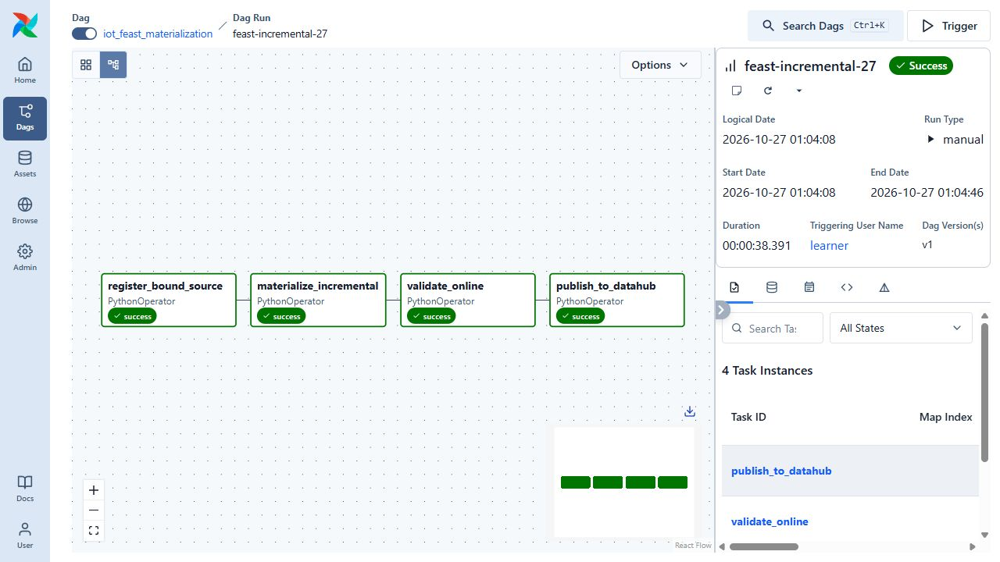
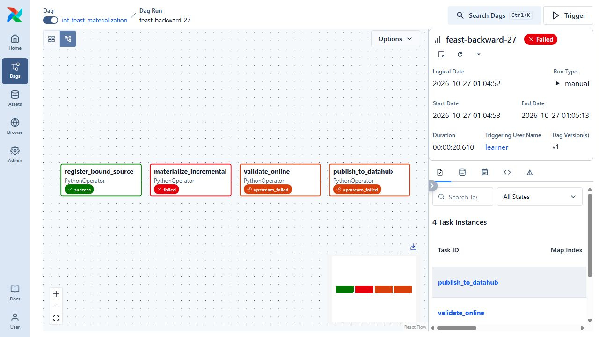
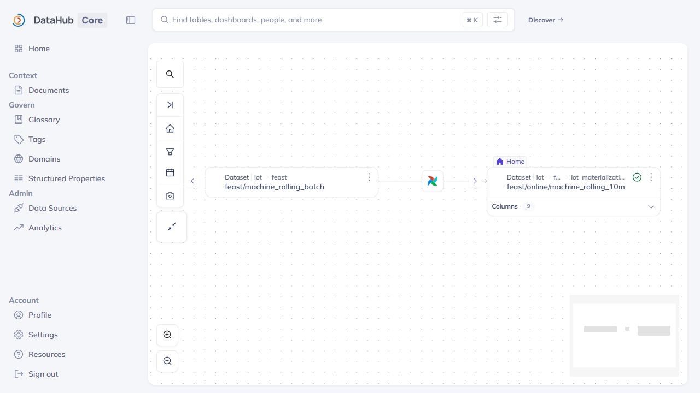

# Airflow incremental materialization and DataHub publication

The materialization DAG transfers eight offline Feast features for 200 machines to an isolated Redis project, validates every vector, and then publishes metadata. Its tasks are `register_bound_source → materialize_incremental → validate_online → publish_to_datahub`.

The recorded deployment used Airflow 3.1.7 with one active run and a one-slot Feast pool. The SDK and publisher execute in separate bounded containers. It uses the existing 60-day feature source and leaves the training registry unchanged.

Initial, recovery, incremental and replay runs are retained. The first publication failed on a DataHub enum; recovery reused the verified checkpoint without resetting it. Subsequent checks cover all 200 online vectors, replay, rollback of the requested cutoff and publication readback. The CI variant has its own namespace and eight successful Airflow task instances.

The cutoffs are simulated UTC event time, whereas task timestamps and UI clocks describe actual execution. This is a bounded backfill demonstration, not evidence that live sensors were updating at those simulated dates. DataHub restoration after VM restart preserved indexed metadata without rerunning materialization or publication.

## Commands and recorded examples

Run commands from the repository root unless the example explicitly changes the working directory. Use a fresh output/run name and check the linked runbook before starting platform services. Examples belong to the recorded workload on this page.

```bash
sudo python3 scripts/verify-feast-materialization.py trigger \
  --run my-feast-replay --end 2026-11-30T00:00:00Z
sudo python3 scripts/verify-feast-materialization.py snapshot --run my-feast-replay
sudo python3 scripts/verify-feast-materialization.py metadata --run my-feast-replay
```

## Implementation and evidence

- [Source: airflow/dags/iot_feast_materialization.py](../airflow/dags/iot_feast_materialization.py)
- [Source: feature_store/airflow_tasks.py](../feature_store/airflow_tasks.py)
- [Recorded artifact: feast-materialization/capture/native-containers.json](evidence/feast-materialization/capture/native-containers.json)
- [Recorded artifact: feast-materialization/controller/verification.json](evidence/feast-materialization/controller/verification.json)
- [Recorded artifact: feast-materialization/runs/feast-incremental-27/materialization.json](evidence/feast-materialization/runs/feast-incremental-27/materialization.json)
- [Recorded artifact: feast-materialization/runs/feast-incremental-27-airflow.json](evidence/feast-materialization/runs/feast-incremental-27-airflow.json)
- [Recorded artifact: feast-materialization/runs/feast-backward-27-airflow.json](evidence/feast-materialization/runs/feast-backward-27-airflow.json)
- [Recorded artifact: feast-materialization/runs/feast-replay-27/materialization.json](evidence/feast-materialization/runs/feast-replay-27/materialization.json)
- [Source: feature_store/materialize.py](../feature_store/materialize.py)
- [Source: feature_store/metadata.py](../feature_store/metadata.py)
- [Recorded artifact: feast-materialization/runs/feast-incremental-27-datahub.json](evidence/feast-materialization/runs/feast-incremental-27-datahub.json)
- [Recorded artifact: feast-materialization/screenshots/datahub-online-schema.jpg](evidence/feast-materialization/screenshots/datahub-online-schema.jpg)
- [Recorded artifact: feast-materialization/screenshots/datahub-six-checks-passing.jpg](evidence/feast-materialization/screenshots/datahub-six-checks-passing.jpg)
- [Recorded artifact: feast-materialization/capture/expected-and-repaired-errors.json](evidence/feast-materialization/capture/expected-and-repaired-errors.json)
- [Source: scripts/verify-feast-materialization.py](../scripts/verify-feast-materialization.py)

## Recorded interface views

These are original captures from the runs described above. Their timestamps, model identities and visible states belong to those runs.








## Related documentation

[Current architecture](architecture.md) · [Demo and recovery](operations.md) · [Rubric index](rubric-tracker.md)

[Original run notes](https://github.com/anle0429/iot-maintenance-platform/blob/a395c4ea47b8f8e235556ab93de3d699ed9df18b/docs/feast-materialization.md) retain the full historical narrative. Raw evidence files have not been translated or rewritten.
