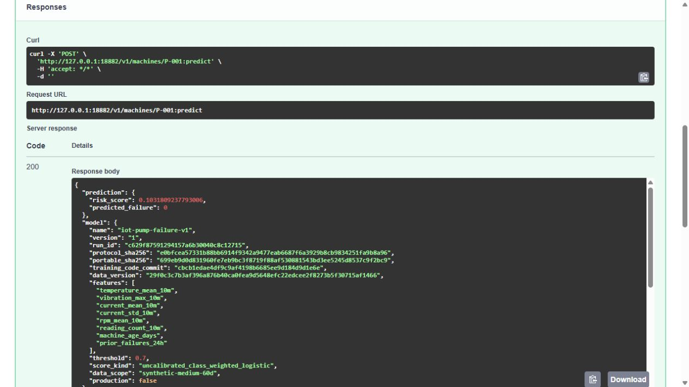
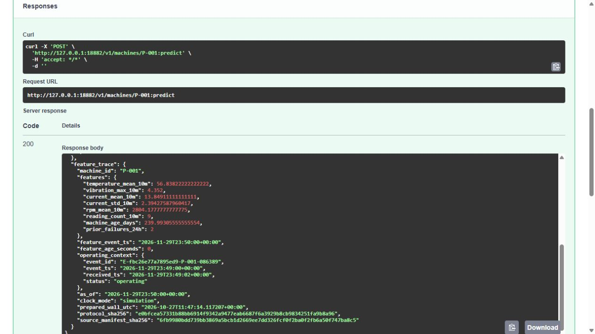
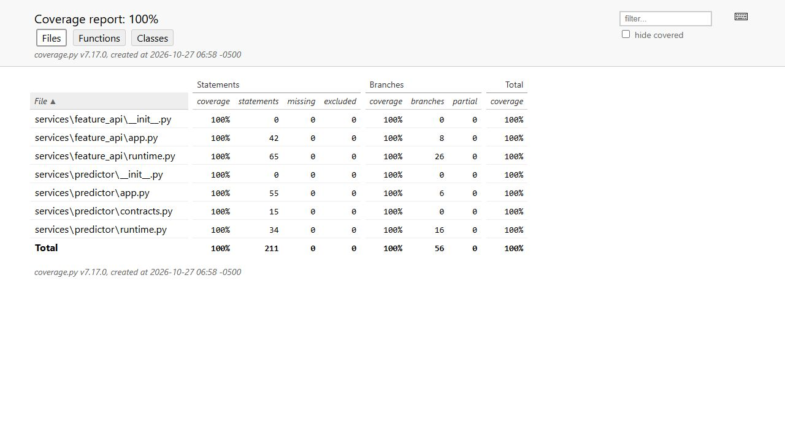
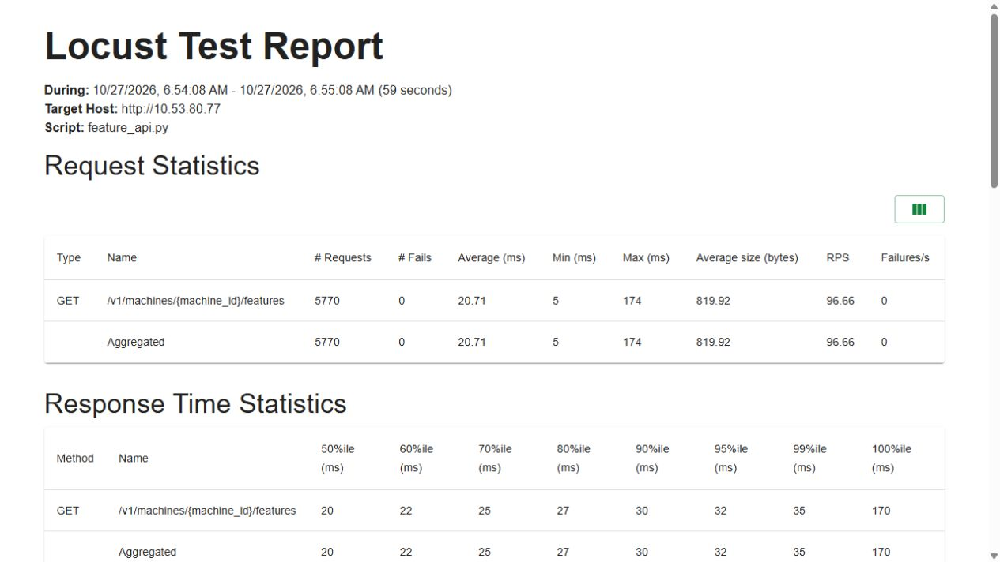
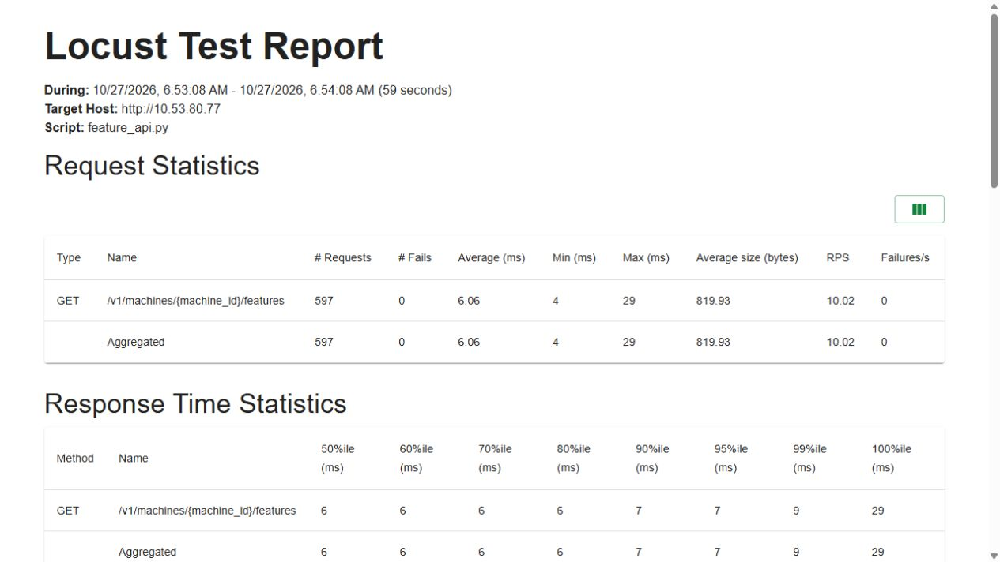

# Feature API: eligibility, inference and provenance

| Boundary | Implementation / execution |
|---|---|
| Code | [FastAPI app](../services/feature_api/app.py), [runtime/backend](../services/feature_api/runtime.py) |
| Runs on | K3s `iot-features`; Feast SDK reads the native online store and calls the pinned KServe model |
| Input → output | Machine ID → validated eight-feature trace or version-attributed prediction |
| Validation | [Native serving](model-serving.md), [current serving CI](ci-serving.md), [post-restart agent path](agent-runtime-validation.md) |

The FastAPI service reads eight native Feast features by machine ID, validates their event timestamps and arrival context, then calls a fixed private KServe endpoint. Async routes offload synchronous SDK/network work and bound in-flight backend operations.

The runtime separately checks the simulated event clock and the real preparation lease. It rejects stale/future/incomplete features, mismatched model pins and stopped-machine inference. Native cohort checks cover 200 machines:195 valid predictions and five stopped-machine 409 responses, plus malformed/unknown IDs and unavailable upstream state.

The first native API evidence belongs to its original model/source version; subsequent serving CI and fresh demo checks establish the model 6 pin. A generated manifest or an old successful receipt does not prove current readiness. The current architecture links the route, runtime, backend, binding and numeric model code so a reviewer can follow one request.

## Commands and recorded examples

Run commands from the repository root unless the example explicitly changes the working directory. Use a fresh output/run name and check the linked runbook before starting platform services. Examples belong to the recorded workload on this page.

```bash
sudo k3s kubectl get pods,svc -n iot-features
sudo k3s kubectl port-forward -n iot-features svc/iot-feature-api --address=127.0.0.1 18082:80
```

## Implementation and evidence

- [Source: services/feature_api/runtime.py](../services/feature_api/runtime.py)
- [Source: services/feature_api/app.py](../services/feature_api/app.py)
- [Recorded artifact: feature-api/deployment/verification.json](evidence/feature-api/deployment/verification.json)
- [Recorded artifact: feature-api/deployment/offline-comparison.json](evidence/feature-api/deployment/offline-comparison.json)
- [Recorded artifact: feature-api/capture/selected-http-probes.json](evidence/feature-api/capture/selected-http-probes.json)
- [Recorded artifact: feature-api/capture/capture-state.json](evidence/feature-api/capture/capture-state.json)
- [Source: infra/feature-api/Dockerfile](../infra/feature-api/Dockerfile)
- [Recorded artifact: feature-api/capture/current-pods.json](evidence/feature-api/capture/current-pods.json)
- [Recorded artifact: feature-api/capture/capture-repair.json](evidence/feature-api/capture/capture-repair.json)
- [Source: feature_store/serving.py](../feature_store/serving.py)
- [Recorded artifact: feature-api/preparation-rejected/console.txt](evidence/feature-api/preparation-rejected/console.txt)
- [Source: tests/fixtures/feature-api-native-online.json](../tests/fixtures/feature-api-native-online.json)
- [Recorded artifact: feature-api/pc/tests-console.txt](evidence/feature-api/pc/tests-console.txt)
- [Recorded artifact: feature-api/pc/coverage.json](evidence/feature-api/pc/coverage.json)
- [Source: tests/api/test_feature_api.py](../tests/api/test_feature_api.py)
- [Recorded artifact: feature-api/mutation-initial/verification.json](evidence/feature-api/mutation-initial/verification.json)
- [Recorded artifact: feature-api/mutation/verification.json](evidence/feature-api/mutation/verification.json)
- [docs.locust.io / installation.html](https://docs.locust.io/en/stable/installation.html)
- [Source: tests/load/feature_api.py](../tests/load/feature_api.py)
- [Recorded artifact: feature-api/load/users-1.html](evidence/feature-api/load/users-1.html)
- [Recorded artifact: feature-api/load/users-10.html](evidence/feature-api/load/users-10.html)
- [Recorded artifact: feature-api/load/verification.json](evidence/feature-api/load/verification.json)
- [Source: infra/feature-api/redis.yaml](../infra/feature-api/redis.yaml)
- [Source: infra/feature-api/deployment.yaml](../infra/feature-api/deployment.yaml)
- [Source: infra/feature-api/requirements-test.txt](../infra/feature-api/requirements-test.txt)
- [Source: scripts/verify-feature-api-offline.py](../scripts/verify-feature-api-offline.py)
- [Recorded artifact: feature-api/capture/manifest.json](evidence/feature-api/capture/manifest.json)
- [Recorded artifact: feature-api/capture/evidence-map.json](evidence/feature-api/capture/evidence-map.json)
- [Recorded artifact: feature-api/screenshots/locust-capture.json](evidence/feature-api/screenshots/locust-capture.json)

## Recorded interface views

These are original captures from the runs described above. Their timestamps, model identities and visible states belong to those runs.












## Related documentation

[Current architecture](architecture.md) · [Demo and recovery](operations.md) · [Rubric index](rubric-tracker.md)

[Original run notes](https://github.com/anle0429/iot-maintenance-platform/blob/f4da7bd21667a8bfca5715a7456bc2bcc813b0fc/docs/feature-api.md) retain the full historical narrative. Raw evidence files have not been translated or rewritten.
