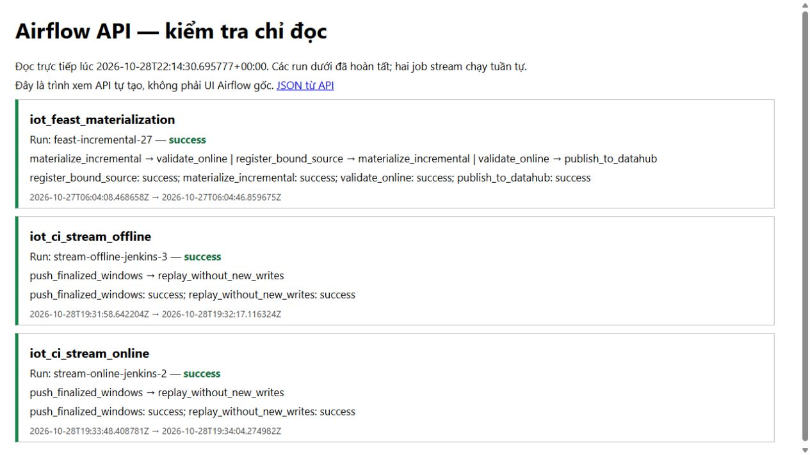
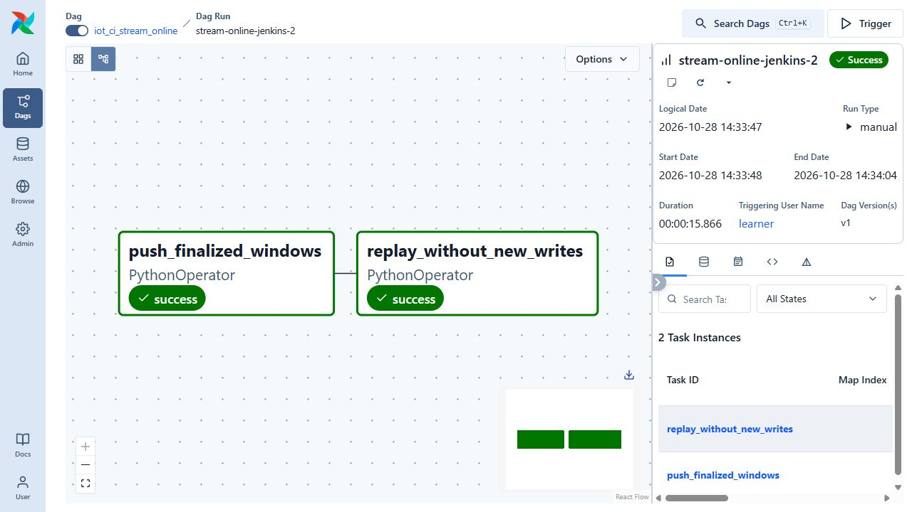
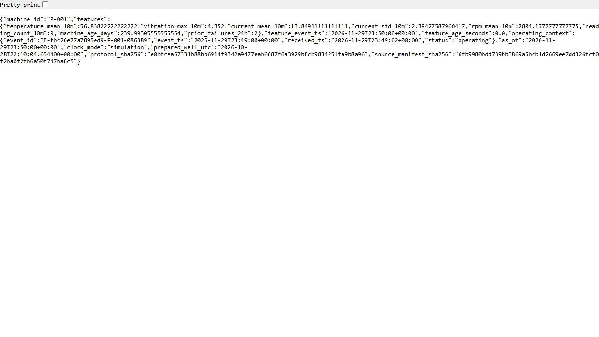

# Recorded ML handover and demonstration evidence

## Submission scope

The submission now includes both final ML and final LLM/agents. This page records the completed ML lab workloads. It does not establish LLM inference, RAG, MCP/agent deployment or the new LLM rubric requirements; those remain open in the LLM tracker.

The source 102.45 GB Bronze/Silver result, the 60-day feature/training cohort, the retained stream-window workload and the short-lived API demo are separate measurements. A successful historical receipt does not establish current endpoint readiness.

## Feature pipelines

The original Airflow UI captures show three successful feature DAGs: materialization with four tasks and offline/online push with two tasks each. They use the recorded 200-machine or three-window CI scopes. The full 5,760-window/57,600-reading native store run was a separate Docker/SDK workload, with write/replay checks at 256, 1,024 and 5,760 windows. Screenshots taken at different times do not prove both jobs were simultaneously RUNNING.

## Inference and verification

The full native cohort checked 200 machines, including 195 eligible predictions and five stopped-machine 409 responses. The selected model 6 portable calculation and returned lineage were independently verified. Feature lease and physical Redis TTL are separate guards.

A frozen independent-PC-clone suite passed 748 tests/314 subtests with seven documented skips. Later publication checks verify 26 artifact checkers, source bindings and original file hashes. They are not a new native coverage, mutation or performance run.

Use the current demo/recovery guide for a fresh materialization and IAP access. Keep historical reports and images byte-exact rather than editing their clocks, model IDs or success flags.

## Commands and recorded examples

Run commands from the repository root unless the example explicitly changes the working directory. Use a fresh output/run name and check the linked runbook before starting platform services. Examples belong to the recorded workload on this page.

```powershell
$base = 'http://127.0.0.1:19404'
Invoke-RestMethod "$base/health/ready"
Invoke-RestMethod "$base/v1/machines/P-001/features"
Invoke-RestMethod -Method Post "$base/v1/machines/P-001:predict" -ContentType 'application/json' -Body '{}'
Invoke-RestMethod -Method Post "$base/v1/machines/P-006:predict" -ContentType 'application/json' -Body '{}'
```

## Implementation and evidence

- [Recorded artifact: final-release-pc/manifest.json](evidence/final-release-pc/manifest.json)
- [Recorded artifact: airflow-final-readback/native-manifest.json](evidence/airflow-final-readback/native-manifest.json)
- [Recorded artifact: airflow-final-readback/snapshot.json](evidence/airflow-final-readback/snapshot.json)
- [Recorded artifact: final-demo-linux/verification.json](evidence/final-demo-linux/verification.json)
- [Recorded artifact: final-demo-linux/http-all-machines.json](evidence/final-demo-linux/http-all-machines.json)
- [Recorded artifact: course-scope/learner-confirmation.json](evidence/course-scope/learner-confirmation.json)

## Recorded interface views

These are original captures from the runs described above. Their timestamps, model identities and visible states belong to those runs.









## Related documentation

[Current architecture](architecture.md) · [Demo and recovery](operations.md) · [Rubric index](rubric-tracker.md)

[Original run notes](https://github.com/anle0429/iot-maintenance-platform/blob/a395c4ea47b8f8e235556ab93de3d699ed9df18b/docs/final-handover.md) retain the full historical narrative. Raw evidence files have not been translated or rewritten.
