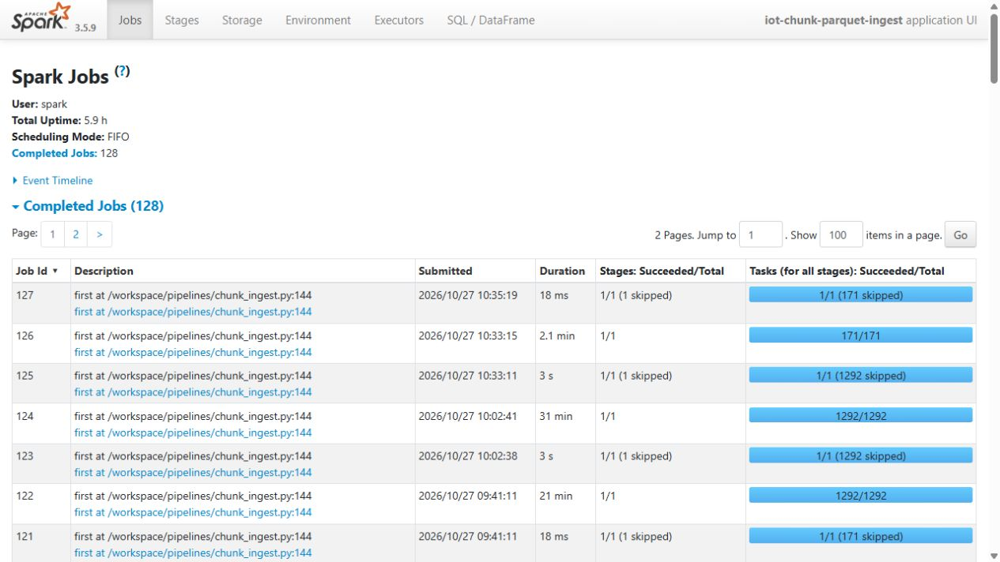
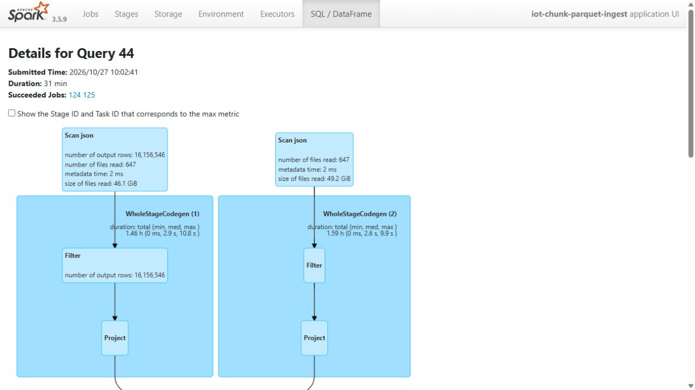
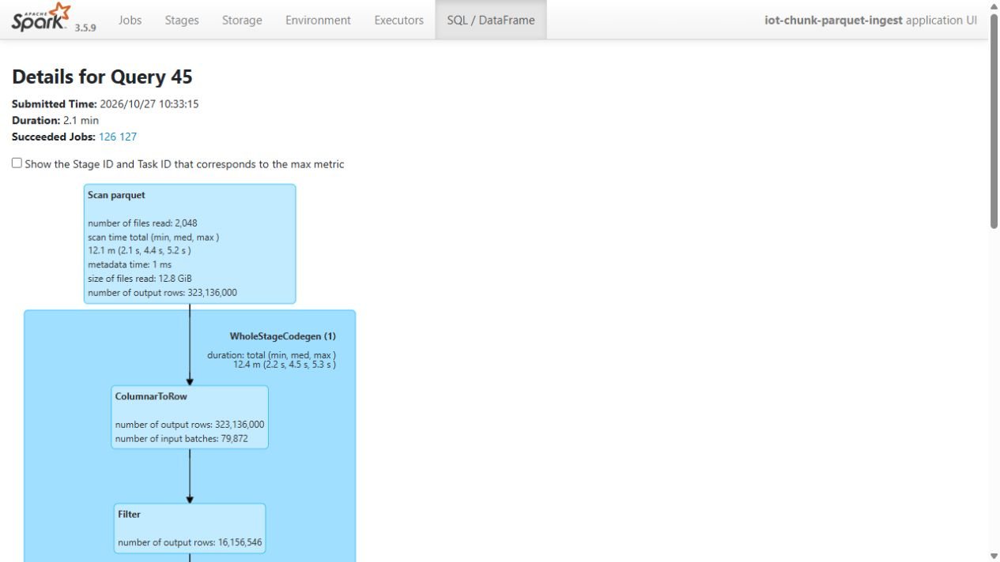

# Verified full-scale Bronze/Silver ingestion

The full Spark workload read 102,447,847,856 bytes of uncompressed offline JSONL. Bronze retained 323.136 million stored readings; Silver contains 316.8 millionunique readings after the contract-defined deduplication.

All 13 Spark checks passed. The recorded event logs contain 45,852 tasks with zero failed task attempts, and source checksums before/after agree. Fourteen semantic source rules and actual file/catalog measurements establish the input, rather than a size projection.

A matched JSONL/Parquet query experiment used three paired runs with equal results. The recorded medians are 1,740.35 seconds for JSONL and 124.69 seconds for Parquet. Cache state and shared-host interference are documented limits; this is not a universal speedup guarantee.

The scale claim covers source ingestion through Bronze/Silver. Gold, offline/online features and model training use separately measured sources. The full Spark runner and smaller Airflow DP1–DP3 pilot have different execution receipts.

## Implementation and evidence

- [Recorded artifact: full-ingest/controller/verification.json](evidence/full-ingest/controller/verification.json)
- [Recorded artifact: full-ingest/controller/ingest-report.json](evidence/full-ingest/controller/ingest-report.json)
- [Recorded artifact: full-ingest/controller/_RUN_SUCCESS.json](evidence/full-ingest/controller/_RUN_SUCCESS.json)
- [Recorded artifact: full-ingest/capture/lakehouse-_RUN_SUCCESS.json](evidence/full-ingest/capture/lakehouse-_RUN_SUCCESS.json)
- [Recorded artifact: full-ingest/capture/evidence-map.json](evidence/full-ingest/capture/evidence-map.json)
- [Recorded artifact: full-ingest/capture/capture-state.json](evidence/full-ingest/capture/capture-state.json)
- [Recorded artifact: full-ingest/controller/unit-tests.txt](evidence/full-ingest/controller/unit-tests.txt)
- [Recorded artifact: full-ingest/controller/spark-metrics.json](evidence/full-ingest/controller/spark-metrics.json)
- [Recorded artifact: full-ingest/capture/history-application.json](evidence/full-ingest/capture/history-application.json)
- [Recorded artifact: full-ingest/controller/container-limits.json](evidence/full-ingest/controller/container-limits.json)
- [Recorded artifact: full-ingest/controller/preflight.json](evidence/full-ingest/controller/preflight.json)
- [Recorded artifact: full-ingest/controller/resource-samples.json](evidence/full-ingest/controller/resource-samples.json)
- [Recorded artifact: full-ingest/capture/history-query-44.json](evidence/full-ingest/capture/history-query-44.json)
- [Recorded artifact: full-ingest/screenshots/capture.json](evidence/full-ingest/screenshots/capture.json)

## Recorded interface views

These are original captures from the runs described above. Their timestamps, model identities and visible states belong to those runs.

## Related documentation

[Current architecture](architecture.md) · [Demo and recovery](demo-walkthrough.md) · [Rubric index](rubric-tracker.md)

[Original run notes](https://github.com/anle0429/iot-maintenance-platform/blob/f4da7bd21667a8bfca5715a7456bc2bcc813b0fc/docs/full-scale-ingest.md) retain the full historical narrative. Raw evidence files have not been translated or rewritten.
