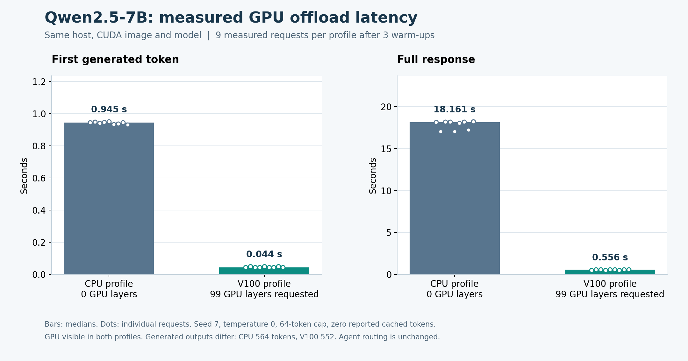

# GPU inference experiment

The dedicated GPU worker is a capacity fallback for the LLM workstream. The existing Data/ML VM and agent endpoint remain separate. Provisioning a GPU, loading a driver and generating a correct agent answer are separate acceptance steps.

## Machine and runtime

| Item | Configuration |
|---|---|
| Worker | `iot-cw-gpu`, `us-central1-a`; N1 Standard 4, 15 GiB RAM |
| Accelerator | One Tesla V100 SXM2, 16,384 MiB VRAM |
| Driver | Google installer, LTS binary branch; observed NVIDIA 580.178.04 |
| OS / boot disk | Ubuntu 24.04, 50 GiB SSD |
| Network | Private address in the existing lab VPC; IAP SSH and outbound Cloud NAT |
| Session | Maximum 28,800 seconds; automatic STOP |
| Model | The same two Qwen2.5-7B-Instruct Q4_K_M shards as the current CPU backend; 4,683,073,632 verified bytes |
| Candidate image | CUDA 12.8.1 llama.cpp b11977, pinned by amd64 digest in the [runtime lock](../infra/llm/gpu-runtime.lock.json) |
| Existing agent backend | CPU image b11960; the new experiment does not silently replace its source or benchmark |

The [Terraform module](../infra/gcp/inference/main.tf) provisions one worker and narrowly scoped private cluster rules. The [Ansible playbook](../infra/ansible/gpu-runtime.yml) verifies the dedicated instance and driver before installing Docker and NVIDIA Container Toolkit. It refuses to configure the Data/ML VM.

## Why this configuration

L4 and T4 requests encountered actual zone-capacity failures across multiple US regions. Increasing quota did not resolve those stockouts. The global GPU quota was granted at one device; the A100 GPU request was denied even though its CPU request was approved. A subsequent V100 allocation succeeded in the same region as the existing lab.

V100 uses the compatible 580 driver branch and a CUDA 12 container. The CUDA 13 image is not substituted. The project-wide external-IP denial remains in force; no model or SSH service was published to the Internet. Unused fallback subnet/router/NAT resources were replaced only after confirming they had no active mappings.

The worker remains within the authorized USD 300 project ceiling. Runtime is bounded independently by the cloud STOP policy and the experiment's process deadline. Disks remain allocated after STOP.

## Comparison method

The [benchmark module](../llm/gpu_benchmark.py) runs both profiles on **the same GPU worker and CUDA image**. The CPU profile requests zero GPU layers; the accelerated profile sets the GPU-layer upper bound to 99. This is an offload setting, not a claim that this model contains 99 layers. Weights, three generation threads, 8,192-token context, one slot, three-CPU/10-GiB container limits and request parameters stay fixed.

Each profile uses three warm-up requests followed by three repetitions of the same three prompts: nine measured requests per profile. Temperature is zero, seed is seven and the output cap is 64 tokens. Prompt caching is disabled, and every response must explicitly report zero cached tokens. Original SSE events, generated text, usage and timings are retained. Text equality is reported separately; a latency improvement is not a model-quality score.

The model port binds only to the worker's loopback interface. The experiment stops each owned container after measurement and retains its logs and inspection records. It does not change the agent model route.

## Recorded result

The paired experiment completed on 29 October 2026 at 11:44:45 UTC. Both containers stopped with exit code zero and no out-of-memory event. The [160-payload evidence capsule](evidence/gpu-inference/manifest.json) retains original SSE events, source seals, image/device observations, Ansible output, failed capacity requests and native process journals. Generated bytecode and one local invocation helper are excluded with their original hashes; the full native archive is retained separately.

| Measurement | CPU profile: 0 GPU layers | V100 profile: 99 GPU layers |
|---|---:|---:|
| Measured requests | 9 | 9 |
| Median first-token time | 0.9446 s | 0.0438 s |
| Median full-response time | 18.1607 s | 0.5558 s |
| Generated tokens across measured requests | 564 | 552 |
| Observed GPU process memory after generation | 564 MiB | 5,118 MiB |

The observed median response-time ratio is **32.68**, and the first-token ratio is **21.56**. The GPU remains visible in both profiles; this measures an offload configuration change on the same machine. Outputs are not byte-identical and can reach the 64-token limit. The experiment measures generation latency, not answer completeness, factual accuracy, concurrent capacity or a 32-fold improvement in a routed agent workflow. The historical 1.5B CPU-thread experiment remains a separate result.



[SVG](images/gpu-inference-latency.svg) · [Plot source](plots/gpu_inference.py). The chart is generated from the original request receipts. Regenerate it with Matplotlib 3.10.7; the resolved rendering dependencies are retained with the evidence.

Check the recorded result without a running VM or model dependencies:

```bash
python -S scripts/verify-gpu-inference.py
```

The checker independently recomputes medians and ratios, validates all 24 actual warm-up/measured streams, confirms source/image/device identities and checks the actual completion invocation. It also retains the failed driver-resume attempt: the first reboot cleared its temporary installer path. Moving the pinned installer to persistent worker storage allowed the next invocation to complete.

## Run on an authorized worker

Use the Terraform module only with the intended project and reviewed profile. Review the saved plan before applying it. The default profile matches the allocated V100:

```bash
terraform -chdir=infra/gcp/inference init
terraform -chdir=infra/gcp/inference plan \
  -var="project_id=YOUR_PROJECT_ID" -var="zone=us-central1-a" \
  -var="gpu_profile=v100" -out=gpu.tfplan
terraform -chdir=infra/gcp/inference apply gpu.tfplan
```

Verify the Google installer checksum from the runtime lock and run its LTS binary driver installation on the GPU worker. Keep the installer on persistent storage across its required reboot. Continue only after `nvidia-smi` reports the expected device and driver. Install the pinned Ansible controller from `infra/ansible/requirements-controller.txt`, then run:

```bash
ansible-playbook -i localhost, infra/ansible/gpu-runtime.yml \
  -e expected_project_id=YOUR_PROJECT_ID --syntax-check
sudo ansible-playbook -i localhost, infra/ansible/gpu-runtime.yml \
  -e expected_project_id=YOUR_PROJECT_ID
```

The measurement CLI expects an immutable source tree under `/srv/iot-inference/source/` and its sibling `manifest.json`. The seal covers the two benchmark modules, package marker and both model/runtime locks. Pass the **actual cloud auto-STOP time**, not a new deadline invented to bypass the guard:

```bash
python -m llm.gpu_benchmark --help
```

Run `--phase prepare` once to download and verify both model shards. After the container runtime is ready, run `--phase benchmark` with a fresh `gpu-*` run name. The CLI requires at least 45 authorized minutes, 10 GiB available RAM and 15 GiB free disk. Model weights, Terraform state, credentials and native bulk outputs stay outside Git.

## Agent limitation

The original offload experiment below measures model generation. A subsequent [GPU routing and agent checkpoint](gpu-agent-routing.md) verifies real MCP execution, complete specialist answers and actual coordinator child sessions on the private GPU route. The original [response baseline](agent-response-contract.md) remains available with its failed outcomes.

The integration has its own source-bound evidence and checker. Autoscaling, warm-up, sandbox egress, CI and other remaining criteria continue separately. See the [remaining LLM criteria](final-llm-rubric-tracker.md).

Official references: [GPU machine types](https://docs.cloud.google.com/compute/docs/gpus/), [resource availability errors](https://docs.cloud.google.com/compute/docs/troubleshooting/troubleshooting-resource-availability), [Google driver installation](https://docs.cloud.google.com/compute/docs/gpus/install-drivers-gpu), [llama.cpp CUDA images](https://github.com/ggml-org/llama.cpp/blob/8642541b2/docs/docker.md), [NVIDIA Container Toolkit](https://docs.nvidia.com/datacenter/cloud-native/container-toolkit/latest/install-guide.html).
