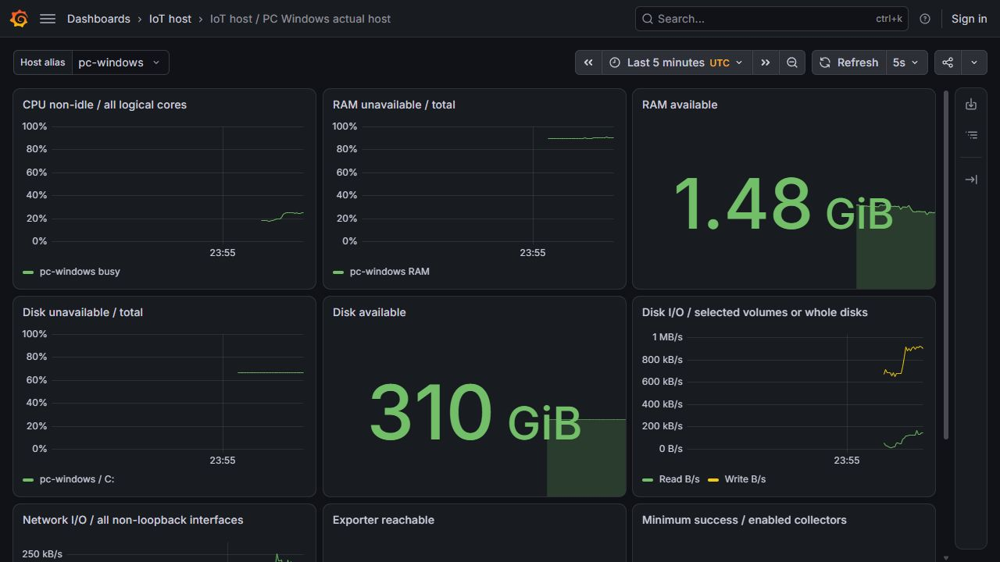
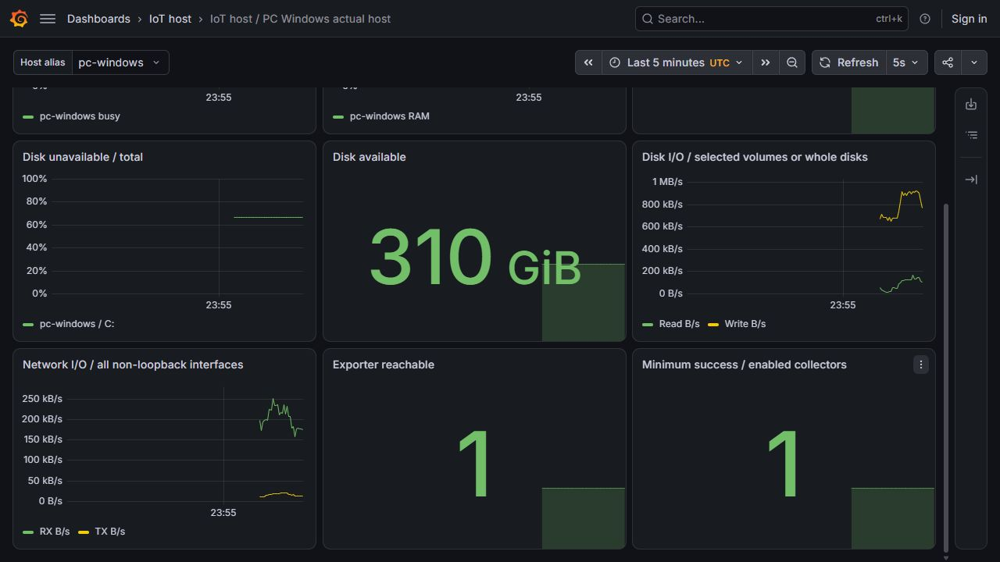

# Theo dõi CPU, RAM, đĩa và mạng

**Đã chạy thật trên PC Windows, chưa triển khai trên VM.** Source `658183995ce28c6ca71aa75104a478a4948305d3`. Windows exporter **0.32.0** đọc hệ điều hành; Prometheus **3.13.5 LTS** lưu các mẫu; Grafana OSS **13.3.0** hiển thị9panel. Dữ liệu host là thật, bao gồm các ứng dụng khác trên PC; không dùng fixture để giả lập số CPU/RAM hoặc gán toàn bộ tải máy cho coursework.

## Các số đo có nghĩa gì?

| Panel | Cách tính | Giá trị ở mốc kiểm cố định |
| --- | --- | ---: |
| CPU non-idle | 100 × (1 − trung bình tốc độ idle của các lõi logic) | 18,6616% |
| RAM unavailable / total | 100 × (1 − available / total) | 89,7861% |
| RAM available | RAM sẵn sàng cấp phát, có tính phần cache có thể thu hồi | 1.740.963.840byte |
| Disk unavailable / total | 100 × (1 − available / size) | 66,7097% trên C: |
| Disk available | Số byte sẵn dùng theo exporter | 332.574.416.896byte |
| Disk I/O | Tốc độ đọc/ghi, không phải tổng byte từ lúc boot | 55.460,57 / 673.371,43byte/giây |
| Network I/O | Tổng RX/TX của các NIC không phải loopback | 197.172,36 / 12.156,96byte/giây |
| Exporter reachable | Prometheus scrape thành công | 1 |
| Minimum collector success | Giá trị nhỏ nhất của4collector đang bật | 1 |

RAM available khác với chỉ phần RAM hoàn toàn trống. Theo [collector memory của bản0.32.0](https://github.com/prometheus-community/windows_exporter/blob/v0.32.0/docs/collector.memory.md), số available có tính standby/cache có thể cấp lại. Không dùng `1 − free/total` rồi gọi toàn bộ cache là RAM không thể cấp.

Tốc độ dùng [`rate()`](https://prometheus.io/docs/prometheus/latest/querying/functions/#rate) trên cửa sổ30giây; Prometheus xử lý counter reset và nội suy tới biên cửa sổ. Lấy counter tích lũy rồi gắn nhãn byte/giây sẽ sai. Tổng mạng có thể đếm trùng lưu lượng đi qua NIC vật lý và NIC ảo, nên đây không phải phép đo tốc độ một đường truyền hoặc riêng coursework.

**Không hiển thị rate khi cửa sổ chưa đủ15mẫu với scrape mỗi2giây.** Lượt xem ban đầu phát hiện đường CPU cao giả trong khoảng khởi động do chưa phủ đủ cửa sổ. Mã hiện tại để trống CPU/disk/network rates cho tới khi đủ mẫu; mất mẫu cũng có thể làm đường trống. Không thay dữ liệu thiếu bằng0. Gauge RAM/đĩa có thể xuất hiện sớm hơn.





Hai ảnh JPEG là capture gốc từ trình duyệt, chụp sau mốc query cố định nên giá trị đang thay đổi có thể khác bảng. Không sửa pixel để ép khớp số. Màu của chuỗi dữ liệu dùng phân biệt biểu đồ; hai panel trạng thái cuối dùng0/1 đỏ/xanh.

## Triển khai và kiểm chứng

[Bộ cấu hình](../ml/host_monitoring.py) tạo runtime riêng, không ghi đè state cũ và không cài OS service. Exporter, Prometheus và Grafana đều nghe `127.0.0.1`. Alias `pc-windows` được chọn riêng cho dashboard, không dùng hostname cá nhân.

Chỉ bật4Windows collectors: CPU, memory, logical_disk và net. Prometheus có allowlist metric name; thông tin MAC, địa chỉ NIC, hostname, process/user không được nhập vào TSDB. Bằng chứng raw sample đã chọn chỉ thay4nhãn NIC bằng2alias, giữ nguyên giá trị/timestamp và quan hệ giữa các series; lưu hash trước/sau. Không đưa full exporter scrape, binary, TSDB, password hoặc runtime log lên Git.

- **22tests PASS** trên PC:21unit/contract tests và một integration chạy exporter/Prometheus/Grafana thật. Không thêm hoặc sửa API body/dependency; không nhận kết quả này thay coverage/mutation/load gates của API.
- `promtool` thật kiểm **5nhóm/35biểu thức có đáp án biết trước**:11query Windows,11query Linux,3ca counter reset/zero-boundary/missing-boundary và10ca khởi động chưa đủ mẫu phải trả rỗng. Các biểu thức fixture được so với profile hiện hành, không kiểm một bản query cũ.
- Mỗi **11query** được gọi qua cả Prometheus và Grafana ở cùng timestamp tới millisecond. [Oracle Python riêng](../tests/monitoring_oracle.py) tính lại từ gauge vectors và raw counter matrices: reset, khoảng cách sample, extrapolation, mean/sum và phép chia. Không lấy chính output đã tổng hợp làm đáp án. Oracle đối chiếu semantics của Prometheus, không phải một định nghĩa rate khác.
- Kiểm thêm bằng Win32/standard library:12logical processors,17.044.983.808byte physical memory và dung lượng C: khớp. Free disk lấy vào thời điểm gần nhau, cho sai lệch tối đa64MiB vì ứng dụng khác vẫn ghi; phép so raw-query cùng timestamp vẫn dùng dung sai số học chặt.
- [Kiểm cold-start thật](evidence/host-monitoring-pc/cold-start-check.json): ở scrape thứ3 có12bare CPU-rate series nhưng cả5query rate đã guard đều rỗng. Đây là kiểm truy vấn ngược vào thời điểm khởi động của cùng lượt PC, tách khỏi fixtures.
- Đã xem9panel trong trình duyệt, lưu2ảnh và kiểm3listener thực đều là loopback. Sau kiểm đã terminate/wait cả3process. Thời lượng107,52giây có khoảng chờ kiểm giao diện, không dùng làm benchmark. Điểm đo working set ba process khoảng434MiB tổng cộng, không phải peak hoặc ngân sách RAM cho VM.

[Verification](evidence/host-monitoring-pc/verification.json), [manifest](evidence/host-monitoring-pc/manifest.json), [mẫu đã chọn](evidence/host-monitoring-pc/raw-samples.json), [query readbacks](evidence/host-monitoring-pc/panel-queries.json) và [kiểm từ Windows](evidence/host-monitoring-pc/native-os-sanity.json) ghi rõ phạm vi.20payload nhỏ,10source bindings có execution bytes đúng Git. [Verifier](../scripts/verify-host-monitoring.py) kiểm hash/source/mọi giá trị đã vẽ/Win32 sanity/cold guard/privacy/listeners/cleanup; audit này không chạy lại dịch vụ.

Windows exporter lấy từ [release chính thức0.32.0](https://github.com/prometheus-community/windows_exporter/releases/tag/v0.32.0), binary AMD64 SHA256 `ca811672573c930c6ba0dd0fd9ac3e010b74b4e951595485fc04d06e7c608687`,33.358.776byte. Đã đối chiếu checksum nhà phát hành và GitHub asset digest trước khi chạy. Receipt của exporter và hai binary monitoring ở thư mục evidence; binary giải nén vẫn giữ cục bộ.

## Tự chạy và xem dashboard

Từ repo root, trong Python environment có dependency test của [lock serving](../infra/ci/requirements-serving-tests.lock):

```powershell
python -S scripts/verify-host-monitoring.py
python -m pytest tests/test_host_monitoring.py -q
```

Muốn chạy lại các phần dùng binary thật, giải nén Prometheus/Grafana như [mốc A/B monitoring](ab-monitoring.md), tải Windows exporter theo release/hash ở trên, rồi đặt đường dẫn thực tế. Ví dụ layout trên PC này:

```powershell
$env:IOT_HOST_EXPORTER_EXE=(Resolve-Path outputs/host-monitoring-27/windows_exporter-0.32.0-amd64.exe).Path
$env:IOT_PROMETHEUS_EXE=(Resolve-Path outputs/monitoring-27/prometheus-3.13.5.windows-amd64/prometheus.exe).Path
$env:IOT_GRAFANA_EXE=(Resolve-Path outputs/monitoring-27/grafana-13.3.0/bin/grafana.exe).Path
$env:IOT_GRAFANA_HOME=(Resolve-Path outputs/monitoring-27/grafana-13.3.0).Path
python -m pytest tests/test_host_monitoring.py tests/integration/test_host_monitoring_http.py -q
```

Thiếu binary environment thì phần tương ứng báo **SKIP**, không nhận là đã có host/dashboard thật. Test chạy trên Windows, tự chọn port còn trống và admin password ngẫu nhiên qua environment; dừng các process do nó tạo khi xong. Nó không đóng ứng dụng khác. Máy cần đủ RAM để chạy thêm ba process; không dùng số working set ở một thời điểm như trần RAM cứng.

Để xem UI trong lúc test, đặt `IOT_HOST_MONITORING_HOLD_FILE` tới **file chưa tồn tại** trước lệnh integration. Sau khi tất cả phép kiểm qua, mở `dashboard_url` trong `host-monitor/ui-ready.json` tại thư mục tmp của pytest. Tạo file hold đã chọn để kết thúc; tối đa10phút thì test tự kết thúc. Tránh dùng lại `--basetemp` chứa dữ liệu cần giữ, vì pytest quản lý/xóa thư mục đó.

[CLI chuẩn bị cấu hình](../scripts/prepare-host-monitoring.py) có thể tạo runtime riêng cho một endpoint đã xác minh:

```powershell
python -S scripts/prepare-host-monitoring.py --output outputs/my-host-monitor --endpoint http://127.0.0.1:19182 --family windows --host pc-windows --label "PC Windows actual host"
```

CLI chỉ tạo file và `launch.json`; không tự khởi động exporter hoặc các dịch vụ. Đặt `GF_SECURITY_ADMIN_USER`/`GF_SECURITY_ADMIN_PASSWORD` riêng trước khi chạy Grafana. Hai port monitor mặc định19091/13001 có thể đổi, listener vẫn loopback. Retention24giờ/256MB là chính sách TSDB, không phải giới hạn toàn bộ đĩa; `GOMEMLIMIT=384MiB` trong test là mục tiêu mềm của Go, không phải hard memory quota.

## Cấu hình Linux/VM và phần còn lại

[Hai profile](../infra/monitoring/host-profiles.json) dùng tên metric và collector riêng theo OS. Profile Linux nhắm node_exporter **1.12.1**, filesystem chỉ `/`, `/srv/iot-data`, `/srv/iot-fast`; disk I/O chỉ whole devices để tránh cộng lại cả partition. Đã kiểm flag filesystem include từ [source đúng phiên bản](https://github.com/prometheus/node_exporter/blob/v1.12.1/collector/filesystem_common.go) và kiểm query bằng promtool với fixture. **Chưa chạy node_exporter hoặc dashboard Linux trên VM.** Sau khi có phiên VM hợp lệ phải đọc tài nguyên/địa chỉ/mount thật, chọn profile Linux, chạy dịch vụ và kiểm lại số đo/ảnh.

F47 chuyển sang **Đang làm** vì đã có host metrics và ảnh thật trên PC; còn triển khai trên máy chạy platform. Không dùng điểm đo PC này tính lại RAM/SSD cho Spark trên VM. F48logs/F49traces, Vault/service authentication và native CI vẫn còn thiếu. Dashboard này tách khỏi [A/B metrics](ab-monitoring.md): tải host không tự quy được cho một thí nghiệm hoặc một model.
