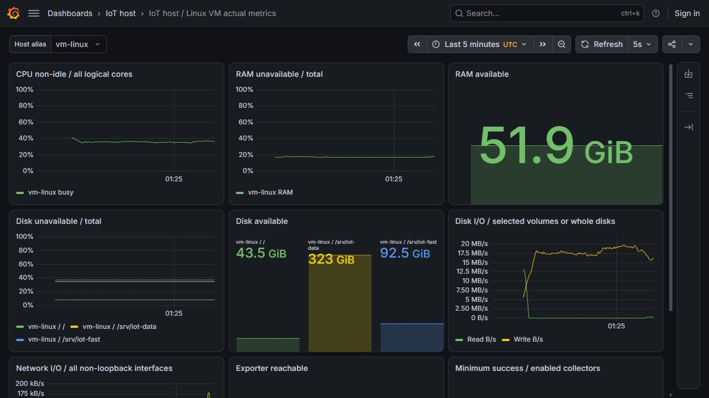
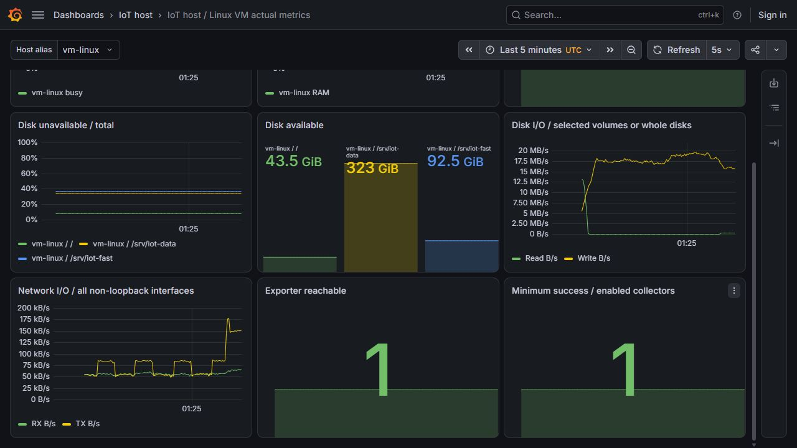

# Host metrics on Windows and Linux

Windows PC and Linux VM measurements use real exporters, Prometheus and Grafana. The dashboards expose nine panels with 11 queries per engine, and independent calculations from raw samples are compared with returned query values.

The Linux readback identifies 8 CPU and three filesystems and checks them against OS observations. Windows and Linux use different native collectors; local fixtures are not substituted for an exporter when native tooling is unavailable. Original query timestamps, binaries, configs and screenshots are retained.

Host CPU/RAM/disk/network counters describe the machine, not automatically one Spark/API job. Counter rates need compatible sample times and units. A dashboard screenshot alone is not a known-answer oracle; the linked raw samples and calculations establish the recorded values.

## Commands and recorded examples

Run commands from the repository root unless the example explicitly changes the working directory. Use a fresh output/run name and check the linked runbook before starting platform services. Examples belong to the recorded workload on this page.

```powershell
python -S scripts/verify-host-monitoring.py
python -m pytest tests/test_host_monitoring.py -q
```

```powershell
$env:IOT_HOST_EXPORTER_EXE=(Resolve-Path outputs/host-monitoring-27/windows_exporter-0.32.0-amd64.exe).Path
$env:IOT_PROMETHEUS_EXE=(Resolve-Path outputs/monitoring-27/prometheus-3.13.5.windows-amd64/prometheus.exe).Path
$env:IOT_GRAFANA_EXE=(Resolve-Path outputs/monitoring-27/grafana-13.3.0/bin/grafana.exe).Path
$env:IOT_GRAFANA_HOME=(Resolve-Path outputs/monitoring-27/grafana-13.3.0).Path
python -m pytest tests/test_host_monitoring.py tests/integration/test_host_monitoring_http.py -q
```

```powershell
python -S scripts/prepare-host-monitoring.py --output outputs/my-host-monitor --endpoint http://127.0.0.1:19182 --family windows --host pc-windows --label "PC Windows actual host"
```

```bash
python -S scripts/verify-linux-host.py
python -m unittest tests.test_linux_monitoring_oracle -v
```

```bash
python3 -S scripts/prepare-host-monitoring.py --output outputs/linux-host-new --endpoint http://127.0.0.1:19100 --family linux --host vm-linux --label "Linux actual host"
```

## Implementation and evidence

- [github.com / collector.memory.md](https://github.com/prometheus-community/windows_exporter/blob/v0.32.0/docs/collector.memory.md)
- [prometheus.io / functions](https://prometheus.io/docs/prometheus/latest/querying/functions/#rate)
- [Source: ml/host_monitoring.py](../ml/host_monitoring.py)
- [Source: tests/monitoring_oracle.py](../tests/monitoring_oracle.py)
- [Recorded artifact: host-monitoring-pc/cold-start-check.json](evidence/host-monitoring-pc/cold-start-check.json)
- [Recorded artifact: host-monitoring-pc/verification.json](evidence/host-monitoring-pc/verification.json)
- [Recorded artifact: host-monitoring-pc/manifest.json](evidence/host-monitoring-pc/manifest.json)
- [Recorded artifact: host-monitoring-pc/raw-samples.json](evidence/host-monitoring-pc/raw-samples.json)
- [Recorded artifact: host-monitoring-pc/panel-queries.json](evidence/host-monitoring-pc/panel-queries.json)
- [Recorded artifact: host-monitoring-pc/native-os-sanity.json](evidence/host-monitoring-pc/native-os-sanity.json)
- [Source: scripts/verify-host-monitoring.py](../scripts/verify-host-monitoring.py)
- [github.com / v0.32.0](https://github.com/prometheus-community/windows_exporter/releases/tag/v0.32.0)
- [Source: infra/ci/requirements-serving-tests.lock](../infra/ci/requirements-serving-tests.lock)
- [Source: scripts/prepare-host-monitoring.py](../scripts/prepare-host-monitoring.py)
- [Recorded artifact: host-monitoring-linux/host/verification.json](evidence/host-monitoring-linux/host/verification.json)
- [Recorded artifact: host-monitoring-linux/host/panel-queries.json](evidence/host-monitoring-linux/host/panel-queries.json)
- [Source: tests/linux_monitoring_oracle.py](../tests/linux_monitoring_oracle.py)
- [Recorded artifact: host-monitoring-linux/host/raw-samples.json](evidence/host-monitoring-linux/host/raw-samples.json)
- [Recorded artifact: host-monitoring-linux/host/native-os-sanity.json](evidence/host-monitoring-linux/host/native-os-sanity.json)
- [Source: tests/test_linux_monitoring_oracle.py](../tests/test_linux_monitoring_oracle.py)
- [Recorded artifact: host-monitoring-linux/runtime/prometheus.json](evidence/host-monitoring-linux/runtime/prometheus.json)
- [Recorded artifact: host-monitoring-linux/host/ingested-names.json](evidence/host-monitoring-linux/host/ingested-names.json)
- [Recorded artifact: host-monitoring-linux/host/units-live.json](evidence/host-monitoring-linux/host/units-live.json)
- [Recorded artifact: host-monitoring-linux/listeners.json](evidence/host-monitoring-linux/listeners.json)
- [github.com / v3.13.5](https://github.com/prometheus/prometheus/releases/tag/v3.13.5)
- [github.com / v1.12.1](https://github.com/prometheus/node_exporter/releases/tag/v1.12.1)
- [grafana.com / 13.3.0?edition=oss&platform=linux](https://grafana.com/grafana/download/13.3.0?edition=oss&platform=linux)
- [Recorded artifact: host-monitoring-linux/downloads.json](evidence/host-monitoring-linux/downloads.json)
- [Recorded artifact: host-monitoring-linux/manifest.json](evidence/host-monitoring-linux/manifest.json)
- [Recorded artifact: host-monitoring-linux/capture.json](evidence/host-monitoring-linux/capture.json)
- [Source: infra/monitoring/host-profiles.json](../infra/monitoring/host-profiles.json)
- [github.com / filesystem_common.go](https://github.com/prometheus/node_exporter/blob/v1.12.1/collector/filesystem_common.go)

## Recorded interface views

These are original captures from the runs described above. Their timestamps, model identities and visible states belong to those runs.







## Related documentation

[Current architecture](architecture.md) · [Demo and recovery](operations.md) · [Rubric index](rubric-tracker.md)

[Original run notes](https://github.com/anle0429/iot-maintenance-platform/blob/a395c4ea47b8f8e235556ab93de3d699ed9df18b/docs/host-monitoring.md) retain the full historical narrative. Raw evidence files have not been translated or rewritten.
