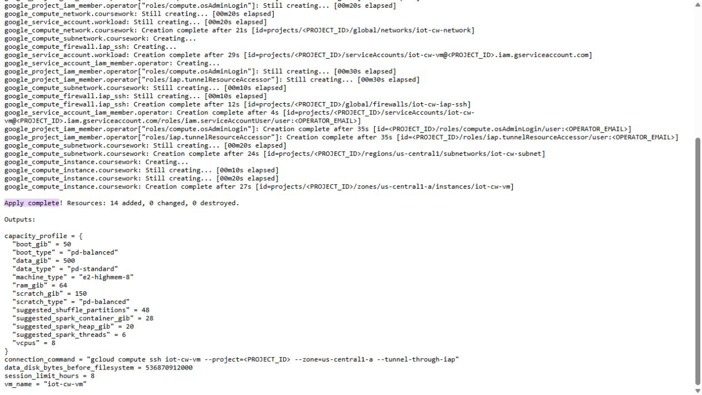
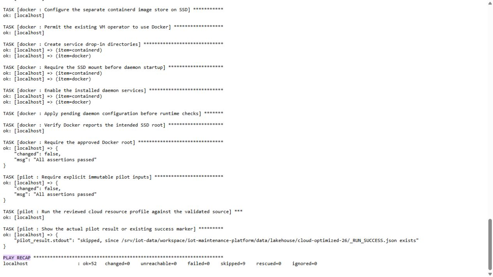

# Terraform và Ansible: kết quả đã chạy

Terraform tạo hạ tầng cloud; Ansible cấu hình bên trong VM bằng các role riêng. Coursework dùng Compute VM và các dịch vụ cloud liên quan trên GCP, không tạo thêm GKE chỉ để lấy ảnh.

**Terraform:** [apply gốc](evidence/iac-final/prior/docs/evidence/gcp-runtime/terraform-apply-redacted.txt) ngày26/10 tạo 14 resource, 0 thay đổi/0 xóa. Gồm network/subnet, firewall IAP SSH, VM, hai data disk, service account, API và quyền operator đã duyệt. [Plan chỉ đọc ngày28/10 21:19UTC](evidence/iac-final/terraform-read-only-redacted.txt), Terraform1.16.6, exit0, cả14 resource `no-op`; không chạy apply trong lượt kiểm này. [Projection](evidence/iac-final/prior/tests/fixtures/policy-terraform-observed.json) giữ address/type/action và cấu hình cần audit, bỏ identity/email/IP cụ thể.

VM e2-highmem-8/64GiB, boot50GiB pd-balanced, data500GiB pd-standard và scratch150GiB **pd-balanced**; vẫn tự STOP sau8giờ. Scratch là SSD-backed balanced, không gọi nhầm thành pd-ssd. VM có một cấu hình IP ra ngoài STANDARD phục vụ tải package; firewall của network chỉ cho SSH22 từ dải IAP35.235.240.0/20. Dịch vụ ứng dụng dùng ClusterIP/loopback/tunnel; không nhận VM không có external IP.

**Ansible:** [playbook](../infra/ansible/bootstrap.yml) tách `common`, `storage`, `docker`, `pilot`; storage kiểm đúng device/size/label trước thao tác filesystem. [Recap lần chạy lại](evidence/iac-final/prior/docs/evidence/gcp-runtime/ansible-idempotent.txt): ok52, changed0, failed0, unreachable0. [Role Kubernetes](../infra/ansible/roles/kubernetes/tasks/main.yml) và [playbook riêng](../infra/ansible/kubernetes.yml) cấu hình K3s; [lần chạy lại](evidence/iac-final/prior/docs/evidence/kserve/cluster/idempotent-console.txt) ok20/changed0, node Ready. Pilot thấy marker hợp lệ thì bỏ qua; đây là idempotency, không phải một lượt Spark mới.

Hai ảnh là ảnh trình duyệt đọc **report gốc đã lưu và redaction định danh**, không phải ảnh terminal vừa apply hoặc Cloud Console. Console cloud trong phiên này báo cần thêm quyền cho tài khoản trình duyệt; không tự cấp quyền để có ảnh. CLI hiện có quyền đọc plan hợp lệ. Giữ SHA console/plan đầy đủ ở [verification](evidence/iac-final/verification.json); bản đầy đủ và state chứa định danh nằm ngoài Git. Verifier kiểm byte payload, tám nguồn Git lịch sử, recaps, node Ready và projection14no-op: `python scripts/verify-iac-final.py`.

Tự kiểm kế hoạch trên máy đã đăng nhập: `terraform -chdir=infra/gcp/vm plan -detailed-exitcode` với cấu hình local riêng. Exit0 nghĩa không đổi,2 nghĩa có thay đổi cần xem xét. Chạy Ansible theo [runtime guide](gcp-runtime.md) và [Kubernetes guide](kubernetes-serving.md) trên đúng VM; không chạy lại apply/format đĩa chỉ để trình bày. Các role trên chưa quản lý toàn bộ platform; những dịch vụ khác có Helm/Compose/CI riêng và bằng chứng riêng.
