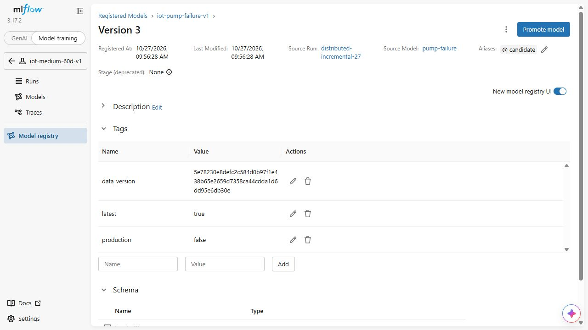

# Incremental dataset versions and full restore

The version store writes canonical content-addressed parts and a manifest for each retrieved dataset. A 59-day to 60-day change stores the changed material while preserving shared blobs; unchanged content is referenced rather than duplicated.

The native MLflow-backed checks compare actual uploaded/reused bytes and reconstruct the complete selected version. Restored rows, schema and keys must match the canonical input, including labels and protocol metadata. A manifest alone is insufficient without full restore/readback.

Data identity, model identity and source version remain linked. The restored snapshot is not a claim of transactional versioning for arbitrary external stores, and later automatic notebook/KFP registration has separate receipts.

## Commands and recorded examples

Run commands from the repository root unless the example explicitly changes the working directory. Use a fresh output/run name and check the linked runbook before starting platform services. Examples belong to the recorded workload on this page.

```bash
python -m ml.canonical_dataset --cohort /ml-data/cohort.json \
  --protocol /workspace/ml/protocols/medium-60d-v1.json \
  --destination /canonical/dataset --output /proof/canonical.json
python scripts/version-feast-dataset.py --canonical-root /canonical/dataset \
  --canonical-report /proof/canonical.json --store /data-cas \
  --output /proof/version-new.json --parent-version "$PREVIOUS_VERSION"
```

```bash
docker compose -f infra/data-versions.compose.yaml run --no-deps publisher \
  -m ml.mlflow_data_versions --store /data-cas --version "$DATA_VERSION" \
  --tracking-uri http://tracking:5000 --restore-to /remote-restores/new-run \
  --output /remote-proof/new-run.json
```

## Implementation and evidence

- [Source: ml/data_versions.py](../ml/data_versions.py)
- [Source: ml/mlflow_data_versions.py](../ml/mlflow_data_versions.py)
- [Recorded artifact: data-versions/local/verification.json](evidence/data-versions/local/verification.json)
- [Recorded artifact: data-versions/remote/verification.json](evidence/data-versions/remote/verification.json)
- [Recorded artifact: data-versions/manifests/5e78230e8defc2c584d0b97f1e438b65e2659d7358ca44cdda1d6dd95e6db30e.json](evidence/data-versions/manifests/5e78230e8defc2c584d0b97f1e438b65e2659d7358ca44cdda1d6dd95e6db30e.json)
- [Recorded artifact: data-versions/kfp-binding/verification.json](evidence/data-versions/kfp-binding/verification.json)
- [Source: ml/canonical_dataset.py](../ml/canonical_dataset.py)
- [Recorded artifact: data-versions/canonical/canonical.json](evidence/data-versions/canonical/canonical.json)
- [Source: tests/test_data_versions.py](../tests/test_data_versions.py)
- [Recorded artifact: data-versions/remote/oracle.json](evidence/data-versions/remote/oracle.json)
- [Source: scripts/version-feast-dataset.py](../scripts/version-feast-dataset.py)
- [Source: infra/data-versions.compose.yaml](../infra/data-versions.compose.yaml)
- [Source: ml/model_data_link.py](../ml/model_data_link.py)
- [Source: ml/register_incremental_model.py](../ml/register_incremental_model.py)
- [Source: scripts/create-source-snapshot.py](../scripts/create-source-snapshot.py)
- [Recorded artifact: data-versions/registry/registration.json](evidence/data-versions/registry/registration.json)
- [Recorded artifact: data-versions/registry/verification.json](evidence/data-versions/registry/verification.json)
- [mlflow.org / mlflow.client.html](https://mlflow.org/docs/latest/api_reference/python_api/mlflow.client.html)
- [Recorded artifact: data-versions/capture/manifest.json](evidence/data-versions/capture/manifest.json)
- [Recorded artifact: data-versions/capture/evidence-map.json](evidence/data-versions/capture/evidence-map.json)

## Recorded interface views

These are original captures from the runs described above. Their timestamps, model identities and visible states belong to those runs.




## Related documentation

[Current architecture](architecture.md) · [Demo and recovery](operations.md) · [Rubric index](rubric-tracker.md)

[Original run notes](https://github.com/anle0429/iot-maintenance-platform/blob/f4da7bd21667a8bfca5715a7456bc2bcc813b0fc/docs/incremental-data-versioning.md) retain the full historical narrative. Raw evidence files have not been translated or rewritten.
