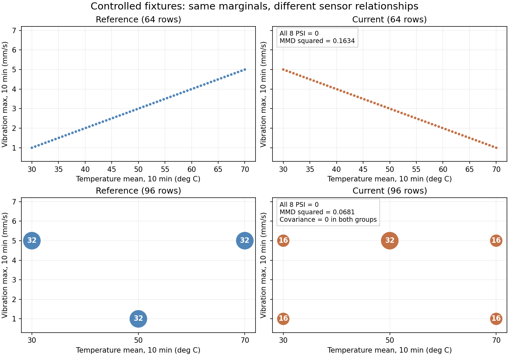

# MMD for joint sensor-distribution changes

Marginal histograms can remain unchanged while relationships between sensors change. This offline diagnostic uses Maximum Mean Discrepancy with a fixed kernel and permutation policy to compare joint input distributions.

Controlled checks cover identical/reordered inputs, known joint shifts and cases where per-feature PSI is zero, including a covariance-zero construction. The recorded package contains 19 tests and six CLI scenarios. Parameters are fixed before reading the comparison outcomes.

MMD is a diagnostic, not a classifier-quality metric. The later native 64+64 cohort check has its own lineage and independent numeric oracles. It does not automatically call the drift API, retrain or promote a model. The learner confirmed MMD had not been covered in class.

## Commands and recorded examples

Run commands from the repository root unless the example explicitly changes the working directory. Use a fresh output/run name and check the linked runbook before starting platform services. Examples belong to the recorded workload on this page.

```bash
python -m pytest tests/test_joint_drift.py -q --cov=ml.joint_drift --cov-branch
python scripts/audit-joint-drift.py --reference docs/evidence/joint-drift/association/reference.json --window docs/evidence/joint-drift/association/window.json --output outputs/joint-association-new.json
python scripts/verify-joint-drift.py --evidence docs/evidence/joint-drift --output outputs/joint-independent-new.json
```

## Implementation and evidence

- [Source: ml/joint_drift.py](../ml/joint_drift.py)
- [www.jmlr.org / gretton12a.pdf](https://www.jmlr.org/papers/volume13/gretton12a/gretton12a.pdf)
- [Source: ml/protocols/joint-drift-v1.json](../ml/protocols/joint-drift-v1.json)
- [Recorded artifact: joint-drift/verification.json](evidence/joint-drift/verification.json)
- [Recorded artifact: joint-drift/manifest.json](evidence/joint-drift/manifest.json)
- [Recorded artifact: joint-drift/unit-tests.txt](evidence/joint-drift/unit-tests.txt)
- [Recorded artifact: joint-drift/coverage.json](evidence/joint-drift/coverage.json)
- [Source: scripts/verify-joint-drift.py](../scripts/verify-joint-drift.py)
- [Recorded artifact: joint-drift/independent-oracle.json](evidence/joint-drift/independent-oracle.json)
- [Recorded artifact: joint-drift/maximum-profile.json](evidence/joint-drift/maximum-profile.json)

## Recorded interface views

These are original captures from the runs described above. Their timestamps, model identities and visible states belong to those runs.




## Related documentation

[Current architecture](architecture.md) · [Demo and recovery](demo-walkthrough.md) · [Rubric index](rubric-tracker.md)

[Original run notes](https://github.com/anle0429/iot-maintenance-platform/blob/f4da7bd21667a8bfca5715a7456bc2bcc813b0fc/docs/joint-drift.md) retain the full historical narrative. Raw evidence files have not been translated or rewritten.
