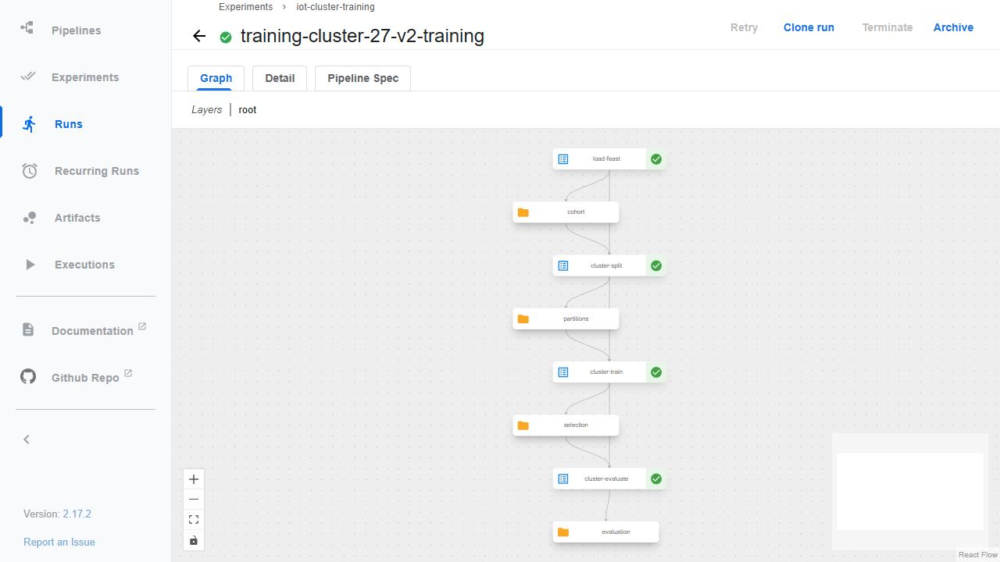
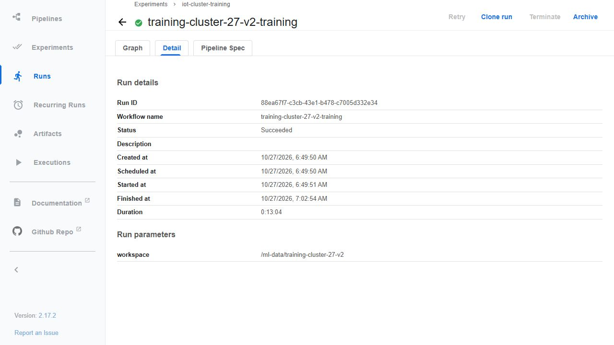
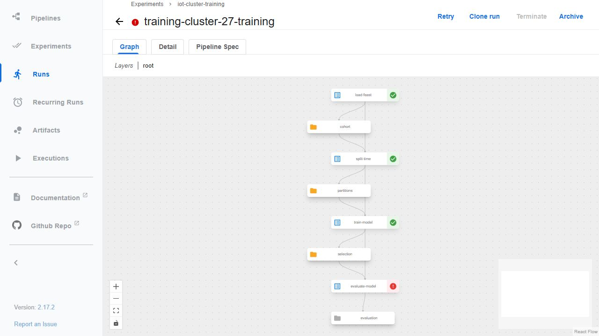

# Kubeflow Pipelines trên VM

Cập nhật: [pipeline tương ứng notebook đã train qua hai executor thật](distributed-training.md), với5taskSUCCEEDED. Bốn task bên dưới là bằng chứng lịch sử trước distributedtraining.

Pipeline thực hiện native Feast load → chia theo thời gian → train/chọn ngưỡng bằng validation → đánh giá holdout. Mỗi bước chạy trong pod riêng và truyền artifact có kiểu. [Code cluster](../ml/kfp_cluster.py) dùng nguyên [kernel ML](../ml/training_job.py) và [protocol đã khóa](ml-evaluation-protocol.md).

## Kết quả đã kiểm chứng

KFP backend**2.17.2**, SDK/kfp-kubernetes**2.17.3**, K3s**v1.35.9+k3s1**, cùng VM8CPU/64GiB. [Backend](evidence/kfp-cluster/backend/verification.json) có14deployments Ready, services ClusterIP và hai PVC local trên SSD. Credentials mặc định của bản development được thay bằng giá trị sinh riêng trước khi apply; không lưu Secret/kubeconfig trong bằng chứng.

[Controller verification](evidence/kfp-cluster/controller/verification.json) **PASS12:03:04UTC27/10**: oracle hai bước rồi pipeline bốn bước. Tổng853,795s gồm oracle và submission; riêng training UI ghi13phút04giây. Run training`88ea67f7-c3cb-43e1-b478-c7005d332e34`, workflow`iot-failure-training-cluster-v1-xj6pp`.





Native Feast đã lấy mới **3.132.184 dòng**, không tái dùng part từ lượt trước. Train2.195.668, validation468.132, test468.384; split/purge và tám feature giữ nguyên. [Evaluation](evidence/kfp-cluster/capture/task-artifacts/evaluation.json):ngưỡng0,7 chọn trên validation, testPR-AUC0,615148/F10,550958; portable/Spark trên toàn468.384hàng lệch tối đa4,44e-16. Đây là tái lập protocol cũ, không điều chỉnh theo holdout. Các giới hạn dữ liệu mô phỏng, cùng máy qua thời gian, cửa sổ liên quan và điểm chưa hiệu chuẩn vẫn áp dụng.

[Artifact verification](evidence/kfp-cluster/capture/artifact-verification.json) xác nhận bốn output thật từ object store và **mọi file dataset/model được tham chiếu còn nguyên byte** trên volume dùng chung. S3 credentials chỉ đọc trong bộ nhớ của tiến trình trên VM, không đưa vào capsule.70file nhỏ được gắn [manifest](evidence/kfp-cluster/capture/manifest.json)/[mapping](evidence/kfp-cluster/capture/evidence-map.json), archiveSHA`53c7cb8ea2e129ce9ae11bf15ace30066130cb0ca2d4799717b6e9f9deabe31b`.

## Lỗi đường dẫn artifact và cách sửa

Lượt đầu`c49e6012-d174-427e-a705-08e4442bf73b` đã load/split/train, nhưng evaluate thất bại trước khi mở holdout: descriptor selection tham chiếu đường dẫn `/minio/.../partitions` chỉ tồn tại trong pod train. [Log gốc](evidence/kfp-cluster/initial/diagnosis/evaluation-main.txt) và [workflow lỗi](evidence/kfp-cluster/initial/diagnosis/workflow.json) giữ nguyên.



[Adapter nhỏ](../ml/cluster_training_job.py) sao chép **đúng byte** input descriptor vào workspace bền trước khi gọi kernel gốc. Nhờ vậy bước sau kiểm hash được split/selection sau khi pod trước kết thúc. [Hai known-answer tests](../tests/test_cluster_artifacts.py) xóa file download tạm rồi kiểm bản bền vẫn đúng, đồng thời chặn ghi đè và descriptor sai stage. Lượt sửa dùng workspace mới; không sửa artifact lỗi hay ngưỡng để biến lượt cũ thành thành công. [Snapshot code trước sửa](evidence/kfp-cluster/initial/diagnosis/source-before-repair/kfp_cluster.py.txt) và [preparation đã kiểm](evidence/kfp-cluster/preparation/verification.json) chứng minh kernel train/evaluate không đổi.

## Version mô hình

[MLflow registration](evidence/kfp-cluster/registry/registration.json) đã tạo **version2**, run`09d24913b9de4595a62d215d8d220f5e`, codecommit`71ea3976cbe21b408aacd98a55ce2424af7eaf30`. Model và ba split Parquet đã upload rồi đọc lại kiểm hash;200prediction từ model tải lại khớp Spark, maxdelta2,22e-16. Candidate/latest hiện trỏ version2, `production=false`. [Giới hạn thực](evidence/kfp-cluster/registry/verification.json):tool1CPU/4GiB,22,006s.

PortableSHA của run cluster là`5d6281fc7f1eeea8d2e0f00eb4b930ddee7b7d75a0c54553de44ae556c174ed6`; dataVersion`2740c5872ece4ef96080473da555a1971f78b6ebd6e9091217c4218c8c656566`. KServe/[feature API](feature-api.md) vẫn phục vụ **version1** đã kiểm chứng, không đổi theo candidate alias. Không gán lineage version2 cho prediction của version1.

Uploader hiện lưu đầy đủ ba split mỗi run. Đây là **baseline full-copy**, chưa đáp ứng incremental data versioning F27 của [rubric final](final-rubric-tracker.md).

## Chạy và giải thích

Trên VM đã có backend/PVC/images và dữ liệu riêng, kiểm node, pods, volume rồi dùng tên run/workspace mới. Kubeconfig nằm trên VM; truy cập UI bằng SSH/IAP tới service`ml-pipeline-ui`, không mở cổng ra Internet. [Kubernetes SDK chính thức](https://kfp-kubernetes.readthedocs.io/en/kfp-kubernetes-2.17/source/kubernetes.html) mô tả mount PVC, image policy và security context; [backend installation](https://www.kubeflow.org/docs/components/pipelines/operator-guides/installation/) là nguồn release.

```bash
sudo k3s kubectl get pods,pvc -n kubeflow
python -m ml.kfp_cluster --output /tmp/training-pipeline.yaml
python -m unittest tests.test_cluster_artifacts -v
python scripts/run-kfp-cluster.py --run training-reproduction-new --prepared outputs/kfp-training-prepare-27-v2 --deadline-utc YOUR_ACTUAL_VM_STOP_UTC
```

Lệnh cuối cần môi trường SDK đã khóa và preparation/source hashes khớp. Output/preparation/dataset/registry không tự xuất hiện khi clone Git. Không chạy lại trong phiên còn ít hơn40phút; không dùng lại thư mục hoàn tất. PVC/hostPath trong [volume config](../infra/kfp/training-volumes.yaml) chỉ dành cho VM một node; capacity khai báo không phải quota filesystem hoặc thiết kế multi-tenant. Workspace ở HDD, scratch/containerd/backend state ở SSD.

**Chưa distributed training:** ba Spark task vẫn dùng`local[2]`; maincontainer mỗi task giới hạn2CPU/10GiB, Argo sidecar có limit mặc định1CPU/2GiB từ namespace policy. Bốn pod nối tiếp là orchestration, không phải các worker cùng train một model. F24/F25 vẫn còn phần distributed và notebook; chưa ML trên100GB. README/ảnh/bằng chứng phải giữ phân biệt này.
