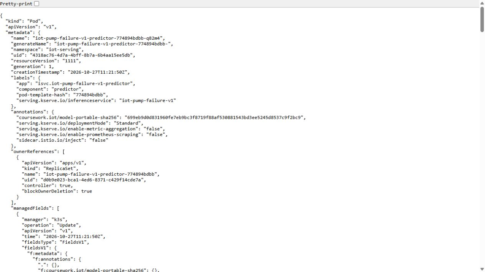
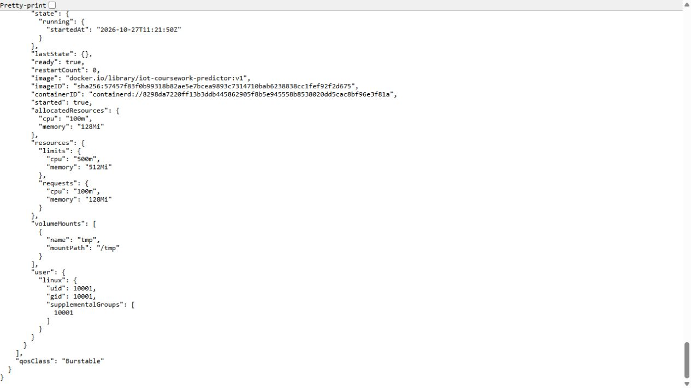
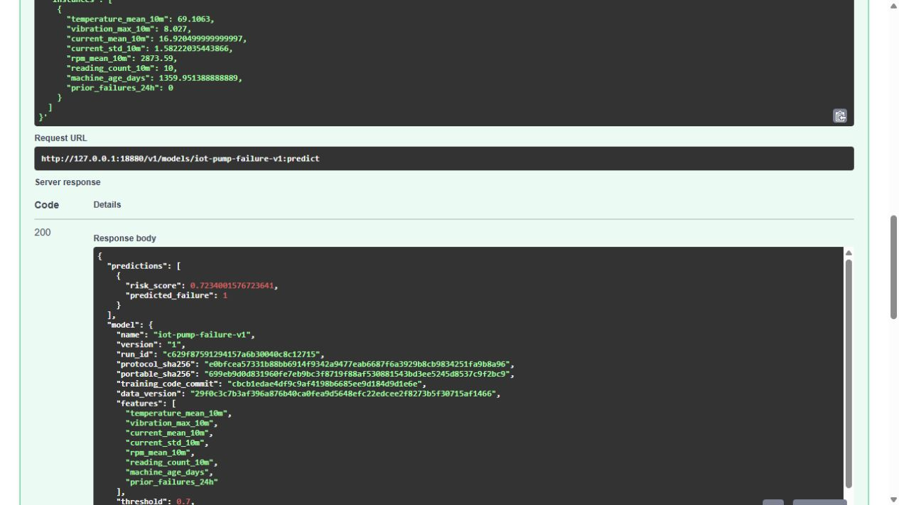

# KServe deployment and native inference checks

The initial KServe milestone deployed the portable predictor on the Kubernetes cluster, read actual Pod/service state and issued real inference requests. Source, model artifact and response arithmetic were checked rather than inferred from YAML.

That original milestone used an earlier model pin. Current serving CI selects model 6, while the original model 1 evidence remains historical. Do not mix its response identities or workload timings with a later release.

The native checks establish that the tested image ran on KServe and respected its schema/lineage contract. Scaling, rolling updates, A/B deployment, observability and later load tests are separate recorded workloads.

## Commands and recorded examples

Run commands from the repository root unless the example explicitly changes the working directory. Use a fresh output/run name and check the linked runbook before starting platform services. Examples belong to the recorded workload on this page.

```bash
ansible-playbook -i localhost, infra/ansible/kubernetes.yml --extra-vars=@/path/to/private-target-vars.json
sudo k3s kubectl get nodes
sudo k3s kubectl get inferenceservice,pods,svc -n iot-serving
```

```bash
docker save -o /srv/iot-fast/predictor-import.tar iot-coursework-predictor:v1
sudo k3s ctr images import /srv/iot-fast/predictor-import.tar
sudo k3s kubectl apply -f infra/kserve/pump-failure.yaml
sudo k3s kubectl wait --for=condition=Ready inferenceservice/iot-pump-failure-v1 -n iot-serving --timeout=360s
sudo k3s kubectl port-forward -n iot-serving svc/iot-pump-failure-v1-predictor --address=127.0.0.1 18080:80
```

## Implementation and evidence

- [Recorded artifact: kserve/cluster/verification.json](evidence/kserve/cluster/verification.json)
- [Source: infra/ansible/kubernetes.yml](../infra/ansible/kubernetes.yml)
- [Recorded artifact: kserve/controller/verification.json](evidence/kserve/controller/verification.json)
- [Source: infra/kserve/values.yaml](../infra/kserve/values.yaml)
- [kserve.github.io / configurations](https://kserve.github.io/website/docs/admin-guide/configurations)
- [github.com / v0.20.0](https://github.com/kserve/kserve/releases/tag/v0.20.0)
- [Recorded artifact: kserve/capture/predictor-deployments.json](evidence/kserve/capture/predictor-deployments.json)
- [Recorded artifact: kserve/capture/predictor-replicasets.json](evidence/kserve/capture/predictor-replicasets.json)
- [Recorded artifact: kserve/controller/oci-manifest.json](evidence/kserve/controller/oci-manifest.json)
- [Recorded artifact: kserve/capture/manifest.json](evidence/kserve/capture/manifest.json)
- [Recorded artifact: kserve/capture/evidence-map.json](evidence/kserve/capture/evidence-map.json)
- [Recorded artifact: kserve/screenshots/capture.json](evidence/kserve/screenshots/capture.json)
- [Source: infra/ansible/roles/kubernetes/tasks/main.yml](../infra/ansible/roles/kubernetes/tasks/main.yml)
- [Recorded artifact: kserve/assets/helm/verification.json](evidence/kserve/assets/helm/verification.json)
- [Source: tests/fixtures/predictor-native-spark.json](../tests/fixtures/predictor-native-spark.json)
- [Recorded artifact: kserve/capture/proxy-boundaries.json](evidence/kserve/capture/proxy-boundaries.json)

## Recorded interface views

These are original captures from the runs described above. Their timestamps, model identities and visible states belong to those runs.








## Related documentation

[Current architecture](architecture.md) · [Demo and recovery](operations.md) · [Rubric index](rubric-tracker.md)

[Original run notes](https://github.com/anle0429/iot-maintenance-platform/blob/a395c4ea47b8f8e235556ab93de3d699ed9df18b/docs/kubernetes-serving.md) retain the full historical narrative. Raw evidence files have not been translated or rewritten.
