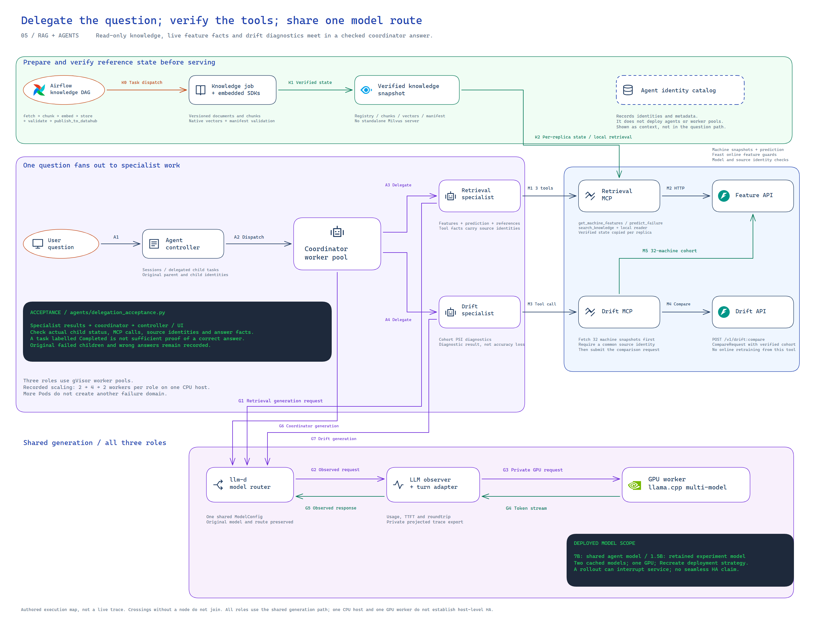

# LLM and agent workstream

**Status: GPU routing, complete specialist/coordinator answers, RAG governance, private MCP, direct MCP isolation and automatic worker scaling verified; the full workstream remains incomplete.** The [GPU checkpoint](gpu-agent-routing.md), [network controls](agent-network-isolation.md) and [scaling experiment with original UI](agent-scaling.md) have separate acceptance records. [MCP mutation checks](mcp-quality.md) and the [strict adapter audit](gpu-agent-routing.md) exceed their gates. The [executed notebook](agent-notebook.md) now has native Feast/RAG/drift evidence. The [matched startup report](agent-warmup.md) preserves mixed results. [RAG delivery](ci-rag.md) and [three MCP/agent pipelines](ci-agents.md) now have native CI proof. [Authenticated gateway access and scoped Vault consumers](agent-gateway.md) now have native controls and original UI captures. Full telemetry and A/B still require their own evidence. Start with the [learning guide](llm-learning-guide.md) to follow the information flow.

[Editable SVG](images/platform-llm-plan.svg) · [Source](diagrams/platform.py) · [LLM rubric](final-llm-rubric-tracker.md)

## Intended IoT interaction

A user asks about a machine's recent condition, risk or a relevant technical document. A coordinator delegates structured feature/RAG retrieval and drift analysis to two specialists. Authenticated MCP tools read the existing machine APIs and a separate versioned knowledge store. Responses identify source records and retrieved chunks. The design has no physical actuator tool.

## Required components

| Area | Required work | Existing baseline |
|---|---|---|
| Inference | llm-d platform, custom server, global model configuration, measured optimization | Router/custom backend and CPU-thread comparison verified; shared agent model config applied |
| Knowledge | Authored corpus, Airflow text/chunk/embedding pipeline, Feast storage, validation and DataHub lineage | [Six-task Airflow/GMS run, ten checks and invalid-input rejection](rag-orchestration.md); [source-cited generation](llm-grounding.md) verified on three questions |
| Tools | Async validated data/chunk and drift MCP services, health checks, Helm rollout/fallback | [Two native MCP releases](mcp-tools.md), each with two replicas and verified rollback |
| Agents | Retrieval and drift specialists, coordinator, registry publication, multi-replica autoscaling and sandbox | [Complete native conversations](gpu-agent-routing.md), [direct MCP isolation](agent-network-isolation.md), [automatic 2 → 4 → 2 scaling and original UI](agent-scaling.md) |
| Startup | Agent Substrate warm-up, worker-pool HA explanation and startup benchmark | [24 fresh actors, matched cold/golden startup, mixed timings and single-host HA explanation](agent-warmup.md) |
| Delivery | RAG and agent/MCP test-build-auto-deploy pipelines, gateway/UI access and secrets | [RAG Jenkins release, six native Airflow tasks and DataHub readback](ci-rag.md) verified; [three accepted MCP/agent pipelines](ci-agents.md) add service/agent delivery; [private gateway/Vault consumers and a complete routed conversation](agent-gateway.md) add native security/interface proof |
| Evaluation | Notebooks, coverage >90%, mutation >80%, boundary/property tests and native load HTML | [79 native MCP tests and load reports](mcp-tools.md); [132 current tests and local mutation gate](mcp-quality.md); [executed agent notebook](agent-notebook.md) verified; fresh 132-case API gates and unchanged-source mutation reuse run in [native CI](ci-agents.md); remaining screenshot and other tracked checks stay open |
| Operations | Token counts, round-trip time, TTFT, safety/PII hits, agent/tool calls/failures and A/B | [Native coordinator cohort](llm-observability.md), [actual monitoring/load](llm-monitoring-demo.md) and [paired model-artifact results](llm-model-ab.md); agent configuration A/B and a fresh policy-frequency window remain open |
| Extensions | Two documented LLM-track ideas with working proof | Selection and acceptance still open |

## Acceptance evidence

Every LLM row remains open until its own implementation and appropriate evidence exist. At minimum, preserve source/model/config identities; actual process/Pod readiness; native inference/tool/chat responses; RAG chunk/embedding/Feast readbacks and DataHub lineage; registry/sandbox/replica/warm-up observations; CI stage results; test/coverage/mutation/load reports; telemetry comparisons; and actual A/B behavior.

An architecture drawing, generated YAML, a mocked test or an unrelated ML dashboard is not native LLM proof. A proposed model is not described as deployed, and new cloud resources are not assumed authorized by this plan.

The [compact response contract](agent-response-contract.md) retains the failed predecessor. Current policy 0.2.2 has [verified GPU conversations and actual child delegation](gpu-agent-routing.md). The later scaling run checks each final parent against both child histories, while retaining the explicit capacity rejections and bounded admission retries.

## Workbook references

The source links point to [llm-d](https://llm-d.ai/docs/getting-started/quickstart), [kagent custom providers](https://kagent.dev/docs/kagent/supported-providers/byo-openai), [agent registry](https://aregistry.ai/), [sandbox agents](https://kagent.dev/docs/kagent/examples/agent-sandbox), [Agent Substrate](https://kagent.dev/docs/kagent/concepts/agent-substrate), [KEDA](https://keda.sh/) and [Feast RAG](https://docs.feast.dev/tutorials/rag-with-docling). These are requirement references retained from the supplied workbook; no installation or compatibility is claimed from merely listing them.
