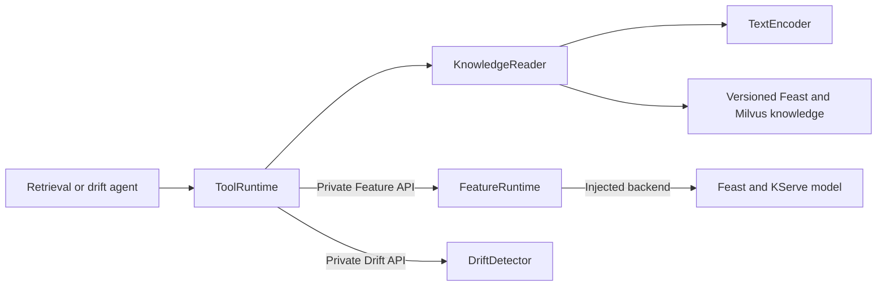

# Five classes behind the assistant's data and answers

The assistant obtains structured machine data and source-bound reference passages through a small set of implemented classes. These responsibilities connect the LLM to the existing ML platform: retrieve the right document, preserve data identity, enforce prediction eligibility and describe drift without inventing a diagnosis.

## Class responsibilities

| Class and source | Main methods | Responsibility | Important boundary |
|---|---|---|---|
| [`TextEncoder`](../rag/embeddings.py) | `__init__(config)`, `encode(texts)` | Encode document chunks and queries with the same pinned model revision; return normalized 384-dimensional vectors. | Empty, oversized or over-token-limit text is rejected. Each vector must be finite and have the configured dimension and unit length. |
| [`KnowledgeReader`](../services/mcp_tools/runtime.py) | `__init__(state, source_root)`, `search(request)` | Load a replica's source-bound knowledge snapshot, retrieve ranked IDs and resolve their exact passages and provenance. | Duplicate chunk IDs, a different catalog hash or a mismatched returned passage prevent a successful result. A lock protects its synchronous SDK/encoder work. |
| [`ToolRuntime`](../services/mcp_tools/runtime.py) | `start()`, `close()`, `features(request)`, `predict(request)`, `search(request)`, `drift(request)` | Own asynchronous clients and the fixed private backend routes used by the retrieval and drift MCP services. | Validate machine/model/reference identities and preserve meaningful upstream failures. Knowledge work runs outside the event loop under a bounded concurrency limit. |
| [`FeatureRuntime`](../services/feature_api/runtime.py) | `features(machine)`, `predict(machine)` | Check both the simulation clock and real snapshot lease, read eligible features and call the deployed ML model through its backend adapter. | Unknown, expired, future, inconsistent or stopped machine states cannot produce an ordinary successful prediction. A returned score must match its model pin and decision threshold. |
| [`DriftDetector`](../services/drift_api/detector.py) | `__init__(bundle)`, `compare(window)` | Validate the trusted reference, freeze bins and compare the eight numeric features using the declared PSI policy. | Input drift does not prove degraded predictive accuracy or an imminent pump failure. Reference identity and the policy are part of the result. |

`TextEncoder` uses the [pinned CPU embedding model](../infra/rag/embedding.lock.json), with two Torch threads. The chat model is served separately on the GPU. These are different workloads; moving every validation or retrieval step onto the GPU is not required for a working assistant.

## How they collaborate



The two API arrows cross process boundaries. `ToolRuntime` calls their fixed endpoints; it does not construct `FeatureRuntime` or `DriftDetector` inside the MCP process. Prediction uses the existing trained pump model. The LLM composes an answer from returned tool data and references.

For a risk-and-reference question, follow this sequence:

1. `ToolRuntime.features()` obtains the machine snapshot from the Feature API. `FeatureRuntime` validates time, schema and operating context.
2. `ToolRuntime.predict()` follows the same eligibility checks before the backend calls KServe. Returned model identity and numeric decision are checked.
3. `ToolRuntime.search()` dispatches bounded synchronous work to `KnowledgeReader`. Its query passes through `TextEncoder`, ranked IDs are retrieved, and returned text is checked against the retained source records.
4. The retrieval agent cites those actual tool results. The coordinator can separately delegate a drift question to the drift specialist, whose tool reaches `DriftDetector`.

The [native agent comparison](agent-configuration-ab.md) checks six risk/reference answers against 18 actual tool events and independent model arithmetic. The [MCP quality report](mcp-quality.md) records API behavior, malformed backend responses, boundary/property tests and strict mutation evidence. The [measured coordinator trace](llm-observability.md#trace-an-actual-coordinator-request) records cross-process execution. These provide different kinds of evidence; a class diagram alone does not establish runtime correctness.

## Keep the original rubric wording

Source cell C60 asks for five key classes representing the main focus and offers these illustrative training interfaces:

```python
class TrainingDataService:
    def read_training_table(self) -> DataFrame: ...
    def validate_schema(self, df: DataFrame) -> None: ...
    def dedup_by_created_ts(self, df: DataFrame) -> DataFrame: ...

class SplitService:
    def get_split_boundaries(self, df: DataFrame) -> dict: ...
    def split_by_time(self, df: DataFrame) -> tuple[DataFrame, DataFrame, DataFrame]: ...
```

The [original cell snapshot](evidence/rubric-llm/source.json) preserves that wording and the D60 deliverable, “Document 5 key classes.” The table above documents five actual classes used by the assistant and its ML backends. The separate [ML lifecycle design](ml-class-design.md) covers dataset versioning, registry publication and portable inference. The example interface names do not imply that additional classes with those names have been implemented.

For a presentation, explain one responsibility per class, then trace one answer across them. Be ready to show where data validation ends and answer composition begins.
