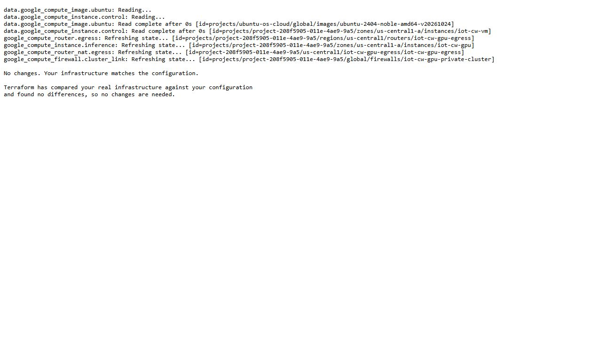
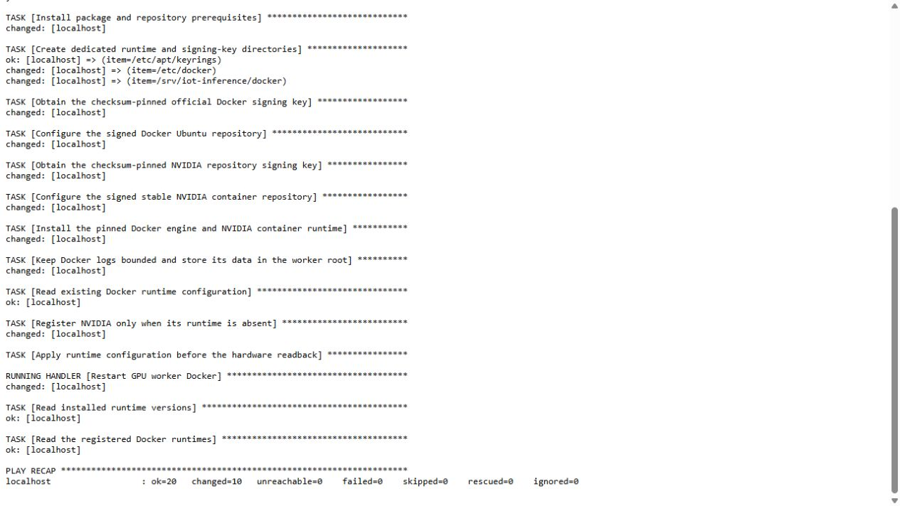
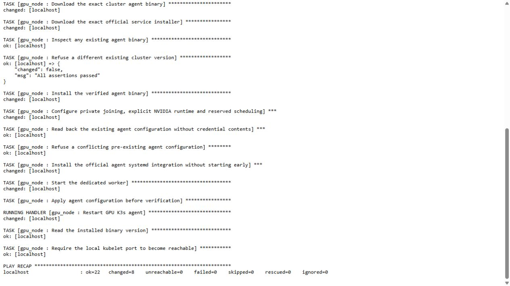

# Infrastructure behind the agent platform

Terraform provisions the private GPU worker and its cloud networking. Ansible configures the container runtime and joins that worker to the retained cluster. Helm then deploys the model gateway, MCP services and agents. These are separate layers, with separate execution receipts.

The captures below display the **original retained run logs**, unchanged, in a local browser text view. They were added after the runs; no new resource was provisioned and no configuration job was repeated for an image.

## Terraform: the retained private worker

The [inference module](../infra/gcp/inference/main.tf) uses the existing lab project/network and a dedicated worker directory. Its retained readback identifies `iot-cw-gpu`, instance ID `11538226507322059`, one V100, no external IP and an eight-hour maximum session with STOP. The later plan confirms that the allocated resources match this module.



A no-op plan is a drift check, not an apply receipt. Actual allocation, disk/firewall identities and failed capacity requests are retained in the [GPU infrastructure report](gpu-inference.md). Earlier CPU provisioning has its own [Terraform apply and Ansible evidence](gcp-vm.md). This lab uses Compute Engine and K3s; it does not claim GKE deployment.

## Ansible: runtime and cluster role

The [runtime playbook](../infra/ansible/gpu-runtime.yml) checks the actual project, instance and NVIDIA driver before installing the pinned Docker/NVIDIA runtime. Its recap records 20 successful tasks, ten changes and no unreachable host or failed task.



The [GPU node playbook](../infra/ansible/gpu-node.yml) uses the [gpu_node role](../infra/ansible/roles/gpu_node/tasks/main.yml) and its [handler](../infra/ansible/roles/gpu_node/handlers/main.yml). It requires the root-only join credential, installs the verified K3s agent, configures private joining/NVIDIA scheduling and checks the kubelet. Its recap records 22 successful tasks, eight changes and no failures.



Those recaps establish configuration execution. Separate server-side readbacks record the Ready worker and one allocatable GPU; [model routing and actual agent conversations](gpu-agent-routing.md) establish application execution. A completed Ansible play alone would not prove an answer reached the GPU.

## Inspect the evidence

```powershell
python -B -S scripts/verify-llm-iac-ui.py
```

The checker binds three unedited JPEGs and complete accessibility text to the original log hashes. It also checks the existing source-bound infrastructure/runtime capsules, module equality, actual VM scheduling/private networking, role sources and historical worker readiness. It starts no cloud resource.

Use the reviewed commands in [GPU inference](gpu-inference.md#run-on-an-authorized-worker) when reproducing provisioning. Keep Terraform state, generated plans, inventory credentials, join tokens and model weights outside Git. A fresh clone supplies the maintained modules and evidence, not the private retained runtime.

[Capture inventory](evidence/llm-iac-ui/manifest.json) · [Source/log identities](evidence/llm-iac-ui/index.json) · [Agent delivery](ci-agents.md) · [LLM rubric](final-llm-rubric-tracker.md)
