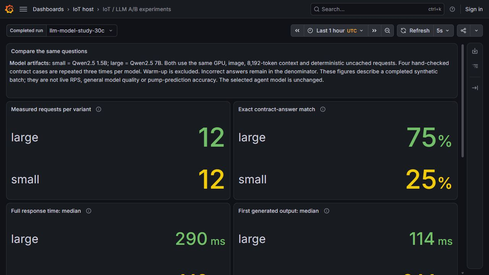
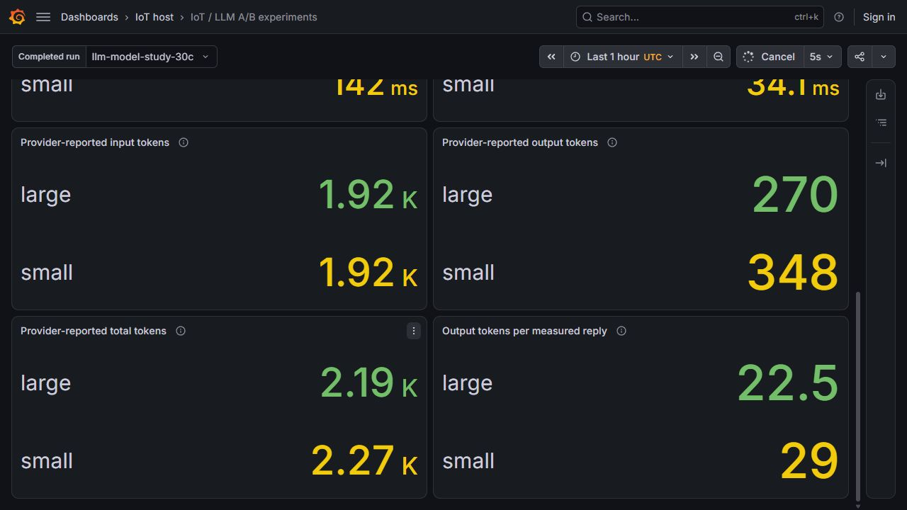

# Comparing two model artifacts

The same V100 served Qwen2.5 1.5B and 7B for a small, paired reasoning experiment. The smaller model answered faster; the larger model matched more of the four expected answers. Both mishandled the inclusive one-hour boundary. The selected agent model remains 7B.

This addresses the model-version experiment in L57. Agent configuration A/B in L56 is a separate experiment and remains open.

## What was held constant

Both variants used the pinned llama.cpp CUDA image, build `b11977-7ac5727d6`, on the existing V100-SXM2-16GB worker. Each child server had three threads, one slot and an 8,192-token context. Requests used the same system instruction and case input, temperature 0, seed 7 and a 96-token output limit. Prompt caching was disabled and the original provider usage reported zero cached tokens.

The [1.5B lock](../infra/llm/model.lock.json) and [7B lock](../infra/llm/assistant.lock.json) identify different, checksum-verified Q4_K_M artifacts. The older 1.5B CPU prototype configuration is historical; this comparison uses the common GPU runtime described above. The [Helm chart](../infra/charts/iot-gpu-multimodel/Chart.yaml) supplies explicit local presets. It upgrades the existing one-GPU release and preserves its Service and deployment identity.

The router's `/models/load` operation is asynchronous. The accepted deployment waits until both models report `loaded`, checks model-specific generation and metrics, then verifies an authenticated 7B generation through the existing agent route. Its 120.478-second upgrade-to-warm window is an elapsed readiness window, not an independently sampled outage duration. Recreate can interrupt service.

## Questions and scoring

The four cases exercise the [data contract](data-contract.md):

| Case | Expected label | Reason |
|---|---:|---|
| Operating; failure begins exactly 60 minutes later | 1 | The upper boundary is inclusive |
| Operating; failure begins 61 minutes later | 0 | Outside the one-hour horizon |
| Operating; only 30 future minutes observed | null | Insufficient observation |
| Machine is not operating | null | No operating-machine label applies |

Each model first answered all four cases as warm-up. The measured batch repeated each case three times, alternating A/B and B/A order. There were **32 actual requests: eight warm-ups and 24 measured replies**. The 12 measured replies per model cover four distinct questions; they are not 12 independent test cases.

The [scorer](../llm/ab_experiment.py) checks the complete three-field JSON contract: label, operating state and reason. Incorrect answers stay in the denominator. This is an exact contract-answer score, not pump-prediction accuracy or a general model ranking.

## Recorded results

| Measured quantity | Qwen2.5 1.5B | Qwen2.5 7B |
|---|---:|---:|
| Measured replies | 12 | 12 |
| Exact contract answers | 3/12 | 9/12 |
| Median complete-response time | 142 ms | 290 ms |
| Median first generated output | 34.1 ms | 114 ms |
| Input tokens | 1,920 | 1,920 |
| Output tokens | 348 | 270 |
| Mean output tokens per reply | 29 | 22.5 |

Different reply lengths affect timing. These short, sequential, uncached requests do not establish concurrent capacity or full-agent latency. The earlier [Locust experiment](llm-monitoring-demo.md) measures a different workload.





The accepted run is `llm-model-study-30c`, completed at 00:43:22 UTC on 30 October 2026. The model Pod UID and restart count stayed unchanged throughout the batch. Native generated-token counter differences were 464 for 1.5B and 360 for 7B, including warm-up; both exactly match the corresponding provider-reported completion totals. Eight dashboard vectors match direct Prometheus results.

### What the wrong answers reveal

Both variants returned label 0 for a failure at minute 60, although the supplied rule requires label 1. The 1.5B variant also returned 0 for censored future observation and maintenance. These were semantic errors in valid JSON, not merely formatting penalties. The 7B variant handled those latter two cases correctly.

This is why the application calculates labels and checks tool facts in ordinary code. A larger model can still misread an explicit boundary. The experiment does not automatically promote either model or replace the prediction pipeline with LLM reasoning.

## Verify and demonstrate

From the repository root, no cloud connection is needed:

```powershell
python -B -S scripts/verify-llm-model-ab.py
python -B -m unittest discover -s tests -p test_llm_ab_experiment.py -v
```

The offline verifier authenticates 484 original native payloads, replays all 32 SSE responses against their original chunk-arrival clocks, recomputes scores and tokens, compares dashboard vectors and checks the unedited JPEGs. The [accepted comparison](evidence/llm-model-ab/comparison.json), [deployment receipt](evidence/llm-model-ab/deployment.json) and [dashboard receipt](evidence/llm-model-ab/dashboard.json) are readable summaries; the archive retains their original inputs.

For the recorded live lab, use the existing private metrics viewer described in the [monitoring demo](llm-monitoring-demo.md), then open `/d/iot-llm-ab` and select completed run `llm-model-study-30c`. Explain the score before the speed. The panels describe a completed experiment even when no new requests are running.

To repeat inference on the retained VM, first check its approved session, both loaded models and competing workloads. The accepted source snapshot is under `data/llm-source/model-study-0c8d00c2/tree`; its runner requires that immutable source manifest. Invoke `scripts/run-model-ab.py` from that snapshot with `--runtime-root`, a **new** `--output` under the runtime root's `outputs/`, and `--deployment` pointing to `outputs/llm-ab-models-deploy-30b`. It needs at least 15 minutes left in the recorded session and makes 32 new GPU requests. Never overwrite the accepted batch. After a GPU restart, explicitly load and wait for both preset aliases before repeating: the accepted router deployment disables automatic loading.

## Retained failed predecessors

- Deployment A tested inference while the asynchronous child models were still loading. The original 502 and actual rollback are retained. Deployment B waits for both loaded states.
- Study A stopped before requests because the client counted an old terminal Failed Pod. The corrected selector requires exactly one current Ready model Pod and retains the old failure for diagnosis.
- Study B completed one warm-up but its client mishandled a null SSE role frame. The raw response and clocks are retained. The failure occurred before its request-summary row was written; no replacement row was manufactured.

These predecessors explain the corrections. Their results are not mixed into the accepted C batch.

## Source navigation after repository cleanup

The original model-study inputs, request bodies, evaluation cases and source hashes remain in the unchanged native archive. Two maintained input documents now point their single “Demo and recovery” footer link to `operations.md`. The verifier permits only that exact link substitution in `data-contract.md` and `ml-evaluation-protocol.md`; any contract, horizon, other text or executable-source change still fails. This documentation move is not a new model run.
