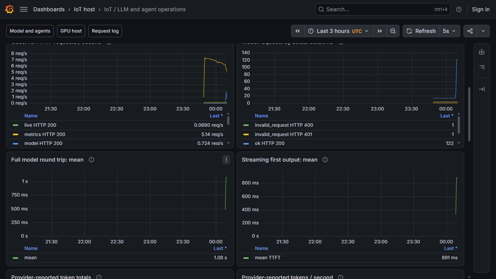
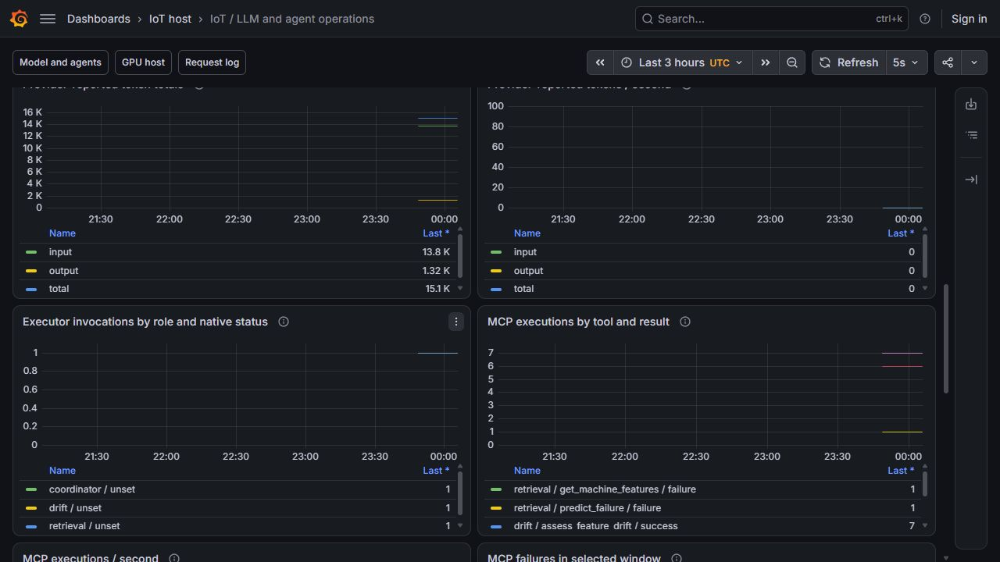
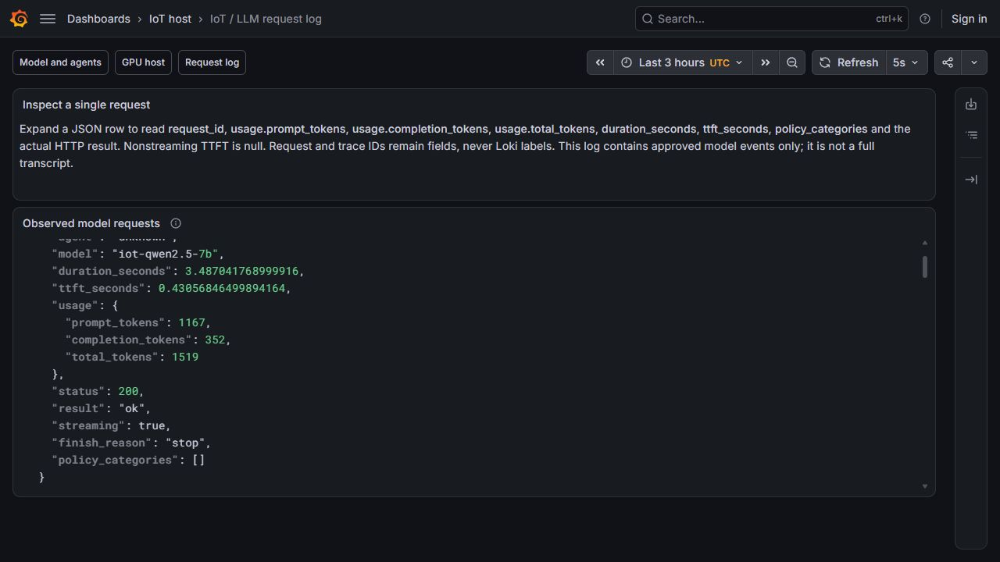
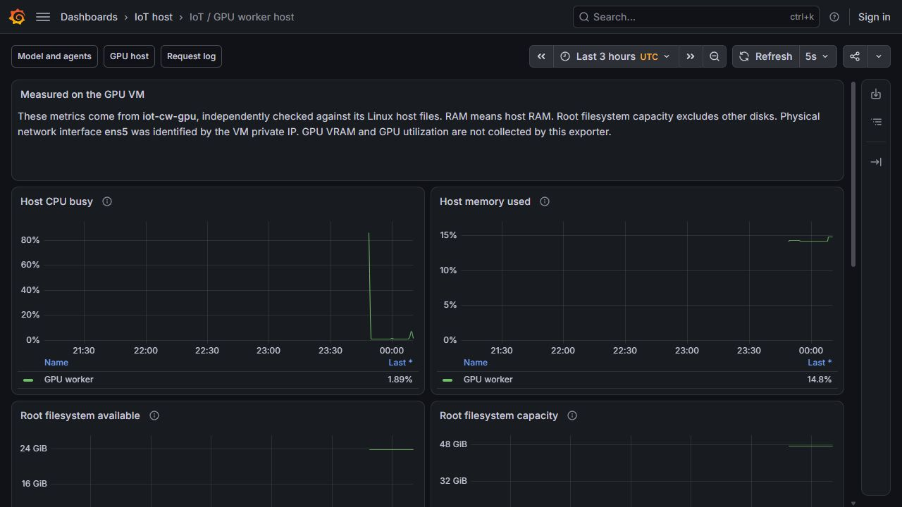
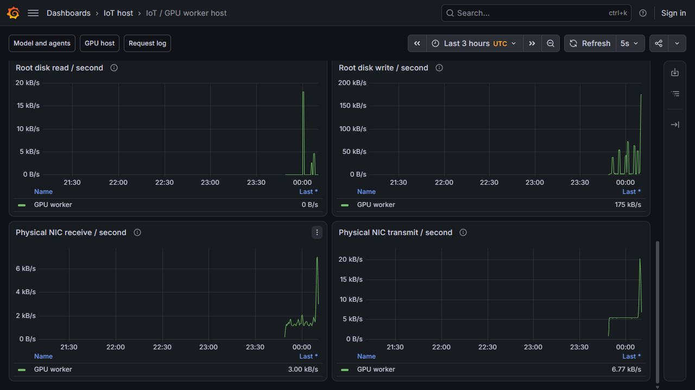
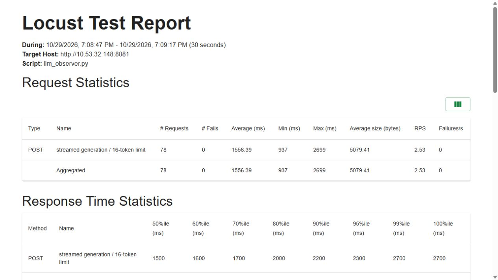
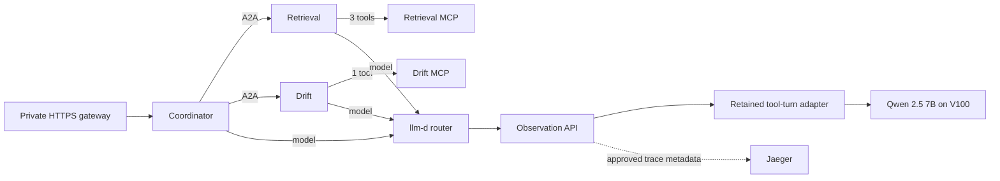

# Measuring model and agent activity

The observation API now sits on the active private model route. Its initial canary produced exactly nine durable facts: three completed generations, four policy rejections and two invalid requests. A later [coordinator cohort](#trace-an-actual-coordinator-request) verifies the active integration against actual specialist histories, per-Pod MCP counters and stored Jaeger traces. The [monitoring checkpoint](#use-the-monitoring-views) adds native dashboards, exact log reconciliation and a bounded GPU load test.

Run `python -B -S scripts/verify-llm-observer.py` to check the [quality report](evidence/llm-observer/quality-verification.json), [ready canary](evidence/llm-observer/canary-verification.json), [request results](evidence/llm-observer/probe-verification.json) and [original native archive](evidence/llm-observer/native-receipts.tar.gz). The checker requires only Python's standard library. It authenticates 894 original payloads, then independently checks mutation exits, reported usage, chunk clocks, request identities and the log/counter readbacks. This is recorded execution evidence, not a claim that a stopped VM is currently serving traffic.

## Use the monitoring views

The later [policy-frequency window](llm-policy-window.md) adds twelve controlled admissions, nine unique pre-inference rejections and separate exact-window versus rolling-minute frequencies. Its original screenshots and eight Grafana/Prometheus target comparisons complete the bounded policy-frequency evidence; the controls remain four explicit text patterns.

The retained Prometheus and Grafana installation now discovers seven individual targets: four MCP Pods, the observation API, the llama.cpp model and the GPU VM host exporter. Existing jobs remain in place, including two unavailable historical ML A/B targets. Discovery has only Pod read/list/watch access in the two application namespaces; actual attempts to list Secrets return 403.



Three English dashboards are maintained as [reviewable JSON assets](../infra/llm-observability/dashboards/runtime.json). Twenty-four numeric panel queries returned exactly the same vectors through Grafana and directly from Prometheus. The final readback contains 128 model-request facts and 20,693 provider-reported tokens: 17,648 input and 3,045 output. These are cumulative facts across the canary, routing checks, one coordinator conversation and the bounded load; they are not the token total of one answer.



The observer's approved JSON events pass from native CRI files through Alloy to Loki. All 128 messages and nanosecond timestamps match the original files exactly. Request and trace IDs remain log fields, not high-cardinality Loki labels. The application schema excludes prompt text, answer text and credentials. Per-request usage, full response time, streaming TTFT and policy categories remain inspectable.



The host exporter runs on the existing GPU worker with read-only host mounts. An independent reading on that VM brackets the exporter response with Linux CPU, memory, disk and network counters. All five collectors agree within the declared sampling tolerances. Its host RAM is 15,705,165,824 bytes; its root filesystem is 50,884,108,288 bytes. The physical NIC is `ens5`, identified from the VM's private address. These measurements do not include GPU utilization or VRAM.





The existing private NGINX routes serve the LLM metrics, log and trace viewers. Native checks require CA/hostname verification: six missing/incorrect-login requests return 401, three authenticated data requests return 200, and all three original UI pages load. The [Jaeger capture](evidence/llm-monitoring/ui/coordinator-trace.jpg) retains its `Incomplete` warning and `missing-service-name` fallback. A visible trace is useful execution evidence, but it is not a claim that every parent/context boundary in the pinned SDK is complete. Jaeger's generated icon for a tool span does not turn A2A delegation into an MCP execution.

### Bounded GPU load

| Clients | Duration per profile | Final requests | Failures | Requests/s | p50 | p95 | p99 |
|---|---|---:|---:|---:|---:|---:|---:|
| 1 | 30 s | 30 | 0 | 0.997 | 720 ms | 970 ms | 1,500 ms |
| 4 | 30 s | 78 | 0 | 2.526 | 1,500 ms | 2,300 ms | 2,700 ms |

Both profiles use a fixed synthetic question, streamed replies, deterministic generation settings and a 16-token output limit. The declared lab gate requires at least 20 requests, zero failures and p95 at most 5 seconds. Every one of the 108 request IDs, usage records and server timings matches the running durable ledger; the observer Pod and restart counts remain unchanged.



The [one-client HTML](evidence/llm-monitoring/load/users-1.html) and [four-client HTML](evidence/llm-monitoring/load/users-4.html) are original Locust outputs. The periodic CSV files stop at 29 and 75 requests; final HTML/summary/event records include the requests completed during graceful shutdown, giving 30 and 78. The offline check preserves that distinction. A first attempt made zero requests because the load user could not traverse the separate discovery identity's private directory. The accepted attempt gives the load client its own temporary 0700/0600 credential path without widening discovery permissions.

These are paced clients on the CPU VM reaching actual GPU inference through the observer. They do not establish maximum capacity, a public-network SLA, whole-agent throughput or the quality of a long answer.

Verify the [original native capsule](evidence/llm-monitoring/native-receipts.tar.gz), [dashboard result](evidence/llm-monitoring/dashboard-verification.json), [host comparison](evidence/llm-monitoring/gpu-host-verification.json), [load result](evidence/llm-monitoring/load-verification.json) and ten [unedited captures](evidence/llm-monitoring/ui/index.json):

```powershell
python -B -S scripts/verify-llm-monitoring.py
```

The checker authenticates 403 original CPU-side payloads and a nested 20-payload GPU archive. Follow the [demo walkthrough](llm-monitoring-demo.md) to inspect the recorded run or open the retained private viewers. The [Alloy process stages](https://grafana.com/docs/alloy/latest/reference/components/loki/loki.process/) and [supported reload mechanism](https://grafana.com/docs/alloy/latest/reference/cli/run/) describe the configuration model used here.

## Source-tested canary

| Check | Recorded result |
|---|---|
| Native API tests | 93 cases and 305 subtests; no failures, errors or skips |
| Statement coverage | 492/492, or 100% |
| Branch coverage | 253/256, or 98.83% |
| Fresh mutation gate | 2,348 killed / 2,932 total, or 80.08%; 584 survivors retained |
| Mutation completion | Every mutant exited normally; no timeout, omission or engine-error kill |
| Running image | All six packaged runtime files match the tested source; authenticated OCI digest |
| Actual model requests | Three generations, four policy rejections and two invalid requests |
| Recorded usage | 125 input + 120 output = 245 total tokens across three generations |

The mutation inventory includes the actual request admission, streaming, finalization, trace receiver and middleware methods. An earlier factory-only inventory could not demonstrate that these handlers were tested. The strict gate accepts only normal failing-test exits as kills; an internal test-engine error cannot increase the score.

Two streamed canary replies had client TTFTs of 0.05090 s and 0.03485 s, with full times of 0.43238 s and 0.39729 s. The third reply arrived as one JSON document in 0.26934 s, so its TTFT is absent. These are functional canary measurements on different questions, not a performance comparison. The [per-request measurements](evidence/llm-observer/generations.json) preserve the exact values.

The original failed attempts are retained. The first quality build found incompatible dependency pins; completed mutation runs B, D and E stayed below the threshold, and C was deliberately interrupted to address uncovered handlers. The accepted F run starts with fresh scratch and keeps all survivors. Canary A stopped when the native image store lacked a digest reference. B stopped before workload creation because Helm had no explicit Kubernetes connection. C authenticated the immutable image reference, retained B's unchanged Secret and unused ledger, and completed installation with an explicit kubeconfig. These repairs did not alter the accepted API image or the existing agent/model specifications.

The canary's prompt checks cover four explicit patterns: email addresses, labeled telephone numbers, credential assignments and direct hardware-control commands. They do not establish universal PII detection or model safety. Logs retain approved identifiers, timings, statuses and counts; the observation ledger has no prompt, answer or credential fields. The fixed canary questions and original responses are retained separately as controlled test evidence.

## Trace an actual coordinator request

The accepted rollout adds one exact private OTLP route to the existing Envoy listener and selects the observation Pod for model requests. The deployed Envoy 1.33.2 binary validates the new configuration before cutover. The old adapter deployment remains available, and the original GPU, shared model and agent business specifications remain unchanged. Tracing settings create three new Ready actor templates with message capture disabled.



This is the recorded application flow, not a runtime screenshot. Agents also export OTLP through the router's exact private trace path to the observer. Only that trace route bypasses model selection; the original model route still uses the endpoint picker.

One new HTTPS coordinator conversation completes with two independently checked child histories. A genuine Feast materialization supplies 200 machines after the previous cache naturally expires; the conversation finishes inside the new one-hour lease. The result identifies the machine/model/features and matches its actual paired tool outputs.

| Native observation | Cohort result |
|---|---:|
| Coordinator / retrieval / drift executor roots | 1 / 1 / 1 |
| Retrieval MCP calls | 3 |
| Drift MCP calls | 1 |
| MCP failures added during the cohort | 0 |
| Model generations | 9 |
| Provider-reported input / output tokens | 13,549 / 1,139 |
| Provider-reported total tokens | 14,688 |
| Native spans added | 771 |

The 771 spans include transport and nested SDK activities. They represent three agent executions, not 771 agent calls. Six traced tool operations comprise four MCP tools and two specialist delegations. Per-Pod MCP counter differences independently confirm the four server executions. Existing failure counters remain visible; zero new failures is only a statement about this cohort.

The agent graph preserves its actual shared trace ID, parent IDs and nanosecond times in Jaeger. The nine native model spans and nine proxy request facts have matching reported usage. The proxy labels these requests `unknown` for agent identity because the runtime tool declarations do not match its narrow role classifier. No per-request identity link to the separate proxy SDK spans is invented. Agent call counts come from the native executor roots.

The pinned Go SDK leaves these span statuses **unset**. Answer/tool acceptance establishes that the conversation worked; an unset span is not rewritten as a success status. Unapproved attributes, events, links and trace state are removed before native agent traces reach storage. Unsupported service names are omitted, so some projected transport spans appear under Jaeger's `missing-service-name` fallback.

Verify the original [rollout](evidence/llm-agent-telemetry/rollout-verification.json), [conversation](evidence/llm-agent-telemetry/conversation-verification.json), [feature lease](evidence/llm-agent-telemetry/feature-lease.json) and [native archive](evidence/llm-agent-telemetry/native-receipts.tar.gz):

```powershell
python -B -S scripts/verify-llm-agent-telemetry.py
```

The checker authenticates 2,104 original payloads and rechecks the complete parent/child answer contract, source identities, native routing transitions, per-Pod counter differences, reported usage and exact stored graph identities. An initial promotion attempt returned to the original route after its probe incorrectly expected an empty OTLP batch to succeed. The corrected run retains the expected HTTP 400 rejection and its original bytes before enabling controller tracing. Both attempts and their original journals remain in the archive; the retained launcher filename issue is explicitly documented in its capture notes.

The later [monitoring checkpoint](#use-the-monitoring-views) verifies Prometheus/Loki export, host resources, bounded native load and original viewer captures. Its cumulative counters and load cohort are separate from the nine-generation conversation above.

## Earlier router pilot

The first measurement checkpoint records three real streaming requests through the private model router. Their token counts come from the provider's `usage` response. Their timings come from the client reading the stream. The [original measurements](evidence/llm-observation/measurements.json), [native execution report](evidence/llm-observation/pilot-verification.json) and [unaltered native archive](evidence/llm-observation/native-receipts.tar.gz) are retained together.

The established [GPU route](gpu-agent-routing.md) sends model-control requests to the V100 service. This pilot does not measure GPU utilization or compare inference engines. It checks that the stream can be observed correctly before adding monitoring to agent traffic.

## Read the measurements

| Request | Input tokens | Output tokens | Total tokens | Time to first output | Full response time |
|---|---:|---:|---:|---:|---:|
| Duplicate sensor events | 46 | 31 | 77 | 18.679 s | 18.935 s |
| Interpreting high vibration | 45 | 29 | 74 | 0.032 s | 0.260 s |
| Model and feature timestamps | 46 | 56 | 102 | 0.028 s | 0.473 s |

The slow first request is part of the result. These are different questions with different cache histories, so the table is not a controlled latency comparison. The pilot does not establish why the first request waited longer.

**Time to first output (TTFT)** starts when the client begins its request and ends when it receives actual generated text or a tool name/argument. An HTTP header, heartbeat, role announcement or empty tool fragment does not count. The full response timer continues until the stream ends. A response returned as one JSON document has no observable first-token timing and must report that value as absent.

The archive preserves the original clock measurements, requests and response bytes. Offline checks can independently recompute the reported token counts from those bytes. They cannot recreate elapsed wall time from an SSE transcript alone.

## Keep counts correct across replay

Each observed request has an identity. The ledger accepts its fact once, ignores an identical replay and refuses a conflicting replay. The native pilot saved three rows, replayed them, closed the database and reopened it. The count remained three. The offline verifier repeats that check against a copy of the original SQLite database.

Telemetry facts contain approved counts, timings and identifiers. They exclude prompts, answers and credentials. The pilot's three fixed demonstration prompts and raw responses are retained separately as explicit test evidence; production request content is not a ledger field.

## Verify this checkpoint yourself

From the repository root, run:

```powershell
python -B -S scripts/verify-llm-observation.py
```

This requires only Python's standard library and starts no cloud service. `passed: true` means the recorded archive, original source, reported usage, request identities and replay results agree. It does not mean a VM or dashboard is currently ready.

For the API exercises, create a small separate environment from the repository root. The dependency profile contains the observation API and its test tools:

```powershell
python -m venv .venv-llm-observer
$cwObserverPython = '.\.venv-llm-observer\Scripts\python.exe'
& $cwObserverPython -m pip install -r infra/llm-observability/requirements-local.txt
```

Then run the focused checks:

```powershell
& $cwObserverPython -B -m pytest tests/test_llm_observation_contracts.py tests/test_llm_telemetry_ledger.py tests/test_llm_observation_metrics.py tests/test_llm_private_traces.py tests/test_llm_observer_properties.py tests/test_llm_observer_quality.py tests/api/test_llm_observer_api.py -q
```

These exercise fragmented Unicode streams, missing or conflicting usage, replay after reopening, policy admission, exact response forwarding, private trace projection and failing upstream connections. They also reject a mutation report that counts an internal test-engine error as a successful test kill.

The local API exercises use controlled backends and temporary databases. Native GPU requests are recorded in the separate pilot archive. The complete fresh mutation gate runs in the retained Linux test image.

## API boundaries and remaining limits

The new observation API sits in front of the retained model-control adapter. It reads streaming bytes while forwarding them, exposes metrics and projects native OTLP traces onto an approved metadata schema. Prompt checks cover four explicit pattern categories: email, labeled telephone numbers, credential assignments and direct hardware-control commands. They are bounded coursework controls, not a universal PII detector or safety classifier.

A separate Helm release runs the tested observer behind an internal ClusterIP service and a narrow network policy. The subsequent accepted rollout selects that Pod for active model traffic and enables private agent tracing while retaining the old adapter deployment. The [later monitoring acceptance](#use-the-monitoring-views) independently verifies its native load, Prometheus/Loki integration and original dashboard captures. A/B evaluation and the remaining rubric obligations are separate work.

The prepared internal API has explicit machine-readable failures. These response bodies are checked locally alongside their HTTP statuses:

| Endpoint | Condition | HTTP status | Error code |
|---|---|---:|---|
| Model | Body exceeds one MiB | 413 | `model_request_too_large` |
| Model | Observation ledger is full | 503 | `observation_capacity_reached` |
| Traces | Unsupported media type | 415 | `require_otlp_protobuf` |
| Traces | Invalid protobuf envelope | 400 | `invalid_otlp_trace` |
| Traces | Body exceeds two MiB | 413 | `otlp_request_too_large` |
| Traces | Trace storage is unavailable | 503 | `trace_storage_unavailable` |

Agent counts need special care: the pinned Go ADK creates one root `invocation` for an executor run, alongside nested agent/model/tool spans. Counting every nested span as another agent call would inflate the result. An unset trace status also stays unset; it is not evidence of success. Actual MCP execution failures remain visible through the MCP services' own counters.

For a presentation, explain the three distinctions first: provider-reported tokens versus estimates; first generated output versus HTTP headers; unique executions versus repeated telemetry delivery. The [monitoring checkpoint](#use-the-monitoring-views) records the integrations and captures for these metrics; SDK graph/identity limits remain explicit, and the full LLM track is still incomplete.

The API separates shared adapters (`ObserverRuntime`) from each request's state (`ModelExchange`) and ASGI response status (`HttpObservation`). The mutation admission gate requires actual mutants for the request admission, stream, finalization, trace receiver and middleware methods. A factory-only inventory cannot qualify as API mutation evidence. Explicit malformed credentials and malformed tool declarations also have regression cases; neither may fall through to an unrelated private-file read or crash the role classifier.
