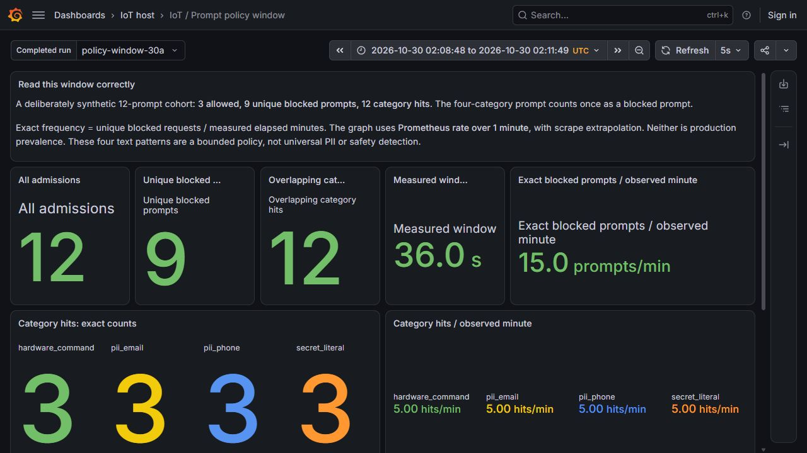
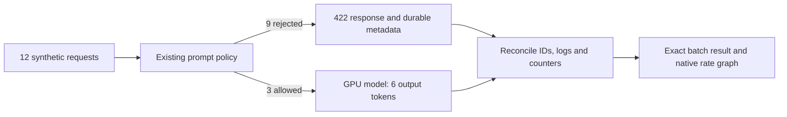
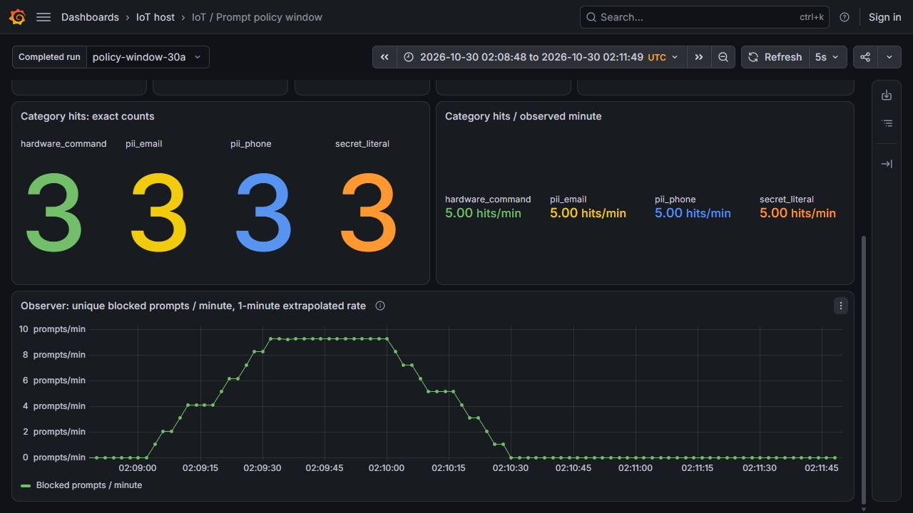

# Counting prompts caught by the policy

The prompt policy rejected nine of twelve controlled synthetic requests before inference. Three allowed controls generated six output tokens in total, matching the GPU's independent generated-token counter. The observer ledger, timestamped container logs and native counters agree on every request.

The measured window ran on the existing CPU VM and V100 GPU from **02:08:58.233636 to 02:09:34.233794 UTC on 30 October 2026**. Its monotonic duration was **36.000115 seconds**. Source commit: `24efae5c0cee654fbe4e96a4623f68ee791c63f6`. The policy and model-serving application code were unchanged.



## What the numbers mean

| Measurement | Recorded result | Interpretation |
|---|---:|---|
| Admissions | 12 | All planned requests, with distinct observer request IDs |
| Allowed controls | 3 | Identical short instructions to reply with `READY` |
| Unique blocked prompts | 9 | Each rejected request counts once |
| Category hits | 12 | A single prompt may match several categories |
| Hits per category | 3 | Email, labeled phone, credential assignment and hardware command |
| Exact blocked frequency | 14.999952 prompts/min | `9 × 60 / 36.000115` |
| Provider usage | 108 input + 6 output = 114 total | Usage from the three genuine streamed responses |
| Independent GPU output-token delta | 6 | No extra generated tokens beyond those allowed responses |

The multi-category case contains a synthetic email, a reserved example telephone number, a clearly fake credential and a pump command. It produces **one blocked prompt and four category hits**. Adding category hits together would overstate the number of rejected prompts.

The 75% rejection fraction is deliberately chosen test composition. It does not estimate how often a real user would submit an unsafe prompt. The controls implement four explicit text patterns; they do not prove general toxicity detection, universal PII recognition or complete prompt-injection protection. No physical equipment is connected or operated.



## Read the frequency graph separately

The exact batch frequency divides the observed blocked count by the measured window duration. The graph reads the persistent observer counter using:

```promql
sum(rate(iot_llm_policy_checks_total{
  job="iot-llm-observer", outcome="blocked"
}[1m])) * 60
```

That expression averages over a rolling minute. It includes idle seconds around the 36-second cohort, and Prometheus extrapolates samples to the range edges. Its values therefore need not equal the exact 36-second rate. Prometheus also accounts for counter resets; applying `rate` before aggregation preserves that behavior. See the official [rate documentation](https://prometheus.io/docs/prometheus/latest/querying/functions/#rate).



Completed batch values use separate `iot_llm_policy_window_*` **gauges** and a separate monitoring job. They retain the original experiment clock; their publication time records later ingestion. This follows Prometheus's distinction between [completed batch statistics and continuous service counters](https://prometheus.io/docs/practices/instrumentation/#batch-jobs).

## Verify it without a running VM

From the repository root:

```powershell
python -B -m unittest discover -s tests -p test_policy_window.py -v
python -B -S scripts/verify-llm-policy-window.py
```

The four focused tests check independently specified category expectations, overlapping hits, invalid or incomplete cohorts, and the requirement for genuine usage and first-output timing. The offline verifier authenticates the original 150 native payloads, replays the saved SSE chunk observations, reconciles twelve unique ledger/log identities, checks the GPU token delta, and checks eight actual Prometheus/Grafana target pairs.

The sealed [evidence inventory](evidence/llm-policy-window/manifest.json) includes the original native archive, readable summaries and unedited screenshots. Credentials, runtime Secret objects, model weights and bulk telemetry are excluded. This operator/test change does not alter the API implementation or replace its separately recorded coverage and strict mutation gates.

## Run a new measured window

Use the existing private lab after checking both VM sessions and model readiness. Do not reset the observer ledger or GPU counters. Build a small source snapshot from the committed Git bytes on your PC. It contains four files, not credentials or model weights. This command refuses to overwrite an existing snapshot:

```powershell
@'
from pathlib import Path
from hashlib import sha256
import json, subprocess
names = ['llm/policy_window.py', 'llm_observability/contracts.py',
         'scripts/run-policy-window.py', 'tests/test_policy_window.py']
commit = subprocess.check_output(['git', 'rev-parse', 'HEAD'], text=True).strip()
destination = Path('outputs/policy-window-source')
destination.mkdir(exist_ok=False)
files = {}
for name in names:
    body = subprocess.check_output(['git', 'show', commit + ':' + name])
    target = destination / 'tree' / name
    target.parent.mkdir(parents=True, exist_ok=True)
    target.write_bytes(body)
    files[name] = sha256(body).hexdigest()
(destination / 'manifest.json').write_text(json.dumps({
    'format': 'iot-policy-window-source-v1', 'commit': commit, 'files': files
}, indent=2) + '\n')
'@ | python -B -

gcloud compute scp --recurse outputs/policy-window-source iot-cw-vm:/tmp/ --project project-208f5905-011e-4ae9-9a5 --zone us-central1-a --tunnel-through-iap --scp-flag=-batch
```

The runner validates every source digest before sending requests. On the CPU VM, run the focused tests in that source tree first, then start a bounded measurement. Use a new unit/output name if this example has already been run:

```bash
cd /tmp/policy-window-source/tree
python3 -B -m unittest discover -s tests -p test_policy_window.py -v
sudo systemd-run --unit=iot-policy-window-demo --property=RuntimeMaxSec=300 \
  /usr/bin/python3 -B /tmp/policy-window-source/tree/scripts/run-policy-window.py \
  --runtime-root /srv/iot-data/workspace/iot-maintenance-platform \
  --output /srv/iot-data/workspace/iot-maintenance-platform/outputs/policy-window-demo
sudo journalctl -u iot-policy-window-demo -f
```

It reads the existing Kubernetes client Secret in memory, uses internal ClusterIP services and makes exactly twelve paced admissions. Three requests reach the GPU. No feature refresh or agent tool execution is needed for these static prompts. Keep a failed output directory intact; use a new run name when retrying.

For the retained demonstration, open the existing [private viewer](http://127.0.0.1:18100/d/iot-llm-policy-window) through the bounded monitoring tunnel described in the [monitoring guide](llm-monitoring-demo.md). Its availability depends on the VM and tunnel. The offline commands above work after the lab stops.

## A display defect found during review

The first dashboard selected the earlier experiment end, while the batch gauges were ingested later. API queries made at the current time returned the expected values, but the browser correctly showed **No data** at the earlier selected time. That first view was not accepted as visual completion.

The scoped repair extends the display through batch ingestion and checks all instant targets at that exact display end, alongside the native counter-rate range. It preserves the original requests, measured duration, panel expressions, application Pods and previous dashboards. Original before/after receipts and the [failed display capture](evidence/llm-policy-window/ui/before-time-fix.jpg) are retained. No model requests were rerun to repair or capture the view.

For a presentation, explain: **nine prompts were stopped; twelve category hits describe overlapping reasons; only three requests generated tokens**. Then show why a 36-second exact frequency differs from a rolling one-minute graph.
