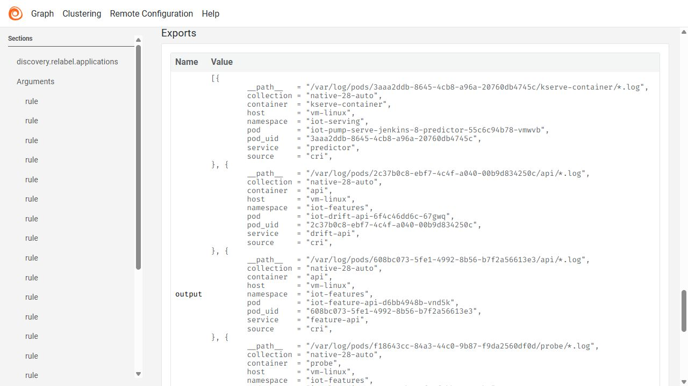
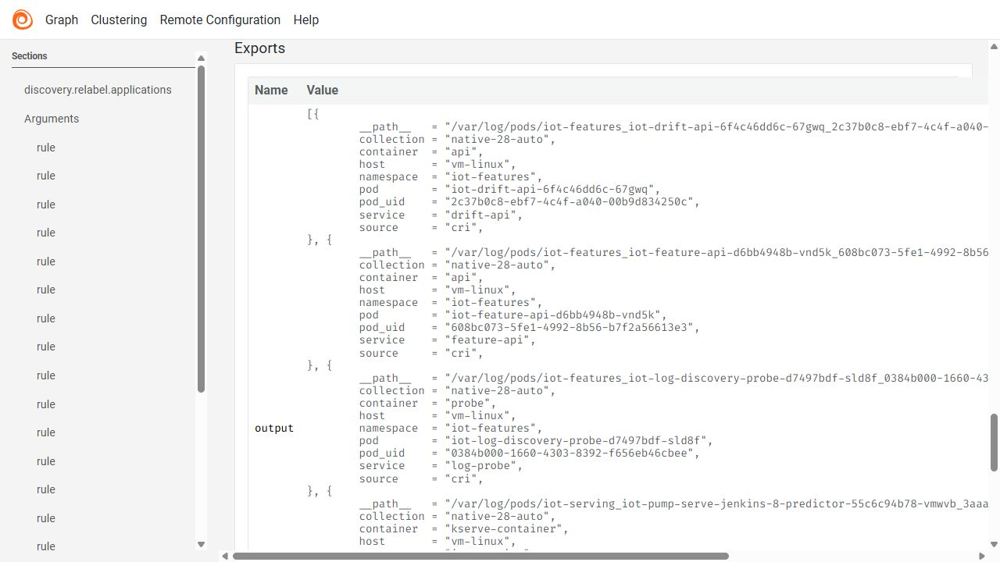
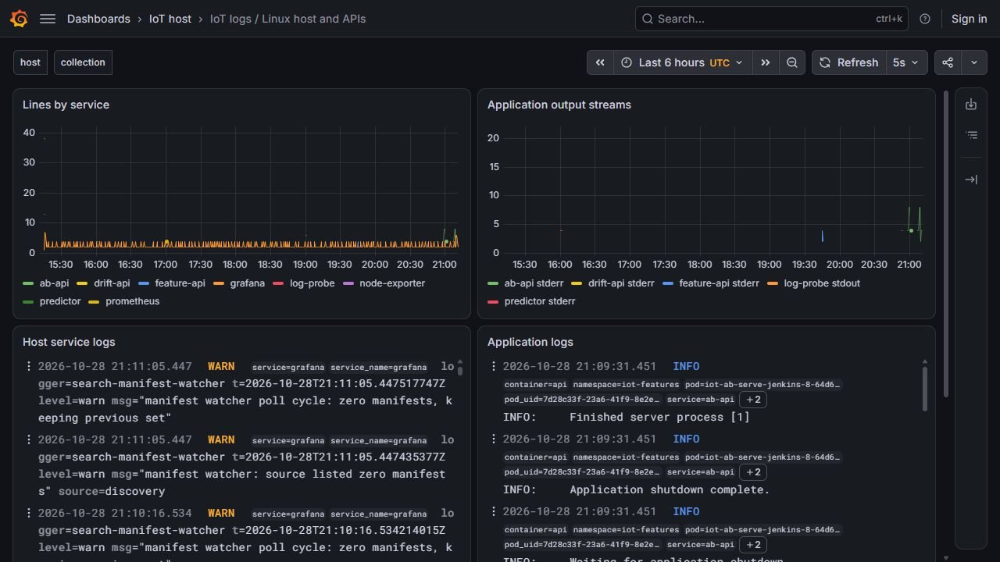

# Dynamic Pod log discovery and collector restart

Alloy discovers the intended Kubernetes Pods and follows their actual CRI log files. Namespace/node/service/container selection and a scoped service-account token constrain access; secret/node reads outside the declared scope are denied.

The successful native run verifies 40 exact lines across two Pod UIDs, including nanosecond timestamps, content and identity labels. A collector restart preserves position state, and the resulting multiset matches the expected rows. Four API readbacks link the capture to the observed applications.

Failed security/configuration attempts remain intact. The active collector is hardened with strict system protection, no capabilities, private temp space and write access limited to its own state. The workload validates these discovery/restart cases, not every possible rotation/crash or universal exactly-once delivery.

## Commands and recorded examples

Run commands from the repository root unless the example explicitly changes the working directory. Use a fresh output/run name and check the linked runbook before starting platform services. Examples belong to the recorded workload on this page.

```powershell
python -S scripts/verify-log-discovery.py
python -m unittest tests.test_log_discovery tests.test_log_monitoring -v
```

## Implementation and evidence

- [Recorded artifact: log-discovery-linux/final-readback/verification.json](evidence/log-discovery-linux/final-readback/verification.json)
- [Recorded artifact: log-discovery-linux/start/rbac.json](evidence/log-discovery-linux/start/rbac.json)
- [Source: ml/log_discovery.py](../ml/log_discovery.py)
- [grafana.com / discovery.kubernetes](https://grafana.com/docs/alloy/latest/reference/components/discovery/discovery.kubernetes/)
- [Recorded artifact: log-discovery-linux/repair/verification.json](evidence/log-discovery-linux/repair/verification.json)
- [grafana.com / discovery.relabel](https://grafana.com/docs/alloy/latest/reference/components/discovery/discovery.relabel/)
- [grafana.com / loki-http-api](https://grafana.com/docs/loki/latest/reference/loki-http-api/#flush-in-memory-chunks-to-backing-store)
- [Recorded artifact: log-discovery-linux/final-readback/query-settings.txt](evidence/log-discovery-linux/final-readback/query-settings.txt)
- [Recorded artifact: log-discovery-linux/hardening/unit.txt](evidence/log-discovery-linux/hardening/unit.txt)
- [Recorded artifact: log-discovery-linux/manifest.json](evidence/log-discovery-linux/manifest.json)
- [Source: scripts/check-log-discovery.py](../scripts/check-log-discovery.py)

## Recorded interface views

These are original captures from the runs described above. Their timestamps, model identities and visible states belong to those runs.








## Related documentation

[Current architecture](architecture.md) · [Demo and recovery](operations.md) · [Rubric index](rubric-tracker.md)

[Original run notes](https://github.com/anle0429/iot-maintenance-platform/blob/a395c4ea47b8f8e235556ab93de3d699ed9df18b/docs/log-discovery.md) retain the full historical narrative. Raw evidence files have not been translated or rewritten.
