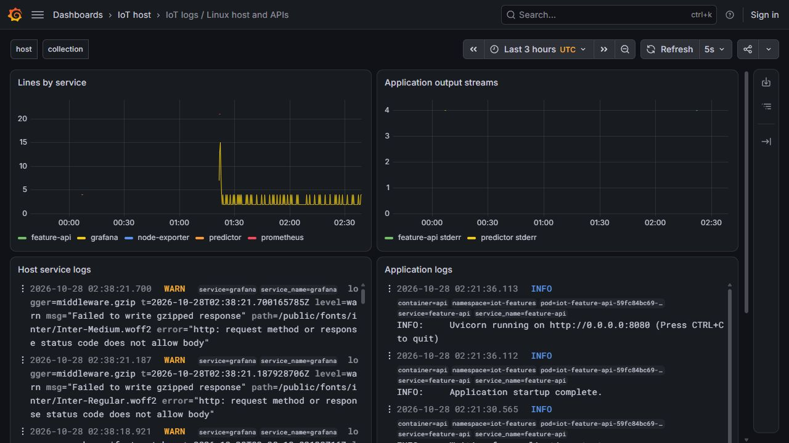
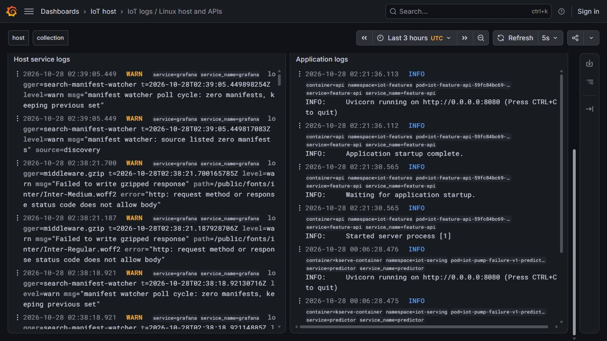

# Tra cứu log trên Linux VM

Cập nhật28/10: [discovery tự theo Pod](log-discovery.md) đã triển khai và kiểm40dòng/twoPodUID/restart/noaddedduplicates/bốnAPI. Bằng chứng fixed-path bên dưới giữ nguyên phạm vi lịch sử.

Log giúp biết dịch vụ đã làm gì và lỗi ở đâu. Mốc này nối **ba file stdout của node_exporter, Prometheus, Grafana và hai file CRI của predictor/feature API → Alloy → Loki → Grafana**. Collector đọc các đường dẫn gắn với PID/Pod UID đã quan sát, không thay dữ liệu telemetry hoặc model.

Loki3.7.9 và Alloy1.21.2 đã chạy thật trên VM8CPU/64GiB. Bộ cấu hình giữ source `12d1374e25ab4f69f257c35d627286243d0be29c`; source đầu `3b8496a` và lượt lỗi vẫn được lưu. [Manifest](evidence/log-monitoring-linux/manifest.json) có58payload/751.258B, gồm thông điệp gốc, cấu hình, phản hồi HTTP và hai ảnh nguyên bản. Binary, Loki store, positions, credentials và helper thao tác riêng không vào Git.

## Kết quả đã kiểm

Trong một khoảng giờ cố định, kiểm độc lập từ **237 dòng nguồn**:229log host và8log khởi động hai API. Nội dung, tất cả nhãn và timestamp khớp qua cả Loki trực tiếp và Grafana datasource proxy. Hai biểu đồ có80+2mẫu mỗi engine, tổng164mẫu; từng số đếm được tính lại từ file nguồn theo cửa sổ **(t−60giây,t]**. Đây là số dòng log, không phải số request, tốc độ model hoặc accuracy.

Sau khi restart riêng collector, PID đổi và cùng khoảng dữ liệu vẫn trả237dòng qua cả hai engine. Loki tiếp tục chạy, các store/positions cũ được giữ.10unit tests chạy trên Linux; verifier trên PC chỉ dùng thư viện chuẩn và Git. [Verification gốc](evidence/log-monitoring-linux/verification.json), [file nguồn/nhãn](evidence/log-monitoring-linux/source-map.json), [cửa sổ query](evidence/log-monitoring-linux/query-context.json).



Biểu đồ trên đếm log trong một phút; bảng dưới hiển thị thông điệp thực. Cảnh báo Grafana về manifest/font là log vận hành thật, không được thêm để tạo ảnh lỗi. Các log API trong snapshot này là thông báo khởi động. Ảnh là giao diện đang cập nhật; phép đối chiếu số học dùng khoảng thời gian cố định trong receipt.



## Chênh lệch timestamp đã phát hiện và sửa

Lượt đầu có219dòng nhưng19timestamp bị cộng thêm nano giây. Alloy1.21 mặc định phân biệt các timestamp trùng nhau bằng cách cộng1ns; điều này được mô tả trong [tài liệu stage.timestamp](https://grafana.com/docs/alloy/latest/reference/components/loki/loki.process/#stagetimestamp) và [source đúng bản1.21.2](https://github.com/grafana/alloy/blob/v1.21.2/internal/component/loki/process/stages/timestamp.go). Đây là chính sách của collector, không phải độ chính xác mới của đồng hồ máy.

Cấu hình hiện tại đặt `action_on_duplicate_timestamp = "keep"` cho logfmt, giữ nguyên thời gian gốc. Thứ tự giữa các thông điệp cùng timestamp có thể khác nhau khi hiển thị. Tạo collection `native-28-keep` và positions mới để phân biệt lượt mới; Loki vẫn giữ dữ liệu lượt cũ. [So sánh lỗi](evidence/log-monitoring-linux/before-differences.json) và file nguồn cũ được giữ nguyên. Oracle tiếp tục so sánh timestamp chính xác, không thêm sai số dung thứ.

Loki thêm `service_name` và trả `detected_level` trong nhãn kết quả từ structured metadata; verifier đối chiếu chúng với tên dịch vụ và mức độ trong dòng gốc. Xem [structured metadata](https://grafana.com/docs/loki/latest/get-started/labels/structured-metadata/). Logfmt lấy `time` hoặc `t`; CRI lấy timestamp của kubelet. Dòng không parse được có chính sách dùng arrival time;237dòng đã kiểm đều parse được. CRI partial chunks chưa thuộc phép kiểm này.

## Chạy lại và tự xem

Trên PC hoặc bản clone sạch, không cần bật Docker/VM để kiểm capsule:

```bash
python -S scripts/verify-linux-logs.py
python -S -m unittest tests.test_log_monitoring tests.test_log_monitoring_oracle -v
```

Trên VM hiện có, `iot-loki-28` và `iot-alloy-28-keep` là hai unit sở hữu mốc này. Loki nghe loopback13100/gRPC19096; Alloy nghe loopback12345. Grafana dùng instance riêng đã có ở loopback13001, datasource UID `iot-logs-loki`, dashboard UID `iot-linux-logs`. Truy cập qua IAP đang mở trên PC19801, chọn dashboard **IoT logs / Linux host and APIs**. Không khởi động thêm bản trùng trên các cổng này.

Để chuẩn bị một lượt mới trên Linux VM có các dịch vụ nền đang chạy, ở repo root:

```bash
sudo python3 -S scripts/observe-log-sources.py --project-root "$PWD" --output outputs/log-sources-new.json
sudo python3 -S scripts/prepare-log-monitoring.py --project-root "$PWD" --sources outputs/log-sources-new.json --output "$PWD/data/runtime/logs-demo-new" --collection demo-new
```

Lệnh đầu đọc stdout của ba PID và lấy Pod qua selector của Service thực; predictor được lấy từ URL đang cấu hình ở feature deployment. Lệnh sau chỉ sinh file, từ chối ghi đè folder cũ. Sau rollout/restart Pod phải quan sát lại để không dùng UID/rotation đã cũ. Hai CLI này chưa chứng minh tự động phát hiện Pod liên tục.

Dùng binary Linux đã kiểm SHA trong [asset pins](../infra/monitoring/logging-assets.json); tải từ các release chính thức [Loki](https://github.com/grafana/loki/releases/tag/v3.7.9), [Alloy](https://github.com/grafana/alloy/releases/tag/v1.21.2) nếu máy mới chưa có. Kiểm trước khi chạy:

```bash
data/runtime/logging-assets-28/loki-linux-amd64 -config.file=data/runtime/logs-demo-new/loki.yaml -verify-config=true
data/runtime/logging-assets-28/alloy-linux-amd64 validate data/runtime/logs-demo-new/config.alloy
```

Khi dựng riêng một stack mới và các cổng đã rảnh, tạo hai thư mục `loki/`, `alloy/` trong bundle. Chạy Loki với `-config.file=<bundle>/loki.yaml`; chạy Alloy bằng `run --disable-reporting --server.http.listen-addr=127.0.0.1:12345 --storage.path=<bundle>/alloy <bundle>/config.alloy`. Provision `grafana-datasource.yaml` vào datasource folder và `dashboard.json` vào dashboard folder của Grafana. Nếu giữ Loki đang có, chỉ đổi collection/positions/collector và dashboard; giữ cấu hình/store Loki hiện tại. [Receipt triển khai](evidence/log-monitoring-linux/keep-started.json) ghi argument thực và nguồn cấu hình của lượt này.

## Tài nguyên và giới hạn

Loki có hard memory1536MiB/CPU1core; Alloy768MiB/CPU0,5core. Cả hai bật NoNewPrivileges, filesystem chỉ ghi vào state riêng và bỏ capabilities; listener đã đọc lại là loopback. Loki chạy `nobody`. Alloy cần UIDroot để đọc CRI root-owned đã quan sát; không thay quyền file hoặc cấp Docker/Kubernetes socket cho collector. Đây chưa phải bằng chứng Vault/service authentication của final.

Hai cache Loki khai báo32MiB mỗi cache, filesystem storage và retention24giờ. Chưa chạy đủ24giờ để kiểm expiry. Số memory trong receipt là cgroup accounting, gồm cache, không gọi là RSS hoặc benchmark. Pull repo không mang binary/store/positions hay runtime riêng từ VM về laptop.

F48 có bằng chứng thu thập/hiển thị log host và hai API theo năm file đã khai báo. Chưa claim toàn platform, automatic Pod discovery/rotation, exactly-once ingestion hoặc distributed traces. F49 và các dashboard/API/drift/CI còn thiếu vẫn được theo dõi riêng trong [tracker final](final-rubric-tracker.md).
