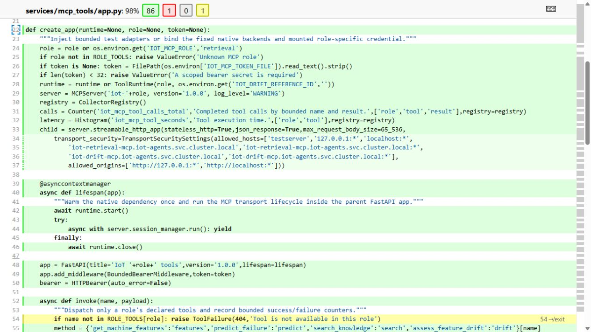

# MCP application factory and dependency injection

The retrieval and drift services share `create_app(runtime=None, role=None, token=None)` in [app.py](../services/mcp_tools/app.py). This is an **application factory**: each call constructs one configured FastAPI/MCP application. Dependencies can be supplied by the caller, which makes the same application usable in production and isolated tests.

The image shows actual source coverage from successful retrieval CI build 5. Green highlighting marks executed lines; yellow partial-branch markings remain visible. The source was read back from that exact CI image and matches the current application text. It is a report view, not a new deployment.

## How construction works

1. Select a validated role: retrieval or drift. Reject an unsupported role before exposing tools.
2. Resolve the service's bearer token from its protected file, or use an explicitly supplied test token.
3. Accept an injected runtime, or construct the native `ToolRuntime` with its configured dependencies.
4. Create separate application, MCP server and metrics registry instances. Register the role's permitted tools.
5. Start and close the runtime through the application's lifespan, then return the assembled application.

Production starts the factory through the container's `uvicorn ... --factory` entry point in [Dockerfile](../infra/mcp/Dockerfile). The retrieval fixture instead supplies a controlled HTTP transport and small knowledge reader. It still exercises the actual application, authentication and validation code.

This avoids a global live database/client at import time and lets both role-specific services use one construction path. It also puts responsibility on the caller to supply a compatible runtime; dependency injection alone does not prove an external backend works. [Native MCP checks](mcp-tools.md) cover that separate boundary.

## Explain it in a review

“The factory assembles a service. Production provides the native runtime and a protected credential file. Tests provide controlled backend responses and a test-only credential. Both paths use the same API and middleware, so a test can verify a rejected request without contacting the VM.”

The pattern is application construction with dependency injection. It is not presented as a GoF abstract factory or as a substitute for the [five-class responsibility map](llm-class-design.md).

[Fixtures, boundaries and replay property](mcp-quality-evidence.md) · [Original image source](evidence/mcp-quality-ui/source/app.py.txt) · [Source/measurement verifier](../scripts/verify-mcp-quality-ui.py)
