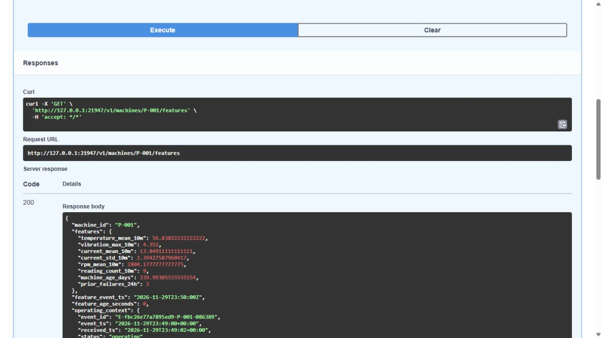
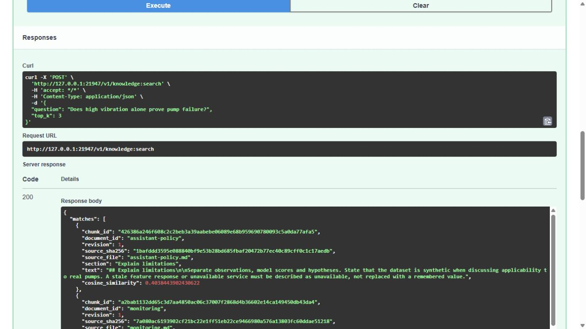

# Private HTTPS for retrieval tools

The retrieval service now answers REST and native MCP requests at `https://retrieval.iot.test` through the existing private NGINX gateway. The hostname belongs to this lab; no public DNS record, Internet listener or browser certificate exception was added.

Native transport and tool checks passed, and the service was reopened successfully after a PC restart. Two original Swagger captures are reconciled with the native viewer's TLS audit. The [offline checker](../scripts/verify-mcp-gateway.py) is included in the final artifact audit. The remaining coursework requirements stay visible in the [LLM tracker](final-llm-rubric-tracker.md).

## Request path

An operator connects to the retained VM through IAP. A client resolves the lab hostname to the private gateway address and verifies both the CA and TLS hostname. NGINX forwards the standard `Authorization: Bearer …` header unchanged. The retrieval service validates its own scoped token before executing a protected operation.

The ingress sets a fixed internal upstream Host that the MCP transport already allows. It does not expand the API's Host or Origin allowlists. A separate NetworkPolicy permits only gateway Pods in the gateway namespace to reach the retrieval Pods on port 8080. Existing specialist and monitoring access remains under its earlier policies.

The [route definition](../infra/gateway/mcp.py), [guarded deployer](../scripts/deploy-mcp-gateway.py) and [native probe](../scripts/probe-mcp-gateway.py) contain no runtime tokens. Agent UI and registry authentication remain separate.

## Recorded native checks

The accepted correction completed on 30 October 2026 at 04:48 UTC. The native probe completed at 04:50 UTC using the retained MCP client image and real deployed APIs.

| Check | Observed result |
|---|---|
| HTTP requests | 13 completed requests |
| Missing, wrong, Basic, nonstandard-header and other-role credentials | Five protected requests returned 401 |
| Plain HTTP | Redirected to the HTTPS lab hostname |
| TLS trust | Actual CA/hostname verification passed; untrusted CA and wrong hostname were rejected |
| Native documentation and schema | Both returned 200 |
| Structured validation and foreign Origin | Invalid `top_k` returned 422; foreign MCP Origin returned 403 |
| Features, model-6 prediction and knowledge retrieval | Successful REST responses matched all three native MCP SDK tool results |
| Local administrative viewer | Four actual boundary cases passed; three focused test methods passed locally and on the VM |

The feature state was genuinely rematerialized for 200 machines at 04:43:57 UTC, after the old Redis keys expired naturally. Its one-hour wall-clock lease ends at 05:43:57 UTC. Simulation event time is separate from this lease. These results do not establish live data availability after that time, a new model, a load benchmark or general LLM answer accuracy.

[Original probe receipt](evidence/mcp-gateway/probe-verification.json) · [TLS receipt](evidence/mcp-gateway/tls-verification.json) · [Viewer boundary results](evidence/mcp-gateway/viewer-boundary.json) · [Untouched native archive](evidence/mcp-gateway/native-receipts.tar.gz) · [Archive identity and scan scope](evidence/mcp-gateway/native-archive.json)

The archive retains the original failures. The first deployment stopped before resource creation because the expired upstream lease made both retrieval replicas unready. The next created the three named resources but NGINX rejected its variable-valued header annotation. The accepted correction changed only that new ingress's annotations, retaining its UID, certificate, backend and NetworkPolicy. It uses native bearer authentication instead of translating credentials between headers.

## Original interface evidence

The same native viewer and feature lease were reused after the PC restarted. At 05:04 UTC, Swagger returned P-001's features and three reference passages. Each image is unedited. The full accessibility snapshots preserve response content that extends beyond the viewport.

The [capture index](evidence/mcp-gateway/ui/index.json) explains the connection boundary. The browser displays loopback HTTP over IAP; the viewer verifies CA/SNI HTTPS to `retrieval.iot.test`. No browser certificate warning was bypassed.

The checker matches the displayed JSON values to the actual viewer response digests in the [untouched supplemental archive](evidence/mcp-gateway/native-viewer-receipts.tar.gz). Two separately recorded HTTP readbacks preserve the matching wire bodies; they are labeled as subsequent requests, not browser interception. This matters because Swagger can display a JSON number such as `0.0` as `0`. No wire response was reconstructed from the display.

The pinned NGINX version's [upstream Host template](https://github.com/nginx/kubernetes-ingress/blob/v5.7.0/internal/configs/version1/nginx.ingress.tmpl) documents the Host override used here. The actual rejected annotation event and rendered accepted configuration are preserved in the archive.

## Resume the demo

Use the [existing lab recovery procedure](operations.md) to check VM sessions, service readiness and a fresh feature lease. Do not rerun provisioning or the 100 GB workload to reopen this demo.

The [administrative viewer](../scripts/view-mcp-gateway.py) runs only on loopback. On the VM, select a port that is free on both machines, pass the existing retrieval-token file and CA paths, then forward that same loopback port through IAP. Its `--port` option defaults to 19111; the recorded second viewer used 21947 because the PC already had other listeners. The viewer replaces incoming credentials with the local scoped token, rejects foreign browser origins and forwards only documentation, structured search, feature and prediction operations. It records upstream TLS facts and response hashes without credential values or question text.

The browser sees loopback HTTP through this administrative connection; the viewer verifies private HTTPS upstream. This does not claim browser CA trust.

After a PC restart, reopen the project and reconnect the tunnel. If the VM has auto-stopped, recover the existing VM first. If the feature lease has expired, use a new genuine preparation. Source, evidence and Git history survive the restart; local tunnels and browser connections do not.

For read-only local evidence verification, run `python -B -S scripts/verify-mcp-gateway.py`. This checks recorded transport and UI evidence without starting services or changing data. It does not assert that the service is live now.
