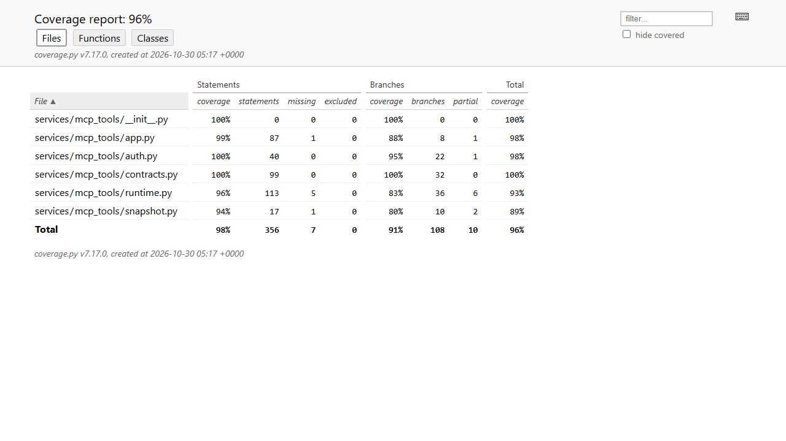
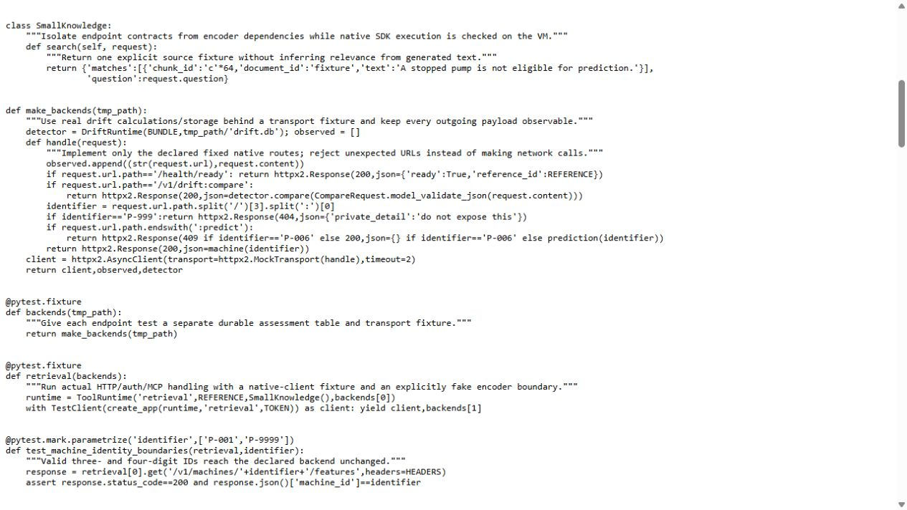
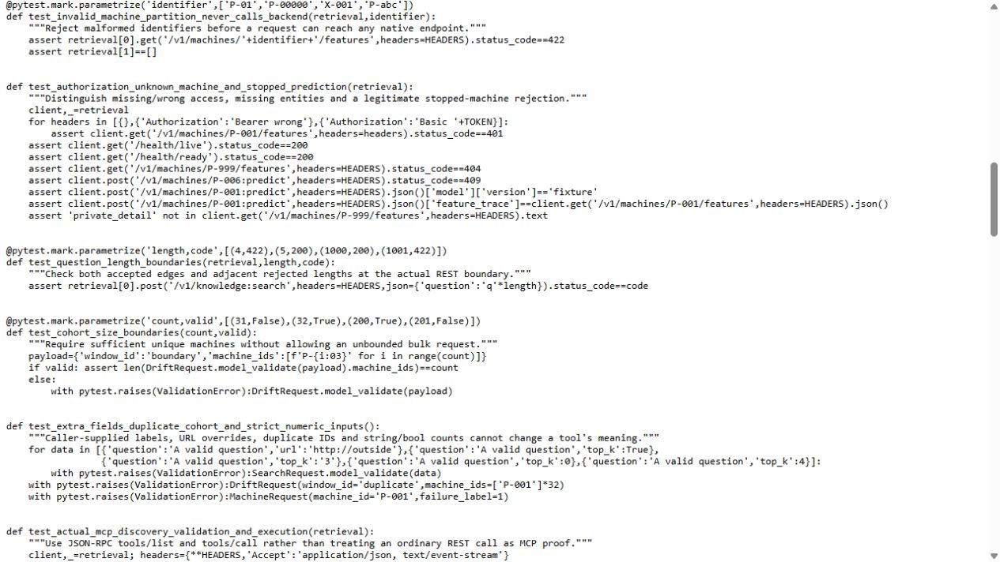
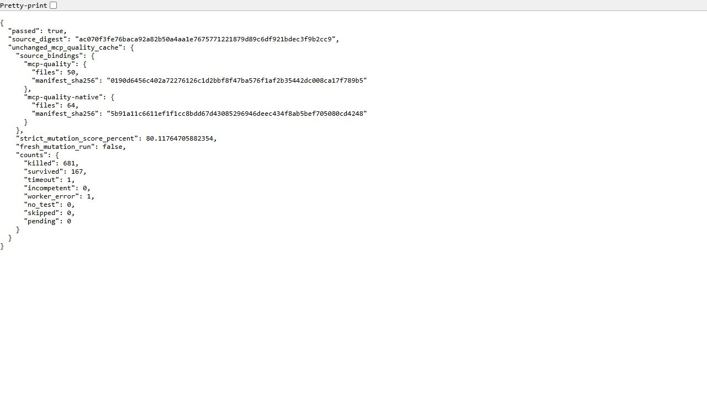
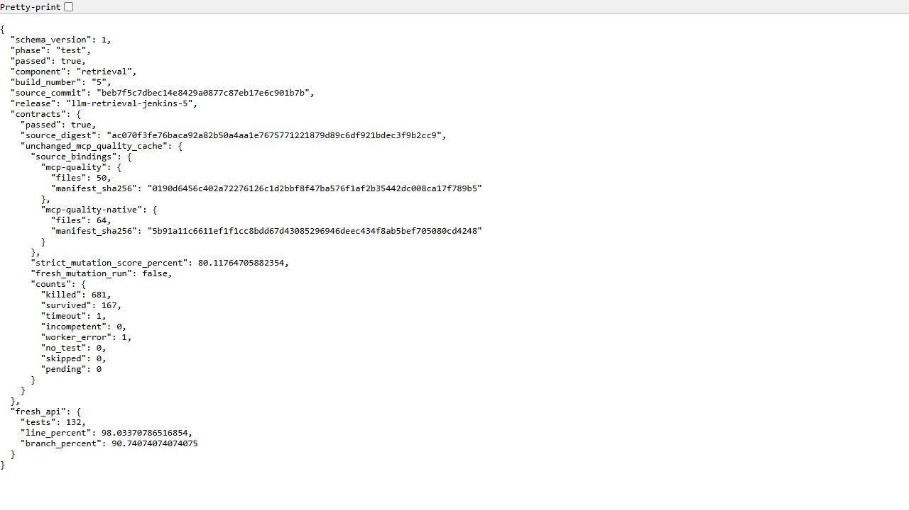
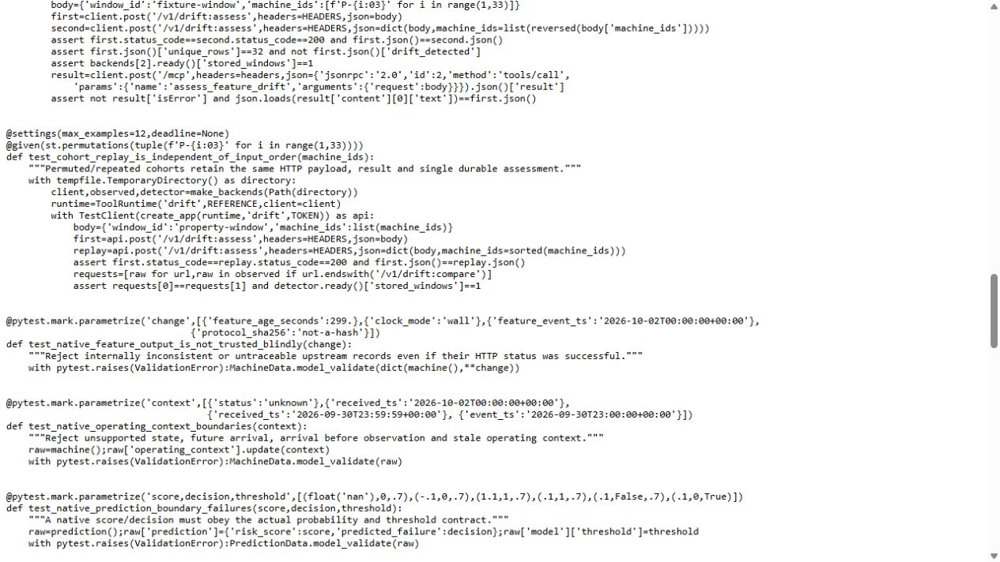

# MCP API testing: results and techniques

The retrieval CI job's successful build 5 ran **132 tests with no failures or skips** against the MCP API package. This page connects the recorded measurements to the fixtures, input partitions and replay property in the actual test image. It also preserves the original mutation result and its reuse conditions.

| Measurement | Recorded result | Interpretation |
|---|---:|---|
| Statement coverage | 349/356, **98.03%** | Seven statements were not executed. |
| Branch coverage | 98/108, **90.74%** | Ten branches were not covered. |
| Combined coverage | 447/464, **96.34%** | The official HTML rounds this to 96%. |
| Strict mutation score | 681/850, **80.12%** | Includes 167 survivors, one timeout and one worker error in the denominator. |

Coverage was measured on 30 October 2026 at 02:46 UTC. The HTML below was exported at 05:17 UTC from the original SQLite database, using the same immutable CI image and coverage.py 7.17.0. The exporter did not run tests again. Its JSON totals and per-file results exactly match the original CI report; the original database hash is unchanged.



[Open the official report](evidence/mcp-quality-ui/report/index.html) · [Original coverage JSON](evidence/mcp-quality-ui/coverage.json) · [Original JUnit](evidence/mcp-quality-ui/junit.xml)

## Fixtures and mocks

The `backends` fixture creates a fresh drift assessment database and an observable HTTP transport. The `retrieval` fixture injects that client and a small knowledge reader into the real `ToolRuntime`, then starts the real application with `TestClient`.

`MockTransport` answers only the declared routes. Unknown routes fail instead of making external network calls. The fake knowledge reader isolates encoder/storage dependencies. HTTP routing, bearer authentication, request validation and response handling still execute, while drift assessment uses the real calculation and storage classes.



[Test source](../tests/mcp/test_tools.py) · [Unchanged image source](evidence/mcp-quality-ui/source/test_tools.py.txt)

These are isolated API tests. Separate [native MCP runs](mcp-tools.md) and [private HTTPS checks](mcp-gateway.md) establish actual service/tool interactions on the VM.

## Partitions and adjacent boundaries

The parameterized cases describe why an input belongs to a class, rather than checking one arbitrary valid request.

| Input | Accepted examples | Rejected or separately handled examples |
|---|---|---|
| Machine identity | `P-001`, `P-9999` | Wrong prefix, too few/many digits, nonnumeric suffix |
| Machine availability | Operating machine | Unknown machine; stopped/failed machine cannot be predicted |
| Search question length | 5 and 1,000 characters | 4 and 1,001 characters |
| Drift cohort size | 32 and 200 machines | 31 and 201 machines |
| Authentication | Correct service bearer token | Missing, malformed, incorrect or wrong-role token |



[Additional contract edges](../tests/mcp/test_contract_edges.py) · [Decision boundaries](../tests/mcp/test_decision_boundaries.py)

## Mutation gate and source-bound reuse

The original changed-code mutation campaign killed 681 of 850 mutations. The strict score retains every outcome, including timeout and worker error. Surviving mutations remain in the original [quality report](mcp-quality.md); this result does not mean all faults are detectable.

Build 5 reused this gate after checking both frozen source/test manifests: 50 files for `mcp-quality` and 64 for `mcp-quality-native`. Its receipt explicitly records `fresh_mutation_run=false`. Changed covered code requires a new gate; screenshot collection does not trigger another campaign.





## Property: replay order cannot create another assessment

Hypothesis generates permutations of 32 machine IDs. For each generated input, the test submits one order and then the sorted order to the drift API. It checks equal response bodies, equal outgoing comparison payloads and exactly **one stored window**. A fresh temporary database isolates each generated case.



The configured budget is `max_examples=12`. The JUnit report records the passing property test, but does not enumerate every generated input; twelve is therefore a configured budget, not a separately observed case ledger or proof over all permutations.

## Inspect without starting the VM

From the repository root:

```powershell
python -B -S scripts/verify-mcp-quality-ui.py
python -m http.server 21948 --bind 127.0.0.1 --directory docs/evidence/mcp-quality-ui
```

Open [the local coverage report](http://127.0.0.1:21948/report/index.html). Stop the local viewer with Ctrl+C. This serves the recorded report and source; it does not exercise a live service or spend cloud credit.

The verifier authenticates 42 published payloads, 89 native payloads and the original 375-file source seal. It reconciles the raw coverage database, official HTML source, JSON arithmetic, JUnit cases, CI image sources and seven unedited JPEG captures. All 24 packaged source texts still match after line-ending normalization; the retained catalog uses CRLF. Original evidence bytes remain unchanged.

The first report-viewer attempt failed with `217/USER` because a container UID was unavailable as a host account. The accepted bounded viewer uses the existing `nobody` account and loopback binding. Both attempts are retained. This was an operator-view failure, separate from the successful CI tests.

[Evidence inventory](evidence/mcp-quality-ui/manifest.json) · [Export receipt](evidence/mcp-quality-ui/report-export.json) · [Implemented application pattern](mcp-application-design.md)
