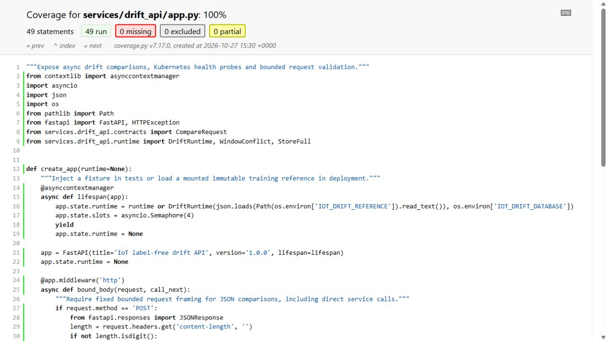

# Five key classes in the ML lifecycle

The low-level design follows implemented responsibilities rather than adding abstractions solely to match a diagram. The source separates content-addressed dataset storage, MLflow publication, portable model inference, feature eligibility/backend access and drift comparison.

The dataset store owns canonical parts, version manifests and restore checks. The registry publisher binds model artifacts to data/protocol/source identity. The portable predictor validates schema and computes the exported model. `FeatureRuntime` owns clocks, operating state and eligibility while a backend adapter performs native SDK/network reads. The drift detector owns reference statistics and comparison policy.

Factory construction and dependency injection let HTTP tests substitute controlled backends without treating those fixtures as native deployment evidence. Interfaces and error boundaries are tested at behavior level. Original source views/screenshots and the exact class locations are retained below.

## Implementation and evidence

- [Source: ml/data_versions.py](../ml/data_versions.py)
- [Source: ml/mlflow_data_versions.py](../ml/mlflow_data_versions.py)
- [Recorded artifact: data-versions/remote/verification.json](evidence/data-versions/remote/verification.json)
- [Source: ml/portable_model.py](../ml/portable_model.py)
- [Recorded artifact: data-versions/registry/registration.json](evidence/data-versions/registry/registration.json)
- [Source: services/feature_api/runtime.py](../services/feature_api/runtime.py)
- [Source: services/drift_api/detector.py](../services/drift_api/detector.py)
- [Source: services/drift_api/app.py](../services/drift_api/app.py)
- [Recorded artifact: drift-api/mutation/coverage-html/z_da970418c10ed19b_app_py.html](evidence/drift-api/mutation/coverage-html/z_da970418c10ed19b_app_py.html)
- [Recorded artifact: drift-api/capture/manifest.json](evidence/drift-api/capture/manifest.json)

## Recorded interface views

These are original captures from the runs described above. Their timestamps, model identities and visible states belong to those runs.

## Related documentation

[Current architecture](architecture.md) · [Demo and recovery](demo-walkthrough.md) · [Rubric index](rubric-tracker.md)

[Original run notes](https://github.com/anle0429/iot-maintenance-platform/blob/f4da7bd21667a8bfca5715a7456bc2bcc813b0fc/docs/ml-class-design.md) retain the full historical narrative. Raw evidence files have not been translated or rewritten.
