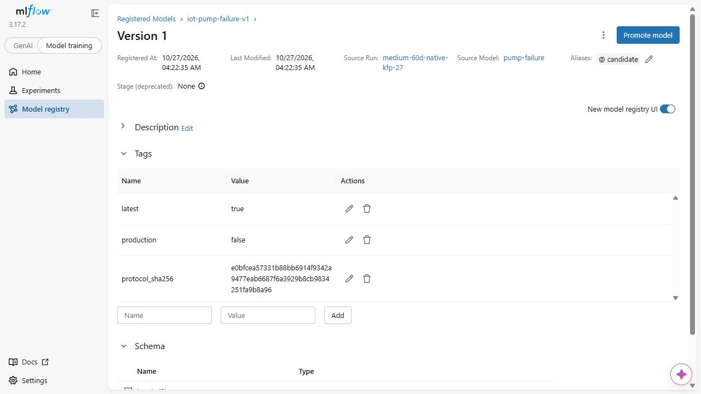
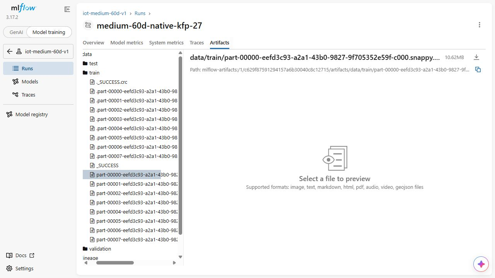
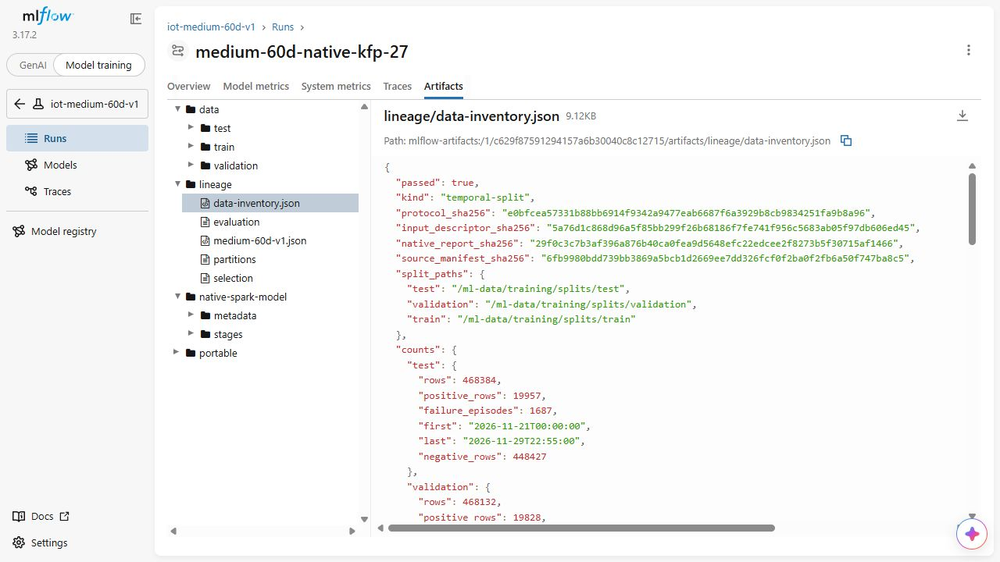

# Initial training pipeline and fixed-protocol evaluation

The initial ML workflow loads the eligible historical Feast cohort, applies the fixed temporal split, fits the train-only scaler/class-weighted logistic model and evaluates the validation-selected threshold. Portable weights and lineage allow independent numeric inference.

The early implementation has four pipeline stages; the current notebook-parity/distributed implementation has five, with saved-model validation before holdout reproduction. Historical model/data versions remain associated with their original source and artifacts rather than renamed to the latest serving release.

The 60-day evaluation has sufficient independent failure support; the earlier 48-hour holdout with zero positives remains limited. PR-AUC/F1 are protocol-specific synthetic-data results. Model registration and candidate evaluation do not establish calibrated real-world risk or authorize an automatic production replacement.

## Commands and recorded examples

Run commands from the repository root unless the example explicitly changes the working directory. Use a fresh output/run name and check the linked runbook before starting platform services. Examples belong to the recorded workload on this page.

```bash
data/runtime/kfp-venv/bin/python -m ml.kfp_training --output outputs/training-pipeline-new.yaml
```

```bash
mkdir -p outputs/ml-oracle-practice
docker run --rm --cpus 2 --memory 10g --user 0:0 \
  --entrypoint /opt/spark/bin/spark-submit \
  --mount type=bind,source="$PWD/ml",target=/workspace/ml,readonly \
  --mount type=bind,source="$PWD/outputs/ml-oracle-practice",target=/proof \
  iot-coursework-spark:3.5.9 --master 'local[2]' --driver-memory 6g \
  /workspace/ml/training_oracles.py \
  --protocol /workspace/ml/protocols/medium-60d-v1.json \
  --workspace /proof/known-answers --output /proof/oracle-verification.json
```

```bash
sudo data/runtime/kfp-venv/bin/python scripts/run-kfp-local.py \
  --run training-practice-1 --deadline-utc '<actual-stop-time-UTC>' \
  --oracles outputs/ml-oracle-practice/oracle-verification.json \
  --ingest-fence outputs/scale-ingest-100gb-27/preflight.json
cat outputs/kfp-local/training-practice-1/verification.json
```

```bash
export IOT_ML_WORKSPACE="$PWD/data/ml-workspaces/training-medium-27-v4"
export IOT_ML_REPORTS_ROOT="$PWD/outputs"
export IOT_ML_REGISTRY_OUTPUT="$PWD/outputs/registry-practice"
mkdir -p "$IOT_ML_REGISTRY_OUTPUT"
docker compose -f infra/mlflow.compose.yaml run --rm tools -m ml.register_model \
  --tracking-uri http://tracking:5000 --run medium-60d-practice \
  --code-commit "$(git rev-parse HEAD)" \
  --evaluation '<absolute-path-to-sealed-KFP-evaluation-descriptor>' \
  --protocol /workspace/ml/protocols/medium-60d-v1.json \
  --output /registry-output/registration.json
```

## Implementation and evidence

- [Source: ml/kfp_training.py](../ml/kfp_training.py)
- [Source: ml/training_contract.py](../ml/training_contract.py)
- [Source: ml/training_load.py](../ml/training_load.py)
- [Source: ml/training_job.py](../ml/training_job.py)
- [Source: scripts/run-kfp-local.py](../scripts/run-kfp-local.py)
- [Source: ml/training_oracles.py](../ml/training_oracles.py)
- [Recorded artifact: ml-training/metadata-repair/oracle-verification.json](evidence/ml-training/metadata-repair/oracle-verification.json)
- [Recorded artifact: ml-training/pc-unit-v4/unit-tests.json](evidence/ml-training/pc-unit-v4/unit-tests.json)
- [Recorded artifact: ml-training/parent-permissions/unit-tests-vm.txt](evidence/ml-training/parent-permissions/unit-tests-vm.txt)
- [Recorded artifact: ml-training/initial-kfp-v2/controller-console.txt](evidence/ml-training/initial-kfp-v2/controller-console.txt)
- [Recorded artifact: ml-training/metadata-repair/previous-run.json](evidence/ml-training/metadata-repair/previous-run.json)
- [Source: ml/kfp_artifacts.py](../ml/kfp_artifacts.py)
- [Source: scripts/verify-kfp-artifacts.py](../scripts/verify-kfp-artifacts.py)
- [Recorded artifact: ml-training/metadata-repair/typed-transport/verification.json](evidence/ml-training/metadata-repair/typed-transport/verification.json)
- [Recorded artifact: ml-training/initial-kfp-v3/controller-console.txt](evidence/ml-training/initial-kfp-v3/controller-console.txt)
- [Recorded artifact: ml-training/parent-permissions/previous-run.json](evidence/ml-training/parent-permissions/previous-run.json)
- [Recorded artifact: ml-training/parent-permissions/typed-transport/verification.json](evidence/ml-training/parent-permissions/typed-transport/verification.json)
- [Recorded artifact: ml-training/full-cohort/controller/verification.json](evidence/ml-training/full-cohort/controller/verification.json)
- [Recorded artifact: ml-training/full-cohort/controller/console.txt](evidence/ml-training/full-cohort/controller/console.txt)
- [Recorded artifact: ml-training/full-cohort/dataset/_LOADED_SUCCESS.json](evidence/ml-training/full-cohort/dataset/_LOADED_SUCCESS.json)
- [Recorded artifact: ml-training/full-cohort/native-load/report.json](evidence/ml-training/full-cohort/native-load/report.json)
- [Recorded artifact: ml-training/full-cohort/task-results/train-model/selection.json](evidence/ml-training/full-cohort/task-results/train-model/selection.json)
- [Recorded artifact: ml-training/full-cohort/evaluation/holdout-opened.json](evidence/ml-training/full-cohort/evaluation/holdout-opened.json)
- [Recorded artifact: ml-training/full-cohort/task-results/evaluate-model/evaluation.json](evidence/ml-training/full-cohort/task-results/evaluate-model/evaluation.json)
- [Recorded artifact: ml-training/full-cohort/model/portable.json](evidence/ml-training/full-cohort/model/portable.json)
- [Recorded artifact: ml-training/mlflow-image/verification.json](evidence/ml-training/mlflow-image/verification.json)
- [Recorded artifact: ml-training/registry/registration.json](evidence/ml-training/registry/registration.json)
- [Recorded artifact: ml-training/registry/verification.json](evidence/ml-training/registry/verification.json)
- [Source: ml/register_model.py](../ml/register_model.py)
- [Recorded artifact: ml-training/registry-initial/controller-console.txt](evidence/ml-training/registry-initial/controller-console.txt)
- [Recorded artifact: ml-training/registry-initial/failed-register_model.py.txt](evidence/ml-training/registry-initial/failed-register_model.py.txt)
- [Recorded artifact: ml-training/registry/after.json](evidence/ml-training/registry/after.json)
- [Recorded artifact: ml-training/registry/wrong-context-console.txt](evidence/ml-training/registry/wrong-context-console.txt)
- [Recorded artifact: ml-training/registry/screenshots/run-test-metrics.jpg](evidence/ml-training/registry/screenshots/run-test-metrics.jpg)
- [Recorded artifact: ml-training/registry/screenshots/capture.json](evidence/ml-training/registry/screenshots/capture.json)
- [Recorded artifact: ml-training/registry/capture/evidence-map.json](evidence/ml-training/registry/capture/evidence-map.json)
- [Recorded artifact: ml-training/registry/capture/capture-state.json](evidence/ml-training/registry/capture/capture-state.json)
- [Source: infra/mlflow.compose.yaml](../infra/mlflow.compose.yaml)
- [www.kubeflow.org / execute-kfp-pipelines-locally](https://www.kubeflow.org/docs/components/pipelines/user-guides/core-functions/execute-kfp-pipelines-locally/)
- [www.kubeflow.org / container-components](https://www.kubeflow.org/docs/components/pipelines/user-guides/components/container-components/)
- [mlflow.org / workflow](https://mlflow.org/docs/latest/ml/model-registry/workflow/)
- [mlflow.org / mlflow.pyfunc.html](https://mlflow.org/docs/latest/api_reference/python_api/mlflow.pyfunc.html)

## Recorded interface views

These are original captures from the runs described above. Their timestamps, model identities and visible states belong to those runs.








## Related documentation

[Current architecture](architecture.md) · [Demo and recovery](operations.md) · [Rubric index](rubric-tracker.md)

[Original run notes](https://github.com/anle0429/iot-maintenance-platform/blob/f4da7bd21667a8bfca5715a7456bc2bcc813b0fc/docs/ml-training.md) retain the full historical narrative. Raw evidence files have not been translated or rewritten.
