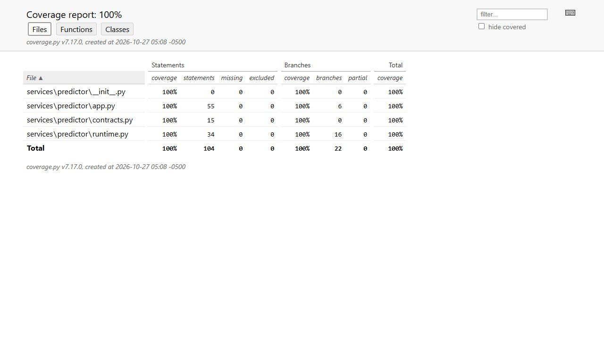

# Phục vụ mô hình máy bơm

**Cập nhật27/10:** [KServe Standard trên K3s](kubernetes-serving.md) đã có InferenceService/pod Ready và32HTTP prediction khớp Spark; ảnh pod và request thật đã lưu. Các số đo Docker/kiểm thử riêng predictor bên dưới là bằng chứng lớp ứng dụng trước khi chuyển lên cluster.

Predictor nhận đúng tám feature của model đã huấn luyện và trả `risk_score`, quyết định theo ngưỡng cố định cùng lineage. Mô hình được **đóng sẵn trong image**; khi khởi động không tải model qua mạng hoặc fit lại. [Runtime](../services/predictor/runtime.py) dùng cùng phép tính portable đã đối chiếu toàn468.384hàng test với Spark trong [mốc training](ml-training.md).

## Kết quả đã chạy

[Image/HTTP verification](evidence/predictor/image/verification.json) **PASS** trên cùng VM8CPU/64GiB khi full Spark còn chạy. Image `sha256:8e9ca40287e7444e828de63dd3cc5d7c47aa2d46d72fd955889b2c395f9ef45e`, kích thước inspect216.149.546byte; [build context](evidence/predictor/image/build-console.txt)16,75kB. File ignore riêng cho Dockerfile chỉ cho phép code, lock và model nhỏ, không đưa nguồn100GB, outputs hoặc secrets vào build context.

- Python3.12, FastAPI0.162.0/Pydantic2.14.1/Uvicorn0.54.0/Prometheus client0.26.0; [lock thực](../infra/predictor/requirements.lock) khớp [gói cài trong image](evidence/predictor/image/requirements-installed.lock).
- Container UID10001, root filesystem chỉ đọc, bỏ capabilities, giới hạn0,5CPU/512MiB. Network riêng `internal`, không publish host port. Health live/ready và metadata qua HTTP thật đều thành công.
- [32đáp án native Spark](../tests/fixtures/predictor-native-spark.json) lấy từ predictions đã seal; đã so byte portable trong MLflow với model gốc trước export. [HTTP output](evidence/predictor/image/http-predictions.json) khớp32scores/decisions, sai số tối đa2,22e-16. Không huấn luyện/đánh giá holdout mới ở bước này.
- Model `iot-pump-failure-v1` version1, run `c629f87591294157a6b30040c8c12715`; [package lineage](../models/pump-failure-v1/lineage.json) trỏ đúng training code/data/evaluation/protocol và checksum portable.

Đây là **container HTTP chạy thật**, chưa phải KServe `InferenceService` hoặc pod Kubernetes. M2-15 giữ đang làm cho tới khi có controller/pod/request thật trên KServe. Image phù hợp custom predictor V1, không dùng việc build thành công để nhận đã deploy KServe.

## Hợp đồng API

[App](../services/predictor/app.py), [Pydantic schema](../services/predictor/contracts.py):

| Endpoint | Công dụng |
|---|---|
| `GET /health/live` | Tiến trình HTTP đang hoạt động |
| `GET /health/ready` | Model đã qua kiểm byte/schema;503 nếu chưa sẵn sàng |
| `GET /v1/models/iot-pump-failure-v1` | Phiên bản và lineage thực dùng |
| `POST /v1/models/iot-pump-failure-v1:predict` | V1 instances,1–128vector/request |
| `GET /metrics` | Request thành công/lỗi và histogram latency |
| `GET /docs` | OpenAPI UI của container |

Ví dụ đầu vào:

```json
{"instances":[{"temperature_mean_10m":62.0,"vibration_max_10m":5.0,"current_mean_10m":16.0,"current_std_10m":1.6,"rpm_mean_10m":2800.0,"reading_count_10m":9,"machine_age_days":900.0,"prior_failures_24h":1}]}
```

Không chấp nhận thiếu/thừa feature, cột nhãn, numeric string, boolean thay số, NaN/Infinity, count không nguyên hoặc batch vượt giới hạn. Các cận rất rộng trong schema bảo vệ phép tính/miền vật lý; không phải khoảng hiệu chuẩn hay khoảng hoạt động an toàn của máy thật. Lỗi422 không echo lại giá trị feature; tên model khác trả404. Startup từ chối model hỏng hash, sai protocol/feature order hoặc numeric metadata không hợp lệ.

`risk_score` là score logistic có class weights, **chưa hiệu chuẩn thành phần trăm xác suất sự cố thực tế**. Ngưỡng0,7 được chọn trên validation và giữ nguyên. Model dùng dữ liệu mô phỏng60ngày; không gọi bản này production. Predictor nhận feature trực tiếp; API kéo feature/chunk từ Feast và kiểm độ mới là thành phần riêng còn phải hoàn thiện. Bốn feature tumbling của stream monitoring không thể dùng thay tám rolling feature của model.

## Test đã kiểm chứng

[71test hiện tại](../tests/api/test_predictor.py) trên PC THIENAN/Python3.13.14 **PASS**, [JUnit](evidence/predictor/pc-v2/junit.xml), [console](evidence/predictor/pc-v2/console.txt), [binding](evidence/predictor/pc-v2/binding.json). [Lượt65test đầu](evidence/predictor/pc/binding.json) vẫn giữ riêng. Có fixture model copy để gây corruption, TestClient/lifespan, tham số hóa partition/biên và100ví dụ Hypothesis kiểm replay/key order. Goldens chứa cả score trên/dưới ngưỡng, không được tạo bằng runtime đang test.145unit tests cũ cũng qua.

[Coverage JSON](evidence/predictor/pc/coverage.json): **104statements/22branches,100%**, phạm vi `services.predictor`; không tính là coverage của API lấy feature/RAG chưa có. Test environment có warning deprecation của Starlette TestClient/httpx0.28.1; không có test skip/fail.



Ảnh là báo cáo HTML do coverage.py7.17.0 sinh từ lượt65test đầu; lượt71test sau vẫn100%/104statements/22branches, không thay code serving; [hash ảnh/report](evidence/predictor/pc/screenshots/capture.json). Mutation lượt đầu có [completion](evidence/predictor/mutation-initial/completion.json), [native log](evidence/predictor/mutation-initial/mutmut-console.txt) và [55diff còn sống](evidence/predictor/mutation-initial/surviving-diffs.json): **191/246=77,64%**, dưới gate80%. Bổ sung sáu test về cấu hình mặc định/biến môi trường/provenance và metadata sai trước chạy lại toàn246mutants. mutmut3.8 chỉ mutate function bodies; Pydantic class-level fields không có mutants, được kiểm qua boundary tests riêng. Không loại surviving/error-message mutants khỏi mẫu số.

[Lượt chạy lại đầy đủ](evidence/predictor/mutation/verification.json) **PASS gate**: **209/246=84,96%**,37survived,0uncovered/timeout/suspicious/skipped. Sáu test bổ sung bắt thêm18mutants; không đổi production code/model và không thay tập mutations. [Native log](evidence/predictor/mutation/mutmut-console.txt), [37diff còn sống](evidence/predictor/mutation/surviving-diffs.json), [71test baseline Linux](evidence/predictor/mutation/baseline-console.txt) và [binding](evidence/predictor/mutation/preflight.json) giữ đầy đủ.37survivors vẫn là giới hạn của bộ test, không diễn giải đạt gate là hết lỗi. Giới hạn1CPU/4GiB được yêu cầu ở lệnh chạy; khi chụp sau khi xong, transient unit đã được thu hồi nên properties trở về `infinity`. Receipt phân biệt yêu cầu cấu hình với đo limits thực còn lưu; không lấy giá trị sau cleanup làm giới hạn lúc chạy.

Load test phải có báo cáo riêng; coverage100% không thay mutation/load. Các mục kiểm thử Web API trong rubric còn đang làm tới khi API kéo feature/chunk cũng được kiểm.

## Tự chạy

Từ repo root, build bằng [Dockerfile](../infra/predictor/Dockerfile) và [Compose](../infra/predictor.compose.yaml):

```bash
docker compose -f infra/predictor.compose.yaml build predictor
docker compose -f infra/predictor.compose.yaml up -d predictor
docker compose -f infra/predictor.compose.yaml ps
docker compose -f infra/predictor.compose.yaml exec predictor python -c "import urllib.request; print(urllib.request.urlopen('http://127.0.0.1:8080/health/ready').read().decode())"
```

Muốn mở UI từ PC, lấy private IP container bằng `docker inspect iot-predictor-predictor-1` và IAP SSH forward một cổng loopback đến IP đó:8080. IP thay đổi khi recreate; không dùng IP ghi trong receipt cũ làm cấu hình cố định. Không mở firewall public cho UI/API.

Kiểm trên môi trường test riêng, không trộn dependencies vào Spark/Feast:

```bash
python -m venv outputs/predictor-test-env
# Linux: outputs/predictor-test-env/bin/python; Windows: .../Scripts/python.exe
outputs/predictor-test-env/bin/python -m pip install -r infra/predictor/requirements.lock -r infra/predictor/requirements-test.txt
outputs/predictor-test-env/bin/python -m pytest tests/api/test_predictor.py --cov=services.predictor --cov-branch --cov-report=term-missing
```

Mutation cần Linux/fork; dùng cùng test environment và [config phạm vi thay đổi](../pyproject.toml):

```bash
outputs/predictor-test-env/bin/mutmut run --max-children 2
outputs/predictor-test-env/bin/mutmut results
```

Chạy trên bản copy riêng khi repo đang có tác vụ đọc source; không apply mutant vào workspace phục vụ/job thật.

Trước chạy trên VM đang xử lý dữ liệu, kiểm ngân sách RAM/CPU/đĩa và giữ code fence của full Spark. Lượt đã kiểm dùng builder1CPU/6GiB, sau build đã dừng builder; không thay image/process/scratch của Spark. [Native capture/map](evidence/predictor/capture/evidence-map.json) giữ các hash source, image và output thực.

Tài liệu chính thức: [KServe custom predictor](https://kserve.github.io/website/docs/model-serving/predictive-inference/frameworks/custom-predictor), [FastAPI testing](https://fastapi.tiangolo.com/tutorial/testing/), [mutmut và yêu cầu fork trên Linux](https://mutmut.readthedocs.io/en/latest/). Bằng chứng runtime ở trên quyết định phạm vi đã làm; tài liệu upstream không thay kết quả triển khai của dự án.
