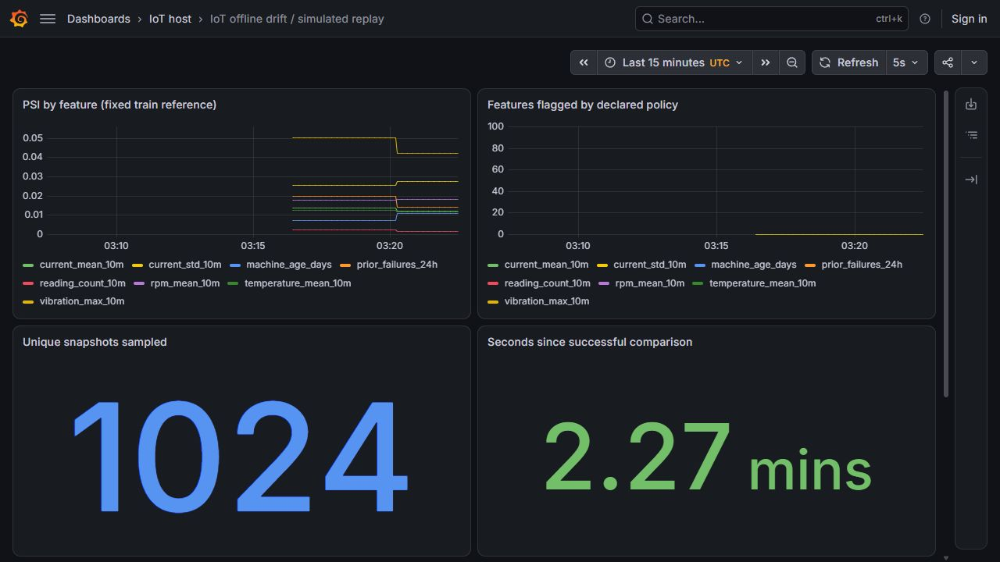
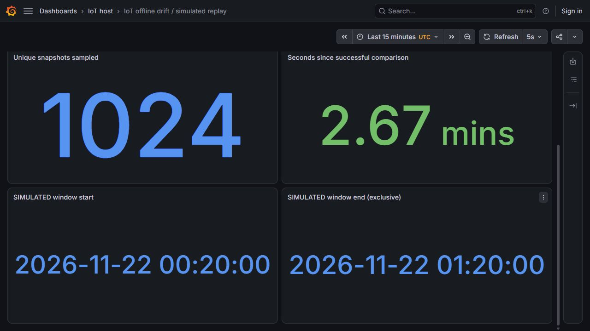

# Airflow theo dõi drift từ Feast offline

Pipeline này đọc tám feature qua SDK Feast, so với mẫu train đã cố định bằng PSI, rồi PUT metric vào Pushgateway để Prometheus/Grafana đọc. Nó không đọc nhãn và không suy ra accuracy. Reference thuộc model3 và tập train đã seal; kết quả mô tả thay đổi so với reference đó, chưa phải giám sát chất lượng model6 đã deploy qua servingCI.

## Đồng hồ và phạm vi

Nguồn là Parquet mô phỏng bất biến đã có trong [Feast](feast-feature-store.md). Airflow chạy mỗi5phút, ánh xạ khoảng thời gian lịch chạy sang cửa sổ event-time mô phỏng dài1giờ, sau ranh giới train12/11. Config khai báo hai mốc đồng hồ riêng; khi vượt ngày cuối nguồn, task thất bại thay vì lặp cửa sổ cũ hoặc sinh thêm dữ liệu. `catchup=False`, một run hoạt động, không retry tự động.

Mỗi cửa sổ chọn tối đa1.024snapshot bằng SHA256 của khóa máy/thời gian; chỉ nhận reading_count≥1. SDK đọc registered feature service từ bản copy registry, rồi so grain và cả tám giá trị với truy vấn trực tiếp cùng nguồn. Parquet/reference/protocol được kiểm SHA trước/sau. Nhãn, trạng thái truth và bảng sự cố không nằm trong SQL hoặc payload. `created` là audit build clock của backfill, nên lookup khai báo `filter_by_created_timestamp=False`; tính khả dụng lịch sử được kiểm upstream bằng arrival≤snapshot. Đây không phải bằng chứng dữ liệu từng được phục vụ ở những ngày mô phỏng.

[DAG](../airflow/dags/iot_offline_drift.py) gọi [adapter Docker](../feature_store/drift_airflow.py) trong SDK image ID bất biến:1CPU/3GiB, readonly root/source, chỉ output mới được ghi. Các attempt giữ thư mục riêng. [Job](../feature_store/drift_monitor.py) không ghi success metric khi input/lookup/validation lỗi. SDK không materialize hoặc ghi Redis.

## Metric và vận hành

[Pushgateway1.11.4](https://github.com/prometheus/pushgateway/releases/tag/v1.11.4) dùng binary chính thức [đã pin](../infra/monitoring/pushgateway-linux.json), listener loopback19092. Publisher PUT thay nguyên nhóm cố định `job=iot_offline_drift`, không đưa run ID/machine ID/thời gian làm nhãn. Có tám PSI, tám policy flags, sample count, hai biên event-time, thời điểm thành công theo wall clock và reference ID.

Pushgateway giữ metric cũ cho đến khi bị thay/xóa; vì vậy dashboard luôn hiển thị tuổi lần so sánh thành công. Scrape `up=1` của gateway không chứng minh task Airflow vừa chạy thành công. Xem [khuyến nghị Prometheus](https://prometheus.io/docs/practices/pushing/) và [ngữ nghĩa PUT/honor_labels](https://github.com/prometheus/pushgateway/blob/master/README.md). Không tự xóa lịch sử, đổi ngưỡng theo holdout, retrain hoặc promote chỉ vì có drift.

## Kiểm tra hiện có

Code mới đã qua7unit kiểm clock mapping, train/data boundary, kích thước mẫu, từ chối timestamp thiếu timezone/public publisher, số liệu gauge biết đáp án và hai loại đồng hồ trên dashboard. Oracle PSI riêng dùng fixture hai bin tính tay và cố tình sửa score/count/decision để xác nhận bộ kiểm phát hiện sai:

```powershell
python -m unittest tests.test_drift_monitoring tests.test_offline_drift_oracle -v
```

Ngày28/10/2026 trên VM8CPU/64GiB, Airflow3.1.7 tạo hai scheduled runs lúc03:15 và03:20UTC, cả hai task SUCCESS lần thử1, lần lượt16,286 và11,685giây. Mỗi run đọc1.024snapshot bằng SDK image Feast0.67.0 đã kiểm trước đây; không chạy Spark hoặc ghi Redis. Hai cửa sổ là `[2026-11-22 00:15,01:15)` và `[00:20,01:20)` UTC mô phỏng. Các snapshot hai cửa sổ có thể trùng; không coi2.048là2.048quan sát độc lập.

[Raw inputs/reports/readbacks](evidence/offline-drift-linux/manifest.json) có64payload/1.720.835byte, gồm60file native nguyên byte, inventory gốc và ba JPEG thật. [Bộ kiểm độc lập](../scripts/verify-offline-drift.py) xác nhận26Git source bindings, tính lại cả8histogram/PSI/decision từ reference và observations, rồi so23gauge và20giá trị của sáu panel qua từng engine Prometheus/Grafana. Mẫu kiểm số ở03:21UTC và ảnh trình duyệt lúc03:23 là các quan sát riêng, không ghép thành cùng timestamp.



Lượt thứ hai PSI nằm trong khoảng0,00163–0,04240, không feature nào vượt0,2; **không có cảnh báo drift**. Đây là kết quả trên mẫu tối đa1.024, không kết luận toàn bộ nguồn không drift. Hai cửa sổ sau train nhưng dữ liệu vẫn tổng hợp, không dùng để đo accuracy hoặc đổi ngưỡng theo holdout.



Phép thử riêng dùng config sai source SHA: container trả1 với lỗi binding, original Parquet/reference vẫn readonly;23successgauge trước/sau giữ nguyên byte. [Receipt lỗi](evidence/offline-drift-linux/negative/verification.json) và log được giữ. Gateway chạy usernobody/256MiB/0,25CPU/listener127.0.0.1:19092; chỉ thêm một scrape job, Prometheus/Grafana giữ nguyên PID. SDK mỗi task1CPU/3GiB; snapshot ghiMemoryMax là giới hạn cấu hình, không đo peak toàn tác vụ.

Airflow3.1.7 thực tế chọn CronTriggerTimetable nên interval_start=end ở mốc trigger; job chỉ dùng endpoint đó để ánh xạ, không dùng độ dài interval làm cửa sổ feature. Manual probe phải gửi `interval_end_utc` rõ ràng; không dùng manual run làm bằng chứng scheduler tự chạy ([Airflow](https://airflow.apache.org/docs/apache-airflow/stable/core-concepts/dag-run.html)).

Kiểm UI phát hiện date unit đọc metric seconds thành milliseconds nên hiển thị1970. Dashboard đã sửa query nhân1.000 cho đúng [đơn vị ngày của Grafana](https://grafana.com/docs/grafana/latest/visualizations/panels-visualizations/configure-standard-options/); metric gốc giữ seconds. Count và event clocks dùng màu trung tính; chỉ tuổi kết quả≥600giây chuyển đỏ theo cadence5phút và một khoảng dự phòng5phút. Màu không đánh giá chất lượng mô hình.

Giữ [ảnh trước sửa](evidence/offline-drift-linux/date-before.jpg) và JSON cũ. SDK/DAG/adapter thực chạy gắn commit`0bca67c`; dashboard và oracle gắn`e7ac32e`. Sửa date presentation không thay source input, metric gốc hoặc kernel PSI.

## Tự kiểm và chạy lại

Từ repo clone có lịch sử Git, chỉ cần Python chuẩn để kiểm capsule; không cần mở VM hoặc Docker:

```powershell
python -S scripts/verify-offline-drift.py
python -m unittest tests.test_drift_monitoring tests.test_offline_drift_oracle -v
```

Native run cần dữ liệu/state/reference đã có trên VM, không có trong Git. [Clock](evidence/offline-drift-linux/runtime/clock.json) và [deployment descriptor](evidence/offline-drift-linux/runtime/config.json) là input đã dùng, không phải lệnh yêu cầu ghi đè runtime. Khi chạy một demo mới, chọn wall_origin mới và event_origin sau train nhưng trong nguồn; giữ nguyên SHA source/reference. Dùng thư mục output mới:

```bash
python -m feature_store.drift_monitor \
  --state /workspace/data/feast/batch-medium-27 \
  --batch-report /inputs/batch-report.json \
  --reference /inputs/reference.json --config /inputs/clock.json \
  --output /output/new-attempt --interval-end 2026-10-28T03:20:00Z
```

Đây là lệnh bên trong image/mount đã ghi ở[adapter](../feature_store/drift_airflow.py), không chạy từ host nếu chưa cấu hình đúng. Cổng Pushgateway chỉ loopback. DAG mặc định pause khi mới tạo; chỉ unpause sau input bindings/gateway/scrape đã kiểm. Khi không cần theo dõi, pause riêng DAG này, giữ thư mục bằng chứng và dữ liệu; Pushgateway vẫn giữ metric cuối nên phải đọc tuổi kết quả.

Cập nhậtF51: [Airflow→KFP retrain](drift-retraining.md) đã có task thứ hai, native5task SUCCEEDED/model7candidate, no-drift skip/replay/cooldown và proof riêng. Lượt huấn luyện là manual probe giữ drift=false; không nhận là có cảnh báo tự động hoặc quality improvement. Với `max_active_runs=1`, lúc chờ training dài thì monitoring kế tiếp phải chờ; tuổi metric vẫn hiển thị thật. Hai scheduled runs/source0bca và dashboard ở mốcF50 phía trên giữ nguyên; traces còn thiếu.
