# Airflow DP1–DP3, validation and DataHub lineage

The native pilot runs DP1 Bronze→DP2 Silver/Gold→DP3 features/labels through Airflow 3.1.7. Each stage ingests, validates and publishes metadata before triggering the next. Spark 3.5.9 jobs run through a one-slot pool with explicit resource limits.

Two clean batches passed 64 rules across 14 outputtables. A separate batch with a null machine key was rejected, blocking downstream DP2/DP3 publication; recovery preserved the failure history. The gate included 91 unit tests and 11 known-answer Spark fixtures.

DataHub receives schemas, producing jobs, table lineage and external assertions through its SDK. GMS/UI readbacks establish that metadata was actually indexed. Images and source/config identities are recorded, and database/broker/search ports remain private.

This pilot uses Parquet Gold and a bounded source. It does not establish a 100 GB full-feature Airflow run or a SQL warehouse deployment. The full-scale Bronze/Silver runner, later feature stores and DataHub restoration are separate workloads.

## Airflow integration: each pipeline in the UI

[iot_data_pipelines.py](../airflow/dags/iot_data_pipelines.py) defines three DAGs. The [task adapter](../pipelines/airflow_tasks.py) invokes the Spark stage, checks the persisted outputs and publishes metadata; the downstream stage is triggered only after the preceding gate succeeds.

| DAG | Input → persisted output | Native successful run capture |
|---|---|---|
| DP1 | Immutable source JSONL → four Bronze tables | [Original DP1 screenshot](evidence/orchestration/screenshots/airflow-dp1-success.jpg) |
| DP2 | Bronze → three Silver tables and five Gold tables | [Original DP2 screenshot](evidence/orchestration/screenshots/airflow-dp2-success.jpg) |
| DP3 | Silver/Gold history → separate feature and label tables | [Original DP3 screenshot](evidence/orchestration/screenshots/airflow-dp3-success.jpg) |

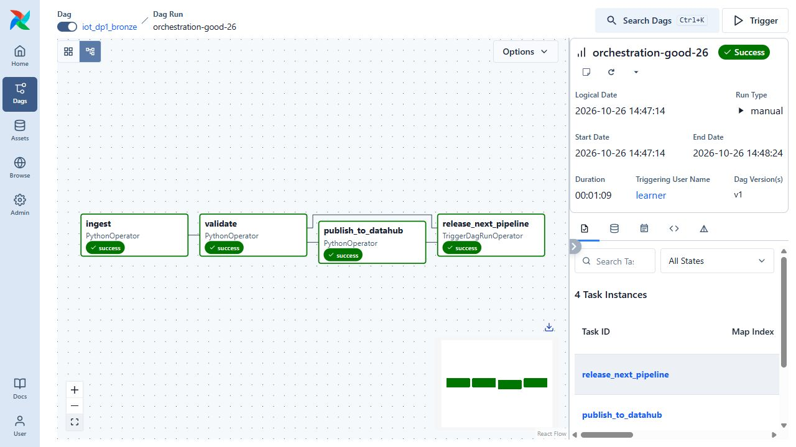

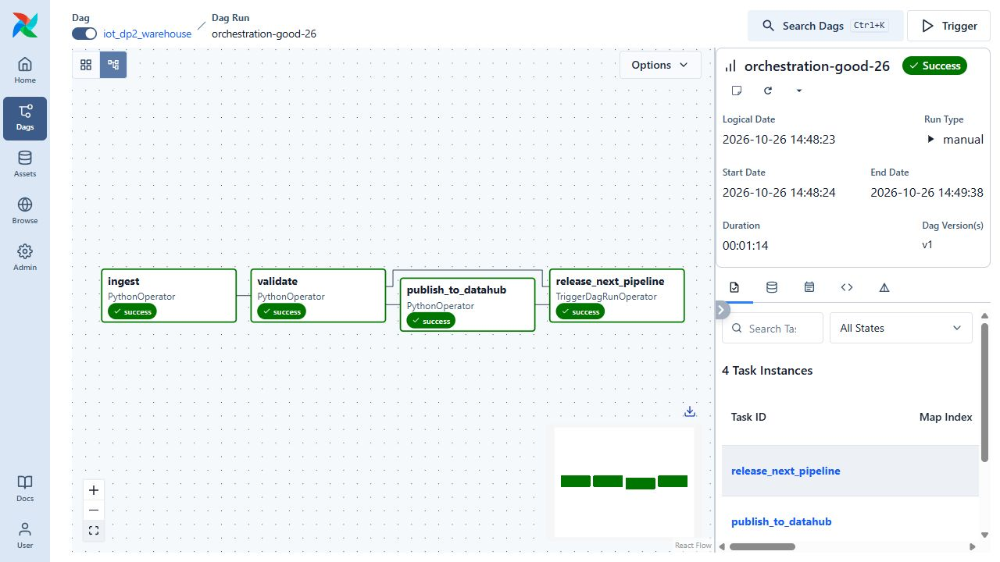

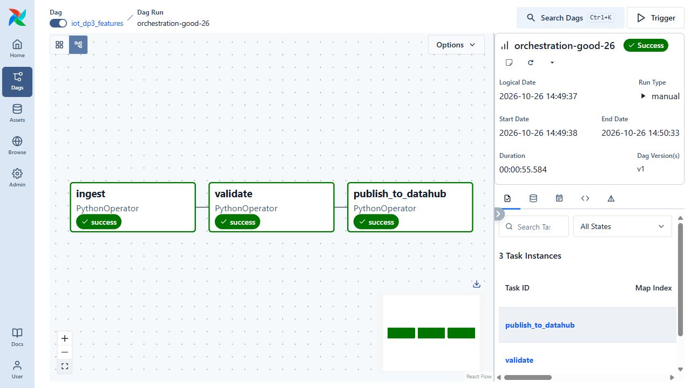

For `orchestration-recovery-26`, [the original readback](evidence/orchestration/verification.json) records DP1 **17 checks / 4 outputs**, DP2 **32 checks / 8 outputs**, and DP3 **15 checks / 2 outputs**. The pilot uses 58,752 Bronze telemetry rows and 57,600 unique Silver/fact rows. These counts belong to this pilot, not the 60-day ML cohort or the 100 GB ingest.

## DataHub lineage and validation: evidence by stage

| Stage | Indexed metadata evidence | Native screenshot coverage |
|---|---|---|
| DP1 lineage | [DP1 publication](evidence/orchestration/orchestration-recovery-26/dp1/datahub-publication.json); [GMS/GraphQL readback](evidence/orchestration/orchestration-recovery-26-datahub.json) | [Original DP1 task: four raw inputs → four Bronze outputs](evidence/data-platform-review/screenshots/datahub-dp1-lineage-all-tables.jpg) |
| DP1 validation | [17 persisted-data rules](evidence/orchestration/orchestration-recovery-26/dp1/validation.json); injected null-machine failure and blocked downstream DAGs | [Original pass→fail→pass history](evidence/orchestration/screenshots/datahub-validation-pass-fail-pass.jpg) |
| DP2 lineage | [DP2 publication](evidence/orchestration/orchestration-recovery-26/dp2/datahub-publication.json); same indexed readback | [Original DP2 task: four Bronze inputs → eight Silver/Gold outputs](evidence/data-platform-review/screenshots/datahub-dp2-lineage.jpg) |
| DP2 validation | [32 persisted-data rules](evidence/orchestration/orchestration-recovery-26/dp2/validation.json), definitions and indexed results | [Silver telemetry Quality](evidence/data-platform-review/screenshots/datahub-dp2-quality.jpg): seven assertions on this dataset; [unique-event history](evidence/data-platform-review/screenshots/datahub-dp2-quality-history.jpg) |
| DP3 lineage/validation | [DP3 publication](evidence/orchestration/orchestration-recovery-26/dp3/datahub-publication.json), fifteen rules | Original feature lineage/Quality screenshots below |

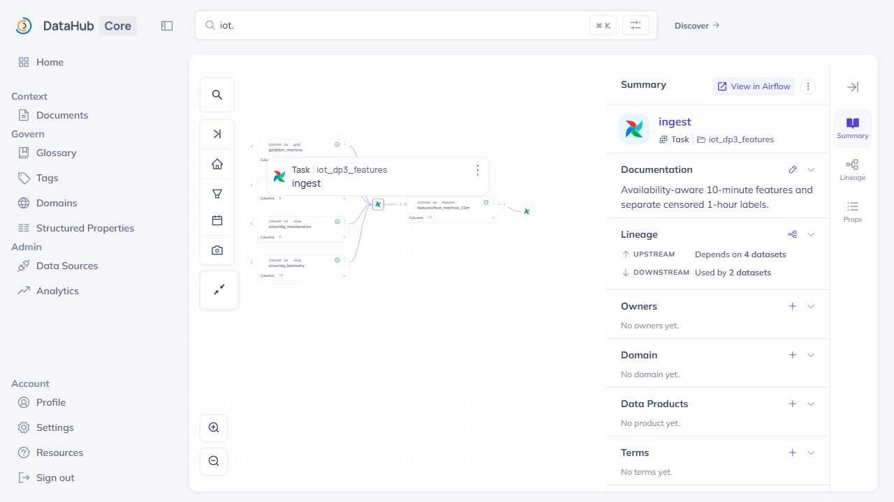

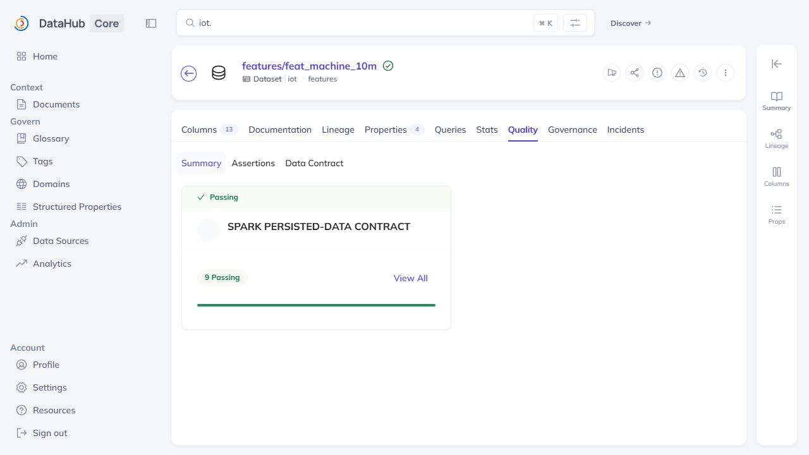

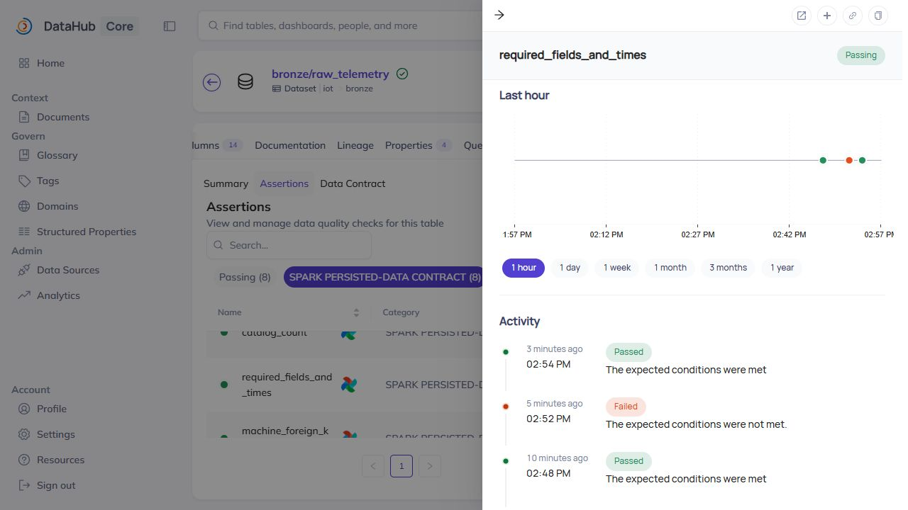

### DP1 and DP2 native captures

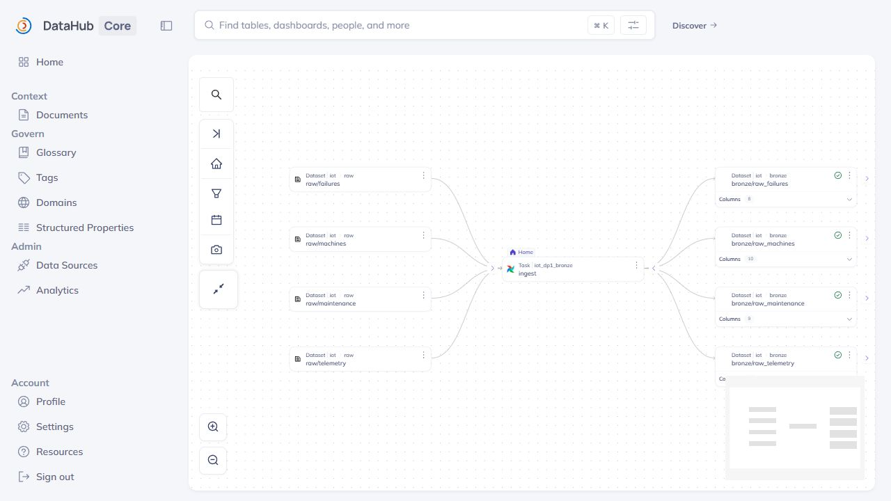

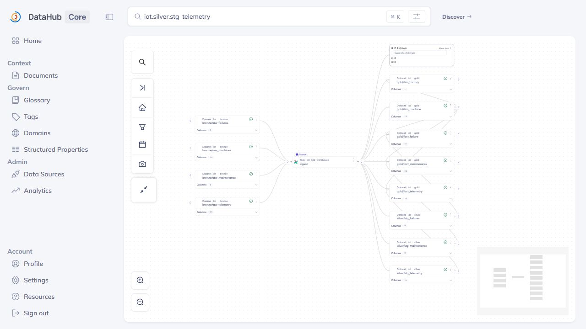

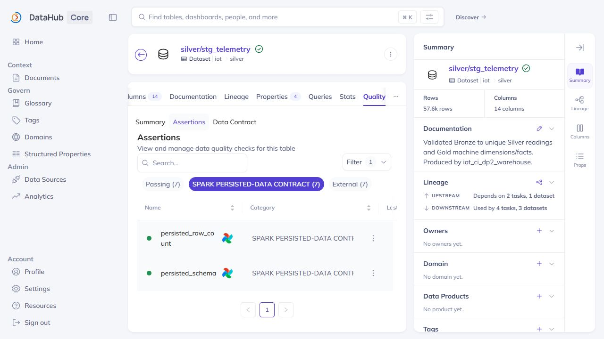

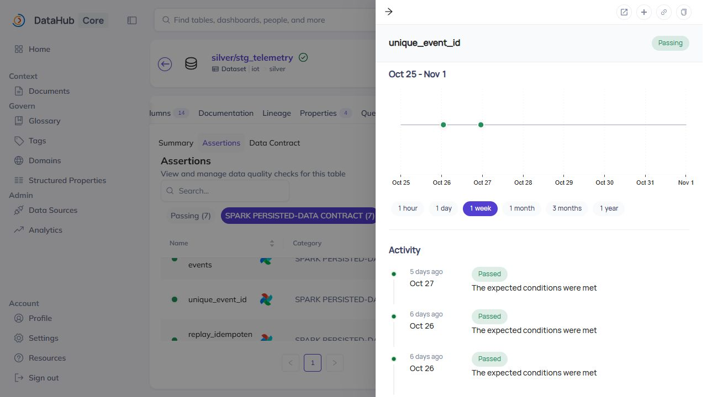

These captures were taken on 1 November from retained indexed metadata. The selected lineage tasks are `iot_dp1_bronze/ingest` and `iot_dp2_warehouse/ingest`, whose external run links identify `orchestration-recovery-26`. The catalog also contains CI DAGs. Dataset properties and the latest Quality links identify the later `iot_ci_dp2_warehouse` run `jenkins-2-1`, evaluated on 27 October. That is seven assertions on **one dataset**, not all 32 stage rules. The [capture receipt and native DOM records](evidence/data-platform-review/datahub/capture.json) preserve these distinctions. No metadata was republished and no new validation run was claimed for taking the images.

The original standalone skew benchmark and full-scale runner remain distinct from these three pilot DAGs. The later benchmark DAG below gives the skew query its own actual Airflow execution. [The data review](data-processing-review.md) separates correctness transformations, measured alternatives and their workload sizes.

## Measured benchmark DAG

[iot_data_benchmarks.py](../airflow/dags/iot_data_benchmarks.py) adds a separate serial experimental workflow, using the same one-slot Spark pool:

| Task | Actual work in the final run | State |
|---|---|---|
| `preflight` | Verify code/input hashes, session deadline and host RAM/disk reserves | Success |
| `schema_dedup_pairs` | Execute three equivalent pairs per experiment in a bounded Spark container | Success |
| `validate_corrections` | Check report/marker binding and completed event-log task metrics | Success |
| `skew_pairs` | Execute three sort-merge/broadcast pairs on the retained 17.28M Silver rows | Success |
| `validate_skew` | Verify full aggregate equality, unchanged inputs and actual task metrics | Success |

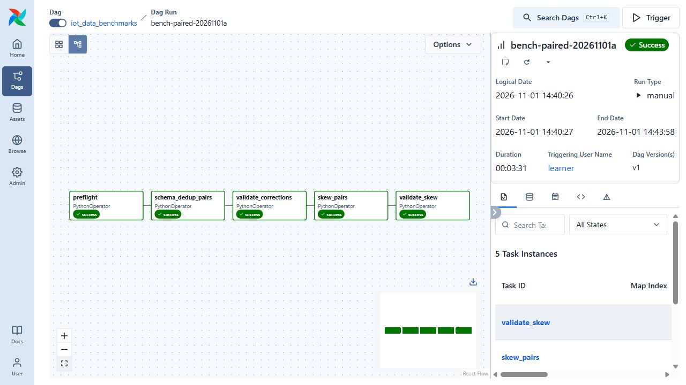

The final run is `bench-paired-20261101a`, with actual scheduler times 20:40:27–20:43:58 UTC on 1 November. Its [API snapshot](evidence/batch-benchmarks/final/airflow.json), task logs and distinct real container IDs are retained. A one-pair pilot passed first; two failed predecessors remain visible and were not cleared. [The comparison report](batch-corrections-benchmark.md) explains the measured boundaries and why the slower aggregate dedup candidate was not promoted into production DP2.

The benchmark workflow is manually triggered after admission. It measures experimental alternatives separately from normal DP1–DP3 publication and the full-scale ingest. The native capture establishes Airflow execution; output equality and completed event logs establish the measured results.

## Commands and recorded examples

Run commands from the repository root unless the example explicitly changes the working directory. Use a fresh output/run name and check the linked runbook before starting platform services. Examples belong to the recorded workload on this page.

```bash
docker build -t iot-coursework-spark:3.5.9 -f infra/spark/Dockerfile .
sudo python3 scripts/start-orchestration.py
sudo python3 scripts/verify-orchestration.py prepare
sudo python3 scripts/verify-orchestration.py health
sudo python3 scripts/verify-orchestration.py trigger --batch my-good-run
sudo python3 scripts/verify-orchestration.py snapshot --batch my-good-run
sudo python3 scripts/verify-orchestration.py metadata --batch my-good-run
```

```bash
sudo python3 scripts/verify-orchestration.py trigger --batch fixture-null-machine --fault null_machine
sudo python3 scripts/verify-orchestration.py snapshot --batch fixture-null-machine
```

```powershell
gcloud compute ssh iot-cw-vm --project=$projectId --zone=us-central1-a --tunnel-through-iap --quiet `
  --ssh-flag=-N --ssh-flag=-L --ssh-flag=127.0.0.1:18480:127.0.0.1:18480 `
  --ssh-flag=-L --ssh-flag=127.0.0.1:19002:127.0.0.1:19002
```

## Implementation and evidence

- [Recorded artifact: orchestration/verification.json](evidence/orchestration/verification.json)
- [Recorded artifact: orchestration/runtime.json](evidence/orchestration/runtime.json)
- [Recorded artifact: orchestration/screenshots/airflow-three-dags-recovered.jpg](evidence/orchestration/screenshots/airflow-three-dags-recovered.jpg)
- [Recorded artifact: orchestration/orchestration-recovery-26-airflow.json](evidence/orchestration/orchestration-recovery-26-airflow.json)
- [Recorded artifact: orchestration/orchestration-recovery-26-datahub.json](evidence/orchestration/orchestration-recovery-26-datahub.json)
- [Recorded artifact: orchestration/fixture-null-machine-26-airflow.json](evidence/orchestration/fixture-null-machine-26-airflow.json)
- [Recorded artifact: orchestration/screenshots/airflow-dp1-success.jpg](evidence/orchestration/screenshots/airflow-dp1-success.jpg)
- [Recorded artifact: orchestration/screenshots/airflow-dp2-success.jpg](evidence/orchestration/screenshots/airflow-dp2-success.jpg)
- [Recorded artifact: orchestration/screenshots/airflow-dp3-success.jpg](evidence/orchestration/screenshots/airflow-dp3-success.jpg)
- [Recorded artifact: orchestration/screenshots/airflow-validation-blocked.jpg](evidence/orchestration/screenshots/airflow-validation-blocked.jpg)
- [Recorded artifact: orchestration/screenshots/datahub-feature-schema.jpg](evidence/orchestration/screenshots/datahub-feature-schema.jpg)
- [Recorded artifact: orchestration/screenshots/datahub-feature-lineage.jpg](evidence/orchestration/screenshots/datahub-feature-lineage.jpg)
- [Recorded artifact: orchestration/screenshots/datahub-feature-quality.jpg](evidence/orchestration/screenshots/datahub-feature-quality.jpg)
- [Recorded artifact: orchestration/screenshots/datahub-validation-pass-fail-pass.jpg](evidence/orchestration/screenshots/datahub-validation-pass-fail-pass.jpg)
- [Recorded artifact: orchestration/screenshots/datahub-catalog.jpg](evidence/orchestration/screenshots/datahub-catalog.jpg)
- [Recorded artifact: orchestration/git-source-mapping.json](evidence/orchestration/git-source-mapping.json)
- [airflow.apache.org / upgrading_to_airflow3.html](https://airflow.apache.org/docs/apache-airflow/3.1.7/installation/upgrading_to_airflow3.html)
- [github.com / docker-compose.quickstart-profile.yml](https://github.com/datahub-project/datahub/blob/v1.6.0.3/docker/quickstart/docker-compose.quickstart-profile.yml)
- [github.com / v1.6.0.3](https://github.com/datahub-project/datahub/releases/tag/v1.6.0.3)
- [Source: infra/datahub/UPSTREAM_LICENSE](../infra/datahub/UPSTREAM_LICENSE)
- [github.com / assertions.md](https://github.com/datahub-project/datahub/blob/v1.6.0/docs/api/tutorials/assertions.md)

## Related documentation

[Current architecture](architecture.md) · [Demo and recovery](operations.md) · [Rubric index](rubric-tracker.md)

[Original run notes](https://github.com/anle0429/iot-maintenance-platform/blob/a395c4ea47b8f8e235556ab93de3d699ed9df18b/docs/orchestration.md) retain the full historical narrative. Raw evidence files have not been translated or rewritten.
