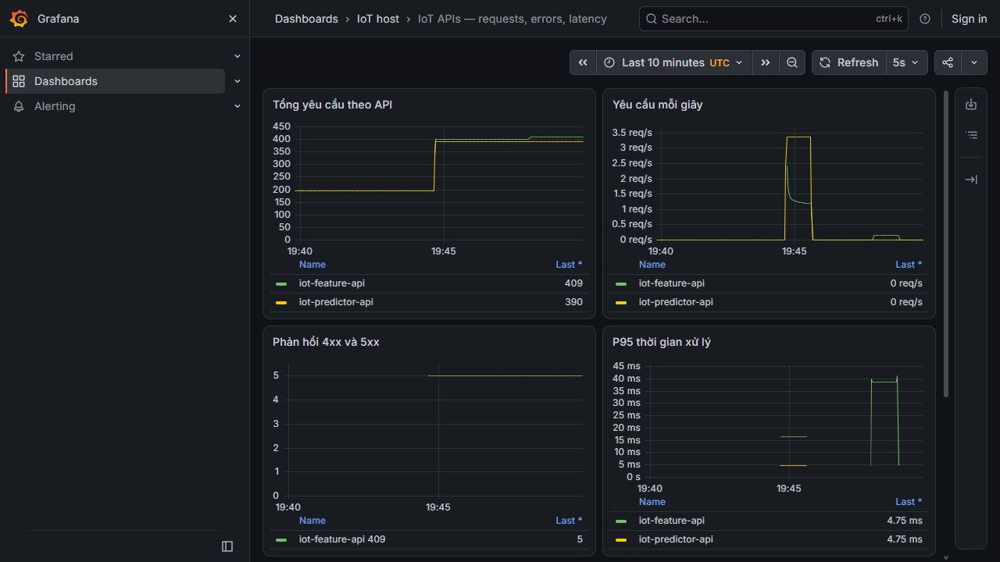
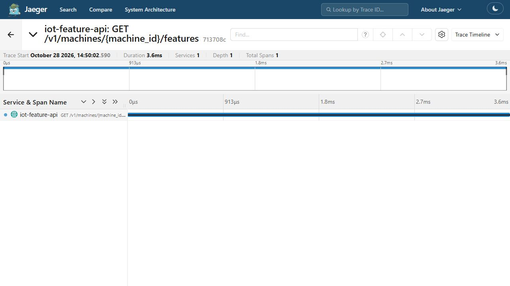

# Private gateway authentication, rate limiting and HTTPS

NGINX Ingress exposes four private lab virtual hosts for metrics, logs, traces and the feature API. Native requests verify Basic authentication, HTTP-to-HTTPS redirects, CA/hostname validation, rate limiting and recovery after the burst.

The original checks include eight 401 responses, four 308 redirects and a 32-request burst with six 200 and 26 responses 429. Later restart/TLS checks restore the CNI-to-loopback relay and verify all four routes using the actual renewed leaf certificate fingerprint.

The `.test` domains use a private CA and explicit host/SNI mapping. Loopback HTTP screenshots through IAP are administrative views, not proof of publicly trusted HTTPS. No public DNS or browser-trusted certificate is claimed. Gateway authentication/rate controls do not by themselves establish cluster-wide network isolation.

## Commands and recorded examples

Run commands from the repository root unless the example explicitly changes the working directory. Use a fresh output/run name and check the linked runbook before starting platform services. Examples belong to the recorded workload on this page.

```powershell
python -S scripts/verify-private-gateway.py
python -m unittest tests.test_gateway_contract -v
```

```bash
sudo python3 scripts/deploy-private-gateway.py --runtime-root "$PWD" --output "$PWD/outputs/gateway-demo" --private "$PWD/data/runtime/gateway-demo-private"
```

## Implementation and evidence

- [Source: scripts/verify-private-gateway.py](../scripts/verify-private-gateway.py)
- [Recorded artifact: private-gateway-linux/verification-final/verification.json](evidence/private-gateway-linux/verification-final/verification.json)
- [Recorded artifact: private-gateway-linux/screenshots/logs-gateway.jpg](evidence/private-gateway-linux/screenshots/logs-gateway.jpg)
- [Recorded artifact: private-gateway-linux/verification-final/logs-native-query.json](evidence/private-gateway-linux/verification-final/logs-native-query.json)
- [Recorded artifact: private-gateway-linux/ui-supplement/trace-713708c.json](evidence/private-gateway-linux/ui-supplement/trace-713708c.json)
- [Recorded artifact: private-gateway-linux/screenshots/features-gateway.jpg](evidence/private-gateway-linux/screenshots/features-gateway.jpg)
- [Recorded artifact: private-gateway-linux/verification-final/feature-http.json](evidence/private-gateway-linux/verification-final/feature-http.json)
- [Recorded artifact: private-gateway-linux/final/rbac-checks.json](evidence/private-gateway-linux/final/rbac-checks.json)
- [Recorded artifact: private-gateway-linux/verification-final/nginx-config.txt](evidence/private-gateway-linux/verification-final/nginx-config.txt)
- [Recorded artifact: private-gateway-linux/verification-final/tls-negative.json](evidence/private-gateway-linux/verification-final/tls-negative.json)
- [Recorded artifact: private-gateway-linux/review-encoding/receipt.json](evidence/private-gateway-linux/review-encoding/receipt.json)
- [Recorded artifact: private-gateway-linux/probe/responses.json](evidence/private-gateway-linux/probe/responses.json)
- [Recorded artifact: private-gateway-linux/feature-refresh/verification.json](evidence/private-gateway-linux/feature-refresh/verification.json)
- [Recorded artifact: private-gateway-linux/header-diagnosis/controller.log](evidence/private-gateway-linux/header-diagnosis/controller.log)
- [Source: infra/gateway/resources.py](../infra/gateway/resources.py)
- [Source: infra/gateway/assets.json](../infra/gateway/assets.json)
- [Source: scripts/deploy-private-gateway.py](../scripts/deploy-private-gateway.py)
- [Source: scripts/check-private-gateway.py](../scripts/check-private-gateway.py)
- [Recorded artifact: private-gateway-linux/sources/gateway-source-v4.json](evidence/private-gateway-linux/sources/gateway-source-v4.json)
- [github.com / v5.7.0](https://github.com/nginx/kubernetes-ingress/releases/tag/v5.7.0)
- [kubernetes.io / ingress-nginx-statement](https://kubernetes.io/blog/2026/01/29/ingress-nginx-statement/)
- [docs.nginx.com / advanced-configuration-with-annotations](https://docs.nginx.com/nginx-ingress-controller/configuration/ingress-resources/advanced-configuration-with-annotations/)
- [github.com / header_parsing_helper.go](https://github.com/nginx/kubernetes-ingress/blob/v5.7.0/internal/configs/version1/header_parsing_helper.go)

## Recorded interface views

These are original captures from the runs described above. Their timestamps, model identities and visible states belong to those runs.






## Related documentation

[Current architecture](architecture.md) · [Demo and recovery](demo-walkthrough.md) · [Rubric index](rubric-tracker.md)

[Original run notes](https://github.com/anle0429/iot-maintenance-platform/blob/f4da7bd21667a8bfca5715a7456bc2bcc813b0fc/docs/private-gateway.md) retain the full historical narrative. Raw evidence files have not been translated or rewritten.
