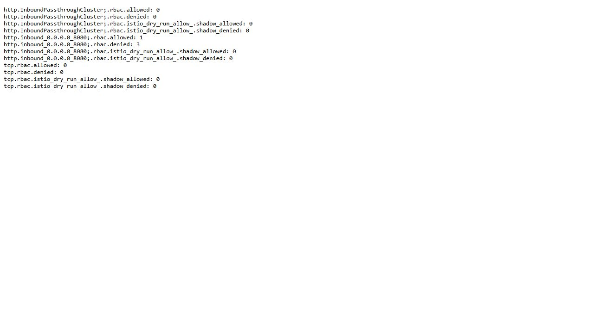
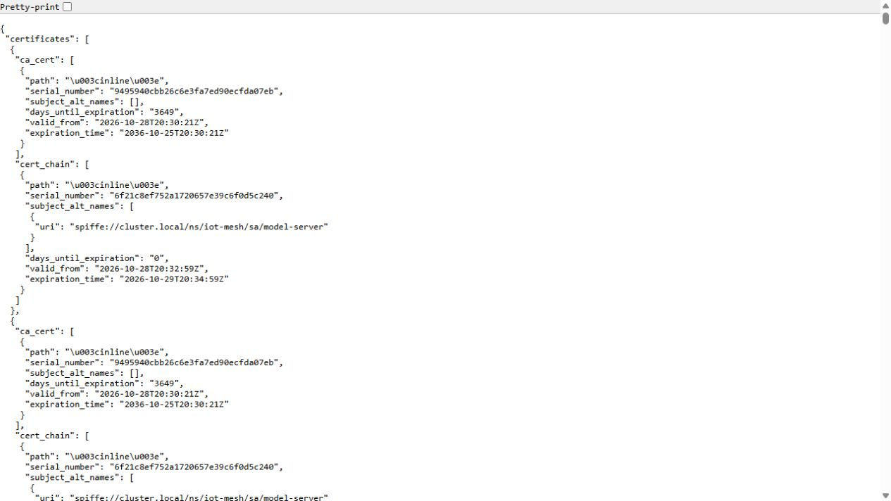

# Service identity and authorization with a private mesh

The recorded Istio 1.31.3 test uses STRICT mTLS and a principal/operation policy in an isolated namespace. An authorized workload calls model 6 successfully and its numeric result matches the independent calculation.

A wrong principal, a spoofed header and an unauthorized operation are rejected 403; a plaintext caller fails the TLS path. Envoy identity/certificate details, application call counts and allowed/denied counters bind the decisions to the actual workload identities.

This is native service-to-service authentication/authorization evidence for the isolated namespace. It does not assert that every production namespace was migrated, that policy survives every failure mode, or that long-duration rotation and HA were validated.

## Commands and recorded examples

Run commands from the repository root unless the example explicitly changes the working directory. Use a fresh output/run name and check the linked runbook before starting platform services. Examples belong to the recorded workload on this page.

```powershell
python -S scripts/verify-private-mesh.py
python -m unittest tests.test_mesh_contract -v
```

## Implementation and evidence

- [Recorded artifact: private-mesh-linux/workloads-readback/verification.json](evidence/private-mesh-linux/workloads-readback/verification.json)
- [Recorded artifact: private-mesh-linux/workloads-readback/server-proxy-log.stdout](evidence/private-mesh-linux/workloads-readback/server-proxy-log.stdout)
- [Recorded artifact: private-mesh-linux/workloads-readback/rbac-counters.stdout](evidence/private-mesh-linux/workloads-readback/rbac-counters.stdout)
- [Recorded artifact: private-mesh-linux/review/certs.json](evidence/private-mesh-linux/review/certs.json)
- [Source: infra/mesh/istio-operator.yaml](../infra/mesh/istio-operator.yaml)
- [Source: infra/mesh/assets.json](../infra/mesh/assets.json)
- [Recorded artifact: private-mesh-linux/control-plane/ready.json](evidence/private-mesh-linux/control-plane/ready.json)
- [Recorded artifact: private-mesh-linux/workloads-readback/pods-before.json](evidence/private-mesh-linux/workloads-readback/pods-before.json)
- [Source: infra/mesh/policies.yaml](../infra/mesh/policies.yaml)
- [Recorded artifact: private-mesh-linux/sources/resume.json](evidence/private-mesh-linux/sources/resume.json)
- [github.com / 1.31.3](https://github.com/istio/istio/releases/tag/1.31.3)
- [istio.io / peer_authentication](https://istio.io/latest/docs/reference/config/security/peer_authentication/)
- [istio.io / authorization-policy](https://istio.io/latest/docs/reference/config/security/authorization-policy/)
- [Recorded artifact: private-mesh-linux/preflight/download.json](evidence/private-mesh-linux/preflight/download.json)
- [Recorded artifact: private-mesh-linux/manifest.json](evidence/private-mesh-linux/manifest.json)
- [Recorded artifact: private-mesh-linux/workloads/baked-model.stderr](evidence/private-mesh-linux/workloads/baked-model.stderr)
- [Recorded artifact: private-mesh-linux/workloads-v2/pods-before.json](evidence/private-mesh-linux/workloads-v2/pods-before.json)
- [Recorded artifact: private-mesh-linux/workloads-readback/resume.json](evidence/private-mesh-linux/workloads-readback/resume.json)

## Recorded interface views

These are original captures from the runs described above. Their timestamps, model identities and visible states belong to those runs.






## Related documentation

[Current architecture](architecture.md) · [Demo and recovery](operations.md) · [Rubric index](rubric-tracker.md)

[Original run notes](https://github.com/anle0429/iot-maintenance-platform/blob/a395c4ea47b8f8e235556ab93de3d699ed9df18b/docs/private-mesh.md) retain the full historical narrative. Raw evidence files have not been translated or rewritten.
