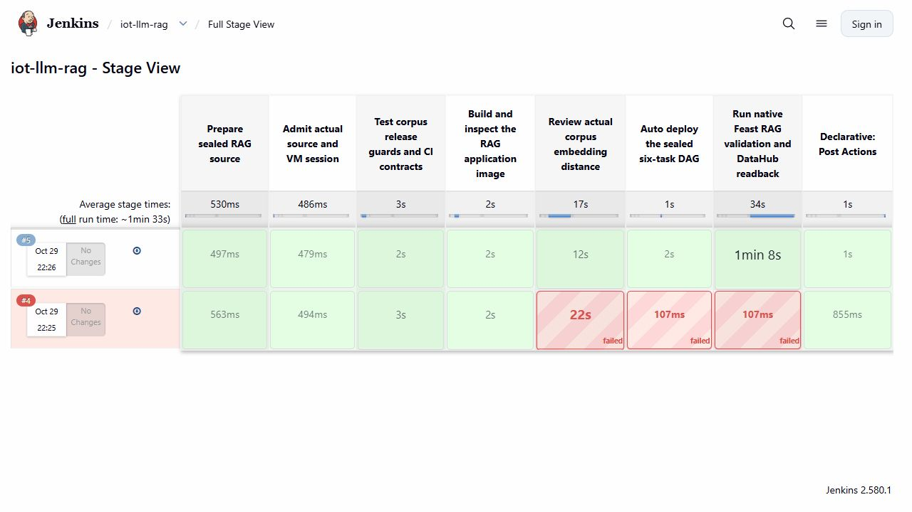
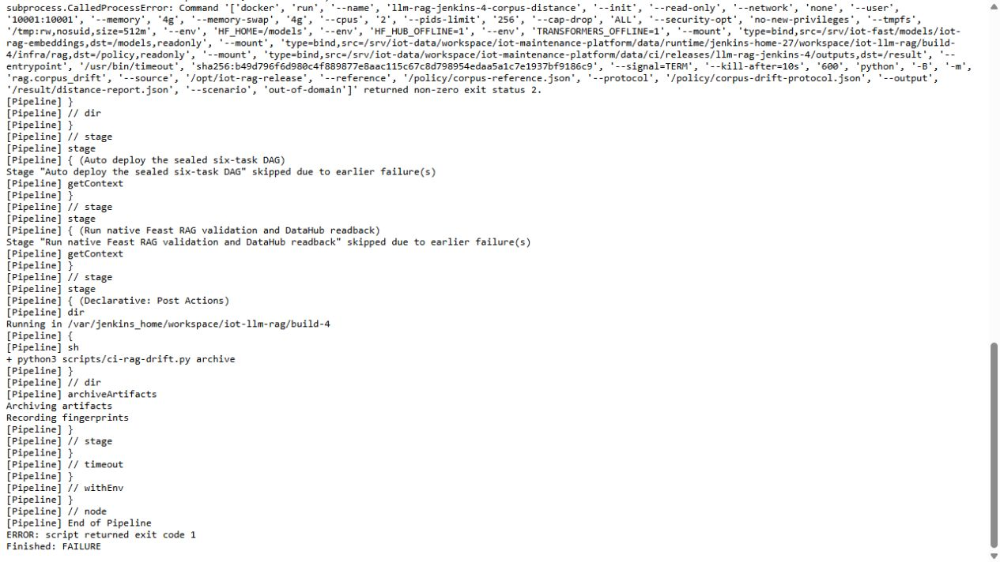

# Review knowledge changes before publication

A valid Markdown file can still introduce the wrong subject into a retrieval system. Source hashes catch unreviewed byte changes; retrieval tests catch specific missing passages. This checkpoint compares the complete candidate knowledge corpus with a fixed reference in the embedding space before publication.

The gate uses the actual packaged corpus and the same pinned encoder used for retrieval. An excessive distance stops CI before the Airflow deployment stage and requests review.



## Method and limits

Each source document is split with the existing chunker. Its actual 384-dimensional chunk embeddings are averaged and the centroid is normalized. Each document contributes one point with equal weight. A long manual cannot gain more weight merely by producing more chunks.

The Gaussian kernel is `k(x,y) = exp(-||x-y||² / (2σ²))`. Empirical squared MMD is the mean of all reference/reference kernel values plus the mean of all candidate/candidate values, minus twice the mean of reference/candidate values. Diagonal terms are included. This is the biased empirical squared norm described in [Gretton et al., A Kernel Two-Sample Test](https://jmlr.org/papers/v13/gretton12a.html).

There are **four authored synthetic reference documents**. They form a complete versioned corpus, not independent samples from production traffic. We use MMD as a deterministic version-distance measure. There is no p-value, calibrated false-alarm rate or statistical significance claim. Repeated chunks are not extra independent observations.

The [protocol](../infra/rag/corpus-drift-protocol.json) declares `σ = 1` and a squared-distance review tolerance of `0.02`. Both were committed before the first native embedding measurement. The tolerance is an engineering demonstration setting, not a production-calibrated threshold. The reference, exact model revision, chunking profile and protocol hashes are part of the sealed CI source.

Centroids can hide changes within a document. A small harmful edit may remain below the tolerance; a large distance can reflect a legitimate new topic. Keep source review, provenance, retrieval cases, prompt controls and capability policies alongside this gate. An allow decision does not certify factual accuracy or safety.

## Recorded controls and delivery

| Candidate version | Documents | Measured MMD² | Outcome |
|---|---:|---:|---|
| Current IoT corpus | 4 | 0 | Allowed |
| Same documents in reverse order | 4 | 0 | Allowed |
| Same documents with trailing blank lines | 4 | 0 | Allowed; chunk text is unchanged |
| Synthetic payment, retail, hotel and recipe texts | 4 | 0.4375155223734153 | Review required |

All controls used genuine cached `all-MiniLM-L6-v2` embeddings at revision `1110a243fdf4706b3f48f1d95db1a4f5529b4d41`. An offline verifier independently recomputes centroids and distances from the original vectors; maximum disagreement was `0.0` in this run.

Native job `iot-llm-rag` executed two distinct builds from source `a4a69138740113c291a1f6bfe23c3705014a884b`:

- **Build 4:** the foreign-corpus control exited with code 2 at distance admission. Deployment and verification were skipped. The DAG hash, release inventory and RAG state-directory inventory were unchanged before the next build. Counterfactual texts existed only in gate memory and evidence output.
- **Build 5:** the actual IoT corpus passed admission and the immediate source/image/artifact recheck. Airflow run `rag-ci-a4a69138-5` completed all six tasks. It persisted 18 chunks through Feast/Milvus, passed ten quality checks, ran semantic retrieval checks and published/read back the actual CI lineage in DataHub. Jenkins completed in 93.503 seconds with warm dependencies.

Jenkins paints later stages red after an earlier failure. The original console confirms that build 4 skipped deployment; the red boxes alone do not show execution:



Each gate container had two CPU cores, 4 GiB memory, a read-only model cache, no network, a non-root user and a ten-minute limit. No LLM generation, GPU renewal or feature-cache refresh was needed. Separate [GPU measurements](gpu-inference.md) apply to generation workloads.

The first installer changed the intended pipeline and added `CORPUS_SCENARIO`, then stopped on an XML comparison because Jenkins inserted indentation. A separate read-only recheck confirmed that other job fields were preserved. Both original configurations and helpers remain in the native archive; no build ran until that recheck passed.

## Run and explain it

From a normal clone, check the recorded evidence without downloading a model or starting the VM:

```powershell
python -B -m unittest tests.test_rag_corpus_drift tests.test_rag_drift_ci -q
python -B -S scripts/verify-rag-corpus-drift.py
```

Expect seven test methods and `passed: true`. The verifier authenticates 161 original native payloads, 50 source inputs, container exit states, both CI builds and the six-task Airflow run.

For a new live run on the retained lab, follow the [demo recovery guide](demo-walkthrough.md), open **iot-llm-rag → Build with Parameters**, and explicitly supply:

```text
SOURCE_COMMIT=a4a69138740113c291a1f6bfe23c3705014a884b
CORPUS_SCENARIO=production
```

Only prepared revisions under `data/ci/source/` work. A clone does not contain private service state, the embedding cache or credentials. Use `out-of-domain` only to demonstrate an intentionally rejected build; it cannot authorize publication even if a future distance setting were permissive. Preserve failures and inspect their first failed stage before starting another run.

For your presentation, start with the two stage-view rows. Explain the four-document comparison, show why order and whitespace do not change its geometry, then follow the accepted run into Feast and DataHub. Finish with one blind spot: a short unsafe instruction can change meaning without moving a document centroid very far.

This is the LLM-specific MMD application for L62; the learner confirmed MMD was not taught. The earlier [sensor-drift experiment](joint-cohort.md) remains separate ML evidence. [OPA agent admission](agent-admission-policy.md) is the other researched extension. Neither completes the remaining [LLM rubric](final-llm-rubric-tracker.md) by itself.
