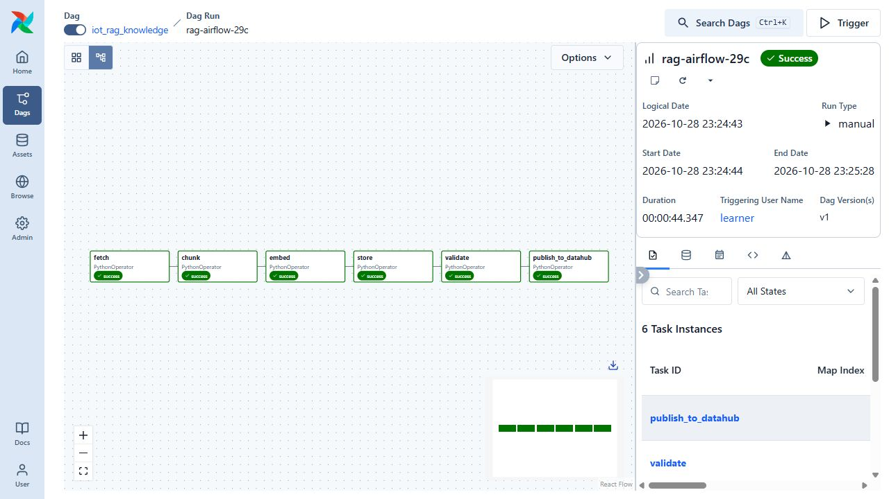
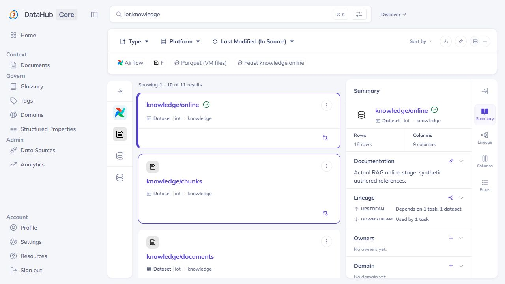
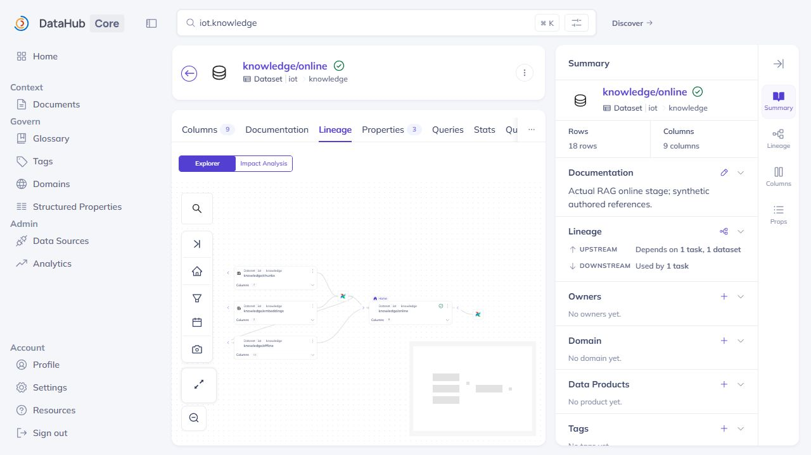
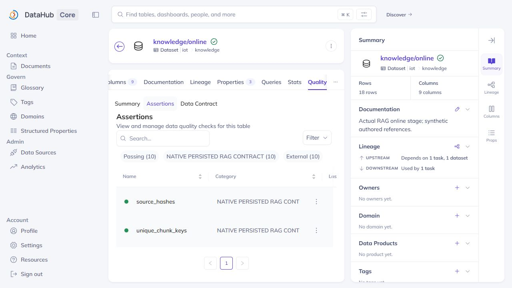
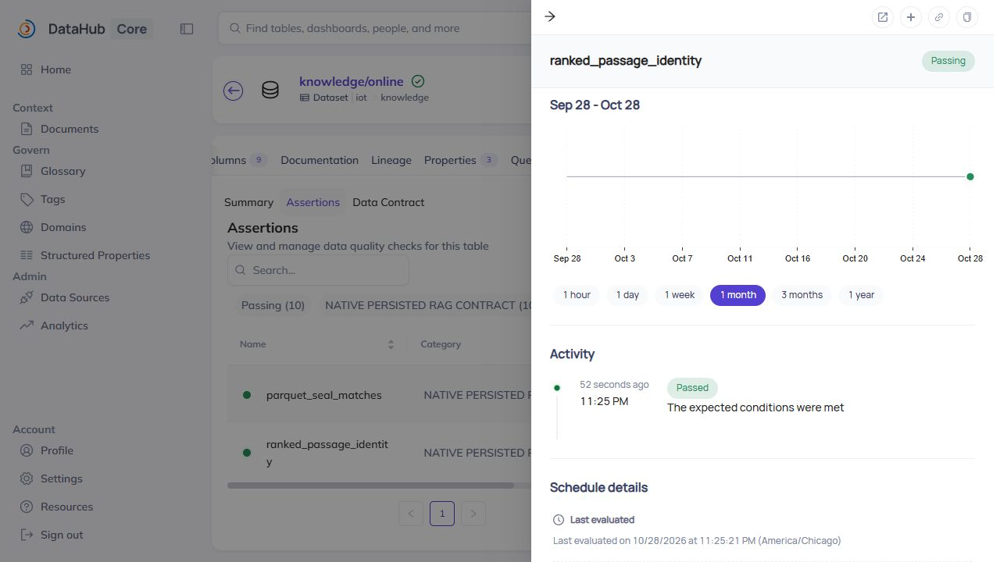
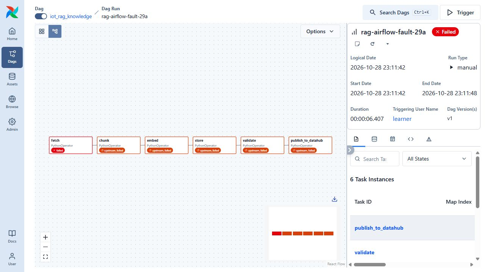

# Airflow RAG pipeline and DataHub governance

The knowledge pipeline now runs as six real Airflow tasks on the coursework VM. It validates persisted data before publishing five datasets, their schemas, lineage, jobs and assertion results to DataHub. The recorded corpus contains four authored references and 18 chunks; this is a bounded knowledge workload, separate from the 100-GB telemetry source.

## Task responsibilities

| Task | Input and output |
|---|---|
| `fetch` | Check catalog/source hashes and retain four declared documents |
| `chunk` | Split sections into 18 stable, source-traceable records |
| `embed` | Generate normalized 384-dimensional vectors with the pinned MiniLM model |
| `store` | Write offline Parquet and the isolated Feast/Milvus online view; replay the same keys |
| `validate` | Read persisted data, check counts/provenance/vector validity/replay, and verify ranked passage identities |
| `publish_to_datahub` | Require the validation report and unchanged artifact hashes, then publish and read metadata back |

The [DAG](../airflow/dags/iot_rag_knowledge.py) permits one active run, no automatic retries and only a prepared `run_id`. The [task launcher](../rag/airflow_tasks.py) checks the release's source hashes, immutable image IDs and existing private DataHub bridge before creating bounded containers. Heavy embedding/Feast libraries stay outside the Airflow scheduler.

## Successful native run

`rag-airflow-29c` completed all six tasks on 29 October 2026 UTC, with a recorded DAG duration of 44.347 seconds. This is one execution, not an optimization benchmark. The browser displays the corresponding Chicago time on 28 October.



All native containers exited zero without OOM. Data stages used two CPUs/4 GiB; metadata publication used one CPU/2 GiB. They ran as UID 10001 with read-only roots and dropped capabilities. Data stages used no network; the publisher joined the actual existing DataHub bridge. Source, image, container and task identities are retained in the [native receipts](evidence/rag-orchestration/success/native/verification.json).

## Validation and governance

The [persisted quality report](evidence/rag-orchestration/success/state/quality.json) records ten passing checks: source hashes, unique keys, equal stage counts, finite normalized vectors, online text, online provenance, replay equality, Parquet identity, native semantic queries and ranked passage identity. The last check was added after an independent review exposed cross-column ordering ambiguity in a Feast vector response; the [grounding report](llm-grounding.md) explains the correction.

The [publisher](../rag/metadata_publish.py) acknowledged 52 aspects, then independently read dataset schemas and upstream lineage from GMS. DataHub indexed five datasets and the Airflow flow/jobs. The online view has 18 rows and nine decoded fields; its schema description is explicitly based on actual SDK values rather than invented SQL types.





The lineage image was captured after the first successful publication of the same five-dataset topology. The corrected run updates that topology and adds the tenth assertion. Dataset schema/lineage readback covers all five stages; this image shows the selected online dataset's visible neighborhood.





## Failure behavior

The controlled `rag-airflow-fault-29a` fixture changes the monitoring source while retaining its declared catalog hash. The source packet itself is correctly sealed, so the real catalog check must detect the mismatch. `fetch` failed with `Source size/hash mismatch: monitoring`; all five downstream tasks were `upstream_failed`, with zero attempts. No invalid snapshot reached publication.



An earlier infrastructure failure is also retained: five stages completed but publication could not start on an obsolete Docker network ID after a prior restart. The corrected deployer derives the live GMS bridge and DNS alias rather than trusting the stale network name. That infrastructure failure is separate from the intentional bad-source test. Previous runs and database files were not deleted or relabeled.

## Inspect and repeat

On the PC, inspect the recorded artifacts without a running VM:

```powershell
python -S scripts/verify-rag-foundation.py
python -S scripts/verify-rag-orchestration.py
python -S scripts/verify-llm-grounding.py
```

The orchestration checker verifies [223 original payloads](evidence/rag-orchestration/manifest.json): uploaded source, Airflow states, actual containers, persisted artifacts, GMS readback, rejected predecessors and eight unmodified browser images. The grounding checker independently verifies generated answers and source identities.

On the retained VM, from its repository root during an approved active session, create a new release/run using the already validated source:

```bash
sudo python3 data/llm-source/rag-airflow-29c/tree/scripts/deploy-rag-airflow.py \
  --runtime-root "$PWD" --source-root "$PWD/data/llm-source/rag-airflow-29c/tree" \
  --run rag-practice-02
```

The runner requires at least 40 minutes remaining and 10 GiB available RAM. It preserves existing run names, stores credentials only in the existing private runtime file and waits for actual Airflow task states. Inspect `outputs/rag-practice-02/verification.json`, then open the same run in Airflow and search for `iot.knowledge` in DataHub. The current PC tunnels use ports 19903 and 19902 respectively; they are local connections, not published Internet services.

This closes the recorded ingestion/governance milestone only. RAG CI/CD, schema-update rollout, authenticated MCP tools, agents and their deployment/testing/observability obligations remain separate work in the [LLM tracker](final-llm-rubric-tracker.md).
