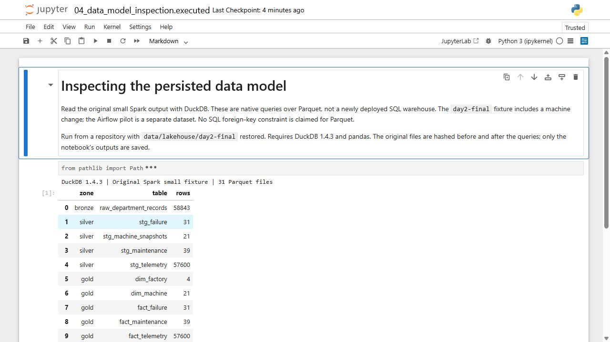
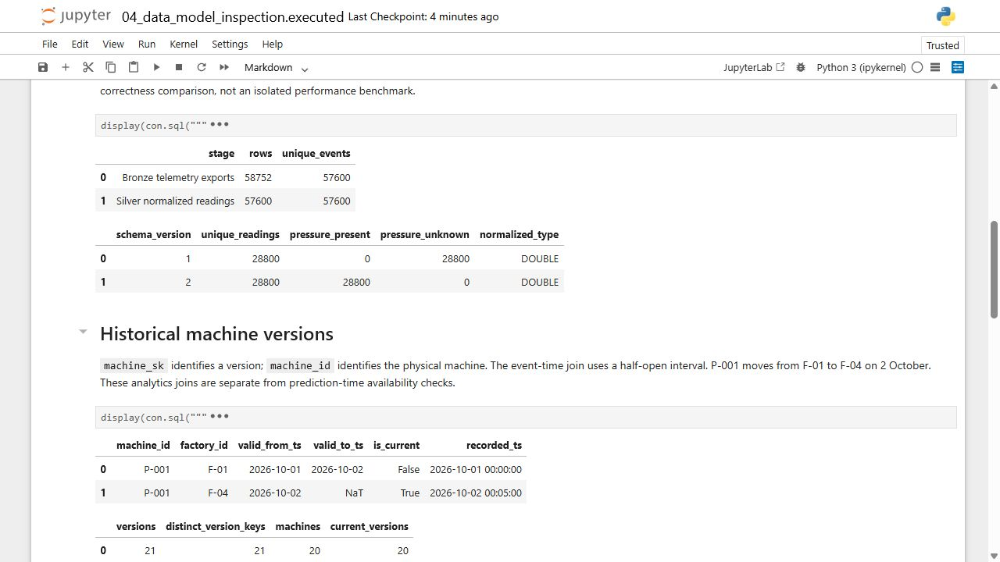
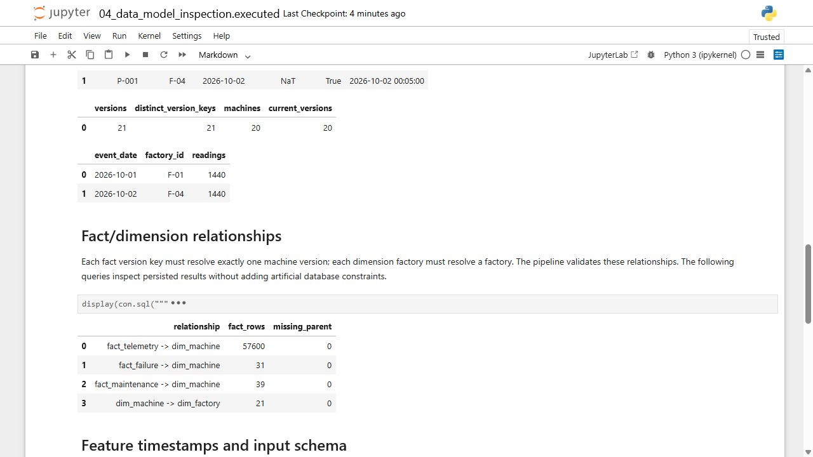
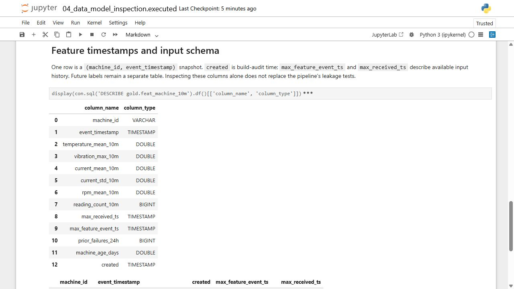
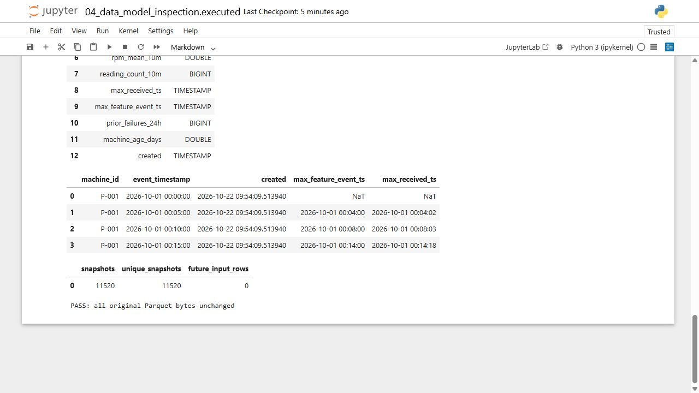
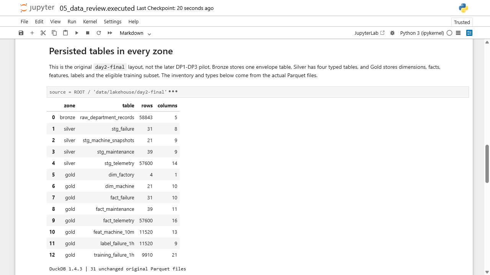
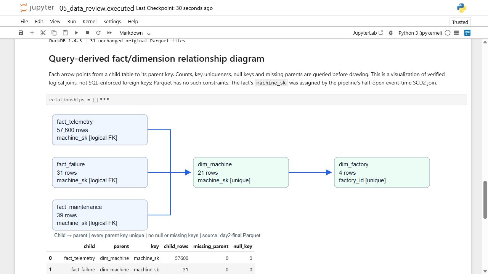
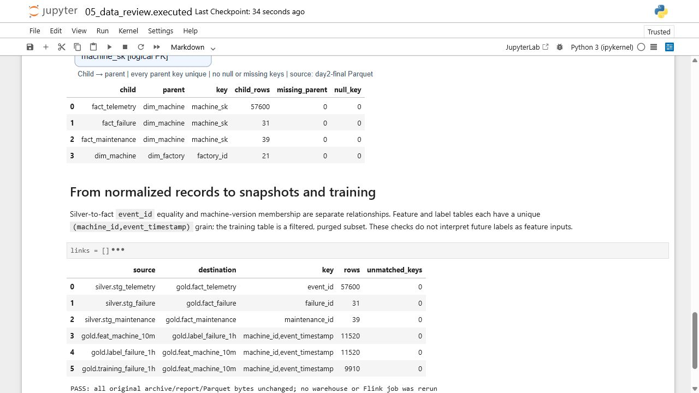

# Table design and historical relationships

The persisted Parquet tables are inspected in [an executable SQL notebook](../notebooks/04_data_model_inspection.ipynb). Native Jupyter captures below show the original small Spark output, including historical machine versions and relationship checks. This is a Parquet inspection workflow, not a newly deployed SQL warehouse or an enforced foreign-key diagram.

## Zones and grains

| Zone | Tables / prefix | Grain and purpose |
|---|---|---|
| Source | JSONL `machines`, `failure_events`, `maintenance_events`, telemetry v1/v2 | Immutable exports and arrival envelopes, before Spark normalization |
| Bronze | Original batch: `raw_department_records`; later DP1: `raw_machines`, `raw_failures`, `raw_maintenance`, `raw_telemetry` | Original envelopes or parsed source tables, with intentional telemetry duplicates retained |
| Silver | `stg_telemetry`, `stg_failure` (original batch) / `stg_failures` (DP2), `stg_maintenance` | Normalized types; telemetry has one row per `event_id`, with first-arrival semantics preserved |
| Gold dimensions | `dim_machine`, `dim_factory` | One effective-dated machine version; one factory key |
| Gold facts | `fact_telemetry`, `fact_failure`, `fact_maintenance` | Reading, failure onset or maintenance interval enriched with temporal `machine_sk` |
| Features | `feat_machine_10m` | One `(machine_id,event_timestamp)` snapshot, with `created` build-audit time and arrival-aware inputs |
| Labels / training | `label_failure_1h`, eligible entities and training tables | Future outcome kept separate until a validated snapshot/label join |

[DP1–DP3](../pipelines/airflow_tasks.py) and [the original batch job](../pipelines/batch_job.py) use distinct run layouts. The original batch job stores feature/label/training outputs under Gold; the later staged DAG places feature and label tables under `features/`. Their naming/layout difference is not a new table relationship or an SQL warehouse. Persisted formats are Parquet; the small earlier demonstration also publishes selected tables through JDBC. The Airflow pilot does not prove a full SQL warehouse deployment.

## SCD2 and fact/dimension linkage

The [original batch receipt](evidence/day2-final/batch-report.json) records 21 machine versions and 20 current machines. P-001 has these two versions:

| Factory | `valid_from_ts` | `valid_to_ts` | `is_current` | `recorded_ts` |
|---|---|---|---|---|
| F-01 | 2026-10-01 00:00Z | 2026-10-02 00:00Z | false | 2026-10-01 00:00Z |
| F-04 | 2026-10-02 00:00Z | NULL | true | 2026-10-02 00:05Z |

`machine_id` is the business key; `machine_sk` identifies an effective version. [temporal_fact()](../pipelines/transforms.py) joins the fact's event time to `[valid_from_ts,valid_to_ts)`, with NULL as the open upper bound. Telemetry, failure and maintenance facts carry that version key; `factory_id` links machine versions to `dim_factory`. The checks require no missing fact key and no lost or multiplied fact rows. Event-time dimensional enrichment alone does not prove prediction-time availability: the feature path separately respects `recorded_ts` and arrival time.

This changed-machine batch is separate from the orchestration pilot, whose receipt has 20 dimension rows and three factories. Mixing those counts would conceal the absence of the change fixture in that pilot.

The later [schema/dedup experiment](batch-corrections-benchmark.md) measures equivalent reader and winner-selection alternatives on the same small source. It separately exposes the lost v2 pressure under a v1-only reader, preserves unknown v1 pressure as NULL, and independently verifies every complete result. The aggregate dedup candidate's median was higher than the window baseline, so these experiments do not change the production table-building functions above.

## Feature timestamps and naming

`feat_machine_10m` includes `machine_id`, `event_timestamp`, `created`, eight model inputs and audit times such as `max_feature_event_ts`/`max_received_ts`. Event and arrival times bound eligible inputs; `created` is a build timestamp, not a future feature or first arrival. The [native receipt](evidence/day2-final/batch-report.json) records 11,520 feature snapshots. [Feast registration](../feature_store/repository.py) declares the two timestamp columns explicitly and excludes the future label from the feature view.

Prefixes identify roles: `raw_` for Bronze, `stg_` for Silver, `dim_`/`fact_` for dimensional Gold and `feat_` for feature tables. An `obt_` table is not implemented or required to explain this layout. There are no SQL-enforced foreign keys inside a Parquet file; the pipeline's validation performs those relationship checks.

## Native table and relationship inspection

On 1 November, Jupyter on the PC restarted its kernel and ran all notebook queries against 31 original `day2-final` Parquet files. All input hashes were unchanged after inspection. [The executed notebook](evidence/data-platform-review/schema/executed.ipynb) and [input-file inventory](evidence/data-platform-review/schema/input-files.json) preserve the source and outputs.

The historical change resolves 1,440 P-001 facts to F-01 on the first day and 1,440 to F-04 on the second. All 57,600 telemetry facts, 31 failure facts and 39 maintenance facts have a matching machine version; all 21 machine versions have a matching factory. These are actual SQL join results, not inferred database constraints.

`created` still shows the original 22 October build time; inspecting the files did not rebuild them. The 11,520 snapshot keys are unique and no populated input event/arrival timestamp exceeds its snapshot time. Empty history remains NULL/NaT. This timestamp check supplements the pipeline's leakage tests; it does not by itself establish all availability semantics.

A separate read-only VM catalog inventoried 27 tables across the original batch and later staged pilot. DuckDB UI initialization failed on both attempted inspection versions, so none of its pages are presented as successful native proof. Feast's deployed dependency version was unchanged. The successful captures above are from Jupyter with DuckDB 1.4.3. The later query-derived relationship view below supplies the missing graphical presentation without inventing SQL foreign-key constraints.

## Query-derived relationship view

[Notebook 05](../notebooks/05_data_review.ipynb) queries the same 31 original Parquet files and generates the relationship view only after checking parent-key uniqueness, child null keys, missing parents and join row preservation. All seven cells were also run in the actual Jupyter interface. [The saved executed notebook](evidence/data-review-audit/executed.ipynb) retains the SQL and SVG output.

There are thirteen persisted tables: one Bronze envelope table, four Silver tables and eight Gold tables. Gold includes 9,910 eligible/purged training snapshots, a subset of the 11,520 feature/label snapshot keys. The Bronze total of 58,843 includes all source record types; it must not be confused with its 58,752 telemetry exports.

The arrows point from child to parent. Each fact's `machine_sk` resolves one `dim_machine` version, and each dimension row's `factory_id` resolves one `dim_factory`. The row counts come from the files, not an authored estimate. This is a query-generated logical relationship graph, rather than a capture of an enforced database constraint editor.

The six additional key checks compare all Silver/fact keys and feature/label/training snapshot membership, with zero unmatched keys. No source archive, report, SQLite snapshot or Parquet bytes changed during inspection. Bronze-to-Silver is a parsing/dedup transformation; Silver-to-fact enrichment and snapshot joins are distinct relationships.

## Schema-design evidence map

| Source criterion | Actual implementation | Native visible proof |
|---|---|---|
| M1-34: tables and relationships across zones | [Zone/grain table](#zones-and-grains); original batch has one Bronze, four Silver and eight Gold tables | [Complete zone inventory](evidence/data-review-audit/screenshots/schema-all-zones.jpg), [cross-table key readback](evidence/data-review-audit/screenshots/schema-key-readbacks.jpg); DP1–DP3 has its [separate lineage layout](orchestration.md#datahub-lineage-and-validation-evidence-by-stage) |
| M1-35: SCD2 dimension | `machine_sk`, `valid_from_ts`, `valid_to_ts`, `is_current`; half-open temporal enrichment | [Original P-001 change and dimension records](evidence/data-platform-review/screenshots/schema-evolution-dedup.jpg), [21 versions / 20 current and historical fact counts](evidence/data-platform-review/screenshots/schema-relationships.jpg) |
| M1-36: feature event/build timestamps | Unique `(machine_id,event_timestamp)` with `created`; future labels outside the view | [Native feature types](evidence/data-platform-review/screenshots/schema-feature-schema.jpg), [records and input-time bounds](evidence/data-platform-review/screenshots/schema-feature-times.jpg) |
| M1-37: dim/fact relationships | Three fact tables reference a unique effective machine key; machine versions reference a unique factory key | [Query-derived graph](evidence/data-review-audit/screenshots/schema-relationship-graph.jpg), [zero null/missing parents and unchanged join counts](evidence/data-review-audit/screenshots/schema-key-readbacks.jpg) |
| M1-38: naming convention | `raw_`, `stg_`, `dim_`, `fact_`, `feat_`; label/training tables explicitly separate | [All thirteen actual table names](evidence/data-review-audit/screenshots/schema-all-zones.jpg), [role/grain explanation](#zones-and-grains) |

These are evidence mappings to the preserved source criteria, not awarded marks. No new SQL warehouse or constraint enforcement is claimed.
