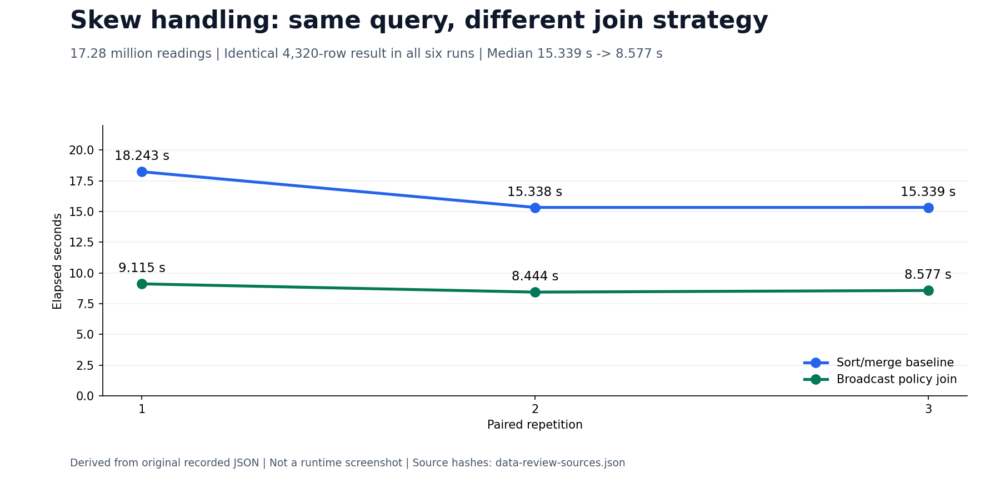
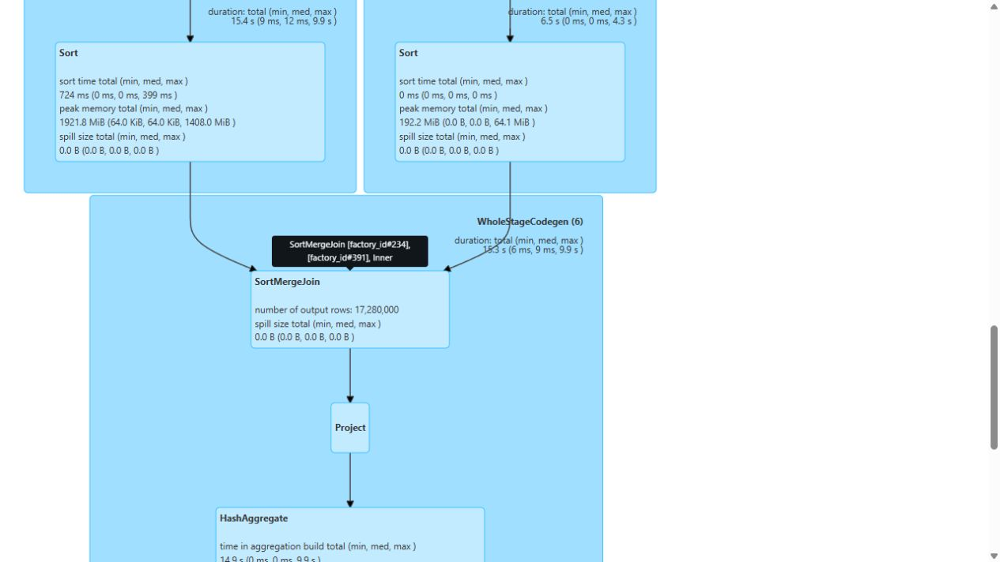
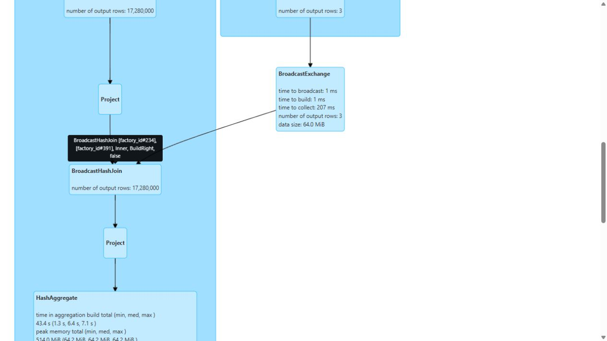
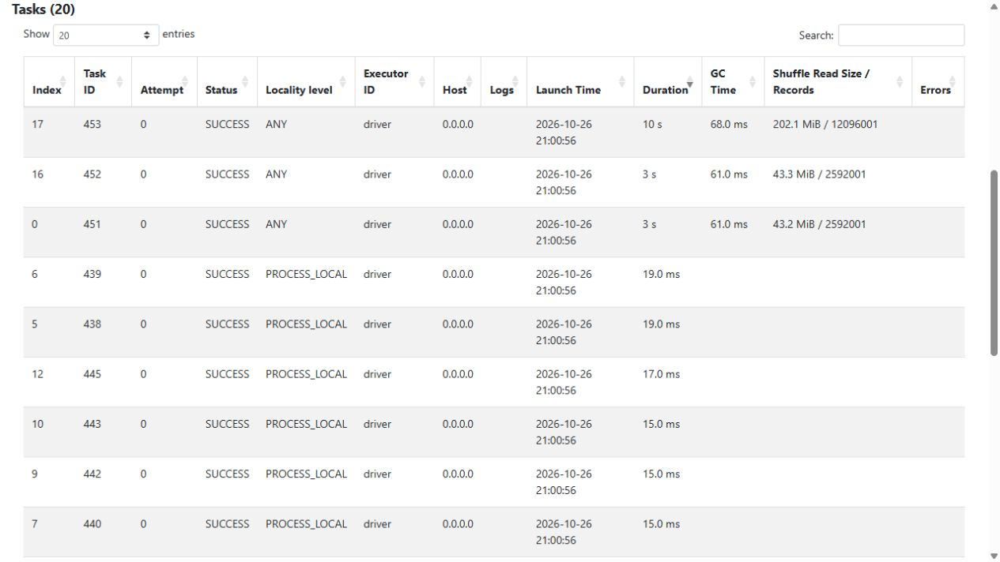
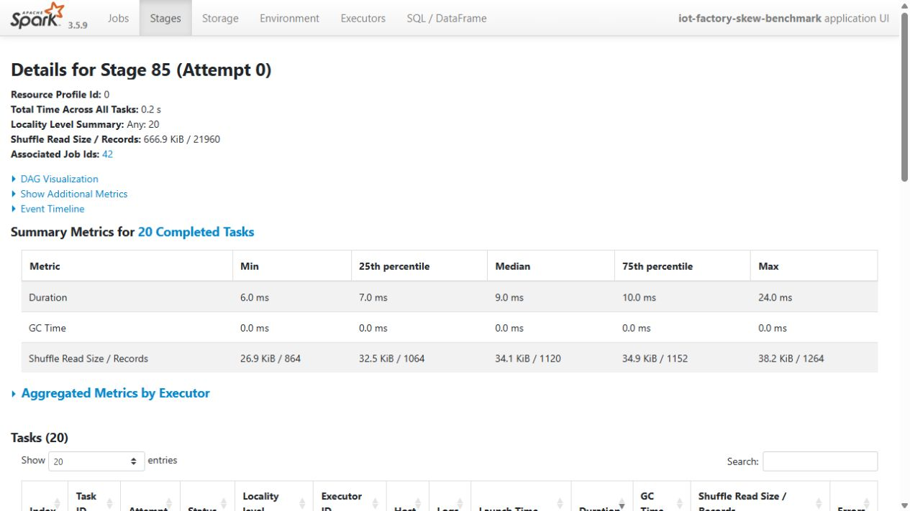
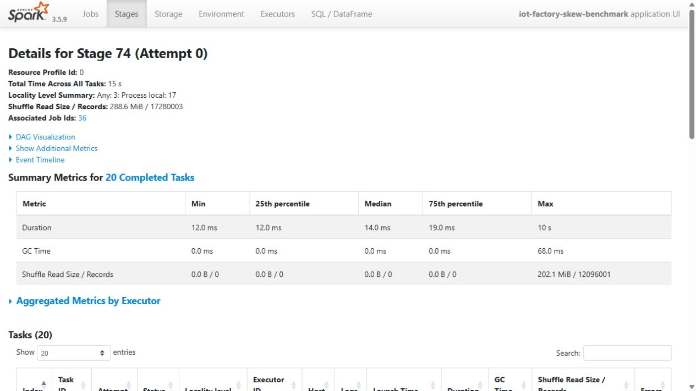

# Spark join-skew benchmark

The benchmark compares baseline and optimized versions of the same factory-policy join on 17.28 millionSilver rows. Three paired runs check equal results and preserve the same source, machine and workload.

Broadcasting the small factory-policy relation reduced the recorded median from 15.339 to 8.577 seconds. Query plans, task/partition metrics and genuine Spark UI captures explain the changed execution strategy.

The synthetic factory distribution is skewed by construction, but that alone is not optimization evidence. Only this measured query/workload supports the comparison. The result does not establish the same speedup for all joins,100 GB feature engineering or an otherwise different cluster.

## Before and after on the same input

The input has 17,280,000 unique readings: F-01 has 12,096,000 (70%), while F-02 and F-03 have 2,592,000 each. A factory-key partition diagnostic placed all 12,096,000 F-01 rows in partition 22. The baseline sorts/shuffles the large relation for a `SortMergeJoin`; the optimized query broadcasts the **three-row policy relation** and uses `BroadcastHashJoin`. It does not rebalance factories or remove data.

| Same-input pair | Baseline, seconds | Broadcast, seconds |
|---|---:|---:|
| 1 | 18.243 | 9.115 |
| 2 | 15.338 | 8.444 |
| 3 | 15.339 | 8.577 |
| Median | 15.339 | 8.577 |

The median reduction is 44.1% (1.788× observed speedup). Each execution returns the same 4,320 rows and SHA-256 `7709e19ad539bcff7eeab3c17925c9a18d406dd9f9b69af0c01822d9ca41f877`. Across each run's recorded jobs, shuffle-read bytes change from 302,603,711 to 1,076,691; both strategies have 47 task attempts, zero failed attempts and zero disk spill. These are [event-log measurements](evidence/skew-benchmark/task-metrics.json), not estimates from the picture.



The plot derives from the original receipt. The following are **original Spark UI screenshots**, with the before and after identified explicitly:

| Before: sort/merge strategy and hot tasks | After: broadcast strategy |
|---|---|
|  |  |
|  |  |

Both settings disable AQE and automatic broadcasting to isolate the explicit join change; shuffle partitions remain 32. OS caches and other VM services were not isolated. This benchmark is a separate analytical query: the DP1–DP3 Airflow pilot has UI proof, but this exact skew benchmark was **not integrated as an Airflow task**. That integration remains a distinct review item.

## Commands and recorded examples

Run commands from the repository root unless the example explicitly changes the working directory. Use a fresh output/run name and check the linked runbook before starting platform services. Examples belong to the recorded workload on this page.

```bash
data/runtime/scale-venv/bin/python scripts/run-skew-benchmark.py \
  --run-name my-skew-check \
  --deadline-utc "$VM_STOP_UTC" --base-commit "$RELEASE_COMMIT"
```

## Implementation and evidence

- [Source: pipelines/configs/factory-risk-policies.json](../pipelines/configs/factory-risk-policies.json)
- [Recorded artifact: skew-benchmark/screenshots/baseline-hot-tasks.png](evidence/skew-benchmark/screenshots/baseline-hot-tasks.png)
- [Recorded artifact: skew-benchmark/screenshots/baseline-sql-18.png](evidence/skew-benchmark/screenshots/baseline-sql-18.png)
- [Recorded artifact: skew-benchmark/screenshots/broadcast-stage-85.png](evidence/skew-benchmark/screenshots/broadcast-stage-85.png)
- [Source: pipelines/skew_metrics.py](../pipelines/skew_metrics.py)
- [Recorded artifact: skew-benchmark/screenshots/paired-sql-runs.png](evidence/skew-benchmark/screenshots/paired-sql-runs.png)
- [Recorded artifact: skew-benchmark/benchmark.json](evidence/skew-benchmark/benchmark.json)
- [Recorded artifact: skew-benchmark/input-binding.json](evidence/skew-benchmark/input-binding.json)
- [Recorded artifact: skew-benchmark/verification.json](evidence/skew-benchmark/verification.json)
- [Recorded artifact: skew-benchmark/_RUN_SUCCESS.json](evidence/skew-benchmark/_RUN_SUCCESS.json)
- [Recorded artifact: skew-benchmark/resource-samples.json](evidence/skew-benchmark/resource-samples.json)
- [Recorded artifact: skew-benchmark/preflight.json](evidence/skew-benchmark/preflight.json)
- [Recorded artifact: skew-benchmark/screenshots.json](evidence/skew-benchmark/screenshots.json)
- [spark.apache.org / sql-performance-tuning.html](https://spark.apache.org/docs/3.5.9/sql-performance-tuning.html)
- [spark.apache.org / monitoring.html](https://spark.apache.org/docs/3.5.9/monitoring.html)

## Recorded interface views

These are original captures from the runs described above. Their timestamps, model identities and visible states belong to those runs.




## Related documentation

[Current architecture](architecture.md) · [Demo and recovery](operations.md) · [Rubric index](rubric-tracker.md)

[Original run notes](https://github.com/anle0429/iot-maintenance-platform/blob/a395c4ea47b8f8e235556ab93de3d699ed9df18b/docs/skew-benchmark.md) retain the full historical narrative. Raw evidence files have not been translated or rewritten.
