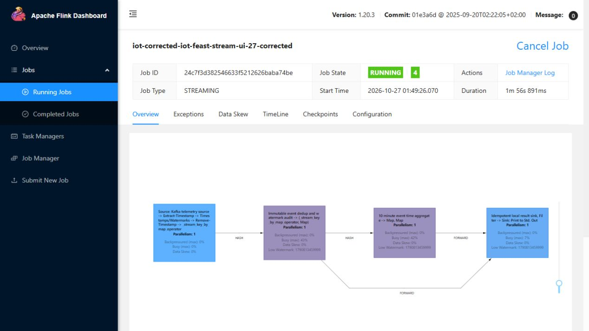
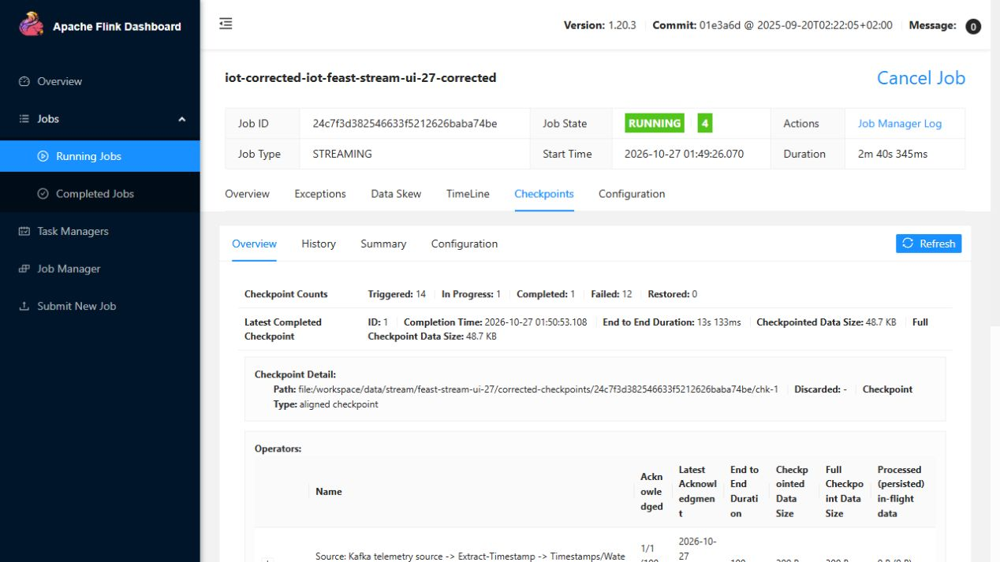

# Pushing finalized Flink windows through Feast

The push path consumes retained finalized windows from the native Kafka/Flink workload and writes a separate monitoring feature view through Feast. Producer readiness is checked before publishing; failed writes retain retry state rather than silently acknowledging missing data.

The initial native fixture uses three windows and checks offline history, online latest-vector behavior, duplicate replay, conflicts and recovery. The monitoring aggregates differ from the eight rolling inputs used by the failure predictor, and project/registry separation prevents accidental substitution.

Later CI independently deploys offline/online jobs, while the full native 5,760-window cohort has its own 12 container receipts. These bounded retained-output replays do not establish a newly continuous live source or an exactly-once transaction across all stores and failure modes.

## Commands and recorded examples

Run commands from the repository root unless the example explicitly changes the working directory. Use a fresh output/run name and check the linked runbook before starting platform services. Examples belong to the recorded workload on this page.

```bash
mkdir -p outputs/push-practice
for step in online-fault recover-online ack-fault recover-ack finish baseline; do
  state=push-practice
  if [ "$step" = baseline ]; then state=push-practice-baseline; fi
  docker compose -f infra/feast.compose.yaml run --rm tools \
    -m feature_store.push_checks --step "$step" \
    --state "/workspace/data/feast/$state" \
    --output "/workspace/outputs/push-practice/$step.json"
  code=$?
  case "$step" in online-fault|ack-fault) expected=3;; *) expected=0;; esac
  test "$code" -eq "$expected" || exit 1
done
```

```bash
sudo data/runtime/scale-venv/bin/python scripts/run-stream-push.py \
  --run stream-practice-1 --deadline-utc '<actual-stop-time-UTC>' \
  --native-proof outputs/push-native-27-v2/verification.json \
  --ingest-fence outputs/scale-ingest-100gb-27/preflight.json
cat outputs/stream-practice-1/feast/verification.json
```

```bash
docker compose -f infra/feast.compose.yaml run --rm tools \
  -m feature_store.inspect_windows \
  --state /workspace/data/feast/stream-stream-practice-1 \
  --worker-report /workspace/outputs/stream-practice-1/feast/report.json \
  --output /workspace/outputs/stream-practice-1/feast/inspection.json
```

## Implementation and evidence

- [Recorded artifact: stream-push/warm/feast/verification.json](evidence/stream-push/warm/feast/verification.json)
- [Recorded artifact: stream-push/warm/feast/observed-live-push.json](evidence/stream-push/warm/feast/observed-live-push.json)
- [Source: feature_store/inspect_windows.py](../feature_store/inspect_windows.py)
- [Recorded artifact: stream-push/first-live/feast/inspection.json](evidence/stream-push/first-live/feast/inspection.json)
- [Recorded artifact: stream-push/warm/feast/report.json](evidence/stream-push/warm/feast/report.json)
- [Source: feature_store/outbox.py](../feature_store/outbox.py)
- [Source: feature_store/push.py](../feature_store/push.py)
- [Recorded artifact: stream-push/native/verification.json](evidence/stream-push/native/verification.json)
- [Recorded artifact: stream-push/native/finish.json](evidence/stream-push/native/finish.json)
- [Recorded artifact: stream-push/native/baseline.json](evidence/stream-push/native/baseline.json)
- [Recorded artifact: stream-push/native/unit-tests-vm.txt](evidence/stream-push/native/unit-tests-vm.txt)
- [Recorded artifact: stream-push/first-live/feast/verification.json](evidence/stream-push/first-live/feast/verification.json)
- [Recorded artifact: stream-push/ui-negative/controller-console.txt](evidence/stream-push/ui-negative/controller-console.txt)
- [Recorded artifact: stream-push/warm/feast/worker-ready.json](evidence/stream-push/warm/feast/worker-ready.json)
- [Recorded artifact: stream-push/prewarm/run-stream-push.py.txt](evidence/stream-push/prewarm/run-stream-push.py.txt)
- [Recorded artifact: stream-push/native-initial/online-fault-console.txt](evidence/stream-push/native-initial/online-fault-console.txt)
- [Recorded artifact: stream-push/native-initial/failed-push-checks.py.txt](evidence/stream-push/native-initial/failed-push-checks.py.txt)
- [Recorded artifact: stream-push/ui-negative/corrected-rest-checkpoints.json](evidence/stream-push/ui-negative/corrected-rest-checkpoints.json)
- [Recorded artifact: stream-push/warm/feast/preflight.json](evidence/stream-push/warm/feast/preflight.json)
- [Recorded artifact: stream-push/image/verification.json](evidence/stream-push/image/verification.json)
- [Recorded artifact: stream-push/capture/runtime-checkpoint.json](evidence/stream-push/capture/runtime-checkpoint.json)
- [docs.feast.dev / push](https://docs.feast.dev/reference/data-sources/push)
- [docs.feast.dev / duckdb](https://docs.feast.dev/reference/offline-stores/duckdb)
- [docs.feast.dev / redis](https://docs.feast.dev/reference/online-stores/redis)
- [docs.docker.com / docker-container](https://docs.docker.com/build/builders/drivers/docker-container/)

## Recorded interface views

These are original captures from the runs described above. Their timestamps, model identities and visible states belong to those runs.






## Related documentation

[Current architecture](architecture.md) · [Demo and recovery](operations.md) · [Rubric index](rubric-tracker.md)

[Original run notes](https://github.com/anle0429/iot-maintenance-platform/blob/f4da7bd21667a8bfca5715a7456bc2bcc813b0fc/docs/stream-feast-push.md) retain the full historical narrative. Raw evidence files have not been translated or rewritten.
