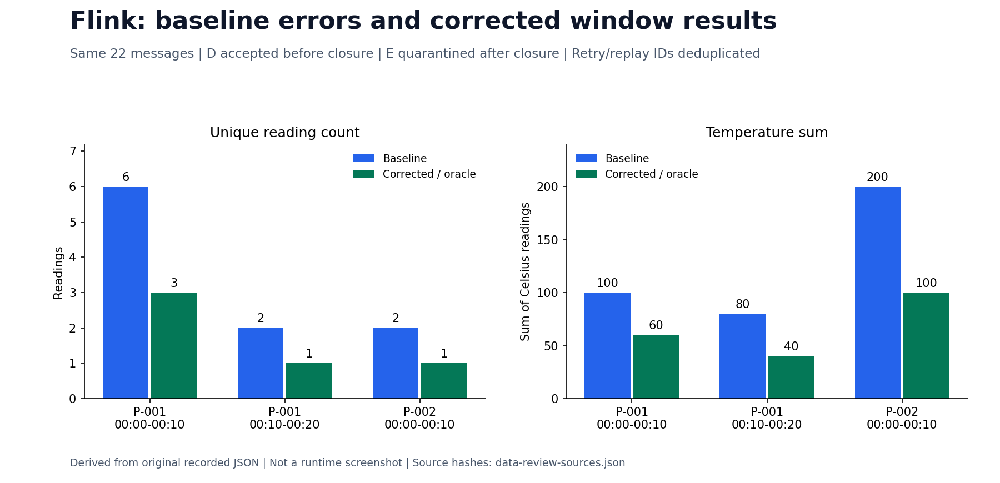
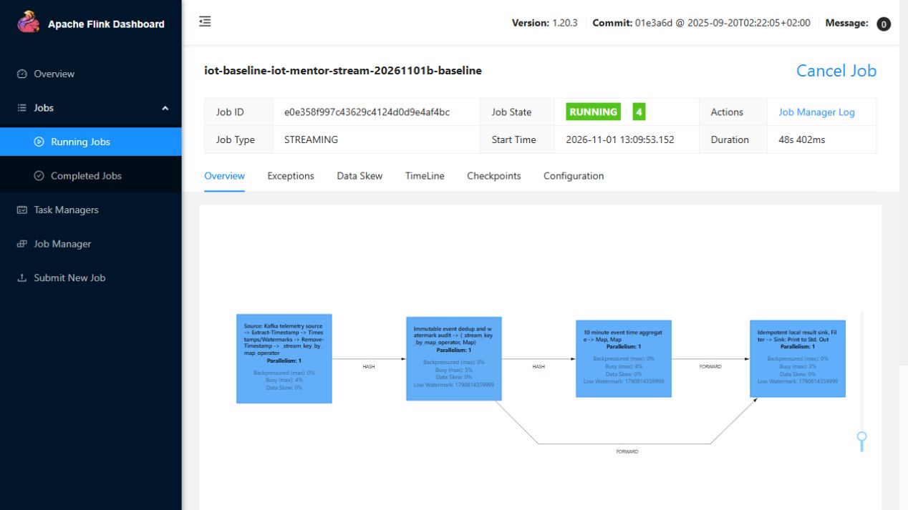
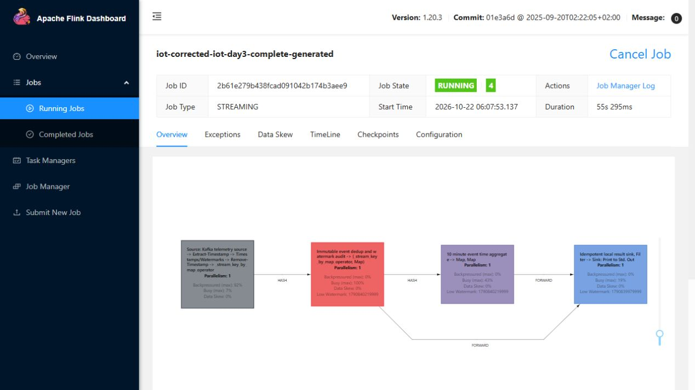
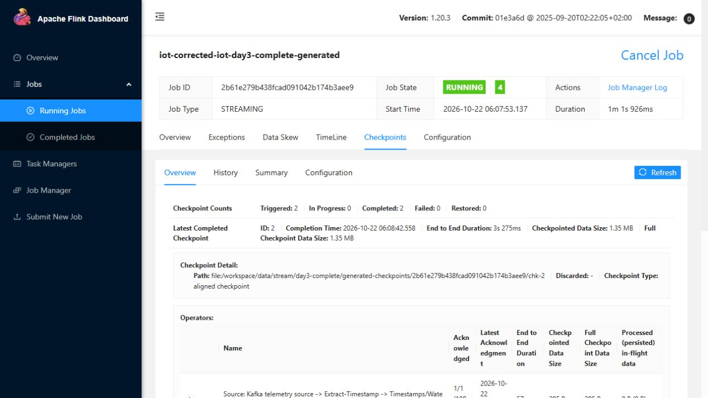

# Kafka/Flink event-time processing and replay

The native small-source stream path replays telemetry in arrival order through Kafka 3.9.1 and PyFlink 1.20.3. It computes ten-minute event-time windows, routes closed-window arrivals to a late side output and writes absolute aggregates to a retained SQLite sink.

Two source passes delivered 116,928 messages. The result retained 57,600 unique readings and rejected 59,328 duplicates; all 5,760 windows matched an independent oracle. The recorded validation contains 55 unit tests and 10 integration checks, with actual Flink UI captures.

A fifteen-minute watermark delay and zero allowed lateness define when a window becomes final. The processing-time cache can expire while the scenario-lifetime event ledger still prevents old IDs from being counted again. Cache TTL is not a complete ledger-retention or crash-recovery design.

This original workload predates the Feast push integration. Later small CI and full-cohort store checks reuse retained outputs with their own receipts. A successful replay does not prove exactly-once behavior for every failure or an indefinitely running live stream.

## Baseline problems and corrected results

The [same 22-message fixture](../pipelines/stream_contract.py) ran through two native Flink jobs. The baseline uses zero watermark delay and no deduplication. The corrected job uses a fifteen-minute delay, an event-ID cache/ledger and absolute sink upserts. Changing these together establishes the combined correction; it does not isolate the performance contribution of each change.

| Observable issue | Baseline | Corrected |
|---|---|---|
| P-001, window `[00:00,00:10)` | Count 6; temperature sum 100; mean 16.666667 | Count 3; sum 60; mean 20, matching A + B + D |
| P-001, window `[00:10,00:20)` | Count 2; sum 80 | Count 1; sum 40, matching C at the half-open boundary |
| P-002, window `[00:00,00:10)` | Count 2; sum 200 | Count 1; sum 100; machines remain isolated |
| Within-policy late event D | Not included after the zero-delay window closes | Included before the delayed watermark closes the window |
| Too-late event E | No correct final-window reconciliation | Exactly one E in the late-event audit; excluded from finalized aggregates |
| Retry/replay handling | Repeated measurements inflate counts | 13 deliveries classified as duplicates; six unique IDs recorded, including quarantined E |
| Replay after cache expiry | Not protected by the baseline | Separate 1.5-second-retention probe: two expirations, one ledger duplicate, final count remains 1 |

The baseline records six late **delivery occurrences**, while the corrected audit records one distinct late **event**; these counters have different grains and should not be presented as a 6→1 rate improvement. The useful comparison is event D's acceptance, E's quarantine and the exact final window values.



This plot is reconstructed from [the original native report](evidence/day3/stream-report.json), not a Flink UI capture. Its original runtime IDs are baseline `55f14b1c63a03492e0bb84e6045fd8a2` and corrected `206335d5a738cc7b7525da05a371d3bb`. Their [REST snapshots](evidence/day3/baseline-rest-overview.json) and [corrected snapshots](evidence/day3/corrected-rest-overview.json) remain unchanged.

### Fresh paired native UI verification

The same 22-message fixture ran again on the CPU VM on 1 November. Final windows, 13 duplicate deliveries, quarantine of E and the retention probe passed [independent readback checks](evidence/data-platform-review/stream/verification.json). These images belong to that new pair:

| Variant | Native job ID | Configuration |
|---|---|---|
| Baseline | `e0e358f997c43629c4124d0d9e4af4bc` | Delay 0; dedup disabled |
| Corrected | `70e00b2bf3b1a737ae3491e1f26f3021` | Delay 15 minutes; event-ID cache plus retained ledger |




Both captures show RUNNING jobs paused after the second real watermark barrier, before the final phase. They establish job identity and topology; displayed partial counts and N/A metrics are not final outputs or throughput measurements. The baseline retains the operator's generic dedup name even though dedup is disabled. The final JSON/SQLite readback supplies the before/after values above.

The [original archive](evidence/data-platform-review/stream/native.tar.gz) retains failures: A could not create checkpoint storage in root-owned new directories; B completed both jobs but its subsequent provenance lookup called Git in a deployment workspace with no Git checkout. A fresh recovery verified B's retained outputs without replaying those jobs, then ran only the missing retention probe.

The maintained Linux entry point is [run-stream-review.py](../scripts/run-stream-review.py). It assigns only the two fresh run directories to the image's actual non-root UID/GID, then composes the unchanged runner and oracle. It uses an explicit source-file manifest and the actual CPU-session descriptor; the VM does not need a Git checkout. The CI-pinned core runner remains byte-identical to its recorded fixture. Existing files are not recursively changed.

A subsequent complete run, `mentor-stream-20261101d`, passed the pair and retention probe through this entry point at 19:53 UTC on 1 November. Its [original report](evidence/data-platform-review/stream-entrypoint/verification.json), [eleven-file source manifest](evidence/data-platform-review/stream-entrypoint/source-manifest.json) and [native archive](evidence/data-platform-review/stream-entrypoint/native.tar.gz) bind the actual implementation and SQLite snapshots. This is a new execution with its own job IDs; the images above remain captures of pair B. The dedicated review broker was stopped afterward. The offline review verifier checks both sets of retained results.

```bash
sudo --preserve-env=COMPOSE_PROJECT_NAME python3 scripts/run-stream-review.py \
  --run-id stream-review-new \
  --source-manifest docs/evidence/data-platform-review/stream-entrypoint/source-manifest.json \
  --descriptor /private/path/to/current-instance.json --ui-pause-seconds 60
```

Start Kafka in a separate Compose project first and use that same `COMPOSE_PROJECT_NAME` for the entry point. The generated-source UI captures further below remain a separate workload.

On the generated-source replay, 58,464 deliveries per pass × two passes = 116,928 messages. The job accepts 57,600 unique readings and rejects 59,328 duplicate deliveries; all 5,760 finalized windows match the independent source oracle. This demonstrates replay idempotency for that bounded workload, rather than general crash-safe exactly-once delivery.

## Commands and recorded examples

Run commands from the repository root unless the example explicitly changes the working directory. Use a fresh output/run name and check the linked runbook before starting platform services. Examples belong to the recorded workload on this page.

```powershell
./scripts/run-day3.ps1 -RunName practice3
Get-Content outputs/practice3/stream-report.json
```

## Implementation and evidence

- [Source: pipelines/stream_verification.py](../pipelines/stream_verification.py)
- [Source: pipelines/stream_job.py](../pipelines/stream_job.py)
- [Recorded artifact: day3/native-ttl-failure.txt](evidence/day3/native-ttl-failure.txt)
- [Source: pipelines/stream_contract.py](../pipelines/stream_contract.py)
- [Recorded artifact: day3/finalization-diagnostic.json](evidence/day3/finalization-diagnostic.json)
- [Recorded artifact: day3/stream-report.json](evidence/day3/stream-report.json)
- [Recorded artifact: day3/commands.json](evidence/day3/commands.json)
- [Recorded artifact: day3/unit-tests.txt](evidence/day3/unit-tests.txt)
- [Recorded artifact: day3/run-context.json](evidence/day3/run-context.json)
- [Recorded artifact: day3/final-verification.json](evidence/day3/final-verification.json)
- [Recorded artifact: day3/generated-jvm.txt](evidence/day3/generated-jvm.txt)
- [Source: infra/flink/Dockerfile](../infra/flink/Dockerfile)
- [Source: infra/streaming.compose.yaml](../infra/streaming.compose.yaml)
- [Recorded artifact: day3/flink-python-packages.txt](evidence/day3/flink-python-packages.txt)
- [Recorded artifact: day3/java-version.txt](evidence/day3/java-version.txt)
- [nightlies.apache.org / installation](https://nightlies.apache.org/flink/flink-docs-release-1.20/docs/dev/python/installation/)
- [nightlies.apache.org / kafka](https://nightlies.apache.org/flink/flink-docs-release-1.20/docs/connectors/datastream/kafka/)
- [nightlies.apache.org / windows](https://nightlies.apache.org/flink/flink-docs-release-1.20/docs/dev/datastream/operators/windows/)
- [kafka.apache.org / docker](https://kafka.apache.org/39/getting-started/docker/)
- [nightlies.apache.org / state_backends](https://nightlies.apache.org/flink/flink-docs-release-1.20/docs/ops/state/state_backends/)

## Recorded interface views

These are original captures from the runs described above. Their timestamps, model identities and visible states belong to those runs.






## Related documentation

[Current architecture](architecture.md) · [Demo and recovery](operations.md) · [Rubric index](rubric-tracker.md)

[Source history and recorded evidence](history-rewrite.md) explain the filtered commit identities. Original native receipts retain their captured bytes and outcomes.
