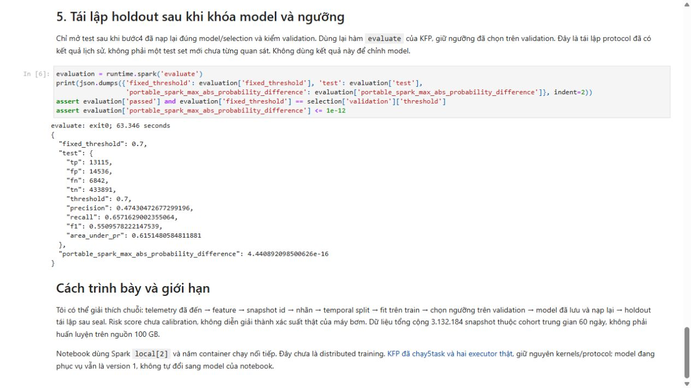
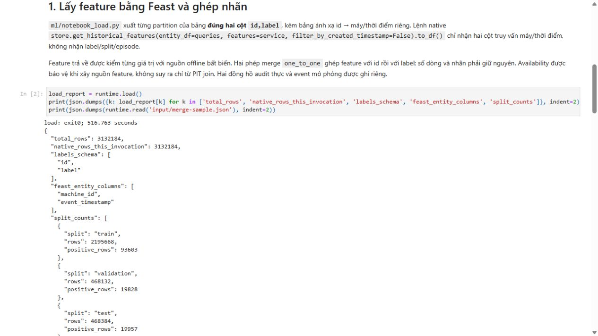
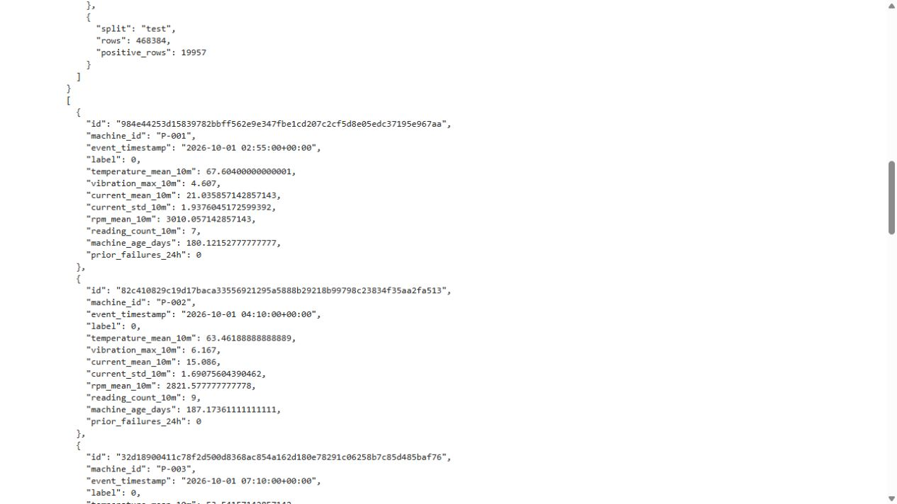
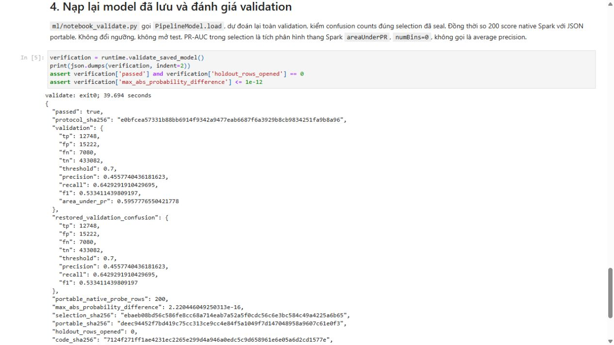

# Training notebook and pipeline parity

The source notebook and Kubernetes pipeline execute the same five ML stages. The parity notebook ran six code cells without errors: one initialization cell and five ML cells.

| ML step | Recorded behavior |
|---|---|
| Load features and labels | Fresh Feast retrieval of 3,132,184 snapshots; separate `id,label` table and one-to-one merge |
| Temporal split | 2,195,668 train / 468,132 validation / 468,384 test rows |
| Train and threshold selection | Train-only scaler/weights; validation selects threshold 0.7 |
| Saved-model validation | Reload weights before opening holdout; 200 Spark/portable scores differ by at most 2.22 e-16 |
| Holdout reproduction | Fixed threshold, F1 0.5509578222 and PR-AUC 0.6151480585; full-score difference at most 4.44 e-16 |

Initialization is not an ML stage. The pipeline replaces local notebook training with two Kubernetes executor Pods while retaining the same kernels and protocol. Validation receipts must match the selected model and show that holdout rows have not already been opened; missing, failed or mismatched validation blocks evaluation.

Executed notebooks, original HTML, source bindings and screenshots remain in the evidence package. Later versioned runs automatically register data/model candidates. Their source and registry versions are separate from the earlier parity run; the historical output is not rewritten to match later serving state.

## Commands and recorded examples

Run commands from the repository root unless the example explicitly changes the working directory. Use a fresh output/run name and check the linked runbook before starting platform services. Examples belong to the recorded workload on this page.

```bash
python3 -m venv data/runtime/notebook-venv
data/runtime/notebook-venv/bin/pip install -r infra/notebook/requirements.txt
data/runtime/notebook-venv/bin/python -m ipykernel install --sys-prefix --name python3
sudo data/runtime/notebook-venv/bin/python scripts/run-training-notebook.py \
  --run notebook-demo-new --deadline-utc "$DEADLINE_UTC"
```

## Implementation and evidence

- [Source: notebooks/01_failure_training.ipynb](../notebooks/01_failure_training.ipynb)
- [Recorded artifact: notebook-parity/execution/execution.json](evidence/notebook-parity/execution/execution.json)
- [Recorded artifact: notebook-parity/execution/executed.ipynb](evidence/notebook-parity/execution/executed.ipynb)
- [Recorded artifact: notebook-parity/execution/executed.html](evidence/notebook-parity/execution/executed.html)
- [Recorded artifact: notebook-parity/dataset/selection.json](evidence/notebook-parity/dataset/selection.json)
- [Recorded artifact: notebook-parity/dataset/validation-reload.json](evidence/notebook-parity/dataset/validation-reload.json)
- [Recorded artifact: notebook-parity/dataset/evaluation.json](evidence/notebook-parity/dataset/evaluation.json)
- [Source: tests/test_notebook_holdout_gate.py](../tests/test_notebook_holdout_gate.py)
- [Recorded artifact: notebook-parity/controller/preflight.json](evidence/notebook-parity/controller/preflight.json)
- [Recorded artifact: notebook-parity/controller/resource-samples.jsonl](evidence/notebook-parity/controller/resource-samples.jsonl)
- [Recorded artifact: notebook-parity/failed/execution/execution.json](evidence/notebook-parity/failed/execution/execution.json)
- [Recorded artifact: notebook-parity/guard-probe/measurements.json](evidence/notebook-parity/guard-probe/measurements.json)
- [Recorded artifact: notebook-parity/retry/source-before-resource-trace.py.txt](evidence/notebook-parity/retry/source-before-resource-trace.py.txt)
- [Recorded artifact: notebook-parity/capture/manifest.json](evidence/notebook-parity/capture/manifest.json)
- [Recorded artifact: notebook-parity/capture/evidence-map.json](evidence/notebook-parity/capture/evidence-map.json)
- [Recorded artifact: notebook-parity/capture/verification.json](evidence/notebook-parity/capture/verification.json)
- [Recorded artifact: notebook-parity/capture/source-commit.json](evidence/notebook-parity/capture/source-commit.json)
- [Recorded artifact: notebook/capture/source-commit.json](evidence/notebook/capture/source-commit.json)
- [Recorded artifact: notebook/execution/executed.ipynb](evidence/notebook/execution/executed.ipynb)
- [Recorded artifact: notebook/execution/executed.html](evidence/notebook/execution/executed.html)
- [Recorded artifact: notebook/execution/execution.json](evidence/notebook/execution/execution.json)
- [Source: ml/snapshot.py](../ml/snapshot.py)
- [Source: tests/test_snapshot.py](../tests/test_snapshot.py)
- [Recorded artifact: notebook/dataset/input/load-report.json](evidence/notebook/dataset/input/load-report.json)
- [Recorded artifact: notebook/dataset/input/merge-sample.json](evidence/notebook/dataset/input/merge-sample.json)
- [Recorded artifact: notebook/label-readback/verification.json](evidence/notebook/label-readback/verification.json)
- [Source: scripts/verify-training-labels.py](../scripts/verify-training-labels.py)
- [Recorded artifact: notebook/dataset/selection.json](evidence/notebook/dataset/selection.json)
- [Recorded artifact: notebook/dataset/validation-reload.json](evidence/notebook/dataset/validation-reload.json)
- [Recorded artifact: notebook/dataset/trained/portable.json](evidence/notebook/dataset/trained/portable.json)
- [Source: ml/notebook_runtime.py](../ml/notebook_runtime.py)
- [Recorded artifact: notebook/controller/preflight.json](evidence/notebook/controller/preflight.json)
- [Source: ml/notebook_load.py](../ml/notebook_load.py)
- [Source: ml/training_job.py](../ml/training_job.py)
- [Source: ml/notebook_validate.py](../ml/notebook_validate.py)
- [Recorded artifact: notebook/environment/installed.lock](evidence/notebook/environment/installed.lock)
- [nbclient.readthedocs.io / client.html](https://nbclient.readthedocs.io/en/latest/client.html)
- [Recorded artifact: notebook/capture/manifest.json](evidence/notebook/capture/manifest.json)
- [Recorded artifact: notebook/capture/evidence-map.json](evidence/notebook/capture/evidence-map.json)
- [Recorded artifact: notebook/screenshots/capture.json](evidence/notebook/screenshots/capture.json)

## Recorded interface views

These are original captures from the runs described above. Their timestamps, model identities and visible states belong to those runs.










## Related documentation

[Current architecture](architecture.md) · [Demo and recovery](operations.md) · [Rubric index](rubric-tracker.md)

[Original run notes](https://github.com/anle0429/iot-maintenance-platform/blob/f4da7bd21667a8bfca5715a7456bc2bcc813b0fc/docs/training-notebook.md) retain the full historical narrative. Raw evidence files have not been translated or rewritten.
