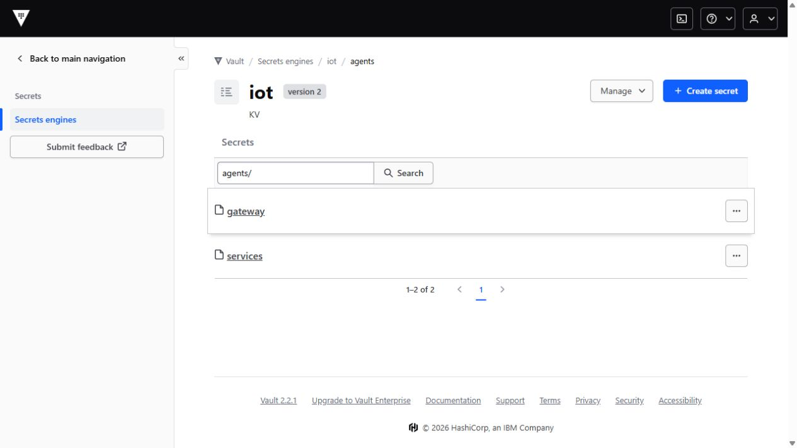
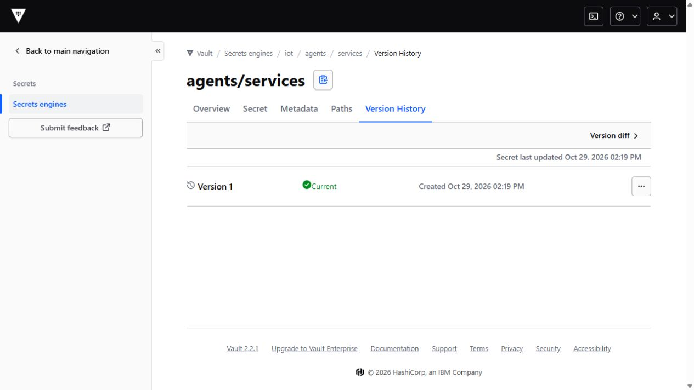

# Centralized agent secrets in Vault

The retained Vault stores the agent gateway login and service credentials under two KV2 paths: `iot/agents/gateway` and `iot/agents/services`. Native consumers already demonstrated scoped AppRole login, exact credential synchronization, denied cross-service reads and token revocation. This checkpoint adds the requested **original Vault UI captures**, showing paths, metadata and version history without displaying secret values.



## What the UI establishes

The `iot` engine is KV version 2. The agent folder contains exactly `gateway` and `services`. Both metadata readbacks retain version 1, created on 29 October 2026; neither has been destroyed or deleted. The service secret's native version-history view shows that current version.



[Original metadata view](evidence/vault-agent-ui/ui/services-metadata.jpg) · [Gateway metadata](evidence/vault-agent-ui/gateway-metadata.json) · [Service metadata](evidence/vault-agent-ui/services-metadata.json)

The screenshots use the existing **root operator login** for an administrative inspection. The [dashboard capture](evidence/vault-agent-ui/ui/dashboard.jpg) retains Vault's root-login warning. This is separate from the restricted AppRole consumers below; the UI session does not prove their permissions. The temporary PC login file was deleted and the browser window was closed after capture. Vault reports that root tokens are kept only for the current window, rather than persisted by its UI.

## What the consumers establish

| AppRole | Permitted KV2 data path | Recorded behavior |
|---|---|---|
| `iot-agent-gateway` | `iot/data/agents/gateway` | Own read succeeds; service, Airflow and older gateway reads are denied. |
| `iot-agent-services` | `iot/data/agents/services` | Own read succeeds; gateway, Airflow and older gateway reads are denied. |

Both roles issue 300-second tokens with a 900-second maximum and no default policy. The [original consumer report](agent-gateway.md#centralize-credentials-without-rotating-them) also retains successful self-revocation and denied subsequent reads. Four Kubernetes Secret UIDs and existing credential bytes were preserved. Current policy/role readbacks match those scoped policies.

## Keep the view separate from secret access

The browser connects to loopback HTTP over IAP. A bounded [metadata viewer](../scripts/view-vault-metadata.py) then verifies the private Vault certificate and IP SAN over HTTPS. It passes native UI/metadata response bytes through unchanged. This is not browser trust of the private CA or an Internet-facing Vault endpoint.

The viewer admits the native UI assets, health/bootstrap reads, token lookup, bounded permission lookups and the dedicated agent metadata paths. It blocks all secret-data reads and mutations, even with the existing operator login. Four live negative checks returned 403 before contacting Vault: three plain/encoded secret-data paths and an invalid permission-lookup body. Destructive actions were tested in isolated request-guard tests; none was sent to the retained Vault.

Five guard tests passed on the PC and natively. The native capture also confirms unchanged Vault service invocation/PID and the original initialized, unsealed cluster ID. No Vault policy, AppRole, secret version or server configuration was changed for these images.

The retained Vault build returned an empty UI body for an `identity` encoding request. The viewer requests the native gzip UI representation and forwards its encoding and compressed bytes. Earlier failed viewer starts, refused bootstrap/encoded metadata paths and the empty-body observations remain in the original archive. The accepted view permits only the two observed encoded agent metadata paths, preserving the denial of encoded secret-data routes.

## Verify locally

```powershell
python -B -m unittest tests.test_vault_metadata_view
python -B -S scripts/verify-vault-agent-ui.py
```

The artifact checker authenticates 19 published payloads, 93 native payloads, historical/current viewer sources, native guard tests, safe metadata readbacks, TLS transport records and four unedited JPEG captures. It does not start Vault or read live credentials. Operator readbacks were captured after the UI; they are labeled accordingly and are not presented as intercepted browser response bodies.

For another live inspection, reuse an active owned viewer or start a fresh bounded one on the retained VM with the current script, existing CA and a new audit filename. Forward only its loopback port through IAP:

```powershell
gcloud compute ssh iot-cw-vm --zone us-central1-a --project YOUR_PROJECT_ID `
  --tunnel-through-iap --ssh-flag=-L `
  --ssh-flag=127.0.0.1:21950:127.0.0.1:21950 --command="sleep 3300"
```

Open [the local native UI](http://127.0.0.1:21950/ui/), use the existing operator login locally, then choose **iot → agents → Manage secret → View version history**. Keep the session on metadata pages and close it afterward. Runtime credentials, Vault Raft state and private keys stay outside Git. Automatic rotation and multi-node Vault availability are not claimed by this single-node lab.

[Capture inventory](evidence/vault-agent-ui/manifest.json) · [Native verification](evidence/vault-agent-ui/verification.json) · [LLM rubric](final-llm-rubric-tracker.md)
