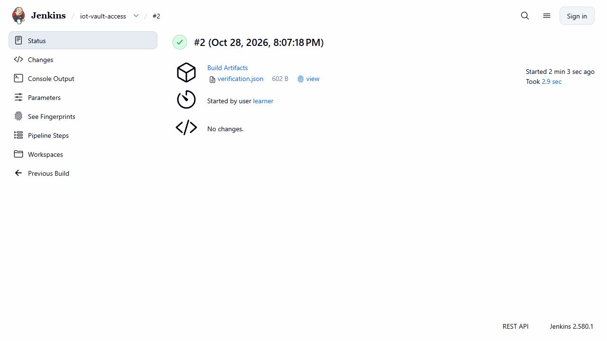

# Vault: bí mật chung, quyền riêng và đổi mật khẩu thật

Ngày 28/10/2026, **Vault 2.2.1 non-dev/Raft/HTTPS** đã chạy trên cùng VM. Hai nơi dùng thật là Jenkins và job đồng bộ tài khoản gateway. [Verifier độc lập](../scripts/verify-vault.py) kiểm **81 payload, 2 ảnh gốc**, 41 binding Git qua các bản nguồn, hai lịch sử CI và 22 dòng audit HMAC. Đây là lab với hai consumer; chưa chuyển mọi secret của toàn repo/tổ chức vào Vault.



## Hai quyền đọc và hai kết quả thực

| Consumer | Quyền tại Vault | Kết quả native |
|---|---|---|
| Jenkins `iot-vault-access/2` | Chỉ đọc `iot/data/ci/airflow`, thu hồi token của chính mình | **SUCCESS 2,977 giây/4 stage**, 3 contract tests; lấy credential lúc chạy, đăng nhập Airflow 201 rồi đọc DAG 200; đọc secret gateway 403 và token đã revoke đọc lại 403 |
| Gateway sync job | Chỉ đọc `iot/data/gateway/basic`, thu hồi token của chính mình | Đồng bộ Secret ở 3 namespace; Vault version 1→2; mật khẩu cũ 401/mới 200 trên **cả 4 host**, không đổi UID Secret |

[Pipeline](../infra/ci/VaultAccess.Jenkinsfile), [consumer CI](../scripts/vault-ci-consumer.py), [sync job](../scripts/sync-gateway-vault.py), [client](../infra/security/vault_client.py). AppRole của Jenkins nằm trong Jenkins Credentials `iot-vault-approle`; AppRole gateway ở private runtime trên VM. Consumer đổi AppRole lấy token 300 giây. Server không cấp default policy; policy chỉ có đúng đường dẫn đọc và revoke-self. [Policy đọc lại từ server](evidence/vault-linux/final-readback/policy-ci.json) và [role server](evidence/vault-linux/final-readback/role-gateway.json) khớp hai file HCL trong Git.

[CI report](evidence/vault-linux/ci-2/verification.json) giữ status thật **201** của API tạo token Airflow. [OpenAPI của auth router](evidence/vault-linux/airflow-token-contract.json) xác nhận 201. Build 1 FAILURE do đòi 200 quá chặt; console nguyên gốc được giữ. Cả hai lượt đều qua 3 contract tests. Source CI2 **a4ef8fd/10 Git files** và source-after đúng từng byte; bản 1/source b390 giữ nguyên.

Operator đổi secret gateway bằng KV2 với compare-and-set version 1. [Receipt CAS](evidence/vault-linux/rotation/rotation.json) có version 2; thử lại CAS cũ bị 400. Sau đó gateway consumer dùng AppRole đọc version 2 và cập nhật htpasswd trong Kubernetes Secrets. [Sync](evidence/vault-linux/sync-v2/verification.json) và [kiểm cả 4 tuyến sau restart](evidence/vault-linux/final-readback/gateway-four-routes.json) xác nhận mật khẩu cũ 401, mới 200; HTTPS/CA/SNI được kiểm thật. Root token chỉ phục vụ bootstrap và thao tác operator, không được đưa vào hai consumer.

## Khởi động lại và audit

[Controlled restart 20:09:22 UTC](evidence/vault-linux/restart/verification.json): trước 200 → khởi động lại cùng binary/config/data → **503 sealed nhưng vẫn initialized** → mở khóa lại → 200 active. Cluster ID giữ nguyên `63e1d9cc-7eb1-c7a7-a48d-b11a3ac107f9`; cùng AppRole đọc được CI version 1 và gateway version 2, đúng giá trị private trước restart. Không gọi init lại hoặc viết lại KV.

[Audit chọn lọc nguyên bytes](evidence/vault-linux/restart/scoped-audit.jsonl) có 22 record/11 request, gồm 4 lần đọc chéo bị từ chối. Mỗi record dùng policy `iot-ci` hoặc `iot-gateway`. Token và giá trị bí mật trong response được Vault HMAC. Verifier ghép request/response theo ID, kiểm HMAC cùng version không đổi sau restart và HMAC password gateway version 1 khác version 2. Namespace `root` trong audit là namespace mặc định của Vault OSS, không có nghĩa token mang root policy.

[Binary pins](../infra/security/vault-assets.json) khớp SHA nhà phát hành và binary đã chạy; archive 185.897.330 byte, binary không nằm trong Git. Listener chỉ ở CNI bridge `10.52.0.1:18200/18201`. Unit chạy user `nobody`/NoNewPrivileges, giới hạn 768 MiB/1 CPU/không swap. MemoryCurrent 62.562.304 byte là snapshot tại thời điểm kiểm. Raft dùng `disable_mlock=true`, đồng thời chặn swap ở cgroup theo [hướng dẫn integrated storage](https://developer.hashicorp.com/vault/docs/configuration/storage/raft). Client kiểm CA/hostname và không chuyển tiếp token qua redirect.

Bootstrap dùng **một operator/một unseal share**. File root/unseal/AppRole có quyền 0600 ngoài Git, server key 0400. Phạm vi này chưa có HA, auto-unseal hoặc phân tách người giữ khóa. Các CI cũ vẫn dùng Credentials của mốc lịch sử; secret bootstrap không thể phụ thuộc chính Vault mà nó khởi động. Chưa nhận migration toàn repo. Certificate lab hiện có hạn 2 ngày, cùng CA riêng với gateway; cần cấp mới trước demo sau hạn đó.

[Privacy gate trên VM](evidence/vault-linux/privacy-audit.json) kiểm 14 giá trị/encoding private thực không xuất hiện trong gói. [Ảnh health active](evidence/vault-linux/screenshots/vault-active-health.jpg) lấy qua cầu review localhost/IAP xác minh TLS phía Vault. Browser thấy loopback HTTP; ảnh không chứng minh public TLS/browser trust và không đăng nhập UI bằng root token.

## Lỗi và phục hồi đã giữ

Lượt đầu/source 1555 thiếu thư mục con Raft, server chưa init. [Journal](evidence/vault-linux/initial-failure/journal.txt) và [repair chỉ tạo thư mục](evidence/vault-linux/initial-failure/repair.json) giữ nguyên. Source 07 thêm guard resume-uninitialized, sau đó gặp 429 lúc bầu leader. Source 82 chờ node active và đọc bootstrap đã lưu; server Ready 20:02:25 UTC. Stderr 429 đã thấy trong phiên nhưng không được archive thành file native riêng.

Sync version 1 đã ghi ba Secret, bước probe bị trùng tên hàm `http` với module. Sửa source 89 rồi dùng **verify-only** với checkpoint cũ để không ghi lại. [Readback version 1](evidence/vault-linux/sync-v1-readback/verification.json) ghi rõ password chưa đổi; chỉ version 2 mới nhận là rotation. Traceback manual của lỗi probe không được archive thành native file. Collector đầu dừng vì auth router có OpenAPI riêng; collector hoàn tất giữ nguyên mọi byte đã copy.

## Tự kiểm và chạy lại

Không cần VM/dependency/secrets trên bản clone:

```powershell
python -S scripts/verify-vault.py
python -m unittest tests.test_vault_client -v
```

[Deployer](../scripts/deploy-private-vault.py) cần binary đúng pins, backend/gateway CA hiện có và ít nhất 30 phút trong phiên VM được duyệt. Chỉ dùng thư mục runtime mới ở lần đầu; hai cờ resume có guard riêng cho chưa-init và bootstrap đã có. Không chạy deployer lại để mở khóa instance đã cấu hình xong.

Trên VM hiện có, chạy lại Jenkins `iot-vault-access` với `SOURCE_COMMIT=a4ef8fdcba62babea563fc388aa8b86e067191fc`. Nguồn phải được niêm phong đúng manifest; job tạo workspace mới và đọc SecretText từ Credentials. Secret-id có giới hạn 20 lần dùng và thời hạn; khi hết hạn operator cấp mới và cập nhật Credentials. Không đưa giá trị vào Git/chat/commandline.

Sau VM STOP/START, unit transient cần được phục hồi từ file unit đã lưu trong phiên được duyệt. Với cùng Raft/state/server key, chỉ start rồi mở khóa qua prompt riêng bằng CLI với địa chỉ private HTTPS và CA đúng. Đọc health để phân biệt sealed với uninitialized; **không gọi init lại**. Gateway hết feature lease cần prepare/materialize mới thật theo [quy trình demo](active-feature-refresh.md), không liên quan việc đổi mật khẩu.

Thiết kế theo [AppRole API](https://developer.hashicorp.com/vault/api-docs/auth/approle) và [KV2 API/CAS](https://developer.hashicorp.com/vault/api-docs/secret/kv/kv-v2). Bước tiếp là service mesh: quyền ở Vault quyết định ai đọc bí mật; mesh quyết định dịch vụ nào được gọi dịch vụ nào.
