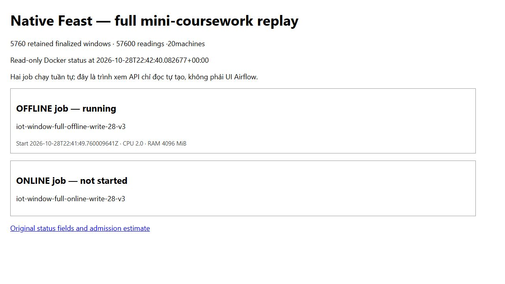
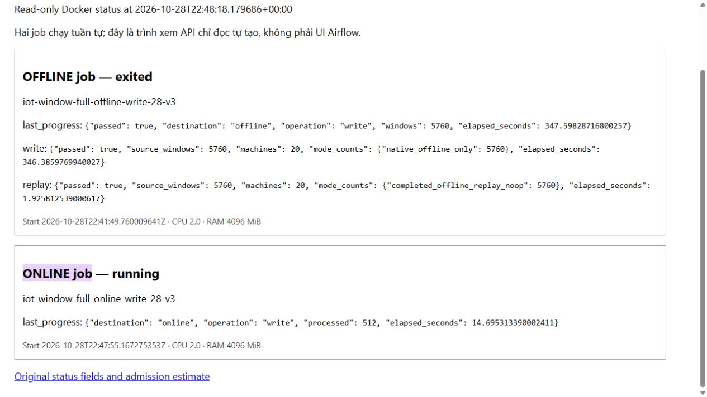
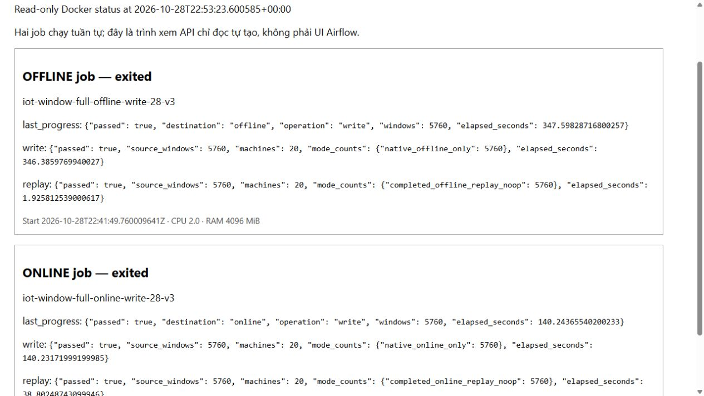

# Kiểm chứng toàn bộ cửa sổ streaming của mini-coursework

Ngày28/10 trên VM Linux8 CPU/64 GiB, hai job Feast riêng đã ghi và replay **5.760 cửa sổ/57.600 reading duy nhất/20 máy**. Nguồn là kết quả Kafka/Flink chạy thật trên PC ngày22/10, được giữ nguyên SHA; lượt này không tạo nguồn Kafka mới. Hai DAG Airflow/CI đã có phép thử riêng ba cửa sổ; không nhận toàn bộ5.760 cửa sổ đã chạy qua Airflow.

## Thử nhỏ, đo trung gian, rồi mới chạy đủ

Mỗi cỡ chạy bốn container tuần tự: offline write → offline replay → online write → online replay. Mỗi container giới hạn2 CPU/4 GiB, không thêm swap, user10001, root filesystem chỉ đọc, bỏ capabilities; image `iot-coursework-feast-versioned:0.67.0-3.17.2`, cùng image ID trong cả12 container. Online chỉ được đọc thư mục offline và báo cáo upstream; chỉ thư mục online/output riêng được ghi.

| Cửa sổ | Offline write | Offline replay | Online write | Online replay | Tổng giây thực đo |
|---|---:|---:|---:|---:|---:|
|256|20,010|8,095|14,796|9,302|52,203|
|1.024|56,792|8,204|31,991|13,699|110,687|
|5.760|355,499|9,403|147,789|46,298|558,989|

Đây là wall time gồm khởi động/container/SDK; không lấy push time riêng làm tổng thời gian. Mỗi cỡ một lượt; không nhận benchmark speedup. Trước chạy lớn còn53.612.290.048byte RAM available,95.372.713.984byte scratch trống,340.295.380.992byte HDD trống. Đây là snapshot tài nguyên, không phải peak RAM đã đo của job. Hai cỡ pilot cho dự toán816,272giây cộng600giây dự phòng, nhỏ hơn1.929,291giây còn lại; thực tế bốn bước lớn dùng558,989giây và hoàn tất22:51:08UTC trước auto-STOP23:13:58UTC. [Preflight](evidence/window-cohort-linux/run/preflight.json), [budget](evidence/window-cohort-linux/run/budget.json), [số đo đủ](evidence/window-cohort-linux/run/full/verification.json).

## Điều được kiểm thay vì chỉ đếm dòng

- Nguồn gốc2.747.771byte/SHA`48fca351b74c88a746611b2e103ac9023cd30bbcad321bf933c597eea33db5bf`:5.760khóa duy nhất,57.600 reading,116.928Kafka deliveries. Sắp theo event time/machine để chọn prefix; source binding khóa chặt SHA, số lượng, semantic digest và source ID.
- Offline giữ đúng mọi giá trị Float64, event timestamp và created microsecond; historical retrieval trả đủ. Online vẫn trống sau job offline.
- Online nhận thứ tự đảo ngược, nhưng lấy đúng cửa sổ mới nhất cho20 máy. Cả5.760intent đều acknowledged; replay5.760lần cho từng store đều no-op và SHA Parquet giữ nguyên.
- Container kiểm riêng chỉ đọc đã hỏi Feast SDK thật: **80 giá trị,80 event timestamp**, tất cả PRESENT và khớp nguồn, registry không đổi. Đây là monitoring view bốn aggregate; không thay rolling feature tám đầu vào của model6.







Ba ảnh gốc là trình xem trạng thái Docker chỉ đọc tự tạo, đi kèm response Docker thật; hai job chạy tuần tự. Ảnh không được gọi là UI Airflow. [UI Airflow gốc của hai DAG](final-handover.md#ba-pipeline-feature) có riêng, cùng edges và output CI tương ứng. [TTL](feature-jobs-and-ttl.md): monitoring view1giờ, Redis3600giây wall clock; lịch sử offline không bị xóa theo TTL cache.

## Hai lỗi được giữ lại và sửa

Lượt đầu SDK ghi/ack đúng256 cửa sổ, nhưng xuất báo cáo bằng `pandas.to_json` mặc định chỉ10chữ số gây so sánh Float64 sai. Đã đổi sang `to_dict(records)` để JSON giữ độ chính xác Python; không nới tolerance hoặc sửa giá trị nguồn. Lượt sau dùng thư mục mới nhưng source ID cũ, nên guard thấy20vector online đã tồn tại và từ chối yêu cầu fresh project. Đã dùng source ID mới riêng cho từng cohort, giữ nguyên project/state thất bại, không flush Redis. [History](evidence/window-cohort-linux/history/state-readback.json) giữ original failure/log/state counts; successful source commit`52ddfb8`, inspector commit`367055f`. SHA source trước/sau bằng nhau.

## Tự kiểm từ clone, không cần VM

```powershell
python -S scripts/verify-window-cohort.py
python -S scripts/verify-final-handover.py
python -m unittest discover -s tests -p test_window_cohort.py -v
python scripts/replay-window-cohort.py --help
```

Bộ kiểm dùng Git và thư viện chuẩn để đối chiếu94 payload/90 file native, tám Git bindings,12 container, toàn bộ offline rows và native online values/timestamps. Phép thử nguồn nhỏ không ghi vào store. Muốn chạy native lại, dùng runtime Feast/Redis riêng theo [CI streaming](ci-stream-push.md), chọn source ID/state/output mới và chạy CLI công khai `scripts/replay-window-cohort.py` lần lượt với `--rows 256`, rồi1.024và5.760 khi ngân sách đủ. Mỗi cỡ dùng cùng source ID qua bốn bước; `--operation replay` chỉ dùng state của write đã hoàn tất, `--destination online` cần `--online-state` và `--offline-report` của offline replay. Đặt Redis qua `IOT_FEAST_REDIS` trong môi trường riêng; không ghi credential vào Git. `scripts/inspect-window-online.py` cung cấp read-only lookup cuối.

Manifest công khai giữ nguyên byte mọi file được liệt kê. Log SDK lớn hơn64 KiB chỉ đưa đoạn đầu/cuối8 KiB nguyên gốc cùng byte count/SHA toàn log trong `log-inventory.json`; log đầy đủ vẫn trên VM, không nhận đã upload toàn bộ stderr. Không đưa dataset, registry/state, khóa hoặc helper review lên Git. Kết quả có thể kiểm lại khi VM đã STOP; chạy live sau này cần phiên được duyệt và cache còn hạn.

Ví dụ native pilot trong terminal **Linux**, từ repo root, khi Docker/image trên và Redis riêng đã sẵn sàng. Cấu hình `IOT_FEAST_REDIS` trong môi trường trước, không nhập giá trị vào chat. Các lệnh này chưa được chạy thêm lần nữa trong phiên bàn giao; chúng diễn đạt CLI và mount contract đã được12 container bên trên kiểm chứng.

```bash
test -n "${IOT_FEAST_REDIS:-}" || exit 1
cohort_id="practice-$(date -u +%Y%m%dT%H%M%SZ)"
cohort_dir="$PWD/data/$cohort_id"
test ! -e "$cohort_dir" || exit 1
sudo install -d -o 10001 -g 10001 "$cohort_dir"/{offline,offline-reports,online,online-reports}
parent_sha=48fca351b74c88a746611b2e103ac9023cd30bbcad321bf933c597eea33db5bf
common=(--rm --network host --user 10001:10001 --cpus 2 --memory 4g --memory-swap 4g --pids-limit 256 --read-only --cap-drop ALL --security-opt no-new-privileges --tmpfs /tmp:rw,nosuid,nodev,size=128m --env IOT_FEAST_REDIS -v "$PWD:/src:ro")
source_args=(--parent /src/docs/evidence/day3/stream-report.json --parent-sha256 "$parent_sha" --rows 256 --source-id "$cohort_id" --state /work/offline)
for op in write replay; do
  docker run "${common[@]}" -v "$cohort_dir/offline:/work/offline:rw" -v "$cohort_dir/offline-reports:/work/offline-reports:rw" iot-coursework-feast-versioned:0.67.0-3.17.2 /src/scripts/replay-window-cohort.py "${source_args[@]}" --destination offline --operation "$op" --output "/work/offline-reports/$op.json" || exit 1
done
for op in write replay; do
  docker run "${common[@]}" -v "$cohort_dir/offline:/work/offline:ro" -v "$cohort_dir/offline-reports:/work/offline-reports:ro" -v "$cohort_dir/online:/work/online:rw" -v "$cohort_dir/online-reports:/work/online-reports:rw" iot-coursework-feast-versioned:0.67.0-3.17.2 /src/scripts/replay-window-cohort.py "${source_args[@]}" --destination online --operation "$op" --online-state /work/online --offline-report /work/offline-reports/replay.json --output "/work/online-reports/$op.json" || exit 1
done
```

Đợi đủ bốn JSON `passed=true`; giữ lại source ID/state của pilot. Chạy cỡ khác phải chọn ID/thư mục mới, sửa `--rows`, đo lại ngân sách và giới hạn thời gian. Không đổi số hàng trong cùng state đã bound.
