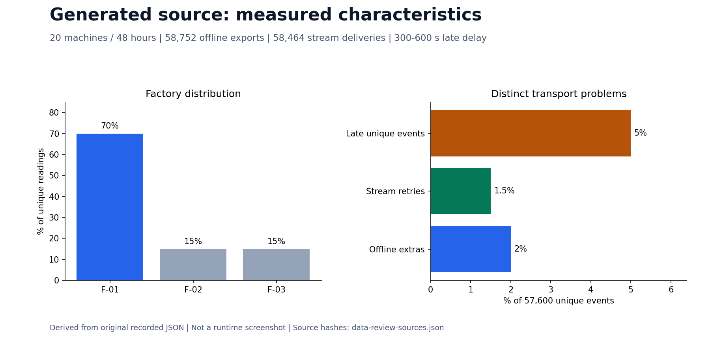

# Pump source generator

The generator separates simulated physical history from data delivery. Wear, load, failures and maintenance determine sensor values and operating state. Export retries, duplicates, schema changes, skew and late arrival are separate transport/data-quality effects.

| Boundary | Implementation |
|---|---|
| Configuration and seed | [config.py](config.py), [development config](configs/dev.json) |
| Machine history and sensor simulation | [simulation.py](simulation.py) |
| Chunked generation and measured resource planning | [chunked.py](chunked.py), [chunked-generator report](../docs/chunked-generator.md) |
| Persisted-output checks | [quality.py](quality.py), [data contract](../docs/data-contract.md) |
| Separate sample/target tables and controlled drift | [Assistant data validation](../docs/assistant-data-validation.md) |

From the project root, Python 3.12/3.13 is sufficient for a small run:

```powershell
$run = "local-$(Get-Date -Format 'yyyyMMdd-HHmmss')"
python -S -m generator generate --config generator/configs/dev.json --output "data/source/$run"
python -S -m generator inspect --source "data/source/$run" --report "outputs/$run/quality.json"
```

The development config uses 20 machines over 48 hours. Use new output names to preserve earlier runs. Small runs demonstrate data contracts; [100 GB ingestion](../docs/full-scale-ingest.md) has separate measured source/readback evidence and resource guards. The model's larger training set uses its own [60-day protocol](../docs/ml-evaluation-protocol.md).

## Observed data characteristics

These are measurements of the persisted development source, not just configured probabilities. The [original quality report](../docs/evidence/day1/quality.json) records 35 passing checks. A fresh local run on 1 November 2026 reproduced all 35 checks and the same 57,600 unique events. Physical simulation and transport faults use separate random streams.

| Problem | Configuration | Observed output | Denominator / meaning |
|---|---|---|---|
| Factory skew | `hot_factory_share=0.70` | F-01: 40,320; F-02/F-03: 8,640 each | 70% / 15% / 15% of 57,600 unique readings; the skew key is `factory_id` after joining machine metadata |
| Offline duplicate exports | `offline_duplicate_rate=0.02` | 1,152 extras; 58,752 stored telemetry rows | Extras / unique = 2%; extras / stored = 1.960784%; repeated `event_id`, unchanged measurement, later `created_ts` |
| Schema evolution | `schema_v2_fraction=0.50` | v1: 28,800 unique; v2: 28,800 unique | Cutover at event time `2026-10-02T00:00:00Z`; stored counts including duplicates are 29,393 / 29,359 |
| Late stream events | `late_rate=0.05`, delay 300–600 seconds | 2,880 late unique readings; observed min/max 300 / 600 seconds | 5% of unique events; normal delay is 0–3 seconds; first arrival remains `received_ts` |
| Stream retry duplicates | `stream_duplicate_rate=0.015` | 864 retry deliveries; 58,464 total deliveries | Extras / unique = 1.5%; delivery IDs differ while the event ID and measurement stay unchanged |
| Arrival disorder | Arrival-sorted delivery envelopes | 2,298 event-time inversions | Event time sometimes decreases even though publication order does not |
| Volume | UTF-8 uncompressed JSONL | 43,582,369 payload bytes; 43,584,255 including manifest | Includes the stream file; not the 100 GB offline-only measurement |

Cardinality is `distinct(column) / row_count`, measured over **58,752 offline telemetry rows**, including duplicate exports:

| Column | Distinct values | Ratio | Interpretation |
|---|---:|---:|---|
| `event_id` | 57,600 | 98.039216% | High cardinality; it identifies readings, with intentional repeat exports |
| `event_ts` | 2,880 | 4.901961% | Shared by many machines |
| `machine_id` | 20 | 0.034041% | Low cardinality; each machine emits a time series |



The chart is derived from the linked JSON, not a service screenshot. The generator does not make skew disappear: [the Spark comparison](../docs/skew-benchmark.md#before-and-after-on-the-same-input) changes the execution strategy while preserving the input distribution.

## Schema and delivery examples

Both schema versions contain `event_id`, `machine_id`, `event_ts`, `received_ts`, `created_ts`, `schema_version`, `operating_status`, `temperature_c`, `vibration_rms_mm_s`, `current_a` and `rpm`. Version 2 adds **`pressure_bar`**. A v1 measurement has no pressure field; after normalization it becomes NULL. Zero would invent an observation. The [batch schema/dedup comparison](../docs/data-processing-review.md#offline-normalization) follows raw input through Silver.

The streaming envelope adds `delivery_id`, `attempt` and `published_ts` around the measurement. A retry changes delivery identity and publication time; it does not create a new sensor measurement. See [fixture_phases()](../pipelines/stream_contract.py) for concrete events: D has event minute 8 and arrival minute 16; E has event minute 7 and arrival minute 32. Whether they can still affect a window depends on the **observed watermark**, not delay alone. The [stream comparison](../docs/streaming.md#baseline-problems-and-corrected-results) shows D accepted and E quarantined after closure.
